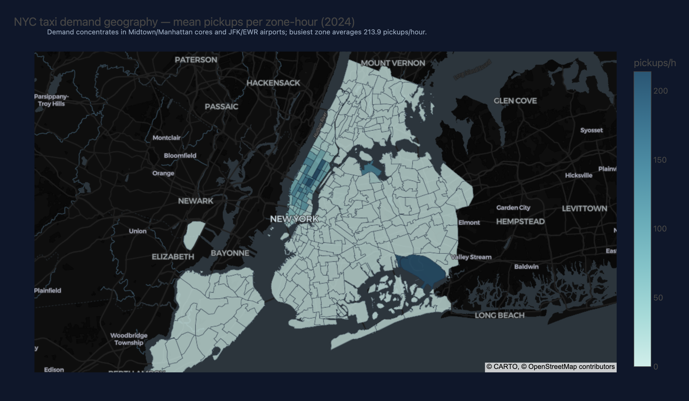
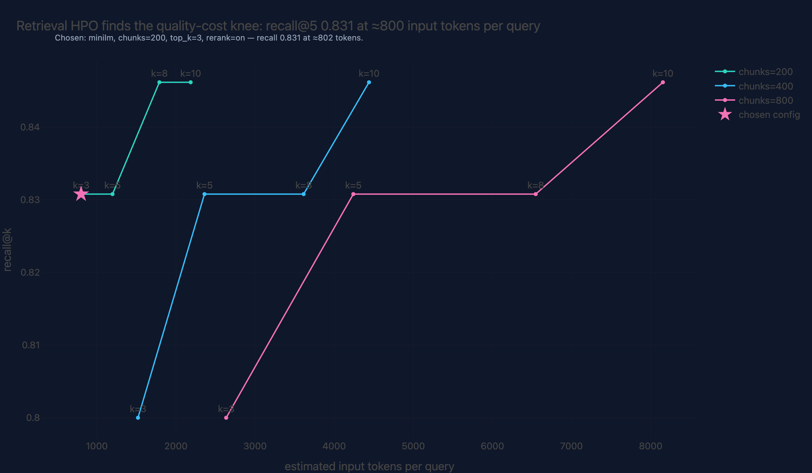
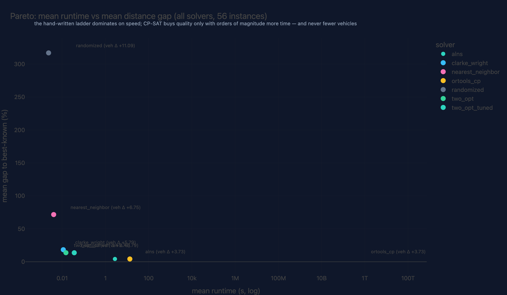

# amm-ds / portfolio

**Data Scientist & ML Engineer.**
End-to-end systems from data engineering and classical ML to agentic AI: every
project ships with its design record, reproducible pipeline, and evaluation
harness.

📚 **Docs (GitHub Pages):** https://amm-ds.github.io/portfolio/ ·
🖥️ **Showcase app:** `make docker-up` → http://localhost:8000

## Stack

| Tool | Role | Where |
|---|---|---|
| `pydantic` (+settings) | Typed contracts at every boundary | everywhere |
| `pydantic-ai` | Agentic AI: typed tools, structured outputs, provider abstraction | 01 |
| `scikit-learn` | Classical ML: pipelines, baselines, metrics | 02, 03, 05, 07 |
| `pytorch` | Deep learning with hand-written training loops | 02, 04, 07 |
| `plotly` | The only viz library — shared theme, interactive everywhere | all |
| `dvc` | Pipelines + data versioning, reproduces from clean clone | all |
| `uv` | Single workspace monorepo, committed lockfile | root |
| `polars` | Lazy/streaming ETL over GB-scale open data | 03, 07 |
| `FastAPI` + `React/TypeScript` | Showcase API + web UI (no Streamlit) | `apps/` |

## Show it, don't just say it

Real artifacts from the pipelines (interactive versions in each [case study](https://amm-ds.github.io/portfolio/projects/)):

| Flagship demand intelligence (41.2M trips, zone map) | RAG quality-vs-cost frontier | Solver runtime-vs-gap Pareto (vs OR-Tools reference) |
|---|---|---|
|  |  |  |

## Projects

Eight working showcases (01–07, 09) and one planned (08 — LLM inference & serving).

| # | Project | Domain | Data | Highlights |
|---|---|---|---|---|
| 01 | [RAG & Agentic AI Assistant](projects/01-rag-agent/) | Agentic AI | Wikipedia (real) | pydantic-ai agent, typed tools, citation-enforced outputs, faithfulness eval, chunk-size sweep |
| 02 | [Hierarchical Demand Forecasting](projects/02-demand-forecasting/) | Time series | Synthetic (+ UCI opt.) | Leakage-proof time-CV, GBM vs PyTorch, reconciliation |
| 03 | [Anomaly Detection over Telemetry](projects/03-anomaly-detection/) | Unsupervised ML | Synthetic (+ NSL-KDD opt.) | DQ gates, IsolationForest vs LOF vs OneClassSVM |
| 04 | [NLP Classification with Transformers](projects/04-nlp-classification/) | Deep learning NLP | AG News (real) | Hand-written fine-tuning loop, macro-F1, confusion matrices |
| 05 | [Churn Modeling, sklearn Pipelines](projects/05-ml-pipeline-churn/) | Classical ML | Synthetic (messy) | Pipeline-embedded preprocessing, calibration, business-cost thresholds |
| 06 | [Routing Optimization (VRPTW)](projects/06-routing-optimization/) | Combinatorial optimization | CVRPLIB Solomon (real benchmark) | Savings + 2-opt vs published best-known solutions, gap-% table |
| 07 | [Urban Mobility Demand Intelligence](projects/07-open-data-mobility/) | Data engineering + ML | NYC TLC + NOAA (real, GB-scale) | Lazy Polars ETL, zone-demand forecasting, weather elasticity, choropleths |

Flagships (01, 07) are complete end-to-end; 02–06 are working showcases built
on the same platform, designed for deepening.

## Selected results

<!-- RESULTS:FILLED:QA — generated from projects' reports/metrics.json at release time -->

| Project | Result |
|---|---|
| 01 RAG agent | Retrieval config by measurement: recall@5 **0.962 vs 0.038 random**; chosen MiniLM/chunk-200/top_k-3/rerank cuts context cost **−65%** at equal recall; client-corpus onboarding + cost telemetry shipped |
| 02 Forecasting | Optuna HPO (56 trials) → production GBM: MAE **8.53, −41.1% vs persistence**; hand-written PyTorch temporal_net trails ridge (reported honestly); MinT-lite reconciliation verified coherence |
| 03 Anomaly detection | Detector HPO: OCSVM rescued **0.34 → 0.91 ROC-AUC** (gamma tuning); IsolationForest stays best (0.917); LOF structurally blind (honest); score distributions + threshold-sweep decision visuals |
| 04 NLP | Six-run ladder to macro-F1 **0.902** (naive 0.10 → random 0.25 → TF-IDF 0.87 → roberta 0.898 → DistilBERT 0.902); 12-trial fine-tuning HPO with bit-exact determinism; val→test non-transfer documented |
| 05 Churn | **Cost-aware HPO** — selection now optimizes the deployment objective (cost 282, −35.9% vs naive; bootstrap CI [−237, −87] significant); isotonic calibration −95% ECE; CRM-extract onboarding |
| 06 VRPTW | **ALNS: 4.23% mean gap vs published best-known solutions across all 56 Solomon instances, 56/56 wins vs tuned 2-opt** (randomized floor: 317%); per-family gaps; convergence traces |
| 07 Mobility | Zone-hour demand over 41.2M trips: GBM MAE 4.67 (−28.4% vs naive); **p90 band 90.8% coverage** (N/A zones flagged); permutation importance shows weather ≈ 0 for point MAE — its value is the elasticity signal |

## Engineering practices

- **Architecture decision records** for every platform-level choice
  ([architecture/](architecture/adr/)) and a [reference architecture](architecture/platform.md).
- **Contracts:** pydantic models at every boundary; hypothesis property tests on
  validators; mypy strict on shared libs.
- **Reproducibility:** committed `uv.lock`; `dvc repro` per project; dataset
  cards pin URLs + checksums in [data-registry/](data-registry/).
- **Operability:** SLOs in design docs, runbooks for drift / LLM cost /
  pipeline restore ([docs/runbooks/](docs/runbooks/)).
- **Review culture:** PR template with design questions, engineering playbook
  ([docs/engineering-playbook.md](docs/engineering-playbook.md)).

## Reproduce in 3 commands

```bash
git clone https://github.com/amm-ds/portfolio.git && cd portfolio
make setup     # uv sync + pre-commit
dvc repro      # downloads pinned public data, runs all pipelines
```

The showcase app runs without an LLM key (deterministic mock provider); set
`LLM_BASE_URL`/`LLM_API_KEY` in `.env` for a live provider (see
[.env.example](.env.example)).

## Services & engagement

Freelance ML/AI engineering — systems delivery, agentic AI/RAG, data
engineering, forecasting & analytics, MLOps/reproducibility audits.
Fixed-scope pilots, retainers, advisory. Full details:
[Services](docs/site/services.md) · every project above is a live case study
(background → objectives → data → EDA → training → evaluation → results →
conclusions, each with a naive baseline and the honest delta).

## Contact & availability

- GitHub: [@amm-ds](https://github.com/amm-ds)
- Freelance/consulting: open to engagements — details on the
  [About/Services page](https://amm-ds.github.io/portfolio/site/about/).
- Languages: English, Spanish.

MIT licensed. Datasets carry their own licenses — see the dataset cards.
