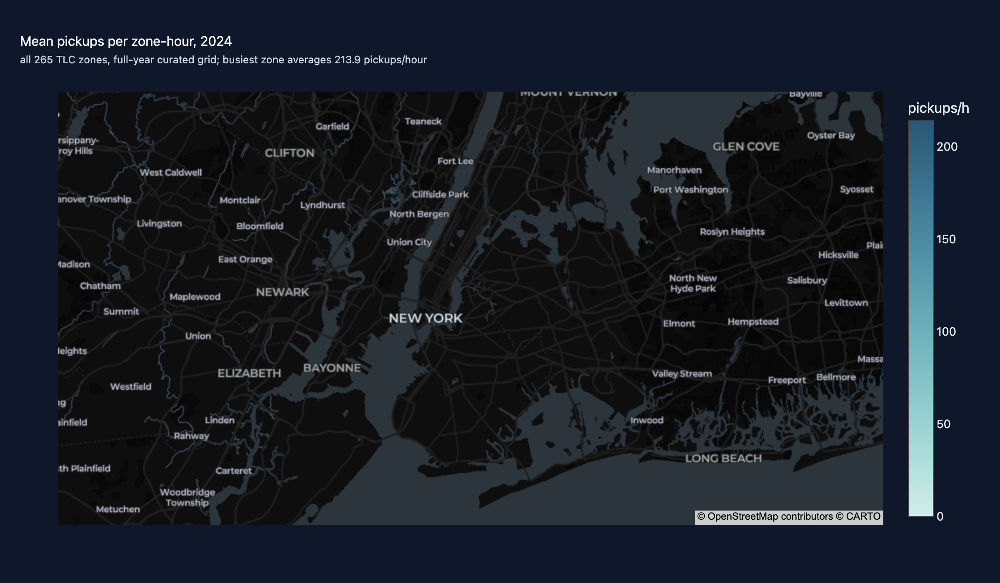
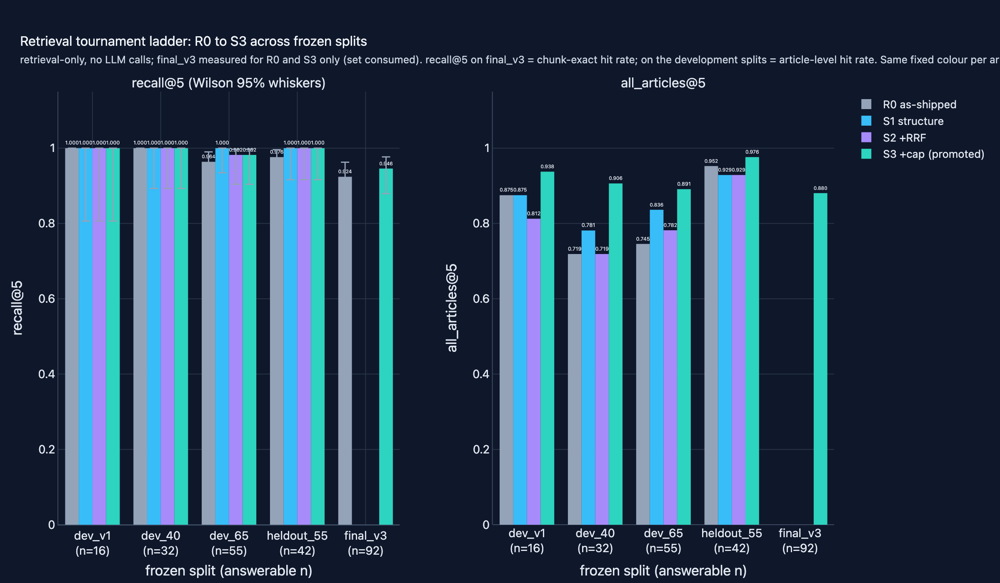
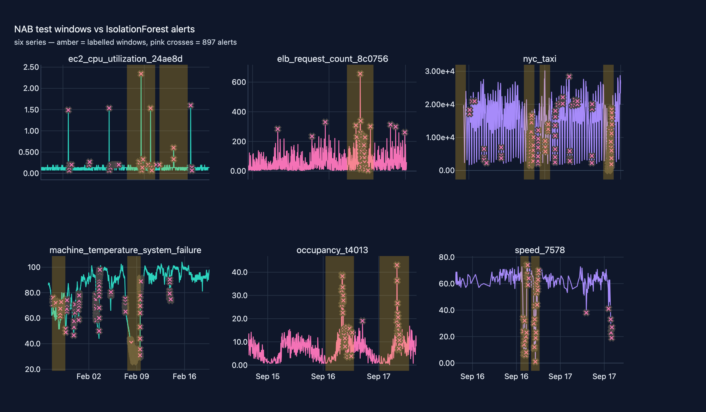

# amm-ds / portfolio

[](https://github.com/amm-ds/portfolio/actions/workflows/ci.yml)

**Data Scientist & ML Engineer.** A growing set of end-to-end case studies —
from data engineering and classical ML to agentic AI — where every project
ships with its design record, a reproducible DVC pipeline, and an evaluation
harness with honest baselines. Every headline number is read from a committed
artifact and checked in CI. Most pipelines re-run from a clean clone; the LLM
projects (01, 04, 09) need a model endpoint, 08 and 13 need comparable
hardware, and 02's full run takes about 375 CPU-hours.

🌐 **Site:** https://alejandromerida.dev ·
📚 **Docs (GitHub Pages):** https://amm-ds.github.io/portfolio/ ·
🖥️ **Local:** `make docker-up` → http://localhost:8000 (deploy: `deploy/DEPLOY.md`)

## Stack

| Tool | Role | Where |
|---|---|---|
| `pydantic` (+settings) | Typed contracts at every boundary | everywhere |
| `pydantic-ai` | Agentic AI: typed tools, structured outputs, provider abstraction | 01, 09 |
| `scikit-learn` | Classical ML: pipelines, baselines, metrics | 02, 03, 05, 07, 10, 12, 13 |
| `pytorch` | Deep learning with hand-written training loops | 02, 04, 07, 12, 13 |
| `plotly` | The single figure authoring path — every payload is built in Python through `portfolio_core.plotting` (shared theme) and exported as JSON | all |
| `apache echarts` | Showcase-web figure renderer — converts the committed plotly payloads (smaller chunks, better mobile), per-figure plotly.js fallback (ADR-0008) | `apps/showcase-web` |
| `dvc` | Pipelines + data versioning, reproduces from clean clone | all |
| `uv` | Single workspace monorepo, committed lockfile | root |
| `polars` | Lazy/streaming ETL over GB-scale open data | 03, 07, 11 |
| `lightgbm` | Gradient-boosted trees for tabular and forecasting baselines | 02, 05, 07, 12 |
| `duckdb` | In-process SQL engine in the DataFrame benchmark | 11 |
| `onnxruntime` + Docker | Exported-model serving and container images | 13 |
| `stable-baselines3` | PPO training for the pricing agent | 15 |
| `FastAPI` + `React/TypeScript` | Showcase API + web UI (no Streamlit) | `apps/` |

## Show it, don't just say it

Real artifacts from the pipelines (interactive versions in each [case study](https://alejandromerida.dev/projects/)):

| Flagship demand intelligence (41.2M trips, zone map) | Hybrid retrieval lifts recall@5 from 0.924 to 0.946 | Six of nine NAB series: 897 of 1,609 alerts vs labelled windows |
|---|---|---|
|  |  |  |

## Projects

Fourteen projects, all working showcases on the same platform.

| # | Project | Domain | Data | Highlights |
|---|---|---|---|---|
| 01 | [RAG & Agentic AI Assistant](projects/01-rag-agent/) | Agentic AI | Wikipedia (real) | Cited question answering over 593 Wikipedia articles. Hybrid search finds a correct passage in the top five 94.6% of the time (recall@5 0.946). Final 120-question test: F1 0.9091, precision 0.952, one unsupported answer. The judge agreed with all 30 hand-labelled checks.<br>Stack: pydantic-ai agent, hybrid FAISS+BM25 retrieval with reranking, per-claim verification, per-phase cost metering |
| 02 | [Hierarchical Demand Forecasting](projects/02-demand-forecasting/) | Time series | Walmart M5 full panel (real) | M5 full panel: 30,490 series, one scored test origin (final 28 days) with official 42,840-node WRMSSE. Pooled LightGBM ensemble: 0.6211 vs seasonal-naive 0.8929 (−30.4%); no bootstrap interval bounds the result; quiet days favor the floor.<br>Stack: rolling origins scored once, global + pooled LightGBM, Tweedie arm, AutoETS, stability-screened convex ensemble |
| 03 | [Anomaly Detection over Telemetry](projects/03-anomaly-detection/) | Unsupervised ML | NAB (real) + seeded synthetic CI path | On 9 NAB series, IsolationForest touches 16 of 17 incidents but fires 1,609 alerts. Merging bursts and capping one page per series per day cuts that to 80 pages. Averaging three detectors halves 66 pages to 35 at the same recall (0.604). No official NAB score yet.<br>Stack: event-based metrics (PR-AUC, range-F1), detector HPO, threshold sweeps |
| 04 | [NLP Classification with Transformers](projects/04-nlp-classification/) | Deep learning NLP | AG News 120k (real) | AG News sorter: the selected transformer + selective LLM cascade shows no measurable change in fresh macro-F1 (0.953 → 0.954, +0.001) and accuracy (0.953 → 0.954), reviewing 22 of 1,000 fresh items. Full evaluation: $0.023671 cloud-equivalent. License: research purposes.<br>Stack: hand-written fine-tuning loop, selective LLM cascade (τ=0.6), calibration analysis |
| 05 | [Churn Modeling, sklearn Pipelines](projects/05-ml-pipeline-churn/) | Classical ML | IBM telco churn (real) + synthetic | On 7,043 IBM telco customers, a calibrated churn policy frozen at 0.175 from training OOF predictions costs $601 versus $1,035 for contact-everyone (95% paired bootstrap cost-delta CI -$508 to -$353). Re-select the cutoff when missed-churner cost changes.<br>Stack: pipeline-embedded preprocessing, cost-aware HPO, fairness slices |
| 06 | [Routing Optimization (VRPTW)](projects/06-routing-optimization/) | Combinatorial optimization | CVRPLIB Solomon (real benchmark) | Routing planner for 56 Solomon 100-customer problems with time windows. Hand-written search returns feasible plans within 4.2% of best-known distance in ~1 second each, using about 3.7 more vehicles on average; an exact solver certifies small cases only.<br>Stack: hand-written ALNS vs best-known solutions, dual distance + vehicle gap |
| 07 | [Urban Mobility Demand Intelligence](projects/07-open-data-mobility/) | Data engineering + ML | NYC TLC + NOAA (real, GB-scale) | Next-hour NYC taxi demand by zone, built on 41.2M real 2024 yellow-taxi trips and public weather: on a strict Oct–Dec test holdout the served GBM cuts error 28.3% vs the persistence floor (4.68 vs 6.52 MAE); its 90% band reached 90.8% coverage (no-borough zones excepted).<br>Stack: lazy Polars ETL, zone-demand forecasting, weather elasticity, choropleths |
| 08 | [LLM Inference & Serving](projects/08-inference-serving/) | AI infrastructure | Local Ollama stack (real serving target) | One laptop, five LLM serving setups, 760 requests, zero failures. The 4-bit MoE records 0.81 s p95 latency (0.63 s median) at about $0.12 per 1M output tokens (electricity only). Reuse the harness to re-measure target hardware.<br>Stack: latency percentiles vs concurrency, GGUF-vs-MLX engine panel, quantization frontier |
| 09 | [Agentic Workflows](projects/09-agentic-workflows/) | Agentic AI | Synthetic 12-doc "Atlas Valley" handbook + read-only Wikipedia slice from 01 (CC BY-SA) | Plan-act-review workflow with typed outcomes and deadlines. Recorded runs: 15/15 fixed tasks, 13/13 unseen answers, 5/6 correct refusals. A live re-run with hosted models: 13/13 answers, 6/6 refusals, all 19 tasks within budget.<br>Stack: pydantic-graph Plan→Execute→Critique, HITL checkpoints, deterministic graders (no AI judge) |
| 10 | [Uplift & Experimentation](projects/10-uplift-experimentation/) | Decision science | Hillstrom email RCT (real) | On 42,613 customers (Men's E-Mail vs No E-Mail) from the 64,000-row Hillstrom dataset, uplift targeting beat random targeting by +$2,812 (+70%) at a 25% send budget, CI [+$718, +$4,767]; at $0.01 per email, mailing everyone still wins. Targeting pays when sending is costly.<br>Stack: CUPED, power analysis, T/X-learner uplift, Qini & value curves |
| 11 | [DataFrame Engines Benchmark](projects/11-data-engineering/) | Data engineering | NYC TLC yellow 2024-01 (real, sha-pinned) + seeded synthetic CI/scalability tracks | Ten data tasks over 2.96M NYC taxi trips, parity-checked on pandas, Polars, DuckDB and stdlib sqlite: Polars 19x, DuckDB 15x pandas; sqlite's from-files workflow is ~29x slower, with loading not timed separately; parity catches 1,658 dropped trips. NYC TLC 2024-01.<br>Stack: 10-task contract on pandas / Polars / DuckDB / sqlite, parity gate, median-of-5 untraced timing + traced allocation pass + fresh-process RSS probes |
| 12 | [Tabular ML & Deep Learning Lifecycle](projects/12-tabular-ml-lifecycle/) | Classical ML + deep learning | UCI Bike Sharing, Capital Bikeshare hourly (real, sha256-pinned) + seeded synthetic CI twin | Real UCI Capital Bikeshare hourly demand (17,379 rows): the validation-selected PyTorch MLP reaches 25.4 test MAE vs 83.2 for the seasonal-naive floor. The 57.8/hour gain has hourly 95% CI 52.5-63.1 and week-block sensitivity 38.8-73.4.<br>Stack: sklearn Pipelines ladder, seeded Optuna HPO (50 trials, 240 s budget), hand-written PyTorch MLP (hour embedding, Huber, early stopping), three-lens feature selection, paired bootstrap CIs |
| 13 | [Model API Serving & Docker Deployment](projects/13-model-serving/) | Model serving & deployment | Project 12's served MLP, re-derived from its committed recipe (UCI Bike Sharing hourly) | Project 12's MLP (25.4316 test MAE) is rebuilt and exported to ONNX behind a 7.2e-07 parity gate. One FastAPI schema serves both backends. Paired tests: 1.6 ms p50, ~950 req/s knee, ~56k rows/s batched; image 6.5 GB, or 291 MB ONNX-only.<br>Stack: FastAPI contract schema (422 on malformed), ONNX export behind a 1e-4 parity gate, seeded paired httpx load harness (concurrency + batch curves), fresh-process RSS probes, multi-stage Docker build |
| 15 | [Dynamic Pricing with RL](projects/15-dynamic-pricing-rl/) | Reinforcement learning & pricing simulation | 600 M5 store-item series (real calibration, simulated response) | Masked PPO for constrained pricing on 600 M5-calibrated series reaches 0.5120 sealed mean profit, but trails tuned static B1 by -1.86% (paired 95% CI [-0.0114, -0.0080]); zero violations across all executable policies.<br>Stack: masked PPO with history encoder, action masks, common random numbers, fluid LP ceiling, four tuned baselines, single sealed evaluation |

Flagships (01, 07) are complete end-to-end; the rest are working showcases
built on the same platform, designed for deepening.

## Production app templates

Standalone applications include the source, UI, infrastructure, specifications,
and executable checks needed to adapt them to another domain:

- [Agent Chat](apps/agent-chat/) — typed tools and skills, provider-agnostic
  Pydantic AI, cited retrieval, session memory, human approvals, and streaming
  React chat.
- [AI Document Intelligence Workbench](apps/document-intelligence/) — page-level
  PDF analysis: one AI call per page produces cited summaries, typed entities,
  and topics, plus page-scoped cited chat with bounded history. Parser-resolved
  evidence, page-by-page progress, and JSON/Markdown reports.

## Engineering practices

- **Architecture decision records** for every platform-level choice
  ([ADRs](docs/architecture/adr/)) and a [reference architecture](docs/architecture/platform.md).
- **Contracts:** pydantic models at every boundary; hypothesis property tests on
  validators; mypy strict on shared libs.
- **Reproducibility:** committed `uv.lock`; `dvc repro` per project; dataset
  cards pin URLs + checksums in [data-registry/](docs/data-registry/).
- **Operability:** SLOs in design docs, runbooks for drift / LLM cost /
  pipeline restore ([docs/runbooks/](docs/runbooks/)).
- **Review culture:** PR template with design questions, engineering playbook
  ([docs/engineering-playbook.md](docs/engineering-playbook.md)).

## Live endpoints

The showcase app serves the pipelines' real artifacts over HTTP. Run
`make docker-up` → http://localhost:8000:

- `POST /projects/07-open-data-mobility/forecast` — zone-hour demand with a p90 band (07; optional `service: "yellow"|"green"` routes the per-service bundle, default yellow)
- `POST /projects/02-demand-forecasting/forecast` — hierarchical demand forecast (02)
- `POST /projects/05-ml-pipeline-churn/score` — churn propensity scoring (05)
- `POST /projects/06-routing-optimization/solve` — VRPTW routing solver (06)
- Per-project story / metrics / figure APIs: `GET /projects/{id}/{story,metrics,figures}`
- Opt-in RAG chat API: `POST /rag/chat` (streaming variant included), disabled by default

The 02/05/07 serving bundles are committed and cached after their first load;
06 is computed from the request. If artifacts are absent, their endpoints
return **503** with rebuild instructions. Reproduce a pipeline from its project
directory, for example `cd projects/02-demand-forecasting && uv run dvc repro`.
The standard image deliberately contains neither the RAG package nor its
retrieval index; see [deployment](deploy/DEPLOY.md) before enabling chat.

For the single-container public deploy, set the required `DOMAIN` and
`IP_HASH_SALT`, then follow the exact `IMAGE`/`TAG` build/run flow in
[deploy/DEPLOY.md](deploy/DEPLOY.md). Caddy provisions TLS and waits for API
readiness. The docs site is always live: https://amm-ds.github.io/portfolio/

## Reproduce in 3 commands

```bash
git clone https://github.com/amm-ds/portfolio.git && cd portfolio
make setup     # uv sync + pre-commit
cd projects/05-ml-pipeline-churn && uv run dvc repro  # or choose another project
```

…or open in GitHub Codespaces (`.devcontainer/`) — the environment builds itself.

The ordinary showcase endpoints need no LLM key. RAG chat is disabled by
default and there is no production mock provider; a deliberately enabled local
Project 01 uses Ollama unless `LLM_BASE_URL`/`LLM_API_KEY` configure a hosted
provider (see [.env.example](.env.example)).

## Services & engagement

Freelance ML/AI engineering across eight offerings — agentic AI & LLM
systems, machine learning, optimization, data engineering, MLOps,
interactive dashboards, full-stack engineering, and APIs & model serving. Fixed-scope pilots,
retainers, advisory. Full details:
[Services](docs/site/services.md) · every project above is a live case study
(background → objectives → data → EDA → training → evaluation → results →
conclusions, each with a naive baseline and the honest delta).

## Contact & availability

- **Start an engagement:** email [alejandromerida.dev@gmail.com](mailto:alejandromerida.dev@gmail.com?subject=Project%20inquiry%20—%20context%20and%20timeline) —
  discovery call first, written scope after (details on the
  [Contact page](https://alejandromerida.dev/contact/)).
- GitHub: [@amm-ds](https://github.com/amm-ds)
- Languages: English, Spanish.

MIT licensed. Datasets carry their own licenses — see the dataset cards.
Security vulnerabilities: [SECURITY.md](SECURITY.md) — never open a public
issue for them.
