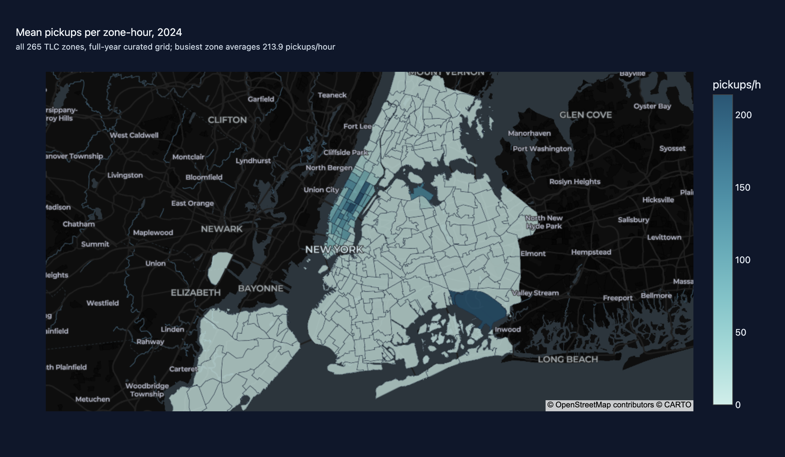
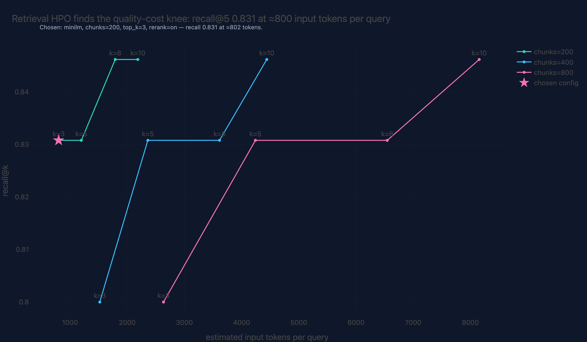
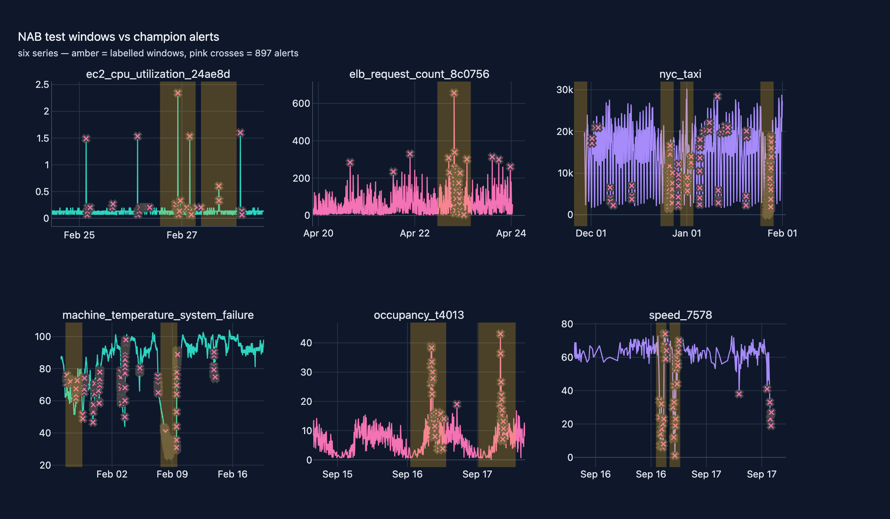

# amm-ds / portfolio

[](https://github.com/amm-ds/portfolio/actions/workflows/ci.yml)

**Data Scientist & ML Engineer.** A growing set of end-to-end case studies —
from data engineering and classical ML to agentic AI — where every project
ships with its design record, a reproducible DVC pipeline, and an evaluation
harness with honest baselines. Every number in the showcase re-runs from a
clean clone.

🌐 **Site:** https://alejandromerida.dev ·
📚 **Docs (GitHub Pages):** https://amm-ds.github.io/portfolio/ ·
🖥️ **Local:** `make docker-up` → http://localhost:8000 (deploy: `deploy/DEPLOY.md`)

## Stack

| Tool | Role | Where |
|---|---|---|
| `pydantic` (+settings) | Typed contracts at every boundary | everywhere |
| `pydantic-ai` | Agentic AI: typed tools, structured outputs, provider abstraction | 01 |
| `scikit-learn` | Classical ML: pipelines, baselines, metrics | 02, 03, 05, 07 |
| `pytorch` | Deep learning with hand-written training loops | 02, 04, 07 |
| `plotly` | The single figure authoring path — every payload is built in Python through `portfolio_core.plotting` (shared theme) and exported as JSON | all |
| `apache echarts` | Showcase-web figure renderer — converts the committed plotly payloads (smaller chunks, better mobile), per-figure plotly.js fallback (ADR-0008) | `apps/showcase-web` |
| `dvc` | Pipelines + data versioning, reproduces from clean clone | all |
| `uv` | Single workspace monorepo, committed lockfile | root |
| `polars` | Lazy/streaming ETL over GB-scale open data | 03, 07 |
| `FastAPI` + `React/TypeScript` | Showcase API + web UI (no Streamlit) | `apps/` |

## Show it, don't just say it

Real artifacts from the pipelines (interactive versions in each [case study](https://alejandromerida.dev/projects/)):

| Flagship demand intelligence (41.2M trips, zone map) | RAG quality-vs-cost frontier | Anomaly detection over NAB telemetry (897 alerts vs labelled windows) |
|---|---|---|
|  |  |  |

## Projects

Thirteen projects, all working showcases on the same platform.

| # | Project | Domain | Data | Highlights |
|---|---|---|---|---|
| 01 | [RAG & Agentic AI Assistant](projects/01-rag-agent/) | Agentic AI | Wikipedia (real) | A cited QA assistant over 593 pinned Wikipedia articles. Tuning (65 q): 46 correct, 17 unsupported-claim outcomes. Sealed held-out (55 q): 44 of 55 correct; 9 of 11 failures kept unsupported claims despite rank-1 retrieval; refusal accuracy 0.92. Auditable, not unattended-ready.<br>Stack: pydantic-ai agent, 65-q tuning + 55-q sealed sets, selected kimi-for-coding, sealed refusal accuracy 0.92, per-phase cost metering |
| 02 | [Hierarchical Demand Forecasting](projects/02-demand-forecasting/) | Time series | Walmart M5 full panel (real) | Walmart M5 at full scale: 30,490 series scored once on the competition window under the official 42,840-node hierarchical WRMSSE. A stability-screened ensemble of pooled LightGBM fits reaches 0.6161 vs the naive floor's 0.8929 (−31.0%) — in the competition winner's ballpark.<br>Stack: rolling origins scored once, global + pooled LightGBM, Tweedie arm, AutoETS, stability-screened convex ensemble |
| 03 | [Anomaly Detection over Telemetry](projects/03-anomaly-detection/) | Unsupervised ML | NAB (real) + seeded synthetic CI path | On NAB at a fixed 2% alert budget, IsolationForest catches 16 of 17 incident windows but fires 1,609 alerts. A one-page-per-day cap cuts that to 80 pages; a rank-average ensemble halves the load again at higher recall — page the alert stream, not the detector score.<br>Stack: event-based metrics (PR-AUC, range-F1), detector HPO, threshold sweeps |
| 04 | [NLP Classification with Transformers](projects/04-nlp-classification/) | Deep learning NLP | AG News 120k (real) | AG News sorter: the selected transformer + selective LLM cascade lifts fresh macro-F1 from 0.9529432 to 0.9539265 and accuracy from 0.953 to 0.954, reviewing 22 of 1,000 fresh items. Full evaluation: $0.023671 cloud-equivalent. License unknown.<br>Stack: hand-written fine-tuning loop, selective LLM cascade (τ=0.6), calibration analysis |
| 05 | [Churn Modeling, sklearn Pipelines](projects/05-ml-pipeline-churn/) | Classical ML | IBM telco churn (real) + synthetic | A churn scorer on real IBM telco data (7,043 customers): serving the calibrated model at a 0.175 threshold cuts decision cost 42% (601 vs 1,035 for contacting everyone; 95% bootstrap interval -485 to -343). The cutoff must be re-derived when a missed churner's price changes.<br>Stack: pipeline-embedded preprocessing, cost-aware HPO, fairness slices |
| 06 | [Routing Optimization (VRPTW)](projects/06-routing-optimization/) | Combinatorial optimization | CVRPLIB Solomon (real benchmark) | Routing planner for the 56 standard Solomon 100-customer problems with time windows. A hand-written search returns feasible plans within 4.2% of best-known routes in ~1 second each, using 3.7 more vehicles than best-known on average; an exact solver certifies small cases only.<br>Stack: hand-written ALNS vs best-known solutions, dual distance + vehicle gap |
| 07 | [Urban Mobility Demand Intelligence](projects/07-open-data-mobility/) | Data engineering + ML | NYC TLC + NOAA (real, GB-scale) | Next-hour NYC taxi demand by zone, built on 41.2M real 2024 yellow-taxi trips and public weather: on a strict Oct–Dec test holdout the served GBM cuts error 28.3% below same-hour-yesterday (4.68 vs 6.52 MAE); its 90% band reached 91% coverage (no-borough zones excepted).<br>Stack: lazy Polars ETL, zone-demand forecasting, weather elasticity, choropleths |
| 08 | [LLM Inference & Serving](projects/08-inference-serving/) | AI infrastructure | Local Ollama stack (real serving target) | One laptop, one run: five LLM serving setups, 760 requests, zero failures. A 4-bit mixture-of-experts model answers in 0.81 s per request at about $0.12 per 1M output tokens (electricity only). The reusable asset is the harness for re-measuring any stack on target hardware.<br>Stack: latency percentiles vs concurrency, GGUF-vs-MLX engine panel, quantization frontier |
| 09 | [Agentic Workflows](projects/09-agentic-workflows/) | Agentic AI | Synthetic 12-doc "Atlas Valley" handbook + read-only Wikipedia slice from 01 (CC BY-SA) | An auditable plan-act-review AI workflow with fixed tools and budgets passed all automated checks: 15/15 fixed tasks, 13/13 unseen answers, 5/6 should-fail probes, ~$0.13 per suite. Ready for supervised pilots, not unattended use. Data: synthetic handbook, real Wikipedia chunks.<br>Stack: pydantic-graph Plan→Execute→Critique, HITL checkpoints, budget-capped offline graders |
| 10 | [Uplift & Experimentation](projects/10-uplift-experimentation/) | Decision science | Hillstrom email RCT (real) | On 64,000-customer randomized email data, uplift targeting beat random targeting by +$2,812 (+69%) at a 25% send budget, CI [+$718, +$4,767]; at $0.01 per email, mailing everyone still wins. Targeting pays when sending is costly. Data: Hillstrom MineThatData, March 2008.<br>Stack: CUPED, power analysis, T/X-learner uplift, Qini & profit curves |
| 11 | [DataFrame Engines Benchmark](projects/11-data-engineering/) | Data engineering | NYC TLC yellow 2024-01 (real, sha-pinned) + seeded synthetic CI/scalability tracks | Ten data tasks over 2.96M NYC taxi trips, parity-checked on pandas, Polars, DuckDB and stdlib sqlite: Polars 19x, DuckDB 15x pandas; sqlite answers every SQL task but file conversion leaves it ~29x slower; 1M-10M tracks show the fast two scaling sub-linearly. NYC TLC 2024-01.<br>Stack: 10-task contract on pandas / Polars / DuckDB / sqlite, parity gate, median-of-5 untraced timing + traced allocation pass + fresh-process RSS probes |
| 12 | [Tabular ML & Deep Learning Lifecycle](projects/12-tabular-ml-lifecycle/) | Classical ML + deep learning | UCI Bike Sharing, Capital Bikeshare hourly (real, sha256-pinned) + seeded synthetic CI twin | Real UCI Capital Bikeshare hourly demand (17,379 rows): a seeded ladder from seasonal-naive to LightGBM and a hand-written PyTorch MLP reaches 25.4 MAE on the scored-once 8-week test vs 83.2 for the floor - a 57.8/hour gain (95% CI 52.5-63.1); validation picked the MLP.<br>Stack: sklearn Pipelines ladder, seeded Optuna HPO (50 trials, 240 s budget), hand-written PyTorch MLP (hour embedding, Huber, early stopping), three-lens feature selection, paired bootstrap CIs |
| 13 | [Model API Serving & Docker Deployment](projects/13-model-serving/) | Model serving & deployment | Champion MLP re-derived from experiment 12's committed recipe (UCI Bike Sharing hourly) | Experiment 12's champion MLP (25.4316 test MAE) is re-derived, exported to ONNX behind a hard parity gate (7.2e-07 max-abs), and served two ways from one FastAPI schema. Seeded paired tests: 1.6 ms p50, ~950 req/s knee, ~56k rows/s batched; image 6.5 GB, mostly unused CUDA.<br>Stack: FastAPI contract schema (422 on malformed), ONNX export behind a 1e-4 parity gate, seeded paired httpx load harness (concurrency + batch curves), fresh-process RSS probes, multi-stage Docker build |

Flagships (01, 07) are complete end-to-end; the rest are working showcases
built on the same platform, designed for deepening.

## Production app templates

Standalone applications include the source, UI, infrastructure, specifications,
and executable checks needed to adapt them to another domain:

- [Agent Chat](apps/agent-chat/) — typed tools and skills, provider-agnostic
  Pydantic AI, cited retrieval, session memory, human approvals, and streaming
  React chat.
- [AI Document Intelligence Workbench](apps/document-intelligence/) — page-level
  PDF analysis: one AI call per page produces cited summaries, typed entities,
  and topics, plus page-scoped cited chat with bounded history. Parser-resolved
  evidence, page-by-page progress, and JSON/Markdown reports.

## Engineering practices

- **Architecture decision records** for every platform-level choice
  ([ADRs](docs/architecture/adr/)) and a [reference architecture](docs/architecture/platform.md).
- **Contracts:** pydantic models at every boundary; hypothesis property tests on
  validators; mypy strict on shared libs.
- **Reproducibility:** committed `uv.lock`; `dvc repro` per project; dataset
  cards pin URLs + checksums in [data-registry/](docs/data-registry/).
- **Operability:** SLOs in design docs, runbooks for drift / LLM cost /
  pipeline restore ([docs/runbooks/](docs/runbooks/)).
- **Review culture:** PR template with design questions, engineering playbook
  ([docs/engineering-playbook.md](docs/engineering-playbook.md)).

## Live endpoints

The showcase app serves the pipelines' real artifacts over HTTP. Run
`make docker-up` → http://localhost:8000:

- `POST /projects/07-open-data-mobility/forecast` — zone-hour demand with a p90 band (07; optional `service: "yellow"|"green"` routes the per-service bundle, default yellow)
- `POST /projects/02-demand-forecasting/forecast` — hierarchical demand forecast (02)
- `POST /projects/05-ml-pipeline-churn/score` — churn propensity scoring (05)
- `POST /projects/06-routing-optimization/solve` — VRPTW routing solver (06)
- Per-project story / metrics / figure APIs: `GET /projects/{id}/{story,metrics,figures}`
- Opt-in RAG chat API: `POST /rag/chat` (streaming variant included), disabled by default

The 02/05/07 serving bundles are committed and cached after their first load;
06 is computed from the request. If artifacts are absent, their endpoints
return **503** with rebuild instructions. Reproduce a pipeline from its project
directory, for example `cd projects/02-demand-forecasting && uv run dvc repro`.
The standard image deliberately contains neither the RAG package nor its
retrieval index; see [deployment](deploy/DEPLOY.md) before enabling chat.

For the single-container public deploy, set the required `DOMAIN` and
`IP_HASH_SALT`, then follow the exact `IMAGE`/`TAG` build/run flow in
[deploy/DEPLOY.md](deploy/DEPLOY.md). Caddy provisions TLS and waits for API
readiness. The docs site is always live: https://amm-ds.github.io/portfolio/

## Reproduce in 3 commands

```bash
git clone https://github.com/amm-ds/portfolio.git && cd portfolio
make setup     # uv sync + pre-commit
cd projects/05-ml-pipeline-churn && uv run dvc repro  # or choose another project
```

…or open in GitHub Codespaces (`.devcontainer/`) — the environment builds itself.

The ordinary showcase endpoints need no LLM key. RAG chat is disabled by
default and there is no production mock provider; a deliberately enabled local
Project 01 uses Ollama unless `LLM_BASE_URL`/`LLM_API_KEY` configure a hosted
provider (see [.env.example](.env.example)).

## Services & engagement

Freelance ML/AI engineering across eight offerings — agentic AI & LLM
systems, machine learning, optimization, data engineering, MLOps,
interactive dashboards, full-stack engineering, and APIs & model serving. Fixed-scope pilots,
retainers, advisory. Full details:
[Services](docs/site/services.md) · every project above is a live case study
(background → objectives → data → EDA → training → evaluation → results →
conclusions, each with a naive baseline and the honest delta).

## Contact & availability

- **Start an engagement:** email [alejandromerida.dev@gmail.com](mailto:alejandromerida.dev@gmail.com?subject=Project%20inquiry%20—%20context%20and%20timeline) —
  discovery call first, written scope after (details on the
  [Contact page](https://alejandromerida.dev/contact/)).
- GitHub: [@amm-ds](https://github.com/amm-ds)
- Languages: English, Spanish.

MIT licensed. Datasets carry their own licenses — see the dataset cards.
Security vulnerabilities: [SECURITY.md](SECURITY.md) — never open a public
issue for them.
