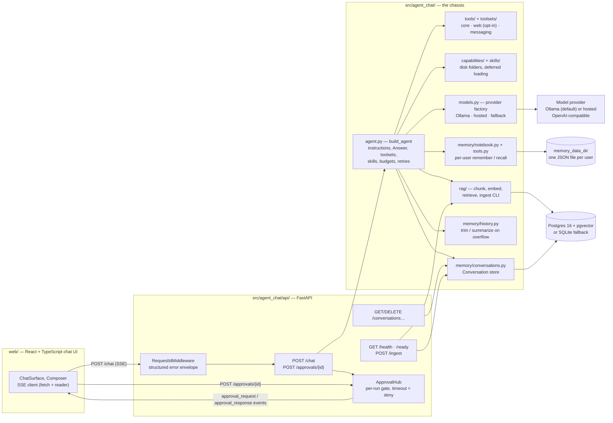

# agent-chat — Architecture

A production-grade, lift-out-able chatbot-agent template: one generic, modular
agent you copy out of this repo and adapt. Built on pydantic-ai v2 + FastAPI +
Postgres/pgvector, with deterministic tests (a scripted fake model — no network,
no API keys) and a real eval suite behind the same graders.

> **What do I edit first? `src/agent_chat/agent.py` — the `BASE_INSTRUCTIONS`
> string.** It is the agent's identity and ground rules; everything else plugs
> in around it.

## Components

- **`agent_chat.agent`** — the only assembly point. `build_agent` wires the
  model, `BASE_INSTRUCTIONS`, the structured `Answer` output type, named
  toolsets, deferred skills, the history processor, and per-run `UsageLimits`
  into one pydantic-ai `Agent`. Nothing else in the file moves when you adapt
  the template.
- **`agent_chat.api`** — the HTTP surface. `create_app` builds `AppState`
  (agent, stores, approval hub) once, from settings or explicit overrides so
  tests inject fakes without monkeypatching. Every response carries an
  `X-Request-ID`; errors are a structured envelope
  (`{"error": {"code", "message", "request_id"}}`).
- **`agent_chat.approvals`** — the human-in-the-loop seam: an `ApprovalGate`
  protocol the agent depends on, with `AutoApproval` (evals, scripts) and
  `DenyAll` (audit paths) shipped, and an SSE-backed hub wired in the API.
- **`agent_chat.rag`** — chunking, the `Embedder` protocol, the `VectorStore`
  protocol (pgvector or SQLite), the bound `retrieve` tool, and the ingest CLI.
- **`agent_chat.memory`** — three separate boundaries: `conversations.py`
  persists whole pydantic-ai `Conversation` values (Postgres primary, SQLite
  fallback); `notebook.py` + `tools.py` provide per-user durable facts through
  on-demand `remember`/`recall`; `history.py` bounds model history with a free
  sliding window or opt-in summarize-on-overflow. No whole-notebook injection.
- **`web/`** — a Vite + React chat UI that consumes the SSE stream and the
  conversations API. The canonical wire contract is
  `src/agent_chat/api/events.py` (see below); the web decoder in
  `web/src/lib/chat/events.ts` must match it.

## Request lifecycle

### 1. Chat request → SSE stream

1. The client posts `{"message": "...", "conversation_id": "...", "user_id": "local"}`
   to `POST /chat` (message 1–8000 chars; the ids are optional). An unknown
   `conversation_id` is a 404. The user id scopes notebook access.
2. The route creates an `asyncio.Queue` and binds a per-run approval gate to it
   (`state.approval_hub.gate(queue.put_nowait)`), so approval events raised
   inside a tool call reach the client while the run is parked waiting.
3. A producer task runs the agent via `agent.run_stream_events(...)` with the
   (optional) prior conversation, per-run usage limits, and deps carrying the
   gate, shared notebook, and user id. Before each model request, the history
   capability trims (or summarizes overflow) without writing notebook content
   into the prompt. A route generator drains the queue, so the SSE response
   starts immediately and stays ordered.
4. Agent stream events are mapped to client-facing events
   (`api/routes_chat.py::_map_event`): tool calls → `tool_call_start` /
   `tool_call_end` (results capped at 500 chars), text deltas → `text_delta`,
   everything else is dropped until the run result arrives.
5. On `AgentRunResultEvent` the conversation is persisted (title = first 60
   chars of the prompt) and a `done` event carries the typed `Answer`, a
   `UsageSummary`, and the `conversation_id`.
6. Any exception becomes an `error` event (`code` = the exception class name in
   snake_case), then a sentinel terminates the generator with the SSE
   terminator `data: [DONE]`. Disconnecting the client cancels the producer.

### 2. The approval leg (human-in-the-loop)

`send_message` is the template's one consequential tool; any tool you add that
acts on the world goes through the same gate:

1. The tool calls `ctx.deps.approvals.request(tool, summary)` before acting.
2. In the API that gate (`_SseApprovalGate`) mints a 12-hex approval id,
   registers an `asyncio.Future` in the app-wide `ApprovalHub`, and emits
   `approval_request` on the run's own queue. The run parks on
   `asyncio.wait_for(future, timeout_s)`.
3. A human answers with `POST /approvals/{approval_id}` and body
   `{"approved": true}`. `ApprovalHub.resolve` settles the future via
   `call_soon_threadsafe` — safe from any thread — and returns false for
   unknown or already-settled ids (404).
4. The gate emits `approval_response` on the same stream, and the tool proceeds
   (recording a `SentMessage` in deps) or reports the denial as its result.
5. **No answer within `AGENT_CHAT_APPROVAL_TIMEOUT_S` (default 120 s) =
   denied.** Default-deny is the contract; implementations must never raise
   for a missing answer.

Each run gets its own gate bound to its own queue, so concurrent chats never
cross approval streams.

## The wire contract (SSE)

One JSON object per `data:` line, discriminated by `type`. Clients dispatch on
`type` and ignore unknown types so the schema can grow without breaking old
frontends. Canonical schema: `src/agent_chat/api/events.py`.

| event | fields | meaning |
|---|---|---|
| `text_delta` | `delta` | incremental answer text |
| `tool_call_start` | `call_id`, `name`, `args` | the model invoked a tool |
| `tool_call_end` | `call_id`, `name`, `result` | the tool returned (≤500 chars) |
| `approval_request` | `approval_id`, `tool`, `summary` | a consequential tool awaits a human |
| `approval_response` | `approval_id`, `approved` | the decision, echoed on the stream |
| `done` | `answer` (`Answer`), `usage` (`input_tokens`/`output_tokens`/`requests`), `conversation_id` | run complete, conversation persisted |
| `error` | `code`, `message` | the run failed; stream ends after it |

## Data model

Postgres is the production store (compose brings up Postgres 16 + pgvector);
a stdlib-SQLite fallback with the same row shapes keeps local dev and tests
docker-free. `database_url` selects the implementation — the code only sees
the `VectorStore` / `ConversationStore` protocols.

### `conversations` — memory

| column | type | notes |
|---|---|---|
| `conversation_id` | `VARCHAR(64)` PK | pydantic-ai conversation id |
| `title` | `VARCHAR(200)` | first 60 chars of the opening message |
| `data` | `TEXT` | the full `Conversation` (messages + usage) as JSON |
| `updated_at` | `VARCHAR(40)` | ISO 8601 UTC, microsecond precision |

### `memory_data_dir/<user_id>.json` — personal notebook

One file per validated user id, with `version: 1` and a `notes` array. Each note
has a stable content-derived `id`, a concise `fact` (1–4000 chars), and a UTC
`created_at`. Writes use atomic file replacement; exact normalized repeats are
idempotent. `recall` reads the user's file, scores case-folded literal terms,
and returns only the best five matches by default (caller bound 1–10). Neither
the notebook nor its file listing is automatically injected into a prompt.

### Model-visible history policy

`ProcessHistory` keeps the last `history_max_turns` user turns (default ten),
including tool calls/results. The default trim makes no model call. With
`history_summarize_enabled`, only overflow turns go through a separate model
request and are replaced by a delimited summary. The whole-Conversation store
persists the bounded result; use an append-only conversation/audit store when a
complete transcript is required.

### `rag_chunks` — retrieval

| column | type | notes |
|---|---|---|
| `id` | `BIGSERIAL` PK | |
| `source` | `VARCHAR(512)` | document path |
| `chunk_index` | `INTEGER` | position within the document |
| `content` | `TEXT` | chunk text (paragraph-first, ≤500 chars, 50-char overlap) |
| `embedding` | `VECTOR(384)` | MiniLM dimension; HNSW cosine index (`m = 16`, `ef_construction = 64`) |

`PgVectorStore.init()` issues the extension, table, and index DDL as raw SQL at
startup, so a fresh database is ready without migrations. In the SQLite
fallback the embedding is JSON text and search is a full-table scan with
in-Python cosine — fine at template scale (thousands of chunks), not for large
corpora.

Two facts worth remembering: ingesting the same file twice duplicates chunks
(document versioning is deliberately out of scope — clear the store first), and
changing the embedder changes the vector space, so a re-ingest is required
after a swap.

## Module map

| module | responsibility | adopter touch |
|---|---|---|
| `agent.py` | assembly: instructions, output type, toolsets, skills, budgets | **first** — persona and ground rules |
| `schemas.py` | `Answer` / `Citation` / `SentMessage` contracts | early — output shape |
| `tools/` | typed tool functions (docstring = model-facing schema) | often |
| `toolsets/` | named groups; the `TOOLSETS` registry | often |
| `skills/` | skill folders (`SKILL.md` + `resources/`) | often |
| `capabilities/loader.py` | folders → deferred capabilities | rarely |
| `config.py` | every env knob, prefix `AGENT_CHAT_` | for budgets/flags |
| `models.py` | provider factory (Ollama / hosted / fallback) | to swap providers |
| `rag/embeddings.py` | `Embedder` protocol + MiniLM/hashing | to swap the embedder |
| `rag/store.py` | `VectorStore` protocol + pgvector/SQLite | to swap the backend |
| `rag/` (rest) | chunking, ingest CLI, `retrieve` tool | rarely |
| `memory/conversations.py` | `ConversationStore` protocol + Postgres/SQLite impls | rarely |
| `memory/notebook.py` | `NotebookStore` + durable per-user JSON notes | to swap memory backend |
| `memory/tools.py` | bounded `remember` / `recall` tools | to change memory policy |
| `memory/history.py` | sliding-window trim + optional overflow summary | to tune context policy |
| `approvals.py` | `ApprovalGate` protocol + test doubles | to change HITL policy |
| `api/` | HTTP surface, SSE schema, approval hub | rarely |
| `evals/` | 13-case suite + deterministic graders | to add cases |
| `testing.py` | scripted fake model for tests/CI | almost never |

See `specs/decisions/` for why the seams sit where they do, `specs/operations.md`
for running it, and `specs/adapting.md` for the adaptation recipes.
