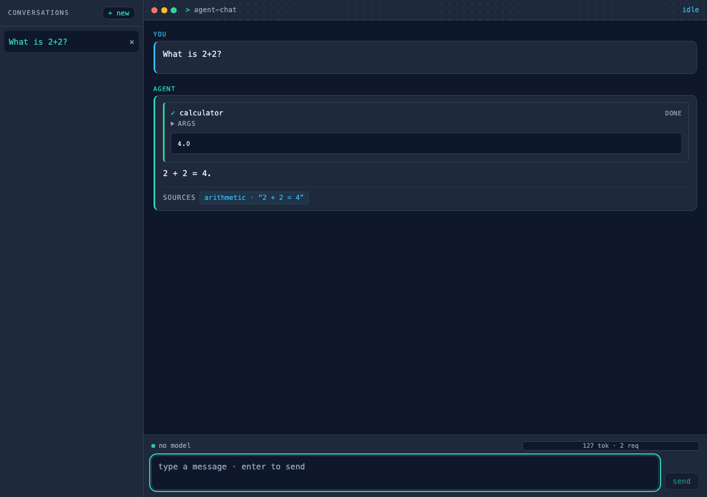
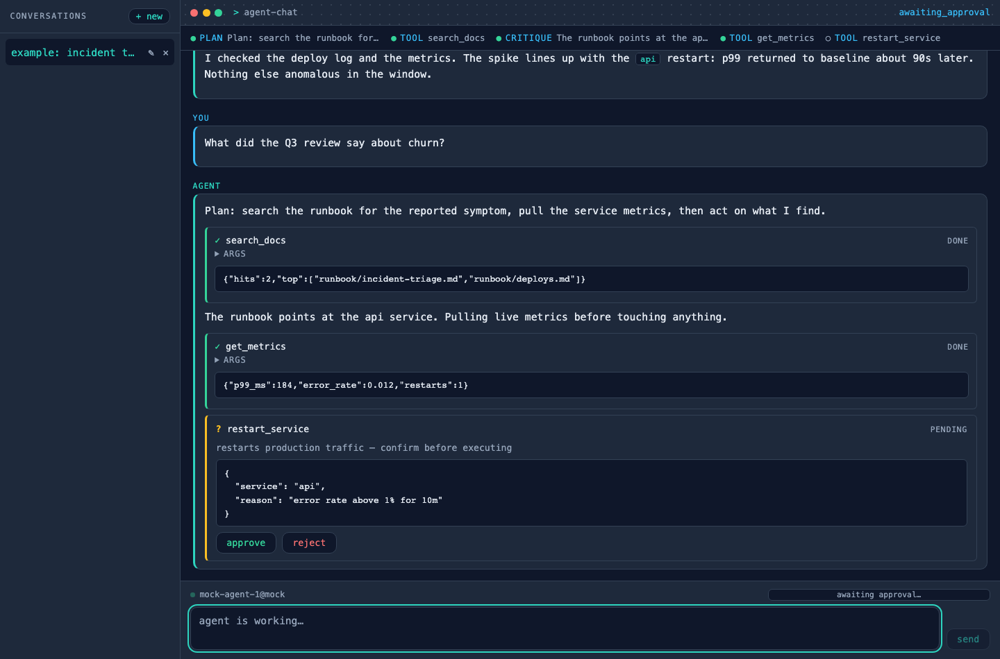
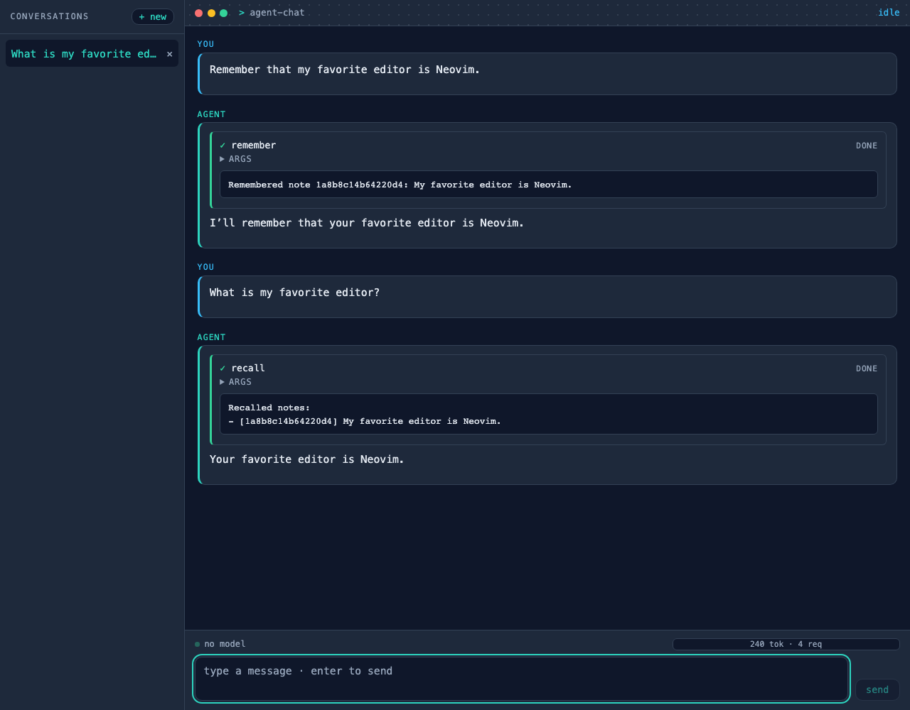

# Agent Chat UI — the agent loop as an inspectable chat surface

**Domain:** agentic AI / frontend engineering ·
**Stack:** React 18 · TypeScript · Vite · FastAPI · Server-Sent Events ·
**Status:** working template —
[UI source](https://github.com/amm-ds/portfolio/tree/main/apps/agent-chat/web) ·
[Backend + specs](https://github.com/amm-ds/portfolio/tree/main/apps/agent-chat)

> A terminal-styled chat client that shows what the agent is doing while it is
> doing it: streamed message parts, paired tool-call cards, an in-band human
> approval leg, a derived step timeline, and the usage returned by the run.

**TL;DR:** the UI is a reducer over one typed SSE contract, not a second agent
state machine. It renders user and assistant turns, folds tool and approval
events into the active answer, and commits the validated `Answer` when `done`
arrives. Memory recall uses the same tool-card path as arithmetic or retrieval;
there is no special memory panel and no hidden notebook dump.

{ width="100%" }

## Surface anatomy

The shell in `web/src/components/chat/ChatSurface.tsx` has three regions:
a conversation sidebar, the main transcript, and a fixed composer. The titlebar
also exposes the run phase (`idle`, `streaming`, or `awaiting_approval`). The
sidebar lists backend-persisted conversations; **+ new** is local until the first
successful run returns a `conversation_id`.

An assistant turn is a list of **message parts**, produced by
`web/src/lib/chat/parts.ts::reduceEvents`:

| part | source events | rendered by | behavior |
|---|---|---|---|
| text | one or more `text_delta` events | `MessageBubble` + `Markdown` | adjacent deltas merge into one block |
| tool call | matching `tool_call_start` / `tool_call_end` | `ToolCallCard` | opens as `running`, closes as `done` with its result |
| approval | `approval_request` / `approval_response` | `ApprovalCard` | starts pending, then approved or rejected |

`done.answer.text` supersedes the last streamed text fragment, so the committed
answer is the validated structured output rather than a possibly incomplete
delta. Citations render below that answer with source and exact quote;
non-low uncertainty is visible. Turns loaded later from the conversations API
render their stored text as plain Markdown; the live event cards belong to the
run that produced them.

## Tool-call cards and the agent-step timeline

A tool card shows the tool name and state, a collapsible JSON args view, and the
returned result once its matching end event arrives. The backend caps result
snippets at 500 characters. This makes the arguments and evidence inspectable
without requiring the client to understand each tool's schema.

The horizontal **agent-step timeline** in `AgentSteps.tsx` is derived from those
same parts, not emitted as a separate event stream. Text before a tool is a
`plan`; each tool or approval is a `tool` step; text between tools is a
`critique`; trailing text becomes the `answer`. While the run is active, the
last completed step is presented as running. It is a compact execution trace,
not a claim that the model exposed private chain-of-thought.

{ width="100%" }

## The approval leg

`send_message` is consequential, so the model cannot complete it unilaterally:

1. The backend emits `approval_request` with an id, tool, and human-readable
   summary. The hook enters `awaiting_approval`; the original SSE response stays
   open and the run remains parked.
2. `ApprovalCard` enables **approve** and **reject** only in that phase. A click
   POSTs `{"approved": true|false}` to `/approvals/{approval_id}` and folds the
   decision into the local card immediately.
3. The server emits `approval_response` on the same stream, executes or skips
   the action, and continues with tool/result and answer events. Unknown or
   already-settled ids return 404. No answer within the backend timeout means
   denied.
4. Stop aborts the fetch; disconnecting cancels the server-side producer. There
   is no reconnect token or client-side approval replay.

The approval is therefore an interactive leg of one ordered transport, not a
parallel notification that can race a later answer.

## Memory in the UI

Memory needs no new event type. A `remember` call appears as a completed tool
card containing the stored note; a later `recall` card contains only the notes
selected for that question. In the capture below, the second answer is grounded
by the visible recalled note, while unrelated notebook entries never enter the
tool result or prompt. The notebook persists across conversations and backend
restarts; the screenshot drives the real FastAPI stream with the deterministic
fake model, not a browser mock.

{ width="100%" }

The current browser does not send `user_id`, so the backend uses its `local`
default. A multi-user deployment must derive notebook identity from the
authenticated server-side principal rather than adding a user-controlled tool
argument or trusting a browser tenant id.

## Composer and budget meter

The composer disables submission while a run is active; Enter sends and
Shift+Enter inserts a newline. Its health badge comes from `GET /health`. After
`done`, the meter displays `input_tokens + output_tokens` and request count from
the run's `UsageSummary`, with a bar against the UI's default 100,000-token
reference budget. The meter is feedback, not enforcement: the backend applies
its configured `UsageLimits` (separate input, output, and request ceilings).
Starting a new conversation or selecting another clears the displayed usage.

## Transport contract

The canonical event models are `src/agent_chat/api/events.py`;
`web/src/lib/chat/events.ts` is the TypeScript decoder. `HttpChatApi` uses
`fetch` plus a streaming reader, splits SSE blocks, joins their `data:` lines,
and stops at `data: [DONE]`. Unknown event types decode to `null` and are skipped
for forward compatibility; malformed payloads for known types raise
`ChatEventError`.

`POST /chat` accepts:

```json
{
  "message": "What is my favorite editor?",
  "conversation_id": "optional-existing-thread",
  "user_id": "local"
}
```

One response carries these JSON event shapes, one per `data:` frame:

| event | essential fields | UI effect |
|---|---|---|
| `text_delta` | `delta` | append assistant text |
| `tool_call_start` | `call_id`, `name`, `args` | open tool card + timeline step |
| `tool_call_end` | `call_id`, `name`, `result` | close the matching card |
| `approval_request` | `approval_id`, `tool`, `summary` | open approval card; await human |
| `approval_response` | `approval_id`, `approved` | settle approval; resume streaming |
| `done` | `answer`, `usage`, `conversation_id` | commit answer, update meter and sidebar |
| `error` | `code`, `message` | show the structured run error |

Conversation CRUD uses `GET /conversations`, `GET /conversations/{id}`, and
`DELETE /conversations/{id}`. The Vite dev server proxies chat, approvals,
conversations, health/readiness, and ingest to the backend; `VITE_API_BASE` and
`VITE_API_KEY` configure direct deployments. `VITE_MOCK=1` swaps in the browser
mock for isolated frontend tests, while the memory capture above uses the real
HTTP/SSE path.

## Extension points and limits

Add a new domain tool in the backend and the existing cards/timeline render it
without frontend changes. A genuinely new event requires the backend union, the
TypeScript decoder, the parts reducer, and a focused component. Restyling stays
in `web/src/styles.css` variables. The UI is intentionally single-agent and
in-band: it has no multi-agent graph, durable pending-approval inbox, semantic
memory browser, or full-fidelity replay of historical tool cards. Those are
product features to add explicitly, not hidden state in the current client.
