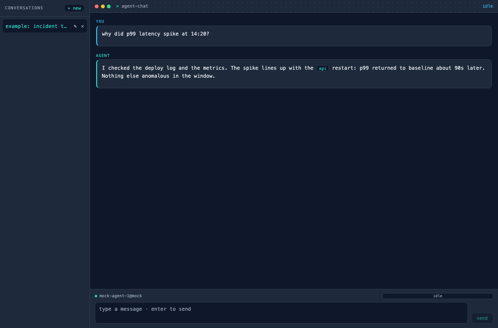
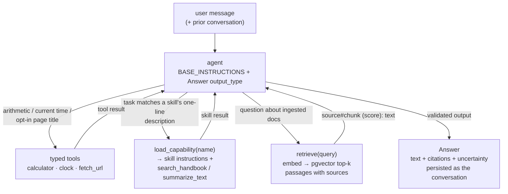
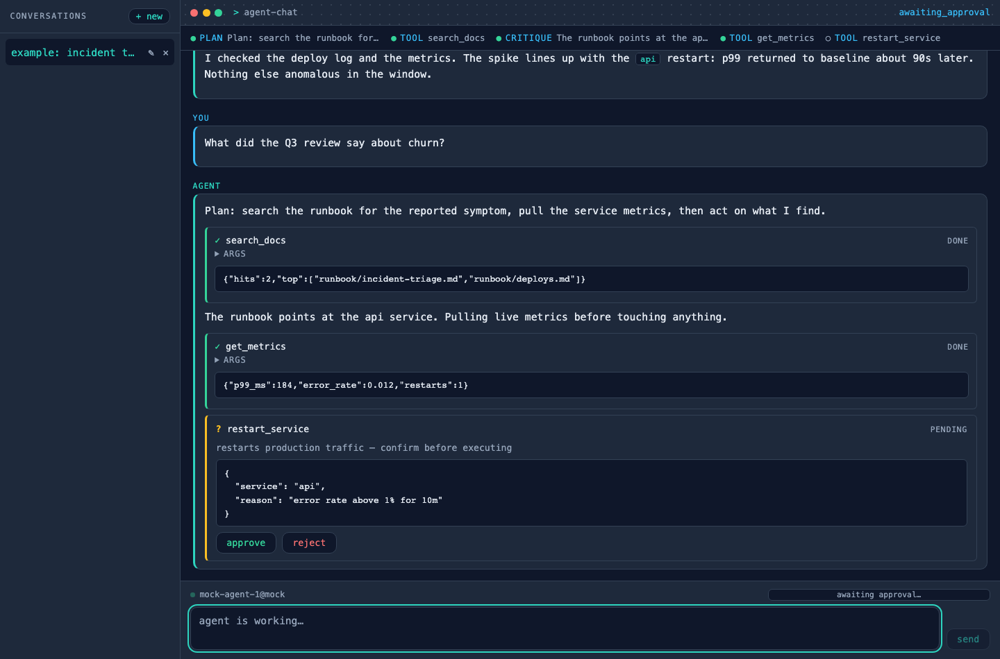

# Agent Chat — an auditable chatbot-agent chassis you lift out and adapt

**Domain:** agentic AI / LLM engineering ·
**Stack:** pydantic-ai v2 · FastAPI · Postgres 16 + pgvector · React/TypeScript ·
**Status:** working template —
[App README + source](https://github.com/amm-ds/portfolio/tree/main/apps/agent-chat) ·
[Specs — architecture, decisions, operations, adapting](https://github.com/amm-ds/portfolio/tree/main/apps/agent-chat/specs)

> A production-grade, lift-out-able chatbot-agent template: one generic,
> modular agent you copy out of the repo and adapt. Built on pydantic-ai v2 +
> FastAPI + Postgres/pgvector, with deterministic tests (a scripted fake
> model — no network, no API keys) and a real eval suite behind the same
> graders.

**TL;DR:** this is for a team that needs an **auditable agent chassis, not a
demo** — typed tools, disk-loaded skills, cited retrieval, a human approval
gate for consequential actions, and per-run budgets, all behind one FastAPI
surface that streams every step as typed SSE events. The first edit is a
string; the seams (provider, store, embedder, approvals) are protocols with
documented swap points. Eighty-three tests and a 12-case eval suite run fully
offline; the same graders score your real deployment.

[App source, specs, and adaptation guide on GitHub →](https://github.com/amm-ds/portfolio/tree/main/apps/agent-chat)

{ width="100%" }

Every LLM engagement eventually needs the same plumbing: a model provider
that can be swapped without touching the agent, tools whose schemas are
honest docstrings, a knowledge base the agent cites instead of paraphrases,
and a way to stop side-effecting actions until a human says yes. Agent Chat is
that plumbing extracted as a template — the generic agent underneath a
customer-facing assistant, an internal ops copilot, or a policy-aware helpdesk
bot. It is deliberately boring where it should be boring (storage,
configuration, error envelopes) and explicit where production agents are
usually hand-wavy (what the model may call, when a human decides, what the
answer grounded itself on).

## What the chassis gives you

One assembly point — `build_agent` in `agent.py` — wires the pydantic-ai
agent: instructions, a structured `Answer` output (text + citations +
self-reported uncertainty), named toolsets, deferred skills, and per-run
usage budgets (30 requests / 100k input / 20k output tokens by default).
Around it, lift-out modules with protocol seams:

| module | what it is | swap point |
|---|---|---|
| `config.py` | every knob, env prefix `AGENT_CHAT_` | — |
| `models.py` | provider factory: local Ollama default, hosted OpenAI-compatible, `FallbackModel` chain | new provider = one branch |
| `tools/` + `toolsets/` | typed functions (docstring = the model-facing schema) in named groups: core, web (opt-in network), messaging | add a function + one registry line |
| `skills/` + `capabilities/` | domain playbooks as disk folders; the model sees a one-line description until it loads the skill | add a folder |
| `rag/` | paragraph-first chunking, embedder and vector-store protocols, `retrieve` tool, ingest CLI | new embedder or store = one adapter |
| `approvals.py` | the `ApprovalGate` protocol the agent depends on | test doubles ship in the package |
| `memory.py` | whole conversations persisted as JSON | Postgres or SQLite by URL |
| `api/` | FastAPI: SSE chat, approvals, conversation CRUD, ingest, health/ready, request-id middleware, structured errors | rarely touched |
| `evals/` | 12 cases with deterministic graders — no LLM in the judge | add cases as your domain grows |

The web UI is a Vite + React chat: conversation sidebar, streamed deltas,
tool-call cards, and an approve/deny card for the consequential `send_message`
tool. Restyling is overriding one block of CSS variables.

## The agent loop

The loop is pydantic-ai's, constrained by the template's contracts: the model
may call tools, load skills, or search the knowledge base, and must finish by
producing a validated `Answer` — a schema, not a hope.



Three behaviors are pinned by the eval suite, not assumed. **Tool
discipline:** the instructions assign each job to a tool ("never do math in
your head when a tool can do it"), and the `tool_choice` graders assert the
exact tool set per case. **Grounding:** `retrieve` returns passages as
`source#chunk (score): text`, and answers that relied on them must carry
citations — a dedicated grader fails answers that don't. **Honest gaps:**
when retrieval or a skill search comes back empty, the instructed behavior is
to say the knowledge base does not cover it and set `uncertainty: high`; the
suite includes refusal probes (a prompt-leak attempt, an out-of-catalogue
tool request, a financial action) that must be declined in plain words
without crashing.

## The human-in-the-loop flow

`send_message` — post to a team channel — is the template's one consequential
tool, and it is the pattern every side-effecting tool you add is expected to
follow. The decision rides the same SSE stream as the conversation:

1. Before acting, the tool calls `ctx.deps.approvals.request(tool, summary)`.
2. The API's approval hub mints an id, emits `approval_request` on the run's
   stream, and parks the run on a future. Each run gets its own gate bound to
   its own queue, so concurrent chats never cross streams.
3. The human answers with `POST /approvals/{id}` and `{"approved": true}`; the
   decision comes back as `approval_response` on the same stream, and the tool
   proceeds — recording a `SentMessage` in the run's deps — or reports the
   denial as its result.
4. **No answer within 120 seconds is a denial.** Default-deny is the
   contract: a lost connection, a closed laptop, or a distracted operator all
   land on the safe side. There is no approve-by-default path.

Outside the API, the same protocol is satisfied by shipped doubles —
`AutoApproval` for evals and scripts, `DenyAll` for audit paths — which is how
the approval flow gets graded deterministically in the offline suite. The
template documents the upgrade to pydantic-ai's native
`ApprovalRequiredToolset` as a local swap behind that same protocol.

{ width="100%" }

## Adapting it

Three recipes cover most lift-outs; the full set (providers, embedders, web
restyle, ship checklist) lives in
[`specs/adapting.md`](https://github.com/amm-ds/portfolio/tree/main/apps/agent-chat/specs/adapting.md).

**Give it your identity.** Edit the `BASE_INSTRUCTIONS` string in
`src/agent_chat/agent.py` — the first edit the README points every adopter
at. Keep the tool-discipline shape and write your domain into it: what the
agent is, what it must refuse, what it must escalate to a human.

**Add a tool.** A typed function in `tools/`, registered in one toolset. The
docstring is the model-facing schema and validation fails fast at import time
when a tool has none:

```python
async def create_ticket(ctx: RunContext[ChatDeps], subject: str, body: str) -> str:
    """Open a support ticket in the tracker. CONSEQUENTIAL: requires human approval.

    Args:
        subject: One-line summary, e.g. "Refund request #1042".
        body: The full ticket description.
    """
    if not await ctx.deps.approvals.request("create_ticket", subject):
        return "Ticket NOT created: denied by operator."
    ...
```

**Add a skill.** A folder: `skills/<name>/SKILL.md` plus optional
`resources/*.md`. The first prose paragraph is the description the model sees;
a folder with resources automatically gets a deterministic `search_<name>`
tool; nothing else to wire. The shipped `handbook` skill is the worked
example — policy questions route through `search_handbook` and get cited from
it.

## Limits

The honest register, per the README and the specs:

- **Single agent.** One agent, one conversation, no multi-agent
  orchestration or sub-agents. The template is the chassis under one chat
  assistant; orchestration is out of scope by design.
- **In-band approvals.** The approval gate rides the chat stream with a
  120-second default-deny timeout. That is right for a supervised assistant
  and wrong as an audit system — pending decisions are not durably logged,
  and a team that needs decision records should add logging at the hub.
- **Embedding model choices.** The docker default embedder is a
  dependency-free hashing embedder: lexical overlap ranking, not semantics —
  fine for CI and first boots, wrong for real retrieval. MiniLM (the local
  default outside docker) is semantic but small; serious corpora deserve a
  stronger embedder, and any embedder swap requires clearing and re-ingesting
  the store. The SQLite vector fallback scans in Python — dev and tests only;
  production runs on pgvector's HNSW index.
- **Template scale.** Ingest deduplicates nothing (re-ingesting duplicates
  chunks until you clear the store); document versioning, multi-user auth
  beyond a single API key, and out-of-band approvals are left to the adopter.
  The eval suite grades behavior, not quality of prose — run
  `--model real` against your deployment and read the report before you
  trust it.
