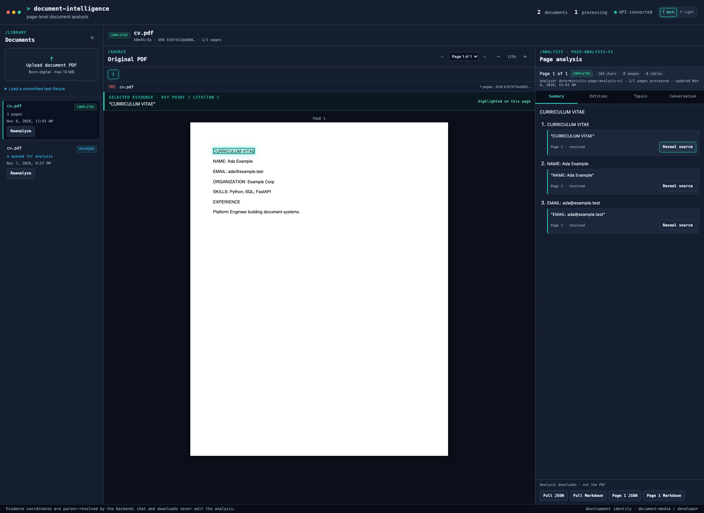
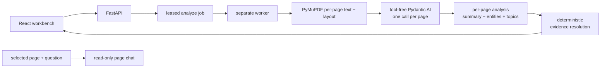
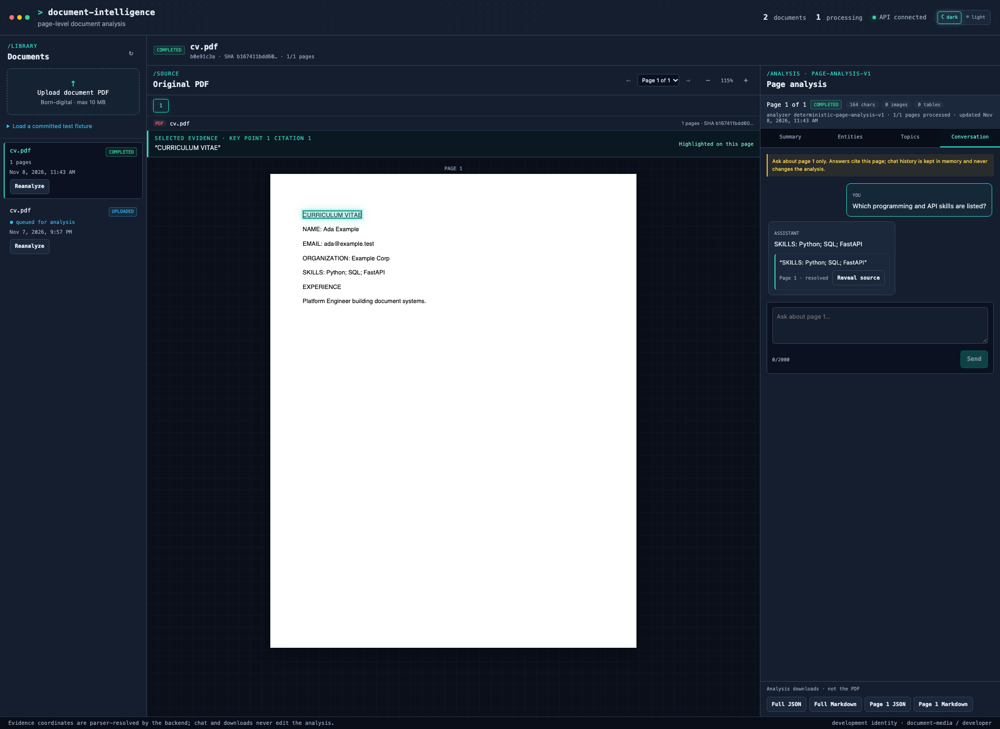

# AI Document Intelligence Workbench

**Domain:** document AI / page-level analysis ·
**Stack:** Pydantic AI · FastAPI · Postgres · PyMuPDF · React/TypeScript ·
**Status:** working standalone template —
[application source](https://github.com/amm-ds/portfolio/tree/main/apps/document-intelligence) ·
[architecture](https://github.com/amm-ds/portfolio/blob/main/apps/document-intelligence/specs/architecture.md) ·
[operations](https://github.com/amm-ds/portfolio/blob/main/apps/document-intelligence/specs/operations.md)

> **AI analyzes page by page, deterministic code verifies every citation, and
> partial results stay visible while the worker continues.**

Upload a born-digital PDF and get per-page, citation-backed analysis: one AI
call per page produces a summary, typed entities, and topics, and a fourth
mode adds page-scoped conversation with bounded history. The API, leased
worker, Postgres migration, React workbench, synthetic fixtures, and
evaluation harness ship together.

**TL;DR:** one strict page-analysis contract connects the model, worker,
database, API, UI, exports, and evaluation. Every factual output can be
traced to a parser-resolved source passage, and completed pages are visible
while the worker keeps going. The default offline adapters are functional
fixtures, not AI-quality claims.

{ width="100%" }

## Page analysis contract

- **One call per page.** Each page of extracted text is analyzed
  independently, so results arrive page by page and a single slow page never
  blocks the document.
- **Three products per call.** The same structured output feeds the summary,
  entity, and topic views, so they stay coherent with each other.
- **Delimited, untrusted input.** Analysis returns strict structured output
  and has no tools, repository access, blob access, or mutation capabilities.
- **Tables and images.** Table text is included in the page context; image
  regions are counted and flagged. A page without an embedded text layer is
  flagged — raster OCR is never silently claimed when unavailable.
- **Bounded execution.** Retries and request/token usage are limited;
  external provider budgets remain an operational requirement.



On the [site's app page](https://alejandromerida.dev/apps/document-intelligence),
this material renders as an article with the same structure and an interactive
version of the architecture diagram.

## Four modes

- **Summary:** a page summary and cited key points for the page.
- **Entity extraction:** literal mentions, normalized names, entity types, and
  exact citations. Entity types use a shared controlled taxonomy.
- **Topics:** open, concise labels for the page with rationale and evidence.
- **Page chat:** page-scoped conversation over the selected page with bounded
  history. Citations resolve after a unicode compatibility fold over the
  page's text spans, extracted table lines, and image placeholders; a quote
  matching several passages resolves to the first whole-passage match and is
  flagged with a warning; only a quote matching nothing fails the answer.

## Trust boundaries

- **Parser-owned evidence.** Models propose quotes, never trusted coordinates.
  Deterministic code resolves each quote on one page — after a unicode
  compatibility fold — against the page's text spans, extracted table lines,
  and image placeholders, and derives its page and bounding box from matching
  PyMuPDF geometry. A quote matching several passages resolves to the first
  whole-passage match with a warning; only a quote matching nothing fails
  validation.
- **Entity support.** The literal entity mention must also occur in its cited
  quote. Missing, ambiguous, or fabricated citations create validation issues.
- **Page-scoped chat.** Chat receives only the selected page's parsed text and
  a bounded history window; it cannot see or change any other page.
- **Honest page state.** Pages still queued or failed are listed as such at
  every point — in the UI and in exports — never silently skipped.

## Application modules

| Module | Responsibility | Production boundary |
|---|---|---|
| `domain/` | Strict page-analysis, evidence, and chat contracts | Unknown fields are rejected |
| `analysis/` | Tool-free Pydantic AI per-page analysis, page chat, evidence resolution | Unsupported citations cannot become trusted |
| `documents/` | PDF parsing and local/S3-compatible blob storage | Coordinates come only from PyMuPDF |
| `jobs/` | In-memory and Postgres queues | Leases, heartbeats, bounded retries |
| `store/` | Tenant-scoped analysis records | Atomic updates, tenant isolation |
| `api/` | Upload, page analysis status, page chat, reports | Signed gateway identity in production |
| `web/` | PDF highlights, per-page analysis views, chat, progress, downloads | No browser-asserted evidence coordinates |

The Compose stack runs Postgres, Alembic migration, API, and worker
separately. Every document read is tenant-scoped; unknown and cross-tenant
documents both return 404. Production identity uses a timestamped
HMAC-signed gateway envelope, not a trusted tenant header.

## Interface

The React client renders the original PDF with `pdfjs-dist` and overlays only
backend-resolved coordinates. Selecting a summary point, entity, topic, or
chat answer reveals the exact source passage. Analysis progress is
page-by-page: finished pages render as soon as the worker completes them,
while the rest keep running.

{ width="100%" }

Chat is **read-only** and page-scoped: it cannot change the document, any
page's analysis, or another page's history. Offline mode returns a
deterministic matching passage for local development, not an AI-quality
answer.

## Downloads/exports

- **Full analysis report:** every completed page in one file, as JSON or
  Markdown.
- **Selected-page report:** the page in view only, in the same two formats.
- Reports render from the server-side analysis record — what was analyzed is
  what downloads — and pages still queued or failed at export time are
  listed, never silently omitted.

## Evaluation

The current mixed-document harness scores analysis at page level against
committed non-sensitive references. It reports:

- summary reference key-point coverage and citation support, per page;
- entity precision, recall, F1, and type accuracy, per page;
- topic label quality against page-level references;
- chat answer correctness and citation support;
- unresolved evidence, run errors, latency, model usage, and configurable cost.

The product has no review step, so no human correction rate is reported;
document-level classification metrics retired with the classifier. The
versioned JSON report records provider/model, schema and prompt versions,
dataset revision, per-page misses, and failed calls. Offline deterministic
output verifies the application path and is labeled separately from live
model quality. The small synthetic corpus is a regression suite, not evidence
of universal document accuracy. Live numbers are re-measured on each explicit
provider opt-in run; the latest committed live run (2026-11-08,
`kimi:kimi-for-coding`, corpus revision 2026-11-08.1, 7 synthetic cases)
measured chat answer accuracy 1.00 with reference citations 1.00, evidence
resolvability 1.00, summary key-point coverage 0.82, entity F1 0.68, topic
F1 0.50, and zero page failures, with per-page misses reported in the JSON
and dominated by entity/topic over-extraction against compact references.

```bash
cd apps/document-intelligence
uv sync --dev
uv run document-intelligence-eval --output reports/offline-metrics.json
# Explicit provider opt-in after configuring credentials and reviewing cost:
uv run document-intelligence-eval --live --output reports/live-metrics.json
```

Inspect the [current evaluation reports](https://github.com/amm-ds/portfolio/tree/main/apps/document-intelligence/reports)
and [runner source](https://github.com/amm-ds/portfolio/blob/main/apps/document-intelligence/src/document_intelligence/evals/analysis_runner.py).

## Production adoption

1. Authenticate users at the gateway, strip client-supplied identity headers,
   and inject the HMAC secret through a secret manager.
2. Run Postgres, migrations, API, and worker as separate units; back up both
   database and blob storage.
3. Use private encrypted buckets, explicit retention/legal-hold policies, and
   tenant-isolation tests.
4. Add representative documents from the real population and set
   provider-specific acceptance thresholds.
5. Configure model request/token limits, provider budgets, timeouts, and alerts.

**Limits:** the prepared corpus contains synthetic born-digital PDFs, not
scans, handwriting, or licensed customer documents. Documents may include
tables and images; table text feeds page context and image regions are
counted and flagged. The system does not claim raster OCR, universal
accuracy, straight-through processing, ROI, or unattended accuracy.
