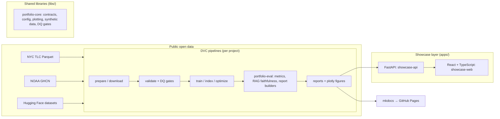

# Reference Architecture — amm-ds/portfolio platform

This document describes the platform shared by every project in this monorepo:
the contracts, the extension points, and the flow from raw data to a client-ready
artifact. Project-specific designs live in `projects/0X-*/DESIGN.md`.

## System view

## Layer responsibilities

| Layer | Package | Responsibility | May not |
|---|---|---|---|
| Contracts | `portfolio-core` | pydantic schemas for datasets, configs, DQ reports; plotting theme; time-CV | import any project code |
| Evaluation | `portfolio-eval` | metric protocols, RAG faithfulness/judging, HTML report builder | depend on torch/transformers |
| Projects | `projects/0X-*` | domain logic, DVC stages, CLIs (`typer`) | duplicate contracts — reuse libs |
| Showcase | `apps/showcase-api` + `apps/showcase-web` | serve results and demos (FastAPI + React/TS) | contain training logic |

Dependency direction is strictly: projects → libs; apps → libs; nothing → projects.

Pragmatic exception (documented, not accidental): `apps/showcase-api` lazily imports two
project packages at runtime to *serve* them — `rag_agent` for `/rag/chat` and `mobility`
for `/projects/07-*/forecast`. Both degrade to a clear 503 when the project artifacts are
absent, so the API never hard-depends on project state; the imports are runtime-only and
never in `libs/`.

## Key contracts (extension points)

- **`portfolio_core.schemas.DatasetContract`** — every dataset (real or synthetic)
  validates against a versioned pydantic model before a pipeline proceeds.
- **`portfolio_core.dq.DQReport`** — data-quality gates are data, not prints:
  null-rate/range/freshness checks produce a serializable report; failing gates
  halt the pipeline loudly (exit non-zero, report persisted for forensics).
- **`portfolio_core.config.Settings`** — `pydantic-settings` base; every project
  extends it. Zero hardcoded constants in logic.
- **`portfolio_eval.metrics.Metric`** — protocol; new metrics plug into the same
  aggregation + report builder.
- **Project manifest** — `portfolio_core.manifest.ProjectIndex` reads each
  project's `portfolio.yaml` so the showcase API and docs never parse READMEs.
- **Case-study story** — `portfolio_core.story.ProjectStory` validates each
  project's `story.yaml` (8 canonical sections) served at
  `GET /projects/{id}/story`; the React app renders the uniform case-study view.

## Data policy

No raw data in git. External datasets are fetched by `prepare` stages from the
URLs pinned in `data-registry/` cards (checksum + snapshot date), tracked by
DVC after preparation, and regenerated locally via `dvc repro` — no paid remote
required. Synthetic generators in `portfolio-core` provide seedable fallbacks
so every pipeline also runs offline and in CI.

## LLM provider abstraction

See ADR-0004 (amended) and ADR-0006. One factory, local-first: env-configured
OpenAI-compatible endpoint (`LLM_BASE_URL`/`LLM_API_KEY`/`LLM_MODEL`) when set,
otherwise local Ollama (default `qwen3.6:35b-a3b-q4_K_M`, `OLLAMA_MODEL` overrides)
with a bounded-timeout client. Runtime mocks are test-only
(`portfolio_core.llm.mock_model_for_tests` + pydantic-ai `TestModel`). No project
imports a provider SDK directly.

## Operational posture

- Observability: stdlib `logging` configured centrally; pydantic-ai agents emit
  OpenTelemetry-compatible spans (see runbook `llm-cost-incident.md`).
- SLOs are documented per project in `DESIGN.md` (e.g., Project 01: p95 latency,
  cost/query budget, fallback chain).
- Rollback = re-run `dvc repro` from the last good commit; every stage is
  deterministic given its inputs (pinned versions, seeds, checksums).
