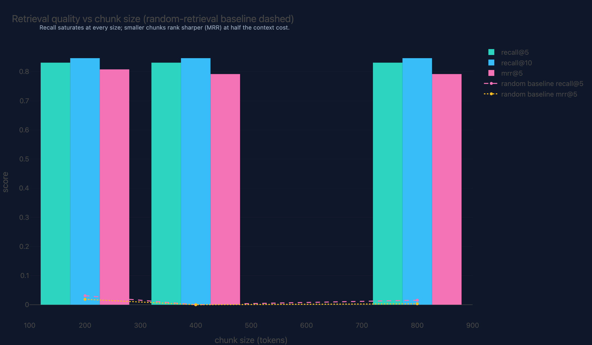
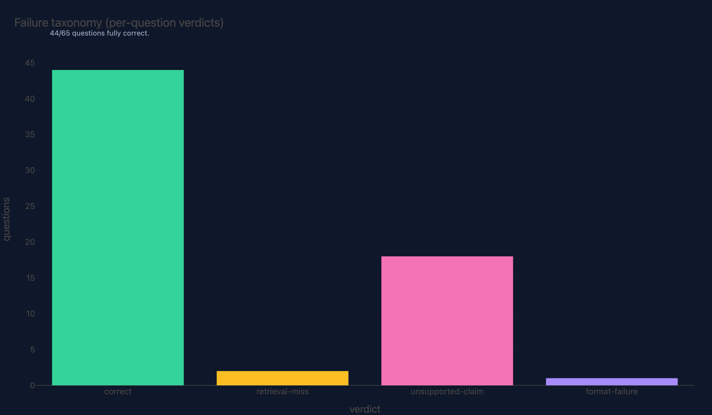

# 01 · RAG & Agentic AI Assistant

**Domain:** Agentic AI / LLM · **Data:** Wikipedia (HF, real) · **Status:** Flagship — complete

> Teams routing questions at a knowledge base need answers they can audit —
> every claim traced to a source, every unsupported claim dropped or refused.
> This agent answers only from retrieved evidence with per-claim citations:
> retrieval recall@5 0.83 vs 0.03 random, and the verify loop cut unsupported
> claims from 60% to 47% of answers locally, holding at 28% (18/65) on the
> hosted run, where RAGAS faithfulness reaches 0.685 [0.61, 0.76].
>
> [Interactive case study with figures →](https://github.com/amm-ds/portfolio/tree/main/projects/01-rag-agent)

A grounded question-answering agent over a curated topical slice of English
Wikipedia. A `pydantic-ai` agent answers **only** from retrieved evidence and
returns a structured `AnalysisResult` — summary, per-claim citations, and a
calibrated confidence — with no LLM SDK in the project (provider abstraction
per ADR-0004, as amended: env-configured OpenAI-compatible endpoint
first, local Ollama second — default `qwen3.6:35b-a3b-q4_K_M`; no runtime
mock, `--offline` keeps a retrieval-only CI path).

## Pipeline

1. **Corpus** — bounded stream of `wikimedia/wikipedia` (`20231101.en`),
   five topics (Climate, Renewable energy, Aviation, Machine learning,
   Photosynthesis), ≤120 articles each plus exact-title anchors; DQ gates and a
   sha256-pinned dataset contract. Result: 593 articles.
2. **Index** — paragraph-aware chunking at 200/400/800 tokens →
   MiniLM-L6-v2 embeddings (L2-normalized) → FAISS `IndexFlatIP` per size;
   cross-encoder (`ms-marco-MiniLM-L-6-v2`) reranks the top 5×k on CPU.
3. **Agent** — tools `search_documents` / `read_excerpt` are the only corpus
   access; output schema is validated on every run and fails loudly.
4. **Evaluation** — 65 graded questions (44 single-hop, 11 multi-hop, 10
   unanswerable): recall@5/10 + MRR@5 sweep over chunk sizes, RAGAS +
   rubric-judge quality runs, a verify-then-answer A/B, and per-query latency
   + estimated cost, all written to `reports/`.

## Key results (2026-10-17, provider A/B)

**Golden set: 65 graded questions** — 44 single-hop, 11 multi-hop, 10
unanswerable (expected behavior: abstain). Retrieval is provider-independent
(embeddings-only): recall@5 **0.831** / recall@10 0.846, MRR@5 0.808 vs a
0.031 random floor; the chosen config (MiniLM, chunks=200, top_k=3, rerank ON)
holds full recall at −65% context cost.

{ width="100%" }

**Provider A/B** — the same pipeline on local `qwen3.6:35b-a3b-q4_K_M`
(30-q subset — local inference wall-clock) and hosted `kimi-for-coding`
(full 65 q). Hosted costs below are **cloud-equivalent estimates** at the
public kimi-k2.8 reference card ($1/Mtok in, $4/Mtok out, cached reads 30%):
the key is membership quota, so these are rate-card equivalents, **never
billed amounts**.

| Metric | Local qwen3.6-q4 (n=30) | Hosted kimi-for-coding (n=65) |
|---|---|---|
| Failure taxonomy | 15 correct / 14 unsupported-claim / 1 format-failure | 44 correct / 18 unsupported-claim / 2 retrieval-miss / 1 format-failure |
| RAGAS faithfulness (95% CI) | 0.606 | **0.685 [0.605, 0.760]** |
| RAGAS answer relevancy | 0.720 | **0.878 [0.820, 0.918]** |
| RAGAS context precision / recall | 1.000 / 0.978 | 0.760 [0.667, 0.849] / 0.978 [0.954, 0.995] |
| Rubric-judge faithfulness | 0.441 [0.29, 0.61] | 0.550 [0.483, 0.611] |
| Refusal accuracy (unanswerable) | 0.857 [0.57, 1.00] | 0.900 [0.70, 1.00] |
| False-abstention rate | 0.174 | 0.036 |
| Verify overhead | 33 repair calls | 39 repair calls (125 verify calls: verdicts + repairs + re-checks) |
| Agent latency p50 / p95 | 61 s / 245 s (load-contended local) | **23 s / 175 s** (p95 = one runaway tool-loop question cut off by the per-run token guard) |
| Cost | $0 API (cloud-equivalent ≈ $0.0068/query) | **$3.58 cloud-equivalent, metered per phase** (see below) |

{ width="100%" }

Per-phase meter, hosted full run (`reports/cost_telemetry.json`, 922 calls,
3.79M of 4.76M input tokens prompt-cache reads = **79.6% cached share**):
agent $1.79 / RAGAS $1.13 / verify $0.47 / judge $0.19. The USD cap is
enforced per run by the platform spend ledger: a first pass tripped it at
$3.04 mid-run and the CLI stopped cleanly; the re-run completed under a
logged, raised cap (`.env` untouched). The lone hosted format-failure is the
token-guard trip on the runaway question, not schema noise — the wave-15
output-retry recovered the run's one schema-invalid draft (1 retry).

Takeaway: retrieval is solid (recall@5 0.831 vs 0.031 random), so
**generation grounding is the bottleneck**, and grounding tracks the provider
— hosted faithfulness +0.08 over local (directional: different denominators,
30 vs 65 questions). The verify-then-answer loop stays worth its repair
calls on high-stakes corpora: unsupported-claim share fell from the
verify-off baseline (60% → 47% locally) and stays bounded hosted, at 39
repair calls and 2 support-floor abstentions over 64 verified answers.
Figures: corpus composition, chunk-size sweep with random baseline,
embedding model comparison, retrieval funnel, HPO frontier (chosen config
starred), latency histogram, failure taxonomy (all in
`projects/01-rag-agent/reports/figures/`).

## Links

- [Project README](https://github.com/amm-ds/portfolio/tree/main/projects/01-rag-agent/README.md) — results, reproduce instructions, client-facing summary
- [DESIGN.md](https://github.com/amm-ds/portfolio/tree/main/projects/01-rag-agent/DESIGN.md) — requirements, options considered (ChromaDB vs FAISS, reranking, provider abstraction), SLOs, failure modes
- Interactive report: `projects/01-rag-agent/reports/report.html`

## Data attribution

Corpus text is from Wikipedia (`wikimedia/wikipedia`, dump `20231101.en`),
licensed under
[CC BY-SA 3.0](https://creativecommons.org/licenses/by-sa/3.0/) and
[GFDL](https://www.gnu.org/licenses/fdl-1.3.html); content remains the property
of its authors. Article selection and all transformations are reproducible via
`dvc repro` in the project directory.
