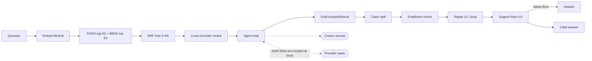
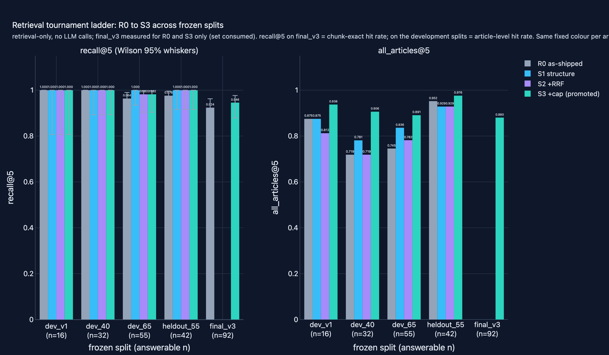
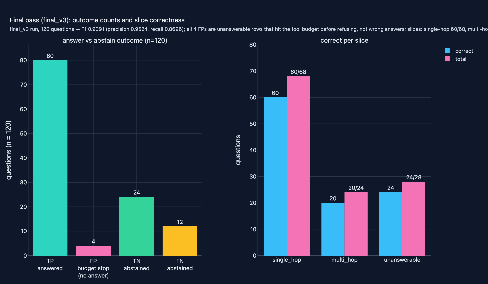
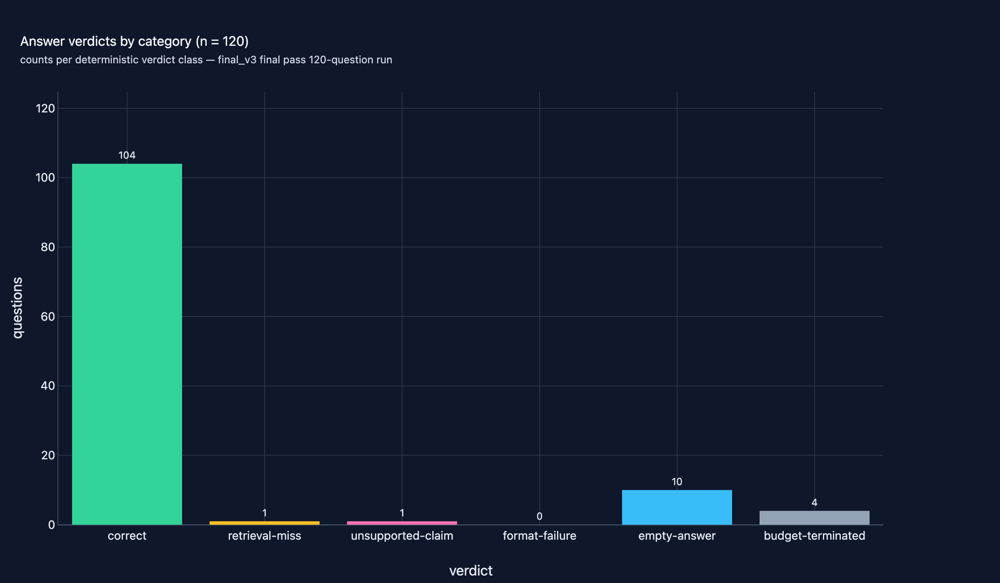
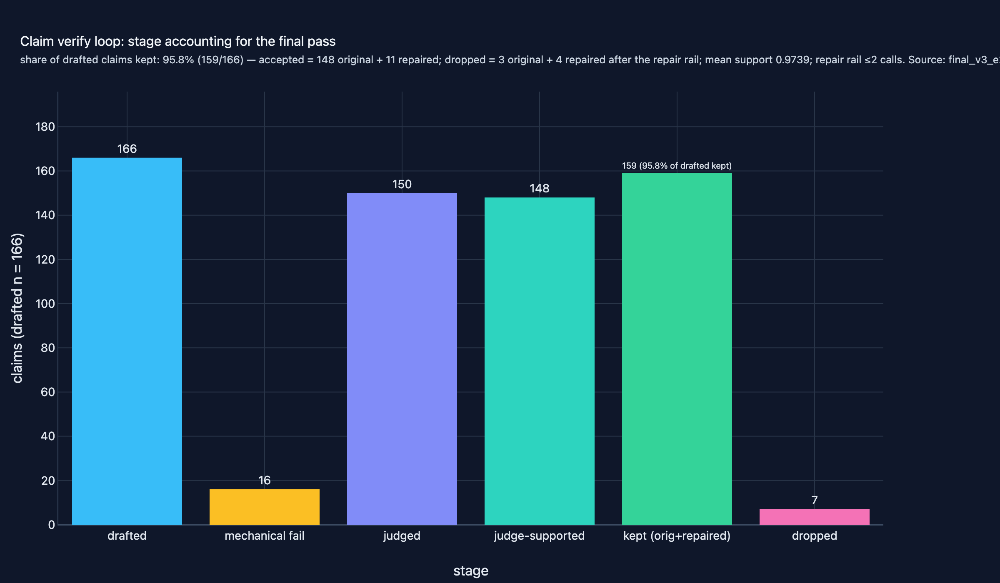
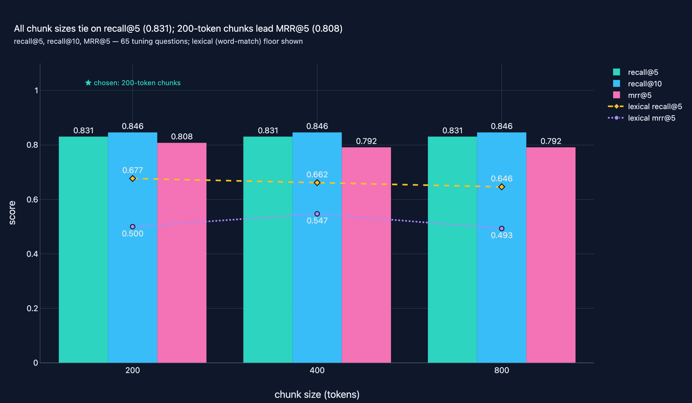

# 01 · RAG & Agentic AI Assistant

**Domain:** Agentic AI / LLM · **Data:** Wikipedia (HF, real) · **Status:** Flagship, complete

> Grounding-hardened cited QA over 593 Wikipedia articles. S3 hybrid retrieval reaches 0.946 recall@5. Judge sample: reviewer-agent audit 30/30; owner hand-label pending. Final 120-question pass: F1 0.909, precision 0.952, faithfulness 0.872, 1/120 unsupported.
>
> Teams routing questions at a knowledge base need answers they can audit,
> every claim traced to a source with residual unsupported outcomes measured.
> This agent answers only from retrieved evidence with per-claim citations.
> The promoted S3 retriever (title-anchored chunks, dense plus BM25 RRF
> fusion, cross-encoder rerank, per-article diversity cap) reaches recall@5
> 0.946 on the sealed set; the judge's labels are audited 30/30 by a reviewer
> agent (owner hand-label pending); the single 120-question final pass reaches F1 0.9091 with 1
> unsupported claim in 120.
>
> [Case study source and interactive figures on GitHub →](https://github.com/amm-ds/portfolio/tree/main/projects/01-rag-agent)

A grounded question-answering agent over a curated topical slice of English
Wikipedia. A `pydantic-ai` agent answers **only** from retrieved evidence and
returns a structured `AnalysisResult`, summary, per-claim citations,
calibrated confidence. Per ADR-0004 (amended): env-configured
OpenAI-compatible endpoint first, local Ollama second (default
`qwen3.6:35b-a3b-q4_K_M`); no LLM SDK in the project, no runtime mock, and
`--offline` keeps a retrieval-only CI path.

The full runtime path, drawn as a graph: the dotted seam is the only LLM
boundary (ADR-0004), and the verify loop is a hard gate, not a prompt:

Retrieval runs CPU-only and unmetered (embed → dense FAISS plus BM25 word
search fused by RRF → cross-encoder rerank → per-article cap of 2); the
agent's only corpus access is `search_documents` / `read_excerpt`, and each
drafted answer is claim-split, entailment-checked, repaired (≤2 calls) or
dropped before it ships, below the 0.6 support floor the agent abstains. A
bounded loop (12 requests, 16 tool calls, 200,000 input tokens) with a soft
in-tool ceiling stops runaway searches before the hard rails.

## Pipeline

1. **Corpus**: bounded stream of `wikimedia/wikipedia` (`20231101.en`),
   five topics (Climate, Renewable energy, Aviation, Machine learning,
   Photosynthesis), ≤120 articles each plus exact-title anchors; DQ gates and a
   sha256-pinned dataset contract. Result: 593 articles.
2. **Index**: paragraph-aware, title-prefixed chunking at 200 tokens →
   MiniLM-L6-v2 embeddings (L2-normalized) → FAISS `IndexFlatIP`; the top-50
   dense candidates fuse with the top-50 BM25 candidates by reciprocal rank
   fusion (k=60), the cross-encoder (`ms-marco-MiniLM-L-6-v2`) reranks, and
   the top-k keeps at most 2 chunks per article.
3. **Agent**: tools `search_documents` / `read_excerpt` are the only corpus
   access; output schema is validated on every run and fails loudly.
4. **Evaluation**: 65 graded questions (44 single-hop, 11 multi-hop, 10
   unanswerable): recall@5/10 + MRR@5 sweep over chunk sizes, RAGAS +
   rubric-judge runs, a verify-then-answer A/B, per-query latency and
   estimated cost, all written to `reports/`.

## Key results (selected `kimi-for-coding`)

**Finalized sealed pass (final_v3, 120 questions).** The single official
end-to-end pass over `data/golden_final_v3.json` uses the promoted S3
retriever, the verify loop, and the bounded agent loop. It is checkpointed
under `reports/runs/final_v3-432d6b705715/`.

| Metric | final_v3 result |
|---|---:|
| F1 / precision / recall | **0.9091 / 0.9524 / 0.8696** |
| Overall accuracy (95% CI) | **0.8667 [0.7944, 0.9162]** |
| Faithfulness (95% CI) | **0.8717 [0.8092, 0.9304]** |
| Failure taxonomy | 104 correct / 1 unsupported-claim / 10 empty-answer / 1 retrieval-miss / 4 budget-terminated |
| single_hop / multi_hop / unanswerable correct | 60/68 / 20/24 / 24/28 |
| Judge sample audit agreement (reviewer agent) | 30/30 [0.8865, 1.0] |
| Final pass meter (answer path / incl. judging) | $1.014 ($0.0084/q) / $1.458 ($0.0121/q) |

One disclosure: final_v3 retrieval was read more than once (R0 baseline, S3
promotion gate, held-out validation, and this pass), so the set is consumed;
future retrieval or agent changes require a newly sealed set (`final_v4`).

The four figures below are rebuilt from the committed final artifacts
(`reports/final_v3_e2e/`, `reports/retrieval_baseline/`,
`reports/retrieval_sweeps/`); regenerate with
`uv run python scripts/build_final_figures.py`:

{ width="100%" }

{ width="100%" }

{ width="100%" }

{ width="100%" }

**Prior tuning baseline (65 graded questions)**, development history: 44 single-hop, 11 multi-hop, 10
unanswerable (expected behavior: abstain). Retrieval is provider-independent
(embeddings-only): recall@5 **0.831** / recall@10 0.846, MRR@5 0.808 vs a
0.031 random floor and a **0.677 word-match (lexical) floor**, word-matching
is the fair naive comparator (no model, yet it finds two-thirds of answers),
and embeddings beat it by **+0.154 recall@5**, which is the priced value of
the index. The chosen config (MiniLM, chunks=200, top_k=3, rerank ON)
holds full recall at −65% context cost.

{ width="100%" }

**Selected provider**: hosted `kimi-for-coding` wins the 65-question
comparison. Costs are **cloud-equivalent estimates** at the public kimi-k2.8
reference card ($1/Mtok in, $4/Mtok out, cached reads 30%): the key is
membership quota, so these are rate-card equivalents, **never billed amounts**.

| Metric | Selected `kimi-for-coding` (n=65) |
|---|---|
| Failure taxonomy | 46 correct / 17 unsupported-claim / 2 retrieval-miss / 0 format-failure |
| Rubric faithfulness / answer relevance | **0.6209 / 0.6458** (incumbent 0.5504 / 0.5573) |
| Rubric context recall | 0.9636 |
| RAGAS faithfulness (95% CI) | **0.7337 [0.6562, 0.8131]** |
| RAGAS answer relevancy | **0.8602** (small regression from 0.8775) |
| RAGAS context precision / recall | 0.7609 / 0.9826 |
| Refusal accuracy / false abstention / cite-when-expected | 1.0 / 0.0545 / 0.9636 |
| Answer latency p50 / p95 | 25.888 s / 108.836 s |
| Answer-generation cost | $0.000906/query before judge/verify costs |

Takeaway: retrieval is comparatively strong on this tuning corpus (recall@5
0.831 vs 0.031 random), while **generation grounding is the dominant measured
failure mode**. This does not establish generally solved retrieval. The selected provider improves
rubric faithfulness, answer relevance, and RAGAS faithfulness; the small RAGAS
answer-relevancy regression remains explicit. Judge and verify costs are
additional, and no replacement total tuning-suite cost is claimed. Figures and
run records are in `projects/01-rag-agent/reports/`.

### Held-out confirmation

All tuning numbers above come from the 65 tuning questions. A sealed
55-question held-out set, written fresh after tuning froze (32 single-hop,
10 multi-hop, 13 unanswerable; the original 15 questions plus 40 gated
expansions), gated for corpus support, absent terms, and Jaccard separation —
is scored separately by `evaluate --heldout` without RAGAS and reported under
`metrics.json → detail.heldout`. The selected `kimi-for-coding` pass keeps
44 of 55 answers correct (0.80, CI [0.69, 0.89]); operational retrieval reads
recall@5 **0.745**, recall@10 0.764, and MRR@5 0.718 (random 0.055). On the
42 answerable questions, rubric faithfulness is 0.6338 [0.5726, 0.7021],
answer relevance 0.7114, and context recall 0.9762; 12 of 13 required
refusals succeed (accuracy 0.92, CI [0.77, 1.0]). The pass meters **241
calls and $1.950667 cloud-equivalent** under the $3.00 cap, with p50
24.443 s and p95 126.811 s.

The failure taxonomy is the honest headline: of the 11 failures, 9 retrieved
the relevant article at rank 1 (fetched and cited) yet kept unsupported
claims, one was a top-k demotion (relevant at rank 7, outside the fetch),
and none was a raw retrieval miss. The expansion questions passed an
answerability gate, so their retrieval reads are consistency checks, not
stress tests, generation grounding, not retrieval, remains the bottleneck.

A citation-correctness pass re-answers the sealed set once with claim-level
verify records persisted (`evaluate --citations`, `metrics.json →
detail.heldout_citations`; the headline `detail.heldout` is untouched): 258
claims over 42 verified answers, first-check support 0.903 CI [0.868, 0.938],
16 repaired / 11 dropped, and the five unsupported-claim answers drafted at
0.74 first-check support vs 0.93 for correct ones, the verifier bounds and
repairs, it does not ground weak drafts. Judge calibration (Q3a, offline,
194 labels by construction) puts a number on that limit: the local judge
accepts 0.4433 of unsupported claims, Wilson 95% [0.3752, 0.5136], kappa
0.5464; the hosted judge accepts 0.3966 [0.3269, 0.4707], kappa 0.6052
[0.5262, 0.6831]. That pass meters 236 calls /
$1.583466 cloud-equivalent.

### Current grounding-hardened configuration

The current production configuration adds verbatim evidence spans,
deterministic number/date/negation checks, bounded repair, and an evidence
gate. These results use different question sets and must not be combined with
the 65- or 55-question denominators above:

| evaluation | correct | unsupported-claim outcomes | decision |
|---|---:|---:|---|
| frozen 30-question stress re-run | 0.733 [0.567, 0.867] | 5, down from 11 | all no-regression gates passed |
| independent sealed set B (30 questions) | 0.633 [0.467, 0.80] | 9 | overall target passed; unsupported ≤6 and answer-expected ≥0.70 gates failed |

The 2026-11-23 SOTA ladder superseded this configuration. The promoted S3
arm (title-anchored chunks, dense plus BM25 RRF fusion before reranking, and
a per-article cap) beat the dense incumbent on final_v3 recall@5, 0.9457 to
0.9239, with multi-hop recall@5 0.8333 to 0.7917 and no slice regression. The
earlier fusion-only arms tied dense and were not promoted then. The judge_v2
calibration supersedes the failed hosted-judge alignment: a reviewer-agent
audit of the judge's sample labels agrees 30/30, Wilson 95% [0.8865, 1.0]; the
owner's own hand-label pass is still pending. Set C's refuse-all result was
a verifier-crash diagnostic, and set D passed only 1/6 targets. The full
revision history and artifacts are linked through DESIGN.md and the project
README rather than treated as evidence of generalization.

## Links

- [Project README](https://github.com/amm-ds/portfolio/tree/main/projects/01-rag-agent/README.md), results, reproduce instructions, client-facing summary
- [DESIGN.md](https://github.com/amm-ds/portfolio/tree/main/projects/01-rag-agent/DESIGN.md), requirements, options considered (ChromaDB vs FAISS, reranking, provider abstraction), SLOs, failure modes
- Interactive report: `projects/01-rag-agent/reports/report.html`

## Data attribution

Corpus text is from Wikipedia (`wikimedia/wikipedia`, dump `20231101.en`),
licensed under
[CC BY-SA 3.0](https://creativecommons.org/licenses/by-sa/3.0/) and
[GFDL](https://www.gnu.org/licenses/fdl-1.3.html); content remains the property
of its authors. Article selection and all transformations are reproducible via
`dvc repro` in the project directory.
