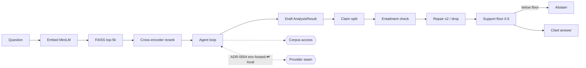
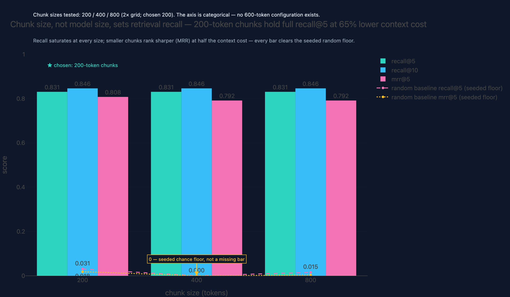

# 01 · RAG & Agentic AI Assistant

**Domain:** Agentic AI / LLM · **Data:** Wikipedia (HF, real) · **Status:** Flagship — complete

> A cited QA assistant over 593 pinned Wikipedia articles. Selected
> kimi-for-coding scores 46/65 correct with 17 unsupported-claim outcomes;
> sealed recall@5 falls from 0.831 to 0.600. Auditable, not unattended-ready.
>
> Teams routing questions at a knowledge base need answers they can audit —
> every claim traced to a source, every unsupported claim dropped or refused.
> This agent answers only from retrieved evidence with per-claim citations:
> retrieval recall@5 0.83 vs 0.03 random; selected `kimi-for-coding` reaches
> RAGAS faithfulness 0.7337 [0.6562, 0.8131], but 17/65 tuning answers still
> retain unsupported claims.
>
> [Case study source and interactive figures on GitHub →](https://github.com/amm-ds/portfolio/tree/main/projects/01-rag-agent)

A grounded question-answering agent over a curated topical slice of English
Wikipedia. A `pydantic-ai` agent answers **only** from retrieved evidence and
returns a structured `AnalysisResult` — summary, per-claim citations,
calibrated confidence. Per ADR-0004 (amended): env-configured
OpenAI-compatible endpoint first, local Ollama second (default
`qwen3.6:35b-a3b-q4_K_M`); no LLM SDK in the project, no runtime mock, and
`--offline` keeps a retrieval-only CI path.

The full runtime path, drawn as a graph — the dotted seam is the only LLM
boundary (ADR-0004), and the verify loop is a hard gate, not a prompt:

Retrieval runs CPU-only and unmetered (embed → FAISS exact search →
cross-encoder rerank); the agent's only corpus access is `search_documents` /
`read_excerpt`, and each drafted answer is claim-split, entailment-checked,
repaired (≤2 calls) or dropped before it ships — below the 0.6 support floor
the agent abstains.

## Pipeline

1. **Corpus** — bounded stream of `wikimedia/wikipedia` (`20231101.en`),
   five topics (Climate, Renewable energy, Aviation, Machine learning,
   Photosynthesis), ≤120 articles each plus exact-title anchors; DQ gates and a
   sha256-pinned dataset contract. Result: 593 articles.
2. **Index** — paragraph-aware chunking at 200/400/800 tokens →
   MiniLM-L6-v2 embeddings (L2-normalized) → FAISS `IndexFlatIP` per size;
   cross-encoder (`ms-marco-MiniLM-L-6-v2`) reranks the top 5×k on CPU.
3. **Agent** — tools `search_documents` / `read_excerpt` are the only corpus
   access; output schema is validated on every run and fails loudly.
4. **Evaluation** — 65 graded questions (44 single-hop, 11 multi-hop, 10
   unanswerable): recall@5/10 + MRR@5 sweep over chunk sizes, RAGAS +
   rubric-judge runs, a verify-then-answer A/B, per-query latency and
   estimated cost — all written to `reports/`.

## Key results (selected `kimi-for-coding`)

**Golden set: 65 graded questions** — 44 single-hop, 11 multi-hop, 10
unanswerable (expected behavior: abstain). Retrieval is provider-independent
(embeddings-only): recall@5 **0.831** / recall@10 0.846, MRR@5 0.808 vs a
0.031 random floor and a **0.677 word-match (lexical) floor** — word-matching
is the fair naive comparator (no model, yet it finds two-thirds of answers),
and embeddings beat it by **+0.154 recall@5**, which is the priced value of
the index. The chosen config (MiniLM, chunks=200, top_k=3, rerank ON)
holds full recall at −65% context cost.

{ width="100%" }

**Selected provider** — hosted `kimi-for-coding` wins the 65-question
comparison. Costs are **cloud-equivalent estimates** at the public kimi-k2.8
reference card ($1/Mtok in, $4/Mtok out, cached reads 30%): the key is
membership quota, so these are rate-card equivalents, **never billed amounts**.

| Metric | Selected `kimi-for-coding` (n=65) |
|---|---|
| Failure taxonomy | 46 correct / 17 unsupported-claim / 2 retrieval-miss / 0 format-failure |
| Rubric faithfulness / answer relevance | **0.6209 / 0.6458** (incumbent 0.5504 / 0.5573) |
| Rubric context recall | 0.9636 |
| RAGAS faithfulness (95% CI) | **0.7337 [0.6562, 0.8131]** |
| RAGAS answer relevancy | **0.8602** (small regression from 0.8775) |
| RAGAS context precision / recall | 0.7609 / 0.9826 |
| Refusal accuracy / false abstention / cite-when-expected | 1.0 / 0.0545 / 0.9636 |
| Answer latency p50 / p95 | 25.888 s / 108.836 s |
| Answer-generation cost | $0.000906/query before judge/verify costs |

Takeaway: retrieval is solid (recall@5 0.831 vs 0.031 random), so
**generation grounding is the bottleneck**. The selected provider improves
rubric faithfulness, answer relevance, and RAGAS faithfulness; the small RAGAS
answer-relevancy regression remains explicit. Judge and verify costs are
additional, and no replacement total tuning-suite cost is claimed. Figures and
run records are in `projects/01-rag-agent/reports/`.

### Held-out confirmation

All tuning numbers above come from the 65 tuning questions. A sealed
15-question held-out set — written fresh after tuning froze (8 single-hop, 2
multi-hop, 5 unanswerable), gated for corpus support, absent terms, and Jaccard
separation — is scored separately by `evaluate --heldout` without RAGAS and
reported under `metrics.json → detail.heldout`. Selected `kimi-for-coding`
reaches recall@5 **0.600**, recall@10 0.667, and MRR@5 0.567 (random 0.022).
On the 10 answerable questions, rubric faithfulness is 0.64, answer relevance
0.595, and context recall 0.9; all 5 required refusals succeed. The pass meters
**61 calls and $0.240699 cloud-equivalent**, with p50 28.025 s and p95 52.176 s.
The recall gap is a warning against generalizing from one Wikipedia slice.

## Links

- [Project README](https://github.com/amm-ds/portfolio/tree/main/projects/01-rag-agent/README.md) — results, reproduce instructions, client-facing summary
- [DESIGN.md](https://github.com/amm-ds/portfolio/tree/main/projects/01-rag-agent/DESIGN.md) — requirements, options considered (ChromaDB vs FAISS, reranking, provider abstraction), SLOs, failure modes
- Interactive report: `projects/01-rag-agent/reports/report.html`

## Data attribution

Corpus text is from Wikipedia (`wikimedia/wikipedia`, dump `20231101.en`),
licensed under
[CC BY-SA 3.0](https://creativecommons.org/licenses/by-sa/3.0/) and
[GFDL](https://www.gnu.org/licenses/fdl-1.3.html); content remains the property
of its authors. Article selection and all transformations are reproducible via
`dvc repro` in the project directory.
