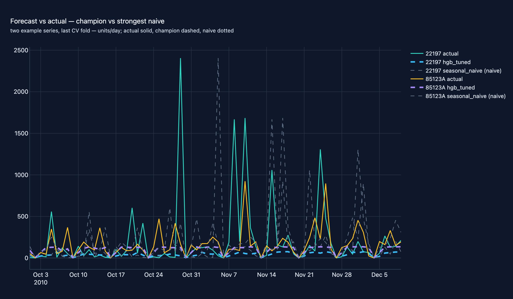

# 02 · Hierarchical Demand Forecasting

**Domain:** time-series forecasting · **Data:** UCI Online Retail II (primary
real track; seeded synthetic hierarchy as the labelled CI fast path) ·
**Status:** working showcase on the standard platform (flagships: [01](01-rag-agent.md), [07](07-open-data-mobility.md))

> A retailer stocking 200 products across 8 countries needs daily unit
> forecasts it can trust for replenishment — every point of error is working
> capital or lost sales. On real transactions, under a frozen holdout
> protocol (champion selected on origins 1..n-1, final quarter scored once),
> the nowcast champion runs at **0.843 relative MAE of the seasonal-naive
> floor** (9.545 vs 11.323 MAE; MASE 1.078 vs the naive's own 1.310 — the
> MASE scale is the naive's in-sample error from a quieter period, so 1.0 is
> not parity on this window); no run dips below MASE 1.0 there — stated, not
> smoothed over. The wave-19 rebuild made the experiment genuinely
> multi-step (direct per-horizon models on weekly origins, protocol
> `direct_multihorizon_v1`, now the primary headline), wave 20 answered
> the peak-capture feedback with peak features plus two peak-capable
> candidates (tweedie HGB, hurdle two-stage HGB) in the per-class router,
> and wave 22 added the missing baselines (ma_28, ADIDA pair) and the
> rmae/rmsse/newsvendor metric layer:
> on the 98.6% of series that are lumpy the routed pipeline beats the
> boosted ladder by **3.98 MAE** (95% CI [3.34, 4.76]) while the peak-capable
> models take over all 15 erratic series — and the new baselines lose
> honestly (all behind the zero forecast, matching the independent
> collapseindex/online-retail-forecast benchmark on the same dataset where
> seasonal-naive wins) — see *Key results*.
>
> [Interactive case study with figures →](https://github.com/amm-ds/portfolio/tree/main/projects/02-demand-forecasting)

## What it shows

Leakage-safe, production-depth forecasting on a store-by-product hierarchy: lag
features built with `shift` (never the current row), calendar features, and
global models with one-hot series identity — naive floors, seasonal-naive and
per-series ETS statistical baselines, a Ridge baseline, default + Optuna-tuned
gradient boosting (sklearn HGB, XGBoost, LightGBM arms), and a hand-written
PyTorch embedding+MLP, all through the identical embargoed expanding-window
`TimeSeriesCV` (4 folds, 7-day purge gap). Seeded Optuna HPO (resumable,
checkpointed), MinT-lite hierarchical reconciliation with a tested coherence
guarantee, and probabilistic 80% bands.

## Key results (frozen holdout: test window scored once)

Real-data track — UCI Online Retail II (top 8 countries × top 200 products,
374 days, 405,416 panel rows, 89% zero share; MAE/MASE lead, MAPE reported but
not decision-grade at this zero share). The table is scored on the final
rolling-origin window (2010-10-01..2010-12-09, the holiday quarter); the
champion was selected on origins 1..3 only and every run is scored exactly
once on the test window. *How to read: lower is better everywhere; MASE
divides by the seasonal-naive's in-sample error (fit on a quieter period —
the naive itself scores 1.310 on this window, so 1.0 is not parity here);
read Δ MASE vs sn for parity with "same day last week"; bold = selected
champion.*

| run | MAE | RMSE | MAPE | MASE | Δ MAE vs sn | Δ MASE vs sn |
|---|---|---|---|---|---|---|
| naive_mean (floor) | 12.475 | 74.699 | 90.3% | 1.382 | +1.152 | +0.072 |
| naive_last (persistence) | 11.505 | 99.548 | 327.6% | 1.331 | +0.182 | +0.021 |
| seasonal_naive (lag-7) | 11.323 | 114.921 | 305.4% | 1.310 | 0.000 | 0.000 |
| ETS (Holt-Winters, damped+weekly) | 11.471 | 80.827 | 302.7% | 1.338 | +0.148 | +0.028 |
| ridge | 12.384 | 72.680 | 221.7% | 1.395 | +1.061 | +0.085 |
| hgb (default sklearn) | 9.565 | 71.700 | 260.3% | 1.085 | −1.758 | −0.225 |
| **hgb_tuned (Optuna, 56 trials) ← best** | **9.545** | **71.847** | **230.0%** | **1.078** | **−1.778** | **−0.232** |
| xgb_tuned (Optuna, 25 trials) | 9.804 | 73.287 | 277.2% | 1.118 | −1.519 | −0.192 |
| lgbm_tuned (Optuna, 25 trials) | 9.409 | 71.360 | 272.3% | 1.076 | −1.914 | −0.234 |
| temporal_net (PyTorch emb+MLP) | 11.770 | 71.849 | 183.6% | 1.305 | +0.447 | −0.005 |

*Δ vs seasonal_naive (sn) per row — negative means the run beats "same day
last week" on that metric; the best row is marked ← best.*

{ width="100%" }

Synthetic track — seeded CI fast path (24 series × 4 origins, seed 42; note
what clean data does to the statistical baselines). Same frozen protocol: bars
are test-window numbers, champion selected on origins 1..3. *How to read: same
metrics on clean seeded data; bold = track champion (ETS overall; temporal_net
edges the ML pack on this window by 0.1 units — fold-noise level).*

| run | MAE | RMSE | MAPE | MASE |
|---|---|---|---|---|
| naive_mean (floor) | 35.946 | 48.639 | 48.26% | 3.755 |
| naive_last (persistence) | 16.223 | 22.238 | 19.47% | 1.695 |
| seasonal_naive (lag-7) | 11.780 | 16.689 | 13.98% | 1.231 |
| **ETS (Holt-Winters, damped+weekly)** | **8.924** | **12.691** | 10.37% | **0.932** |
| ridge | 9.705 | 13.706 | 11.92% | 1.014 |
| hgb | 9.549 | 13.380 | 11.58% | 0.998 |
| hgb_tuned (Optuna, 56 trials) | 9.472 | 13.269 | 11.51% | 0.990 |
| xgb_tuned (Optuna, 25 trials) | 9.525 | 13.372 | 11.59% | 0.995 |
| lgbm_tuned (Optuna, 25 trials) | 9.341 | 13.101 | 11.31% | 0.976 |
| temporal_net (PyTorch emb+MLP) | 9.244 | 12.908 | 11.38% | 0.966 |

- **Cross-track rankings reversed under the frozen protocol — in both
  directions**: the old pooled ladder claimed the best synthetic ML run
  ranked fourth on real data; on the one-shot test window
  `lgbm_tuned` posts the best MAE of all runs (9.409, ahead of the selection
  champion 9.545 — a 1.4% gap inside fold noise), while the synthetic overall
  champion `ets` ranks 6th on UCI (11.471). Configs tuned on clean synthetic
  demand behave differently on intermittent real demand; neither pooled nor
  single-window rankings should be read as more than what they are.
- ETS wins the synthetic test window outright (MASE 0.932) and loses to its
  own seasonal naive on UCI (11.471 vs 11.323, MASE 1.338) — 89% zeros break
  the smooth-seasonality assumption. Both verdicts reported.
- HPO improved on hgb in **every** fold on synthetic (8.619 → 8.529, −1.0%
  pooled legacy); on the synthetic test window the NN edges every ML run
  (9.244) without threatening ETS — reported, not hidden.
- Probabilistic 80% band, coverage AND width on the test window: quantile
  band 0.727 synthetic / 0.919 UCI (pooled); zero-aware split-conformal
  horizon set **0.741 synthetic (avg width 26.5 units, under-covers) / 0.861
  UCI (avg width 0.00 — degenerate)** against the 0.80 target. On UCI the
  champion's median forecast is 0 on ~100% of rows, so the band collapses to
  the point forecast — the honest limit, stated on the figure, whose buttons
  drop the band interactively.
- **Multi-step headline (wave 19 rebuild + wave 20 peak candidates + wave 21
  LightGBM arms/ensemble/win rates + wave 22 baselines/metrics, PRIMARY —
  `direct_multihorizon_v1`)**: direct per-horizon models on the full h ∈
  {1..14} lattice (one real direct-h fit per window day) on 20 weekly rolling
  origins (16 selection + 4 scored once, no embargo gap; features aged ≥ h
  days at target−h — calendar + a peak block (7/14/28d rolling mean/max,
  days-since-last-nonzero, 28d non-zero count, 28d peak ratio) + wave-21
  price/trading-cycle features + a wave-22 rolling block (rmean7/14/28,
  rstd14/28) + aged lags, taint-tested). ADI/CV² routing: 1,069 of 1,084
  series are lumpy and choose among the statistical methods (zero,
  seasonal_naive, Croston, SBA, TSB, ma_28, adida_sba, adida_tsb) plus six
  peak-capable ML candidates — `hgb_tweedie`, `hurdle_hgb`, `lgbm_tweedie`,
  `hurdle_lgbm`, `peak_weighted_hgb` and the honestly-losing `lgbm_poisson`
  (exp-link overflow, finite-prediction guard; 107.17 pooled MAE) — while
  the 15 erratic series choose among the direct HGB and the same ML pool
  (all 15 route to ML: 10 hurdle, 3 peak-weighted, 2 tweedie). Lumpy
  champion vs floor: **6.09 vs 11.07 MAE at h=7** (95% paired-bootstrap CI
  [−7.74, −2.88]), 5.80 vs 10.64 at h=14; routing beats the unrouted all-HGB
  ladder by 3.98 MAE (CI [3.34, 4.76]) with zero the most-picked method (945
  of 1,069 lumpy series). The wave-22 baselines lose honestly: pooled MAE
  ma_28 9.94, adida_tsb 9.98, adida_sba 10.73, routed_reconciled 9.97 — all
  behind zero (9.28), consistent with the independent
  [collapseindex/online-retail-forecast](https://github.com/collapseindex/online-retail-forecast)
  benchmark where seasonal-naive wins on the same dataset. On erratic the
  peak-capable models cut peak-day MAE to 278.7–295.1 vs zero 367.3 (routed
  285.6); on lumpy tweedie cuts peak-day MAE to 28.1 (vs zero 33.7) while
  trading top-5 day-ranking recall (0.44 vs 0.88) — the peak_capture block
  carries every delta with a paired bootstrap CI. Error grows with the true
  horizon (pooled 0.08 → 6.40, h=1 → h=14). Per-horizon bands report
  coverage AND width per h (pooled 0.918, conservative — sparse
  P(sale)+ladder bands never collapse; the ML candidates carry their own
  conformal bands, pooled 0.909). The wave-22 metric layer adds rmae
  (champion 0.649 vs the floor's 1.000), per-candidate M5-convention rmsse
  (routed 0.520 pooled) and a newsvendor order-quantile cost simulation
  (holding 1.0 / stockout 3.0 per unit-day, documented assumption): at
  q=0.90 erratic 1.820 vs 1.727 cost/unit against, lumpy 2.370 vs 2.243
  against; at q=0.95 erratic flips in routing's favour (−0.137, CI excludes
  zero) — MAE-optimal routing over-orders at high service levels on
  spike-driven demand; simulation, no savings claims. The earlier
  order-up-to layer (τ=0.90, holding 0.25 / stockout 4.0) tells the same
  story: erratic 1.422 vs 1.510 for the champion, lumpy 2.874 vs 2.777
  against. The nowcast ladder above stays committed as
  the labelled one-day-ahead track.
- UCI reconciliation: w=0.75 this run, incoherence 536.7 → 134.2 (coherence
  property exact); store MAE 749.1 → 719.8. Synthetic: w=0.00 this run (store
  MAE 24.133 → 24.133, incoherence 26.688 → 26.688), accuracy effect null and
  reported as such.
- 6/6 DQ gates on both tracks; synthetic evaluate ≈ 2 min, UCI ≈ 30 min
  (multi-step the bulk of it — 14 model fits × 14 horizons × 20 origins,
  joblib-parallel);
  161 offline tests.

{ width="100%" }

## Artifacts

- Figures: interactive versions live in the [showcase app case study](https://github.com/amm-ds/portfolio/tree/main/projects/02-demand-forecasting);
  static artifacts (`.html` + `.json`, per track) in `reports/figures/` and `reports_uci/figures/`
- Metrics: `reports/metrics.json` (+ `_uci`, with `_meta` protocol block and
  `legacy_pooled_*`) · Protocol: `evaluation_metadata.json` · Report:
  `report.html` · Reconciliation: `reconciliation.json` · Probabilistic:
  `probabilistic.json` (per-horizon coverage/width + verdict) ·
  Data-generating process: `dataset_metadata.json` (UCI)
- Dataset cards: `data/dataset.json`, `data_uci/dataset.json` · HPO:
  `data/hpo_best.json` (+ `hpo_study.db`) · Story: `story.yaml`

## Links

- [Project README](https://github.com/amm-ds/portfolio/tree/main/projects/02-demand-forecasting/README.md) — problem,
  design summary, real numbers, reproduce commands, client takeaways, roadmap
- [DESIGN.md](https://github.com/amm-ds/portfolio/tree/main/projects/02-demand-forecasting/DESIGN.md) — requirements,
  options considered (global vs per-series, validation protocol, HPO, NN,
  reconciliation), pipeline diagram, changelog
- Dataset card: [UCI Online Retail II](../data-registry/uci-online-retail-ii.md)
- Drift response runbook: [drift-response.md](../runbooks/drift-response.md)
- Source: `projects/02-demand-forecasting/src/demand_forecasting/`
