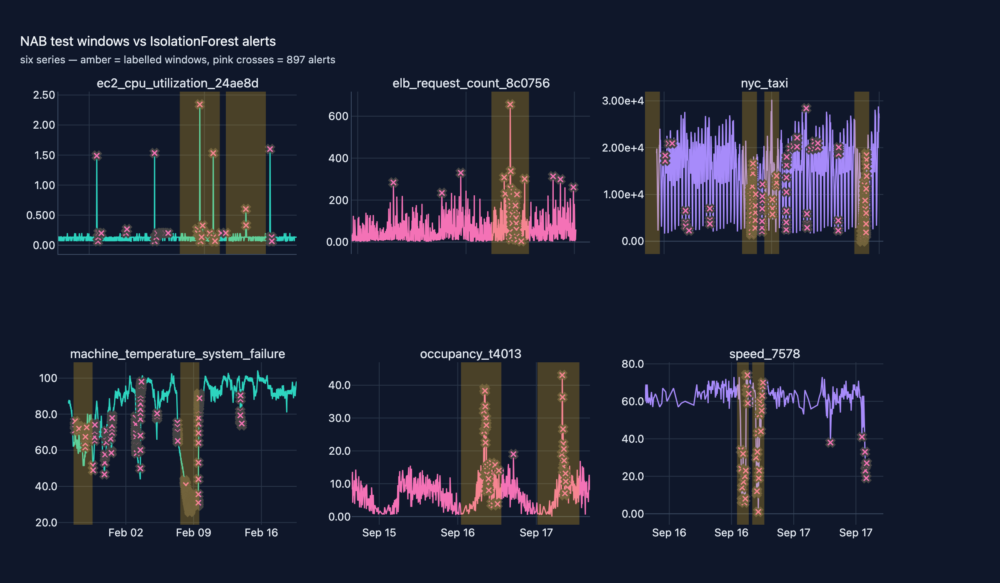

# 03 · Anomaly Detection over Telemetry

**Domain:** anomaly detection / systems monitoring · **Data:** Numenta Anomaly
Benchmark (12 series; seeded synthetic telemetry as the labelled CI fast path;
NSL-KDD transfer probe) · **Status:** working showcase

> On 9 NAB series, IsolationForest touches 16 of 17 incidents but fires 1,609 alerts. Merging bursts and capping one page per series per day cuts that to 80 pages. Averaging three detectors halves 66 pages to 35 at the same recall (0.604). No official NAB score yet.
>
> [Case study source and interactive figures on GitHub →](https://github.com/amm-ds/portfolio/tree/main/projects/03-anomaly-detection)

Unsupervised anomaly detection on 12
[Numenta Anomaly Benchmark](https://github.com/numenta/NAB) series, with a
seeded synthetic stream for pipeline checks and NSL-KDD only as a non-transferable
contract probe. Nine NAB series have incidents in the scored span; three have
labels only in training and leave the incident aggregates. Range recall instead
averages over all 12 series, counting those three as zero. Windows touched and
range recall therefore have different denominators.

## NAB headline (9 evaluable series, 17 incident windows)

`nab_timelines` shows six representative series: amber bands are incidents and
pink crosses are raw IsolationForest alerts. Compare crosses inside and outside
the bands to see detection and false-page load; the 897 alerts in these panels
do not prove production readiness.

{ width="100%" }

| NAB group | pointwise PR-AUC | range-F1 | windows touched (raw alerts) |
|---|---:|---:|---:|
| realAWSCloudwatch | 0.404 | 0.088 | 3/3 (132) |
| realKnownCause | 0.438 | 0.074 | 8/9 (1,289) |
| realTraffic | 0.728 | 0.310 | 5/5 (188) |
| **overall** | **0.527** | **0.157** | **16/17 (1,609)** |

The range-PR sweep gives area 0.804 against a 16-seed no-skill band of 0.228
[0.081, 0.401]. At a 2% stream budget it reports precision 0.527 and recall
0.944 over evaluable windows; these threshold-sweep values are not the raw
headline's range precision 0.107 or twelve-series range recall 0.729.

## Alert budgeting and the recommended detector

Deduplication emits one page per contiguous burst; the budgeted stream adds at
most one page per series per 24 hours. Compare raw and budgeted values within
each row, not across different feature sets:

| detector and feature cell | raw → budgeted pages | range recall | range-F1 |
|---|---:|---:|---:|
| IsolationForest + rolling | 1,864 → 66 | 0.729 → 0.604 | 0.154 → 0.388 |
| IsolationForest + rolling+residual | 1,609 → 80 | 0.729 → 0.562 | 0.157 → 0.315 |
| **rank-average ensemble + rolling** | **1,157 → 35** | **0.729 → 0.604** | **0.485 → 0.533** |
| rank-average ensemble + rolling+residual | 1,003 → 45 | 0.729 → 0.562 | 0.316 → 0.365 |

The recommended detector is the ensemble on rolling features at the frozen (2%,
24 h) default. Against IsolationForest on that same budgeted rolling stream,
it cuts 66 pages to 35, raises range-F1 0.388 → 0.533 and range precision
0.347 → 0.553, and holds range recall at 0.604. Nearly half of its pages still
fall outside incidents. The 1,609 → 80 headline is a different feature cell
and compares raw with budgeted load; it is not a 1,609 → 35 ensemble claim.

Train-side tuning adopts (0.5%, 24 h) for IsolationForest, reducing its rolling
and rolling+residual cells to 33 and 46 pages. The ensemble's best validation
gain is only +0.010, below the +0.05 adoption margin, so it keeps its default.
Six validation windows cannot certify OCSVM's fragile peak.

## Non-headline datasets and rejected refinements

- The synthetic test window has 5,983 rows at 1.89% prevalence. Validation
  PR-AUC selects tuned OCSVM before test scoring; its test AP is 0.136. Large
  residual-feature gains (0.9999 ROC-AUC / 0.9960 PR-AUC) do not transfer to NAB.
- `adaptive_stream` shows no drift trigger on five synthetic chunks, while the
  same synthetic-calibrated rule fires on 31 of 120 real NAB chunks. Adaptive
  thresholds remain rejected, not drift-ready.
- NSL-KDD has 56.9% prevalence and different network-flow semantics. Its probe
  scores cannot establish transfer to rare telemetry.
- Context calibration and two IsolationForest+LOF fusion variants fail the joint
  precision, range-F1, and 16/17 coverage gate. The best fusion reaches
  range-F1 0.403 but touches only 14/17 windows.

## Artifacts

- NAB metrics: `reports/nab_metrics.json` · NAB sweep + alert budgets: `reports/nab_sweep.json` · train-side operating-point tuning: `reports/nab_tune.json` · synthetic ladder: `reports/metrics.json` (7 runs)
- Probes: `reports/detect.json` (adaptive stream), `reports/residual_probe.json`,
  `reports/nsl_probe.json`
- Evaluation report: `reports/report.html`
- Figures: interactive versions live in the [case study on GitHub](https://github.com/amm-ds/portfolio/tree/main/projects/03-anomaly-detection);
  static artifacts (HTML + JSON) in `reports/figures/`
- DQ report: `reports/dq_report.html` — 8/8 gates passing

## Pipeline

`prepare → validate → features → train → tune → evaluate → detect →
residuals → nsl → nab`, each a Typer command (`uv run python -m
anomaly_detection.cli all` runs everything) and a DVC stage
(`dvc repro projects/03-anomaly-detection`).
