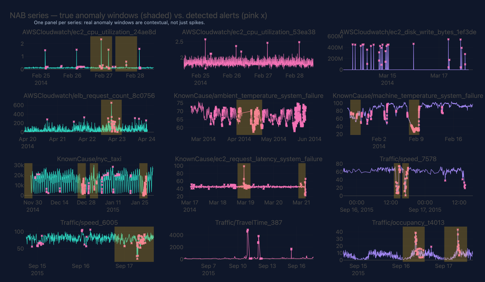

# 03 · Anomaly Detection over Telemetry

**Domain:** anomaly detection / systems monitoring · **Data:** Numenta Anomaly
Benchmark (12 series; seeded synthetic telemetry as the labelled CI fast path;
NSL-KDD transfer probe) · **Status:** working showcase

> On-call engineers pay for missed incidents in outage multiples and for
> false pages in alert fatigue — the detector choice is a budget question.
> On real NAB telemetry the champion finds 16 of 17 labelled events (range
> recall 0.729), but at 0.107 range precision the firehose is the remaining
> problem.
>
> [Interactive case study with figures →](https://github.com/amm-ds/portfolio/tree/main/projects/03-anomaly-detection)

Unsupervised anomaly detection, **real data first**: 12 series from the
[Numenta Anomaly Benchmark](https://github.com/numenta/NAB) (AWS CloudWatch,
traffic sensors, known-cause system failures; [dataset
card](https://amm-ds.github.io/portfolio/data-registry/nab/)) evaluated with
event-based metrics — PR-AUC and range-F1 lead, ROC-AUC secondary. A seeded
synthetic telemetry stream (CPU, memory, latency) remains the clearly-labelled
CI / fast path. Three classical detectors compete behind data-quality gates
with time-ordered splits, seeded HPO, adaptive-threshold streaming, residual
features, and an NSL-KDD transfer probe.

Working showcase on the standard platform — see the project
[README](https://github.com/amm-ds/portfolio/tree/main/projects/03-anomaly-detection/README.md) for the full write-up
and [DESIGN.md](https://github.com/amm-ds/portfolio/tree/main/projects/03-anomaly-detection/DESIGN.md) for the
detector-failure and real-vs-synthetic analysis.

## NAB headline (event-based, 9 of 12 series evaluable)

*How to read: PR-AUC rewards alerts inside labelled windows; range-F1 scores
whole events; "events" = detected/total with the alert count at a fixed 2%
budget; bold = overall champion.*

{ width="100%" }

| family | PR-AUC | range-F1 | range prec./rec. | events |
|---|---|---|---|---|
| realAWSCloudwatch | 0.404 | 0.088 | 0.049 / 0.500 | 3/3, 132 alerts |
| realKnownCause | 0.438 | 0.074 | 0.040 / 0.938 | 8/9, 1 289 alerts |
| realTraffic | 0.728 | 0.310 | 0.232 / 0.750 | 5/5, 188 alerts |
| **overall** | **0.527** | **0.157** | **0.107 / 0.729** | **16/17, 1 609 alerts** |

The honest delta vs. the synthetic track (PR-AUC 0.916, residuals 0.9999):
injected synthetic anomalies are trivially separable; on real data the
champion finds most events (recall 0.73) but the remaining problem is the
false-positive firehose (precision 0.107). On the synthetic run ladder,
`tuned OCSVM` is the PR-AUC champion (0.136) after a 0.34 → 0.91 tuning
rescue; LOF's local-density blindness is structural and tuning-resistant.

## Artifacts

- NAB metrics: `reports/nab_metrics.json` · synthetic ladder: `reports/metrics.json` (7 runs)
- Probes: `reports/detect.json` (adaptive stream), `reports/residual_probe.json`,
  `reports/nsl_probe.json`
- Evaluation report: `reports/report.html`
- Figures: interactive versions live in the [showcase app case study](https://github.com/amm-ds/portfolio/tree/main/projects/03-anomaly-detection);
  static artifacts (HTML + JSON) in `reports/figures/`
- DQ report: `reports/dq_report.html` — 8/8 gates passing

## Pipeline

`prepare → validate → features → train → tune → evaluate → detect →
residuals → nsl → nab`, each a Typer command (`uv run python -m
anomaly_detection.cli all` runs everything) and a DVC stage
(`dvc repro projects/03-anomaly-detection`).
