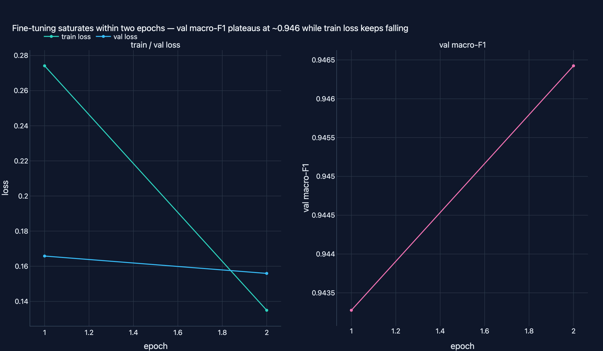
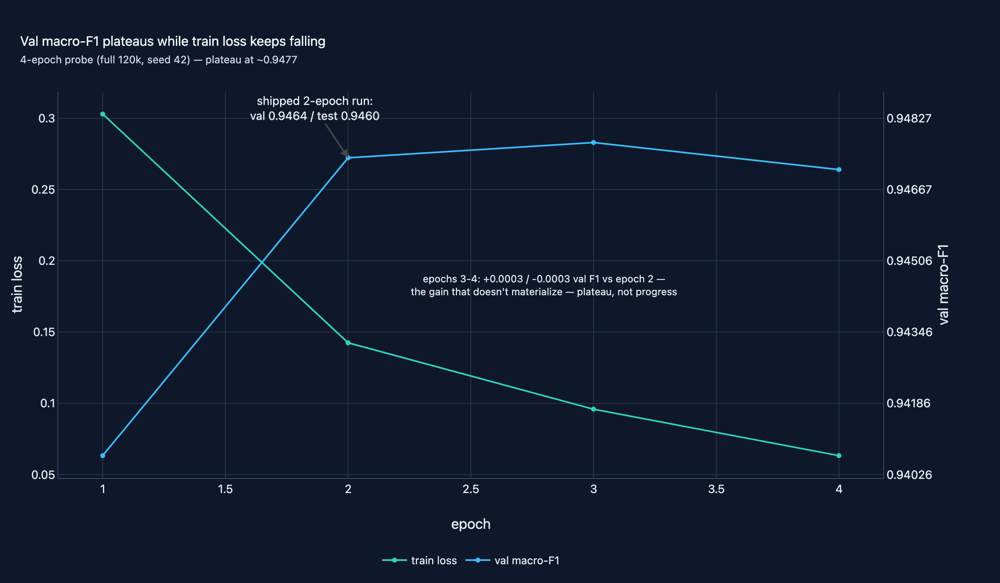
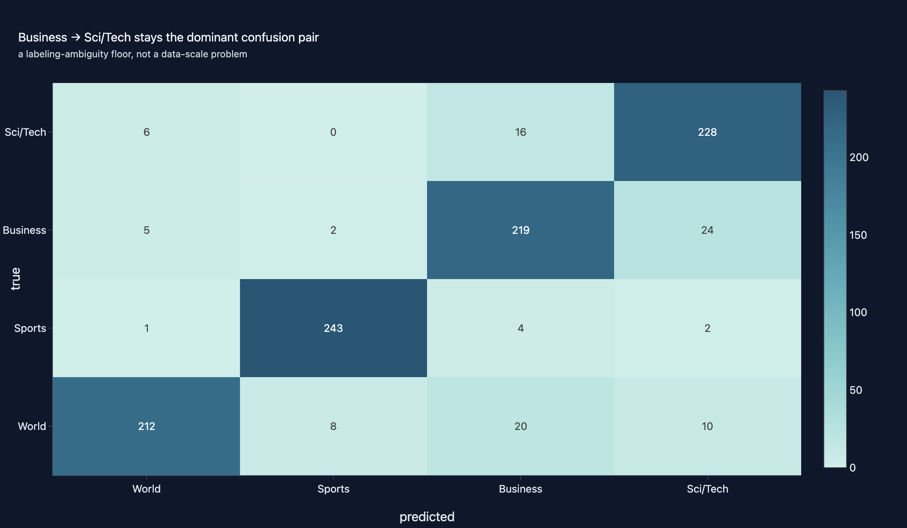

# 04 · NLP Classification with Transformers

**Domain:** Deep learning NLP · **Data:** AG News (real, HuggingFace `fancyzhx/ag_news`) ·
**Status:** Working showcase

> Newsrooms, aggregators, and compliance teams routing a continuous stream of
> headlines need topic triage that keyword rules break on at the first
> unfamiliar wording. A full-data DistilBERT fine-tune on a laptop GPU
> reaches **0.9460 test macro-F1**, ~7.5 pp above the strong TF-IDF baseline.
>
> [Interactive case study with figures →](https://github.com/amm-ds/portfolio/tree/main/projects/04-nlp-classification)

Fine-tuned transformers vs. a TF-IDF + LogisticRegression baseline on news
topic classification — a hand-written PyTorch training loop, seeded Optuna
HPO, a second encoder candidate, audited model selection, and a full 120k
fine-tune on Apple-Silicon MPS.

## Key results

**Headline:** the full 120k fine-tune of DistilBERT on Apple-Silicon MPS
(laptop GPU, seed 42, 2 epochs, val macro-F1 0.9433 → 0.9464 during training)
reaches **0.9460 test macro-F1** on the same untouched 1,000-row stratified
test split as every other run, at ~18–27 min/epoch measured.

*How to read: every run is scored on the same untouched 1,000-row stratified
test split; rows are historical rungs of one scaling ladder, not separate
experiments; bold = headline.*

| Run | Accuracy | F1 macro |
|---|---|---|
| `naive_majority` | 0.2500 | 0.1000 |
| `random_uniform` | 0.2540 | 0.2533 |
| `baseline_tfidf_logreg` | 0.8720 | 0.8714 |
| `encoder_b` (roberta-base) | 0.8980 | 0.8982 |
| `distilbert` (bounded 3.6k) | 0.9020 | 0.9021 |
| `distilbert_tuned` (bounded 3.6k) | 0.9020 | 0.9021 |
| `distilbert_fulldata_20k` | 0.9270 | 0.9270 |
| `distilbert_full_120k` | **0.9460** | **0.9460** |

The older bounded numbers are historical rungs of one scaling ladder
(0.9021 → 0.9270 → 0.9460, +4.4 pp from bounded to full data). HPO improved
validation macro-F1 (0.8880 → 0.8953) but the gain sat inside seed noise
(mean 0.8910 ± 0.0042 over 3 seeds) and did not transfer to test — the
honesty rule kept the original artifact as `distilbert_tuned`.

**Serving economics** (probe-hardware numbers, not the headline — measured
on this machine, an Apple M4 Max, CPU, torch 2.14.1, 12 threads; batch=1
end-to-end, n=200 predictions per variant; cost at a declared $1/M-input +
$4/M-output rate card, ~51.5 in + ~3.5 out tokens per prediction; accuracy
from the committed test-split metrics, int8 measured on a 2000-row train
sample — single-machine probe figures, not production benchmarks):

| Variant | Size (MB) | p50 latency (ms) | Throughput (pred/s) | Cost ($/1k preds) | Accuracy | F1 macro |
|---|---|---|---|---|---|---|
| `tfidf_logreg` | 0.5 | 0.2 | 4477.8 | 0.0000 | 0.8720 | 0.8714 |
| `distilbert_tuned` fp32 (bounded) | 255.5 | 9.0 | 110.7 | 0.0656 | 0.9020 | 0.9021 |
| `distilbert_full_120k` fp32 | 255.5 | 8.7 | 112.5 | 0.0654 | 0.9460 | 0.9460 |
| `distilbert_full_120k` int8 (dynamic) | 132.3 | 13.2 | 77.6 | 0.0654 | 0.9635 | 0.9637 |

Dynamic int8 (`torch.quantization.quantize_dynamic`, qnnpack on arm64)
halves model size with no measured quality loss (sample macro-F1 0.9627 →
0.9637, Δ +0.0010) but is slower than fp32 at batch=1 on Apple Silicon —
quantization buys memory, not speed, here. Data:
`projects/04-nlp-classification/reports/latency_probe.json`.

{ width="100%" }

Two epochs is a measured budget, not an assumption: a 4-epoch probe with
early stopping disabled (same hypers, seed 42;
`projects/04-nlp-classification/reports/history_probe4.json`) peaks at val
macro-F1 0.9477 in epoch 3 — +0.0003 over epoch 2, −0.0003 by epoch 4 —
while validation loss climbs again and train loss keeps falling. Epochs 3-4
overfit rather than improve. Both history files are from the **full 120k
data**, not the bounded subsample: `history_fulldata.json` is the shipped
headline run (2 epochs, val macro-F1 0.9433 → 0.9464), `history_probe4.json`
is the 4-epoch probe of the same full-data fine-tune (early stopping
disabled) — read the probe as "extra epochs overfit", not as a better result.

{ width="100%" }

Temperature
scaling cuts test ECE 0.047 → 0.013 for free. The dominant confusion pair,
Business → Sci/Tech (24/250 → 15/250 → 14/250 across the curve), is a
labeling-ambiguity floor, not a data-scale problem. Representative
misclassifications of the selected model (`distilbert_tuned`, wave-2
artifact) on the untouched 1,000-row bounded test split — reproduced from
the committed artifact + test split, bit-matching `metrics.json`; full list
in `reports/misclassification_examples.json`:

| text snippet | true | predicted |
|---|---|---|
| "Amazon Snaps Up China's Largest Web Retailer (NewsFactor) … will buy Joyo.com Limited --…" | Business | Sci/Tech |
| "India's Tata makes powerful debut Shares in Indian software services giant Tata Consultancy close 16 higher…" | World | Business |
| "Dell Exits Low-End China Consumer PC Market HONG KONG (Reuters) - Dell Inc., the world's largest PC maker…" | Sci/Tech | Business |
| "U.S. Misses Cut in Olympic 100 Free ATHENS, Greece - Top American sprinters Jason Lezak and Ian Crocker…" | World | Sports |

Full ladder:
`projects/04-nlp-classification/reports/metrics.json`; decision record:
`reports/selection.json`; interactive figures in `reports/figures/`.

{ width="100%" }

## Artifacts

- `projects/04-nlp-classification/README.md` — problem, run ladder, HPO and
  selection narrative, reproduce commands, client takeaways
- `projects/04-nlp-classification/DESIGN.md` — requirements, options
  considered, bounded-data contract, pipeline diagram, changelog
- `projects/04-nlp-classification/story.yaml` — 8-section case study served by
  the showcase API
- `projects/04-nlp-classification/reports/report.html` — standalone themed
  evaluation report

## Reproduce

```bash
uv run python -m nlp_classification.cli all   # prepare → baseline → train-nn → hpo → tuned → encoder-b → evaluate
```

Bounded data contract: 4,000 train / 1,000 test, stratified, seeded for the
CPU ladder — documented in DESIGN.md. The headline run uses the full AG News
train split (120k rows) via `train-nn --full-data` on an accelerator
(Apple-Silicon MPS on this machine). Dataset card:
[data-registry/ag-news](https://amm-ds.github.io/portfolio/data-registry/ag-news/).
