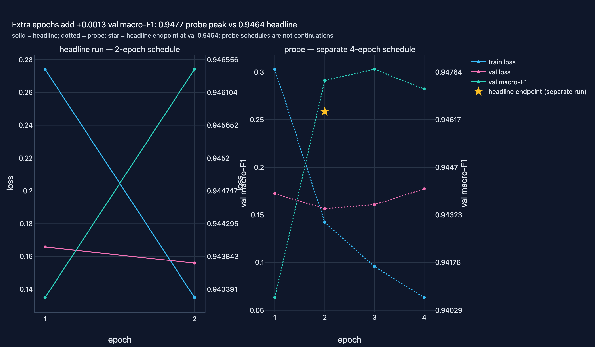
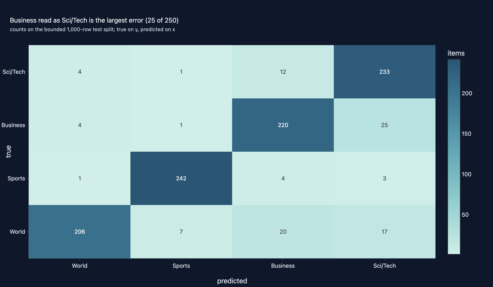

# 04 · NLP Classification with Transformers

**Domain:** Deep learning NLP · **Data:** AG News (real, HuggingFace `fancyzhx/ag_news`) ·
**Status:** Working showcase

> AG News sorter: the selected transformer + selective LLM cascade shows no measurable change in fresh macro-F1 (0.953 → 0.954, +0.001) and accuracy (0.953 → 0.954), reviewing 22 of 1,000 fresh items. Full evaluation: $0.023671 cloud-equivalent. License: research purposes.
>
> [Case study source and interactive figures on GitHub →](https://github.com/amm-ds/portfolio/tree/main/projects/04-nlp-classification)

The cascade delta is +0.001 macro-F1 — no measurable change, not established
superiority: no paired cascade interval can be computed from committed
artifacts (the per-row review decisions are not persisted), and the dollar
figure is a rate-card
estimate rather than an observed cloud bill.

The task is to sort English headline-plus-description items into four topics.
A transformer predicts every item; only predictions below the validation-fitted
confidence threshold τ=0.6 receive batched LLM review. TF-IDF + logistic
regression remains the cheaper baseline.

## Acceptance gates

- Select the bounded candidate and cascade threshold on validation data only;
  keep the bounded test and disjoint fresh holdout out of those decisions.
- Compare accuracy and macro-F1 on the same fixed splits. Macro-F1 gives each
  topic equal weight.
- Report selective-review counts, latency, and estimated token cost beside the
  quality delta; do not claim superiority without paired uncertainty.

## Key results

The full 120k fine-tune of DistilBERT (seed 42, two epochs) reaches **0.9460
macro-F1** on the shared 1,000-row bounded test split and **0.9529** on the
disjoint 1,000-row fresh holdout. The ladder below uses the same bounded test
split; the rows are historical rungs, not independent experiments.

| Run | Accuracy | F1 macro |
|---|---|---|
| `naive_majority` | 0.2500 | 0.1000 |
| `random_uniform` | 0.2540 | 0.2533 |
| `baseline_tfidf_logreg` | 0.8720 | 0.8714 |
| `encoder_b` (roberta-base) | 0.8980 | 0.8982 |
| `distilbert` (bounded 3.6k) | 0.9020 | 0.9021 |
| `distilbert_tuned` (bounded; validation-selected HPO) | 0.9010 | 0.9011 |
| `distilbert_full_120k` | **0.9460** | **0.9460** |

Validation selects the HPO candidate by +0.0073 macro-F1, but its paired 95% CI
[−0.0048, +0.0204] crosses zero. The tuning result is therefore inconclusive.
Three seeded searches average 0.8910 ± 0.0042 validation macro-F1.

### Selected cascade

At τ=0.6, only lower-confidence full-data transformer rows go to LLM review,
batched eight rows per call. Test and fresh are scored after the threshold is
frozen; the fresh 1,000 are disjoint from bounded test.

| Split | Transformer macro-F1 → cascade | Accuracy → cascade | Reviews |
|---|---:|---:|---:|
| Validation | 0.9601531 → 0.9602051 | 0.960 → 0.960 | 6 |
| Bounded test | 0.9460236 → 0.9490153 | 0.946 → 0.949 | 16 |
| Fresh holdout | 0.9529432 → 0.9539265 | 0.953 → 0.954 | 22 |

The 44 total reviews take 96.933 s and an estimated $0.023671 cloud-equivalent
across validation, test, and fresh. The keyword-first router remains the cheaper
alternative at 0.9061 fresh macro-F1, with 75.4% of items staying on the keyword
path. Neither router's small point gains establish superiority without a paired
interval. Exact artifact: `projects/04-nlp-classification/reports/llm_cascade.json`.

### Controlled data scale

The scale ladder holds the device, seed, and hyperparameters fixed. Each tripling
of training rows adds +1.5 / +1.6 / +1.3 macro-F1 points on bounded test and
+1.5 / +2.1 / +1.0 on fresh. Same-rows CPU/MPS twins differ by 0.0002 test
macro-F1, so device choice does not explain the scale gain.

| Train rows | Run | Device | Val F1 | Test macro-F1 | Fresh macro-F1 |
|---|---|---|---|---|---|
| 3.6k | `distilbert` (earlier bounded config) | CPU | 0.8880 | 0.9021 | 0.8962 |
| 3.6k | `distilbert_scale_4000` | MPS | 0.8849 | 0.9019 | 0.9067 |
| 10.8k | `distilbert_scale_12000` | MPS | 0.9120 | 0.9170 | 0.9219 |
| 36k | `distilbert_scale_40000` | MPS | 0.9320 | 0.9331 | 0.9428 |
| 108k | `distilbert_full_120k` | MPS | 0.9464 | **0.9460** | 0.9529 |

### Training, calibration, and errors

In `training_curve`, read the two histories separately: the solid two-epoch
headline run and the dotted four-epoch probe have different learning-rate
schedules. The star marks only the headline endpoint. The probe peaks at
validation macro-F1 0.9477 in epoch 3, then declines while validation loss
rises; extra epochs overfit rather than establish a better champion.

{ width="100%" }

One temperature fitted on validation cuts selected-model test calibration
error without changing predictions (the before/after pair is recorded in the
project DESIGN.md). In `confusion_matrix_selected`,
Business → Sci/Tech is the dominant bounded-test error at 25 of 250 Business
items. The original default-artifact scaling curve moves 24/250 → 15/250 →
14/250; more data reduces but does not remove this ambiguity.

{ width="100%" }

## Serving economics

These are one-machine Apple M4 Max CPU probes at batch size 1, n=200, not
production benchmarks. Cost uses a declared $1/M-input + $4/M-output rate card.
The int8 quality score comes from a 2,000-row training sample, not test data.

| Variant | Size (MB) | p50 latency (ms) | Throughput (pred/s) | Cost ($/1k preds) | Accuracy | F1 macro |
|---|---|---|---|---|---|---|
| `tfidf_logreg` | 0.5 | 0.2 | 4477.8 | 0.0000 | 0.8720 | 0.8714 |
| `distilbert_tuned` fp32 (bounded) | 255.5 | 9.0 | 110.7 | 0.0656 | 0.9010 | 0.9011 |
| `distilbert_full_120k` fp32 | 255.5 | 8.7 | 112.5 | 0.0654 | 0.9460 | 0.9460 |
| `distilbert_full_120k` int8 (dynamic) | 132.3 | 13.2 | 77.6 | 0.0654 | 0.9635* | 0.9637* |

\* Training-sample quality only. Dynamic int8 halves model size but is slower
than fp32 in this probe. Data: `reports/latency_probe.json`.

## Limits

- The evidence covers English-only, single-label items with four clean topics;
  hybrid Business/Sci-Tech articles need a multi-label contract.
- Cascade gains are small, cover 44 reviews on fixed splits, and have no paired
  interval. They do not justify reviewing every item with an LLM.
- Serving speeds are machine-specific, and quantized quality is not measured on
  test data.

## Artifacts and reproduction

- [Project README](https://github.com/amm-ds/portfolio/tree/main/projects/04-nlp-classification/README.md) — run ladder, protocol, and commands
- [DESIGN.md](https://github.com/amm-ds/portfolio/tree/main/projects/04-nlp-classification/DESIGN.md) — requirements and design history
- `story.yaml` — canonical eight-section case study
- `reports/metrics.json`, `reports/selection.json`, `reports/fresh_holdout.json`,
  and `reports/llm_cascade.json` — exact measurements
- `reports/figures/` — interactive figure payloads

```bash
uv run python -m nlp_classification.cli all
# Provider-backed selective review; not part of offline reproduction:
uv run python -m nlp_classification.cli llm-cascade
```

Dataset card: [data-registry/ag-news](https://amm-ds.github.io/portfolio/data-registry/ag-news/).
