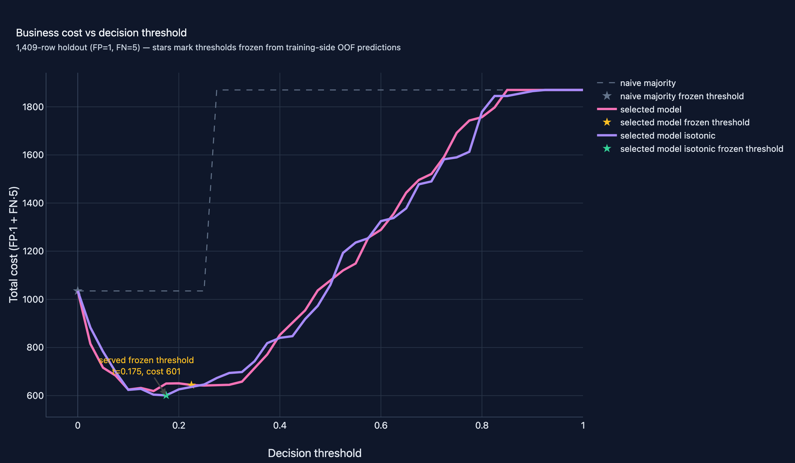
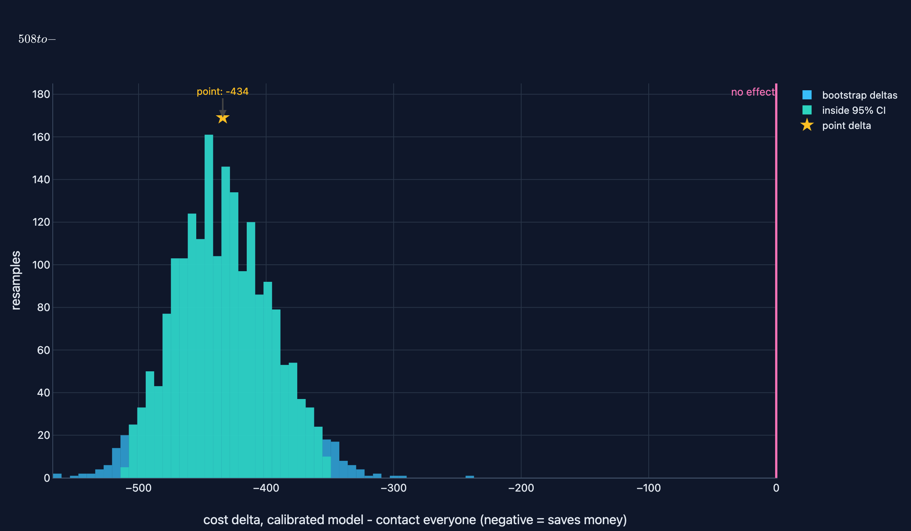

# 05 · Churn Modeling with Production-Grade sklearn Pipelines

**Domain:** Classical ML · **Data:** IBM telco churn (7,043 rows, 26.5% churn)
with a seeded synthetic CI path · **Status:** working showcase

> On 7,043 IBM telco customers, a calibrated churn policy frozen at 0.175 from training OOF predictions costs
> $601 versus $1,035 for contact-everyone (95% paired bootstrap cost-delta CI -$508 to -$353). Re-select the
> cutoff when missed-churner cost changes.
>
> [Case study source and interactive figures on GitHub →](https://github.com/amm-ds/portfolio/tree/main/projects/05-ml-pipeline-churn) ·
> [Churn sandbox demo source →](https://github.com/amm-ds/portfolio/tree/main/apps/showcase-web/src/demos/churn-sandbox)

The 601 and 1,035 values are modeled cost units on one 1,409-row holdout, not
realized ROI. The output is a priced contact list. A false alarm costs one retention voucher;
a missed churner costs five. Accuracy prices those mistakes alike, so the
project optimizes decision cost instead. One fitted `sklearn.Pipeline` applies
outlier caps, missingness indicators, imputation, scaling, and one-hot encoding
in both training and serving.

## Acceptance gates

- Select models and thresholds from training-side cross-validation/OOF
  predictions, then freeze them before holdout scoring.
- Compare every candidate under the same FP=1/FN=5 cost model; report cost
  beside ROC-AUC, macro F1, and calibration error.
- Bootstrap the exact frozen policy against contact-everyone and logistic-at-0.5.
- Treat the synthetic twin as an offline pipeline test, never business evidence.

## Key results

The stratified seed-42 split produces 5,634 training rows and one 1,409-row
holdout. A separate 20% training carve-out fits isotonic calibration. The
thresholds below are training-side OOF-frozen, not holdout optima; lower business
cost is better.

| Run | Threshold | ROC-AUC | F1 (macro) | ECE | Business cost |
|---|---|---|---|---|---|
| Contact everyone (fixed) | 0.000 | 0.5000 | 0.2098 | – | 1,035 |
| Logistic, default | 0.500 | 0.8292 | 0.7022 | – | 691 |
| Logistic, OOF-frozen | 0.450 | 0.8292 | 0.6796 | – | 655 |
| Selected raw XGB | 0.225 | 0.8387 | 0.6981 | 0.028 | 644 |
| **Selected + isotonic ← served** | **0.175** | **0.8317** | **0.6745** | **0.016** | **601** |

A seeded 25-trial Optuna search selects XGBoost by OOF business cost. On the
holdout, isotonic calibration improves ECE 0.028 → 0.016 and the separately
frozen policy cost 644 → 601. These are measured outcomes here, not a claim
that isotonic calibration always helps.

{ width="100%" }

The served policy costs **601 versus 1,035**, a 41.9% reduction in modeled cost.
The paired cost delta is −434 with 95% CI [−508, −353] against contact-everyone,
and −90 with 95% CI [−159, −26] against logistic-at-0.5. Each uses 2,000 paired
holdout resamples at fixed thresholds. The intervals estimate customer-row
sampling variation only, not model-search or threshold-selection instability.

{ width="100%" }

### Cost sensitivity and fairness

Changing the missed-churner price re-freezes the cutoff from the same training
OOF predictions before holdout scoring:

| FN cost | Served threshold | Served cost | Contact-everyone cost | Delta 95% CI |
|---|---|---|---|---|
| 3 | 0.250 | 514 | 1,035 | [−581, −456] |
| 5 | 0.175 | 601 | 1,035 | [−508, −353] |
| 8 | 0.150 | 718 | 1,035 | [−418, −204] |

`fairness_slices` describes the **raw** XGB model at its OOF-frozen 0.225
threshold, not the served calibrated policy. Recall is 0.918 for month-to-month,
0.250 for one-year, and 0.000 for two-year contracts; the raw model misses 27 of
36 one-year churners and all 9 two-year churners. Gender recall is nearly level
(0.834 female / 0.829 male). Served-policy fairness therefore remains a fresh-
data rollout gate.

### Data-quality record

All five gates pass on the pinned real snapshot. The synthetic twin separately
exercises missing values and extreme charges in CI.

| Gate | Column | Contract | Observed | Status |
|---|---|---|---|---|
| Null rate ≤ 5% | tenure_months | ≤ 0.050 | 0.000 | Pass |
| Null rate ≤ 5% | monthly_charges | ≤ 0.050 | 0.000 | Pass |
| Range [0, 240] | tenure_months | Within bounds | [0.0, 72.0] | Pass |
| Range [0, 10,000] | monthly_charges | Within bounds | [18.25, 118.75] | Pass |
| Binary {0, 1} | churned | Within bounds | [0.0, 1.0] | Pass |

## Limits

- Final metrics come from one random snapshot split. Bootstrap intervals omit
  selection instability, and no time axis supports drift or seasonality claims.
- Cost units encode an assumed 1-versus-5 mistake price; they are not revenue,
  savings realized in production, or ROI.
- Fairness numbers describe the raw model, not the served calibrated policy.
- Evidence covers one operator and 21 columns; transfer is unmeasured.

## Artifacts and links

- [Project README](https://github.com/amm-ds/portfolio/tree/main/projects/05-ml-pipeline-churn/README.md) — full results and reproduce commands
- [DESIGN.md](https://github.com/amm-ds/portfolio/tree/main/projects/05-ml-pipeline-churn/DESIGN.md) — requirements and experiment history
- `story.yaml` — canonical eight-section case study
- `reports/metrics.json`, `data/operating_policy.json`, and
  `reports/sensitivity.json` — exact policies and measurements
- `reports/figures/` — interactive figures; `reports/report.html` — standalone report
- Dataset card: [data-registry/telco-churn](https://amm-ds.github.io/portfolio/data-registry/telco-churn/)
