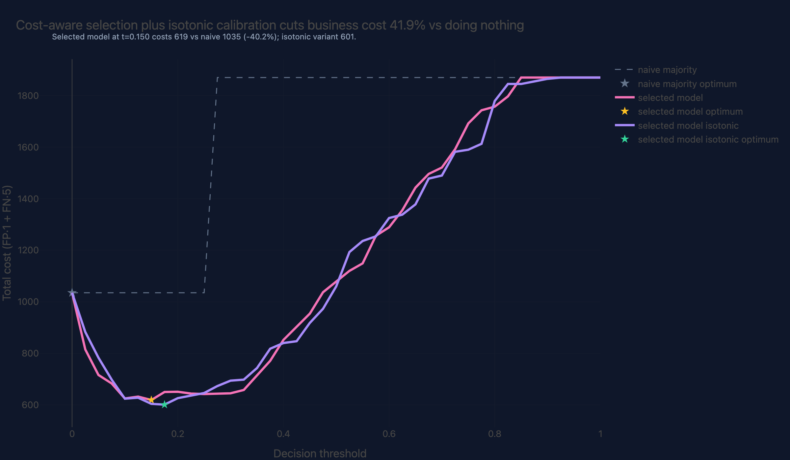
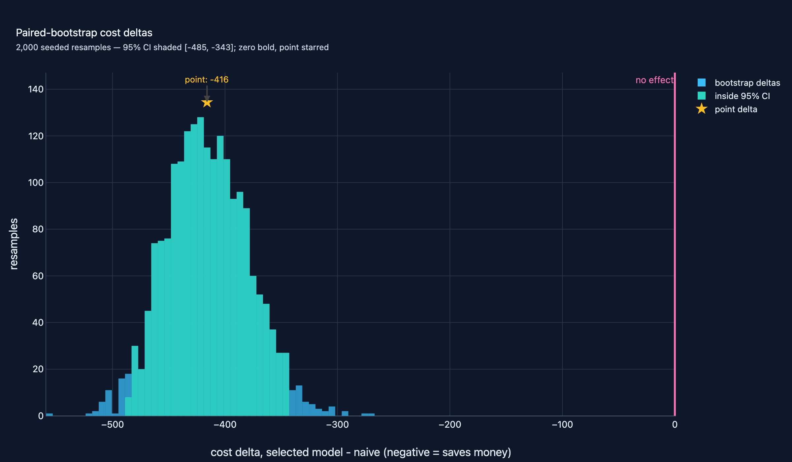
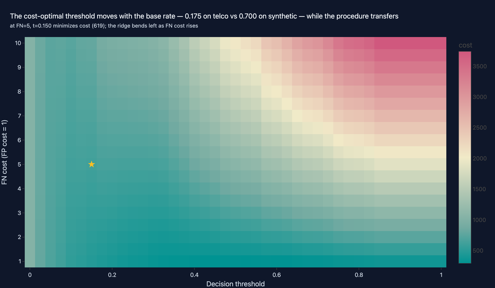

# 05 · Churn Modeling with Production-Grade sklearn Pipelines

**Domain:** Classical ML · **Data:** IBM telco churn (7,043 rows, 26.5% base
rate) with a seeded synthetic CI path (messy on purpose: 2% NaN age, 3% NaN
support calls, a 9,999 charge outlier) · **Status:** working
showcase on the standard platform (flagships: [01](01-rag-agent.md), [07](07-open-data-mobility.md))

> **TL;DR:** subscription businesses where a missed churner costs five times a
> false alarm, and the base rate makes "do nothing" look accurate.
> The pipeline cuts decision cost by **41.9%** (1,035 → 601) vs that contact-everyone
> policy, with a bootstrap 95% CI of [−485, −343].
>
> [Interactive case study with figures →](https://github.com/amm-ds/portfolio/tree/main/projects/05-ml-pipeline-churn) ·
> [Threshold sandbox source →](https://github.com/amm-ds/portfolio/tree/main/apps/showcase-web/src/demos/churn-sandbox) (interactive when the showcase app is running)

## What it shows

Churn is asymmetric economics for any subscription business: a missed
churner costs about five times a false alarm. This project delivers a
production-grade decision pipeline that cuts that decision cost by **41.9%**
(1,035 → 601) vs a contact-everyone policy on real IBM telco data:

A single self-contained `sklearn.Pipeline` — custom `OutlierCapper` and
`MissingValueIndicator` transformers, median imputation, scaling, one-hot
encoding — followed by **cost-aware Optuna model selection** across four
arms (logistic, HistGradientBoosting, XGBoost, LightGBM — all sklearn-API on
the same in-pipeline preprocessing; seeded TPE with median pruning; trials
scored by CV business cost at per-trial cost-optimal thresholds) whose
winning config is written back to `params.yaml`. Client CRM extracts onboard
via `prepare --input client.csv` through the same DQ gates and contract.
Evaluation is a five-run ladder on one holdout: naive majority → logistic
baseline (default and cost-tuned thresholds) → selected model raw and
isotonic-calibrated — with calibration (ECE), permutation importance, PR
curves, a business-cost curve (FP=1, FN=5), and a paired bootstrap CI on the
cost delta vs naive.

## Key results (IBM telco churn, 7,043 rows -> 1,409-row holdout)

How to read this table: business cost (FP=1, FN=5) is the verdict column —
lower is better; the bolded row is the selected model at its cost-optimal
threshold.

| run | threshold | ROC-AUC | F1 (macro) | ECE | business cost |
|---|---|---|---|---|---|
| naive majority | cost-optimal | 0.5000 | 0.2098 | - | 1,035 |
| logistic, default 0.5 | 0.500 | 0.8292 | 0.7022 | - | 691 |
| logistic, tuned | 0.300 | 0.8292 | 0.6151 | - | 611 |
| selected (cost-HPO XGB) | 0.150 | 0.8387 | 0.6512 | 0.028 | 619 |
| selected + isotonic | 0.175 | 0.8317 | 0.6745 | **0.016** | **601** |

{ width="100%" }

- Cost-aware HPO selected **XGBoost** on real data (synthetic track's winner
  was a logistic) — the winner tracks the data. Deliverable vs naive:
  **cost −41.9% (1,035 -> 601), bootstrap −416, 95% CI [-485, -343]**.

{ width="100%" }
- Base rate 26.5% (vs 8.8% synthetic): the operating point does NOT transfer
  (t*=0.175 vs 0.700) - the cost-curve procedure does. Calibration verdict
  flips too: isotonic improves both ECE and cost on telco.

{ width="100%" }

- Fairness slices: recall uniform across gender (0.90 both), higher for
  seniors (0.97 vs 0.88); the real gap is contractual (month-to-month 0.98 vs
  two-year 0.00 at FN=5) - a stated business choice, movable on the cost
  surface.
- Figures include `fairness_slices` (grouped bars) and `cost_surface`
  (FN cost x threshold heatmap with the operating point marked).
- 5/5 DQ gates on the pinned snapshot; full pipeline ~10 s, deterministic:

  | gate | column | contract | observed | status |
  |---|---|---|---|---|
  | null rate ≤ 5% | tenure_months | ≤ 0.050 | 0.000 | ✅ |
  | null rate ≤ 5% | monthly_charges | ≤ 0.050 | 0.000 | ✅ |
  | range [0, 240] | tenure_months | within bounds | [0.0, 72.0] | ✅ |
  | range [0, 10,000] | monthly_charges | within bounds | [18.25, 118.75] | ✅ |
  | binary {0, 1} | churned | within bounds | [0.0, 1.0] | ✅ |

## Artifacts

- Figures: interactive versions in the [interactive case study](https://github.com/amm-ds/portfolio/tree/main/projects/05-ml-pipeline-churn), served from `reports/figures/` (HTML + JSON for the showcase app)
- Metrics: `reports/metrics.json` (5-run ladder + `_meta.cost_delta_ci`) ·
  Report: `reports/report.html` · DQ: `reports/dq_report.md`
- Selection record: `data/model_selection.json` · Dataset identity card:
  `data/dataset_contract.json` (SHA-256, seeded source)

## Links

- Dataset card: [data-registry/telco-churn](https://amm-ds.github.io/portfolio/data-registry/telco-churn/) —
  pinned source, SHA-256, DQ expectations
- [Project README](https://github.com/amm-ds/portfolio/tree/main/projects/05-ml-pipeline-churn/README.md) — full
  results, reproduce commands, client takeaways
- [DESIGN.md](https://github.com/amm-ds/portfolio/tree/main/projects/05-ml-pipeline-churn/DESIGN.md) — requirements,
  options considered, pipeline diagram, changelog, experiment versioning
- Story: `projects/05-ml-pipeline-churn/story.yaml` (8 canonical sections +
  roadmap, served by the showcase API)
- Source: `projects/05-ml-pipeline-churn/src/churn_pipeline/`
