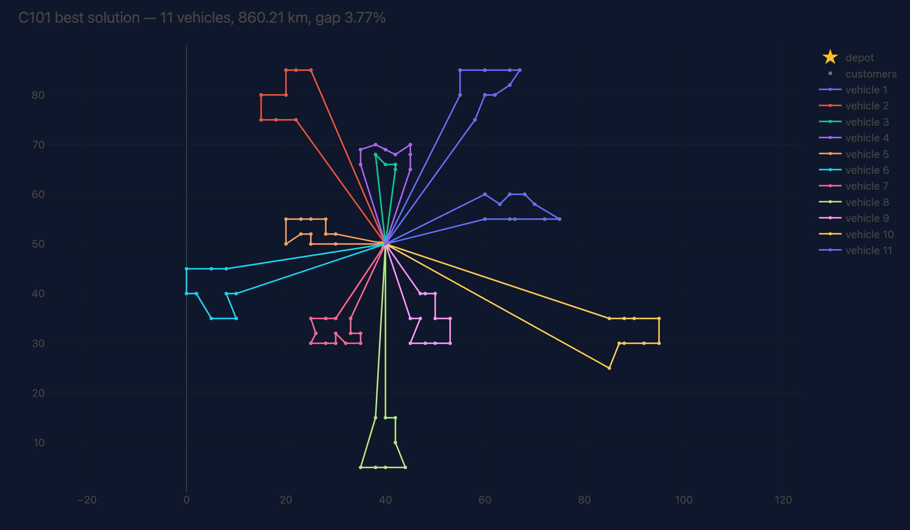
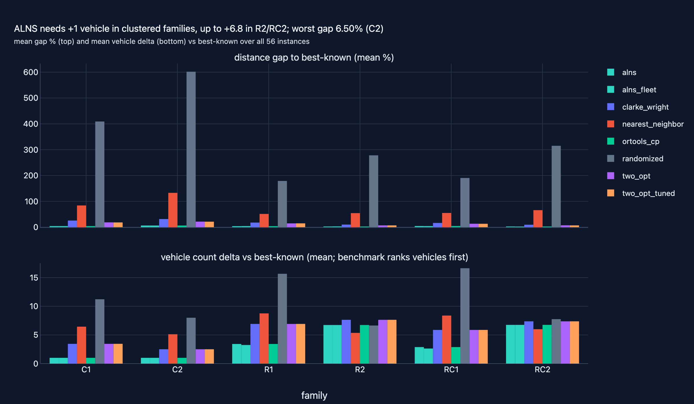
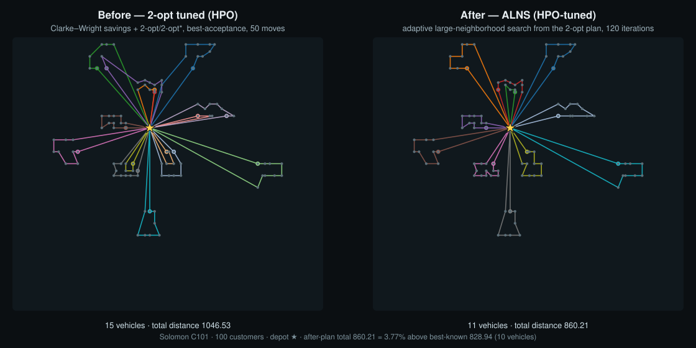

# 06 · Routing Optimization (VRPTW)

**Domain:** combinatorial optimization ·
**Data:** CVRPLIB Solomon VRPTW benchmark (all 56 100-customer instances) ·
**Status:** working showcase —
[Project README](https://github.com/amm-ds/portfolio/tree/main/projects/06-routing-optimization) ·
[DESIGN.md](https://github.com/amm-ds/portfolio/tree/main/projects/06-routing-optimization/DESIGN.md) ·
[Dataset card](https://amm-ds.github.io/portfolio/data-registry/cvrplib-solomon/)

> Routing planner for the 56 standard Solomon 100-customer problems with time windows. A hand-written search returns feasible plans within 4.2% of best-known routes in ~1 second each, using 3.7 more vehicles than best-known on average; an exact solver certifies small cases only.
>
> [Case study source and interactive figures on GitHub →](https://github.com/amm-ds/portfolio/tree/main/projects/06-routing-optimization)

Best-known routes are published references, not proven optima. The exact mean
gap is 4.23%, with a +3.73 vehicle delta and ~1.1 s mean runtime per instance.

The task is to serve every customer exactly once, within vehicle capacity and
each customer's arrival window. ALNS removes and reinserts stops, then accepts
or rejects the repaired plan. Distance and fleet size are reported together:
adding vehicles can shorten distance, so either number alone hides a trade-off.

{ width="100%" }

## Acceptance gates

- Reject any plan that misses a customer, repeats service, exceeds capacity, or
  violates a time window.
- Use seed 42 with no hidden state so each run can be replayed.
- Report distance gap, vehicle-count delta, and runtime for all 56 instances;
  retain per-family spread beside the means.
- Treat published best-known plans as references, not optimality certificates.
  Keep the hinted exact-solver probe separate from independent comparisons.

## Key results

Mean gap is the percentage above published best-known distance; lower is better.
Δ gap is the change versus `nearest_neighbor` in percentage points. Runtime is
from one shared, load-sensitive machine and is context rather than a stable
hardware benchmark.

| Solver | Mean gap to best-known | Mean vehicle Δ | Δ gap vs NN | Mean runtime |
|---|---|---|---|---|
| randomized (feasible floor) | 316.95% | +11.09 | +245.31 pp | <10 ms/instance |
| nearest_neighbor | 71.64% | +6.75 | — | <10 ms/instance |
| clarke_wright | 18.31% | — | −53.33 pp | <10 ms/instance |
| two_opt_tuned (HPO) | 13.63% | +5.79 | −58.01 pp | <10 ms/instance |
| **alns (HPO-tuned) ← best distance** | **4.23%** | **+3.73** | **−67.41 pp** | **~1.1 s/instance** |
| alns_fleet (vehicles-first) | 4.30% | +3.66 | −67.34 pp | ~1.1 s/instance |
| ortools_cp (ALNS-hinted, 10 s budget) | 4.23% | +3.73 | −67.41 pp | 12.0 s/instance |
| ortools_cp_unhinted (10 s budget) | No feasible plan on any of 56 | — | — | 13.1 s/instance |

ALNS wins 52 of 56 intra-ladder distance comparisons; `alns_fleet` wins the
other four. With fleet size ranked first, ALNS wins 38 of 56, `alns_fleet` five,
and naive solvers 13 by using fewer vehicles at much worse distance. No solver
beats the best-known fleet size. ALNS undercuts eight published distance
references, with RC202 best at −3.85%; the worst residual is C203 at 19.48%.
The means therefore do not describe every instance.

### What the figures show

- In `family_gap`, compare the six family bars with the 4.23% overall mean.
  Family means range from 3.00% on RC2 to 6.50% on C2, and the vehicle deltas
  remain visible beside distance.
- In `route_map_C101_before_after`, compare the feasible C101 plans. ALNS uses
  11 routes and 860.21 distance versus tuned 2-opt's 15 routes and 1046.53.
  This is one instance, not evidence that every plan improves by the same amount.
- In `frontier_gap_time`, both solvers start from the same Clarke-Wright plan
  with a 30-second cap and one worker. ALNS's median gap improves from 6.6% to
  best-known level by 10 seconds; cold-start CP-SAT stays near 17.6%. This is a
  measured cold-start trace, not a general exact-solver speedup claim.

{ width="100%" }

{ width="100%" }

### Exact solver's role

The hinted CP-SAT arm starts from the ALNS plan, so it is an incumbent-
improvement probe, not an independent baseline. It ends UNKNOWN on all 56
100-customer instances and returns the ALNS plan unchanged; its measured mean
runtime is 12.0 s versus ~1.1 s for ALNS. At the same 10-second budget without
a hint or fallback, CP-SAT finds no feasible plan on any instance. Neither arm
proves a full-scale optimum or a general runtime ordering.

The exact solver does certify small cases: a 25-customer C101 prefix reaches a
proven-optimal 191.8 in 2.9 s, and a five-customer case is certified in 0.1 s.
Those proofs do not transfer to the 100-customer benchmark.

## Limits

- The 56 deterministic instances have family and per-instance spread; there is
  no sampling-uncertainty claim about a broader population.
- Best-known references are not proven optima; only the two small cases carry
  certificates.
- Euclidean textbook routes omit street networks, traffic, and dynamic
  re-optimization. No fuel, emissions, or realized operating-cost effect is
  measured.
- Evidence covers 100 customers. Larger instances and hosted solver deployment
  remain unproven here.

## Reproduce

```bash
uv run python -m routing_optimization.cli all   # from projects/06-routing-optimization
```

Exact per-instance records and interactive figures live in
`projects/06-routing-optimization/reports/`, including `results.md`,
`metrics.json`, `report.html`, and `figures/`.
