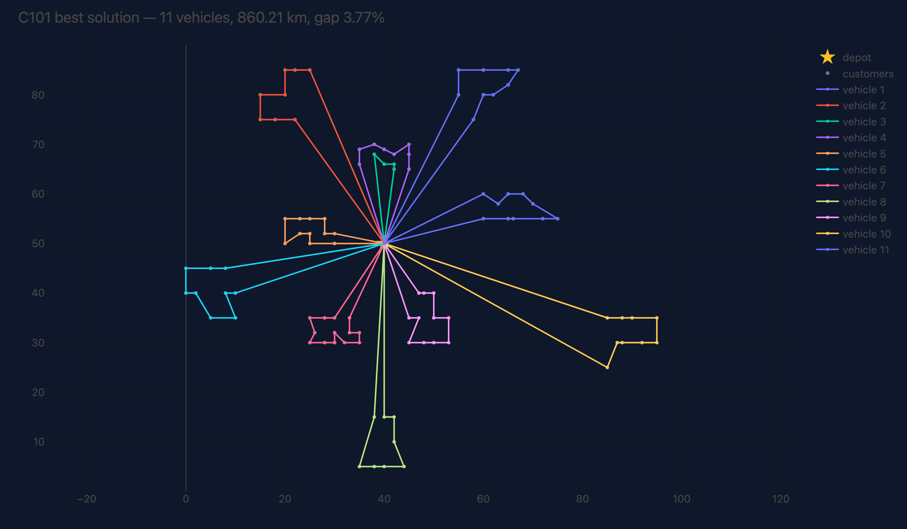
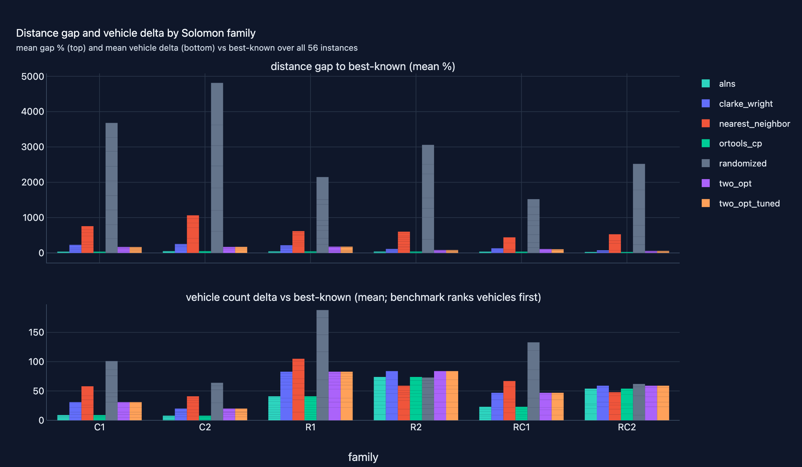

# 06 · Routing Optimization (VRPTW)

**Domain:** combinatorial optimization ·
**Data:** CVRPLIB Solomon VRPTW benchmark (all 56 100-customer instances) ·
**Status:** working showcase —
[Project README](https://github.com/amm-ds/portfolio/tree/main/projects/06-routing-optimization) ·
[DESIGN.md](https://github.com/amm-ds/portfolio/tree/main/projects/06-routing-optimization/DESIGN.md) ·
[Dataset card](https://amm-ds.github.io/portfolio/data-registry/cvrplib-solomon/)

> **TL;DR:** fleet operators running last-mile and field-service routes, where
> every percent of distance is fuel, driver hours and CO₂, every day.
> The solver ladder lands **4.23%** from published best-known optima on all 56
> Solomon instances, in auditable seeded code.
>
> [Interactive case study with figures →](https://github.com/amm-ds/portfolio/tree/main/projects/06-routing-optimization)

{ width="100%" }

Fleet operators routing last-mile and field-service vehicles leave fuel,
driver hours and CO₂ on the table every day. This project answers with a
deterministic, seeded solver ladder that lands within 4.23% of published
best-known optima on the full Solomon benchmark — and states exactly what the
remaining gap costs:

A seeded solver ladder for the vehicle routing problem with time windows —
randomized floor, nearest neighbor, Clarke–Wright savings,
hyperparameter-tuned (HPO) 2-opt/2-opt*,
and adaptive large-neighborhood search (ALNS: random/worst/Shaw destroy +
regret-2 repair, segment-adapted operator weights, SA acceptance) — benchmarked
against published best-known solutions. Every solution is machine-validated
(exactly-once service, capacity, time windows) before reporting.

## Key results (real run, seed 42, 56 instances)

Mean gap to published best-known distance, lower is better; the benchmark's
vehicles-first ranking is reported alongside the gap (see the story results).
Δ gap is the change in mean gap vs `nearest_neighbor` (the construction
incumbent), in percentage points; the bold row is the ladder's best.

| solver | mean gap to best-known | Δ gap vs nn | mean runtime |
|---|---|---|---|
| randomized (feasible floor) | 316.95 % | +245.31 pp | <10 ms/instance |
| nearest_neighbor | 71.64 % | — | <10 ms/instance |
| clarke_wright | 18.31 % | −53.33 pp | <10 ms/instance |
| two_opt_tuned (HPO) | 13.63 % | −58.01 pp | <10 ms/instance |
| **alns (HPO-tuned) ← best** | **4.23 %** | **−67.41 pp** | **~0.8–2.8 s/instance** |
| ortools_cp (ALNS-hinted cross-check, 10 s budget) | 4.23 % | −67.41 pp | 13.6 s/instance |

Two criteria throughout: ALNS wins 56/56 instances on distance (13.63 % →
4.23 %, single digits on every family: C1 4.48 %, C2 6.50 %, R1 4.10 %, R2
3.04 %, RC1 4.75 %, RC2 3.00 %), and under the vehicles-first ranking it wins
43/56 intra-ladder with a mean of +3.73 vehicles vs best-known (up to +6–8 on
R2/RC2). The hinted CP-SAT arm is an incumbent-improvement probe, not an
independent baseline: it ended UNKNOWN on all 56 within its 10 s budget and
returned the ALNS plan unchanged, while certifying small subproblems to
optimality (25-customer C101 prefix: 191.8 in 2.9 s). All artifacts live in
`projects/06-routing-optimization/reports/`: interactive figures (instance
maps, per-family gaps, convergence descents, runtime-vs-gap Pareto) with
`results.md` / `metrics.json` / `report.html` for the full per-instance and
per-family tables — interactive versions in the [interactive case study](https://github.com/amm-ds/portfolio/tree/main/projects/06-routing-optimization).

![Before/after of the improvement heuristic on Solomon C101 — left: HPO-tuned 2-opt on the Clarke–Wright plan (15 routes, 1046.53 total distance); right: ALNS on the same instance (11 routes, 860.21). The metaheuristic consolidates the construction plan's overlapping short routes into fewer, longer ones, cutting distance 17.8% (1046.5 → 860.2, matching `alns_convergence_C101`); the after-plan sits 3.77% above the best-known 828.94. Routes reproduced from the committed solution artifact; both plans verified capacity- and time-window-feasible by the project validator.](../assets/projects/06-routing-optimization/route_map_C101_before_after.svg){ width="100%" }

{ width="100%" }

## Roadmap

Delivered (retrospective): ALNS behind the `RoutePlan` contract (13.63 % →
4.23 % mean gap, dual criteria, HPO-tuned); full 56-instance dual-criteria
benchmark; hierarchical-objective (vehicles-first) reporting per the SINTEF
convention; CP-SAT hinted cross-check arm (ties ALNS 56/56 at ~5× runtime,
certifies small subproblems optimal in seconds).

## Reproduce

```bash
uv run python -m routing_optimization.cli all   # from projects/06-routing-optimization
```
