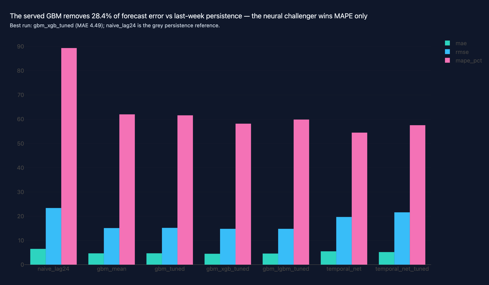
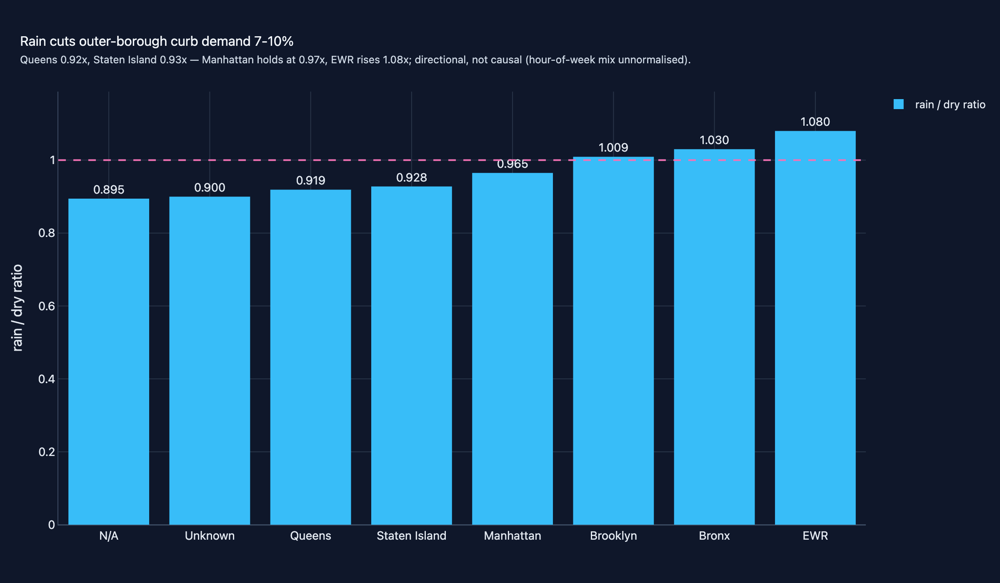

# 07 · Urban Mobility Demand Intelligence

**Domain:** data engineering + ML · **Data:** NYC TLC yellow-taxi 2024 (41.2M
trips) + NOAA GHCN-Daily weather · **Status:** flagship — complete

> Next-hour NYC taxi demand by zone, built on 41.2M real 2024 yellow-taxi
> trips and public weather: on a strict Oct-Dec holdout the model was 28%
> more accurate than same-hour-yesterday; its 90% upper band reached 91%
> coverage (sparse zones excepted).
>
> **TL;DR:** NYC taxi fleet planners staging vehicles and driver shifts one hour
> ahead across 265 zones — demand must be forecast before it arrives.
> The served tuned GBM removes **28.3% of forecast error** vs "same hour
> yesterday" on a strict future holdout, with a 90.8%-calibrated p90 staffing band.
>
> [Case study source and interactive figures on GitHub →](https://github.com/amm-ds/portfolio/tree/main/projects/07-open-data-mobility)

{ width="100%" }

**Flagship — complete.** End-to-end demand nowcasting on real, messy,
GB-scale public data: 41.2M NYC yellow-taxi trips (2024) joined with NOAA
GHCN-Daily weather, engineered with lazy/streaming Polars under a 2 GB RAM
peak, gated by per-month DQ contracts, and validated with leakage-proof
temporal splits.

## Key results (temporal holdout Oct–Dec 2024, 584,855 zone-hours)

The served `gbm_tuned` removes **28.3% of forecast error** vs the same-hour-
yesterday lag-24 baseline. Tuning moves the default GBM only within noise;
the xGB challenger wins on Q4 but loses on embargoed validation, so it is not
promoted on test performance. MASE normalises by in-sample lag-24 error
(1.0 = no better than persistence); ΔMAE is measured against the same floor.

| run | MAE | RMSE | MAPE | MASE | ΔMAE vs naive |
|---|---|---|---|---|---|
| naive lag-24 (same hour yesterday) | 6.517 | 23.367 | 89.4% | 1.063 | — |
| GBM mean | 4.667 | 15.096 | 62.0% | 0.761 | −28.4% |
| GBM tuned (30 Optuna trials) ← served | 4.676 | 15.189 | 61.6% | 0.763 | −28.3% |
| **GBM xgb tuned (15 trials) ← best test MAE** | **4.487** | **14.785** | **58.2%** | **0.732** | **−31.2%** |
| GBM lgbm tuned (15 trials) | 4.582 | 14.794 | 59.9% | 0.747 | −29.7% |
| TemporalNet (torch, log1p target) | 5.510 | 19.686 | 54.5% | 0.899 | −15.5% |
| TemporalNet tuned (10 trials) | 5.178 | 21.580 | 57.5% | 0.845 | −20.5% |

{ width="100%" }

p90 band calibration **90.8%** overall (target 90%; sparse N/A
zones under-cover at 84.7%, flagged). Per-borough GBM MAE peaks in Manhattan
(14.2 pickups/h) where volume peaks. Permutation importance: weekly/daily lag
features dominate, weather ≈ 0 for point MAE. Weather elasticity:
outer-borough curb demand drops 7–10% in rain (Queens 0.92×, Staten Island
0.93×) while Manhattan holds (0.97×) and EWR rises (1.08×) — directional,
with documented non-causal caveats.

{ width="100%" }

## Drift observatory

Monitoring is running software, not just a runbook: the scheduled
`.github/workflows/drift-observatory.yml` workflow scores each newly published
TLC month against the persisted serving model with training-identical
features, no retraining (mechanics, exit codes, and response steps:
[project README](https://github.com/amm-ds/portfolio/tree/main/projects/07-open-data-mobility)
and [drift-response runbook](../runbooks/drift-response.md)). Three months
scored: 2024-11 at **+8.2%** and 2024-12 at **+7.9%** relative MAE from the
local snapshot, and the first genuinely unseen month **2025-01**, fetched
live through the checksum machinery — MAE **4.442** vs pinned 4.676
(**−5.0%**, within tolerance), MAPE 59.6%, ΔMAE vs naive +34.6%, p90
coverage 87.4% (slight under-cover vs the 90% target). Unseen-window
behavior is now measured: no month has regressed through 2025-01, so the
alarm path remains unwalked only because no scored month exceeded tolerance.
Reports accumulate in `reports/drift/`.

## Cross-service transfer (green taxi)

Yellow-trained weights transfer mixed: they lose green-taxi MAE to green
persistence (0.296 vs 0.212) but win RMSE (−17%) and MAPE (−19%). The control
arm settles why — a GBM retrained on green's own two months of history
(`gbm_green_retrained`, 337k zone-hours) beats green persistence on **all
three** metrics (MAE 0.180 vs 0.212, RMSE 0.688 vs 1.100, MAPE 66.4% vs
81.8%): the gap is a service-distribution difference with a measured fix, so
budget a per-service retraining run before extending to a new vehicle class.

Per-service retraining is productionized (wave 15): the green model is fit on
all **534,240** curated green zone-hours with the measured control recipe
(default GBM family on the service's own history + quantile-0.9 p90 twin) and
persisted as `gbm_green_served` under `reports/models/serving/green/` in the
identical three-file contract, indexed by a typed `services.json` registry
(`yellow` root, `green` subdir). The showcase API forecast endpoint routes it:
`service` is an optional request field (default `"yellow"`, response echoes
the selected service; unknown service → 422), verified by deterministic API
tests against the committed bundles.

## Serving

The tuned GBM pair is persisted per `SERVING.md`; the showcase API forecast
endpoint is verified live (JFK zone 132 → 223.827 point / 251.811 p90), for
both the yellow bundle and the per-service green bundle above.

## Where things live

- Code + design: [projects/07-open-data-mobility](https://github.com/amm-ds/portfolio/tree/main/projects/07-open-data-mobility) — pipeline `mobility download|validate|join|features|tune|train-baselines|train-nn|evaluate|dashboard|dq-report|all`, DVC stages in `dvc.yaml`
- Dataset cards: [NYC TLC](../data-registry/nyc-tlc.md) · [NOAA GHCN](../data-registry/noaa-ghcn.md)

## Data attribution

- **NYC TLC Trip Records** — NYC TLC terms of use; free, anonymous download.
  Monthly yellow-taxi Parquet, snapshot 2026-10-12, checksum-pinned.
- **NOAA GHCN-Daily** (station USW00094728, Central Park) — public domain
  (US Government work).

Both are downloaded by the pipeline itself; nothing raw is committed to git
(DVC tracks the derived data products).
