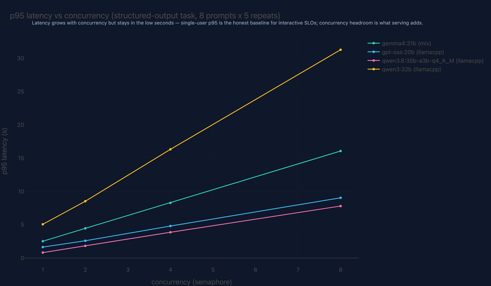
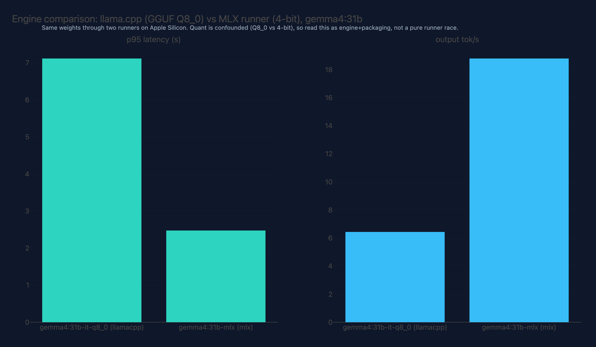

# 08 · LLM Inference & Serving

**Domain:** LLM Systems · **Data:** fixed 8-prompt structured-output
benchmark (synthetic task, no download) · **Status:** working showcase on
the standard platform

> Anyone deciding between local and cloud LLM serving usually gets vendor
> rate cards, not measurements of the stack they would actually run.
> Headline: the 4-bit MoE arm serves locally at ~$0.12 per 1M output tokens
> with single-digit-second p95 through concurrency 8 — measured on the real
> endpoint, 760 requests, zero failures.
>
> [Interactive case study with figures →](https://github.com/amm-ds/portfolio/tree/main/projects/08-inference-serving)

Every project in this portfolio serves LLMs through one local Ollama
endpoint (ADR-0004 — no redundant gateway, see the project's DESIGN.md), and
this benchmark is where that stack gets measured — both external audits' #1
recommendation. An async load driver exercises models, quantizations,
runners, and concurrency levels on a fixed structured-output task with
validated schemas, so the numbers describe real traffic, not a lab proxy.

## Key results (real run, Ollama 0.40.4, Apple-Silicon Mac, 128 GB unified memory)

Full run: 19 cells, **760 requests, zero failures, schema-valid rate 1.00 and
keyword-quality 1.00 in every cell** (8 fixed prompts x 5 repeats per cell,
`temperature 0`, `max_tokens 128`, reasoning disabled). One caveat before
reading on: these numbers are a single **author run** on one machine — **not
committed to the repo** and not universal. Regenerate on your hardware with
`bench --full && report` and compare cell-for-cell.

How to read this table: each cell shows p95 latency in seconds / aggregate
output tok/s for that model at the given concurrency.

| model | runner | c=1 | c=4 | c=8 |
|---|---|---|---|---|
| qwen3.6:35b-a3b-q4_K_M (MoE) | llamacpp | 0.81 s / 67.7 | 3.86 s / 52.3 | 7.80 s / 50.2 |
| gpt-oss:20b (MXFP4) | llamacpp | 1.64 s / 36.8 | 4.80 s / 39.5 | 9.04 s / 40.0 |
| gemma4:31b (dense) | mlx | 2.52 s / 17.6 | 8.28 s / 18.4 | 16.06 s / 18.5 |
| qwen3:32b (dense, --full) | llamacpp | 5.06 s / 9.6 | 16.31 s / 9.6 | 31.27 s / 9.4 |

{ width="100%" }

Engine panel (gemma4:31b family, concurrency 1): **MLX 4-bit beats GGUF Q8_0
on llama.cpp 2.9x on tok/s** (18.8 vs 6.4) with p95 2.47 s vs 7.12 s — but
quant is confounded (the registry has no same-quant cross-runner pair), so
this reads as engine+packaging, not a pure runner race.

{ width="100%" }

Quality-vs-quant (same llama.cpp runner, concurrency 1): **QAT-int4 holds
1.00 schema-valid and 1.00 keyword quality while running 53% faster than
Q8_0** (9.8 vs 6.4 tok/s) — at this task size quantization buys speed, not
quality loss.

| dimension | setup |
|---|---|
| task | fixed structured output: validated pydantic `Answer` (one sentence + confidence + citation) over 8 fixed prompts |
| harness | asyncio + httpx streaming against Ollama `/v1/chat/completions`, `json_schema` response_format, semaphore concurrency 1/2/4/8, 5 repeats/cell, cooldown between cells |
| metrics | nearest-rank p50/p95/p99, TTFT, aggregate + per-request tok/s, schema-valid rate, keyword quality rate, failures |
| engines | llama.cpp (GGUF) vs MLX (safetensors) — auto-selected by Ollama 0.40.4 from the artifact, verified via `/api/ps` `runner` (no override env on this build) |
| models | qwen3.6:35b-a3b-q4_K_M, gemma4:31b, gpt-oss:20b; `--full` adds qwen3:32b, gemma4:31b-it-q8_0 / -qat / -mlx |

## Cost

API cost is **$0** (local inference). Amortized electricity at the measured
best tok/s (declared assumptions: 100 W system draw, $0.30/kWh): qwen3.6 MoE
**$0.12 per 1M output tokens**; gpt-oss:20b $0.21; gemma4:31b $0.45;
qwen3:32b $0.83; gemma4:31b-it-q8_0 $1.30. Against the labelled hypothetical
cloud rate card in `params.yaml`, the local stack wins on the MoE arm and
roughly ties mid-tier dense models — dominated here by the declared power
assumption, not by measurement error in tok/s.

## What the numbers say

- **Decode is memory-bandwidth bound on unified memory**: aggregate tok/s is
  flat (gemma4, gpt-oss, qwen3:32b) or declining (qwen3.6: 67.7 -> 50.2) as
  concurrency rises — batching buys latency hiding, not free throughput.
- **p95 grows ~linearly with concurrency** on every arm: c=8 costs roughly
  8x the single-user latency. Single-user p95 is the honest interactive SLO;
  the serving layer's job is keeping that slope shallow.
- **MoE vs dense at similar total size**: qwen3.6's 3B-active MoE serves
  ~7x the tok/s of dense qwen3:32b.
- **Reasoning defaults are a serving concern**: qwen3.6 defaults to thinking
  mode, which silently burned the entire 128-token budget (0 valid answers);
  `reasoning_effort: none` (per-model override, `low` for gpt-oss) makes the
  decode bounded and took schema-valid rate to 1.00.

## Architecture

- **Benchmark harness** (`src/inference_serving/bench.py`) — async load
  driver over Ollama's OpenAI-compatible endpoint; fixed prompt suite;
  per-(model, engine, concurrency) cells with semaphore concurrency;
  runner auto-detection via `/api/ps`; `json_schema` response_format with a
  one-shot fallback to instruction-based JSON (surfaced as a run note).
- **Aggregation** (`build_cell`, pure) — nearest-rank percentiles, aggregate
  and per-request tok/s, schema-valid/quality rates, failures; unit-tested
  from fixture records.
- **Report** (`report.py` + `figures.py`) — themed plotly figures with
  takeaways (latency-vs-concurrency, tok/s bars, quality-vs-quant, engine
  panel), headline + cost tables, `metrics.json`, `report.html` — all offline
  from `data/bench_run.json`.
- **Config** (`BenchConfig` mirrors `params.yaml`, ADR-0002) — models, arms,
  concurrency levels, cost assumptions; bounded default vs `--full` cell plan.

## Where things live

- Code + design: [projects/08-inference-serving](https://github.com/amm-ds/portfolio/tree/main/projects/08-inference-serving) —
  CLI `prepare | bench [--full] | report`, DVC stages in `dvc.yaml`
- Options & rationale: [DESIGN.md](https://github.com/amm-ds/portfolio/tree/main/projects/08-inference-serving/DESIGN.md)

## Reproduce

```bash
cd projects/08-inference-serving
ollama pull qwen3.6:35b-a3b-q4_K_M gemma4:31b gpt-oss:20b   # bench arms
ollama pull qwen3:32b gemma4:31b-it-q8_0 gemma4:31b-it-qat gemma4:31b-mlx  # --full arms
uv run python -m inference_serving.cli prepare
uv run python -m inference_serving.cli bench      # bounded (<45 min)
uv run python -m inference_serving.cli bench --full
uv run python -m inference_serving.cli report     # offline → reports/
```

Tests are fully offline (fixture math + fake-server ASGI integration):
`uv run pytest projects/08-inference-serving/tests`
