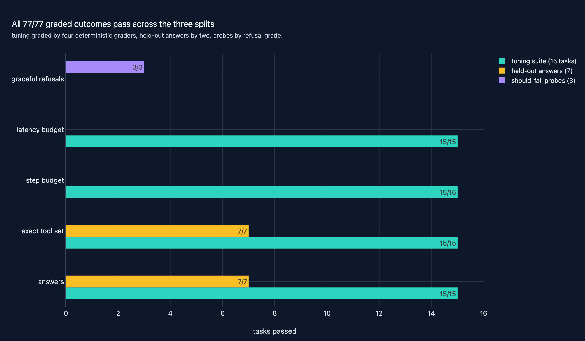
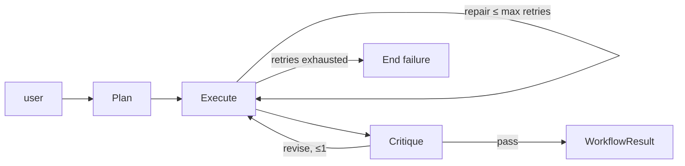
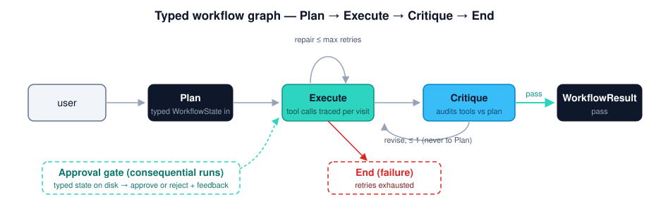
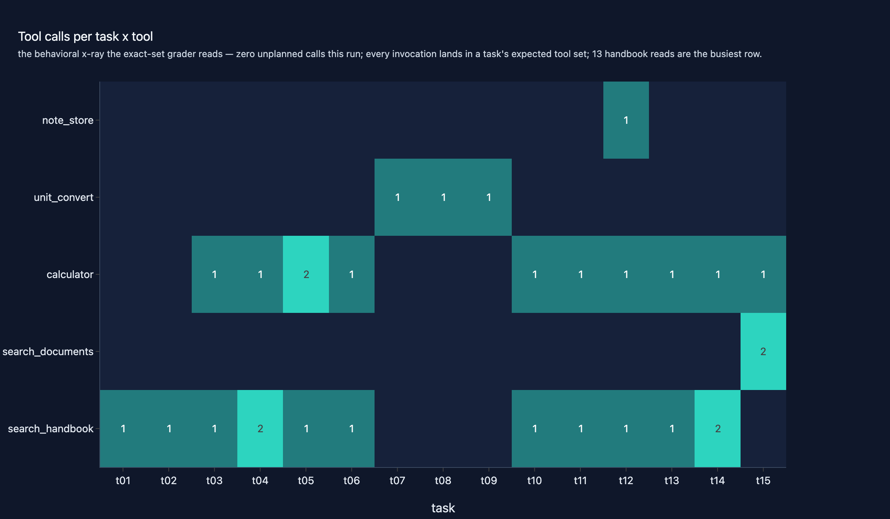
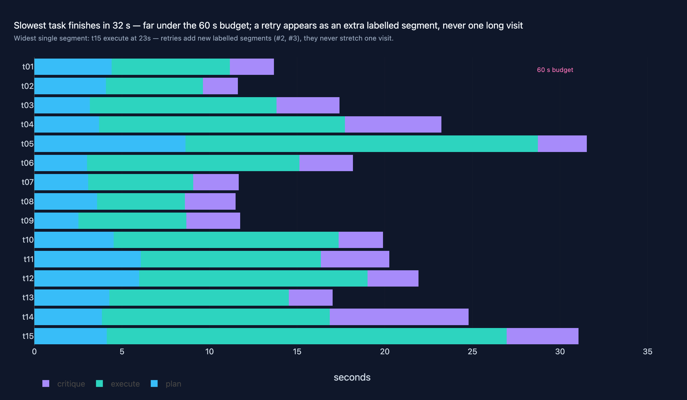

# 09 · Agentic AI Workflows

**Domain:** Agentic AI · **Data:** 12-document synthetic "Atlas Valley"
handbook + project 01's Wikipedia FAISS index (read-only) · **Status:**
working showcase on the standard platform

> A client deciding where LLM agents may run unsupervised needs graded
> evidence, not a demo.
> Headline: a 15-task deterministic suite grades a hosted multi-step
> workflow at 15/15 on every grader — answers, exact tool-set, step budget,
> latency — for $0.13 cloud-equivalent per suite (~$0.0088/task mean) of the
> $2.00 cap, and a 19-task held-out
> set (13 answer tasks + 6 designed-to-fail probes) verifies the behavior
> generalizes beyond the tuning prompts.
>
> [Case study source and interactive figures on GitHub →](https://github.com/amm-ds/portfolio/tree/main/projects/09-agentic-workflows)

Single-shot answers are not the deliverable this project grades: real work
is a chain of dependent steps — a mistake in the middle corrupts everything
after it, which is why unsupervised runs need grading, budgets, and
checkpoints. This project is the platform's dedicated agentic-AI-workflows
showcase: multi-step, stateful LLM workflows as explicit typed graphs —
planning, tool orchestration, bounded retries, self-critique, and
human-in-the-loop checkpoints — graded by a deterministic evaluation harness
with per-run cost and latency budgets, plus a cross-project retrieval arm on
real data.

## Key results (full 15-task hosted run, `kimi-for-coding`)

Plain `run-all` on the hosted Kimi coding endpoint with per-call tool
capture on, after a tool-discipline pass (tightened prompts/docstrings;
Critique now audits tools used against the plan). How to read this table:
counts are tasks passed out of 15; tool selection is an exact-set match, so
unprompted extra calls count as misses.

| metric | value |
|---|---|
| tasks run | **15/15** ok, zero retries, every critique passed |
| answer success | **15/15** |
| tool-selection accuracy | **15/15** exact-set — up from 8/15; all 30 captured calls planned (call precision 100%, tool recall 100%), `detail.tooling` |
| step budget | 15/15 |
| latency | median **18.2 s**, p95 31.1 s per task; 60 s budget held 15/15 |
| tokens / cost | ~85k in + ~12k out; suite total **$0.13** cloud-equivalent of the $2.00 suite cap (~$0.0088/task mean) |
| held-out set | 13/13 answer success, 13/13 exact tool set (22 calls, all planned), **5/6 should-fail probes refused gracefully** (`detail.heldout`) |

One chart tells the whole verification story — the tuning suite passes all
four graders 15/15, held-out answers pass 13/13, and 5 of 6
designed-to-fail probes refuse gracefully (the one miss is a
failure-message wording gap, detailed below):

{ width="100%" }

| suite | 15 tuning tasks + 19 held-out, 5 categories — 14 tuning tasks over the deterministic Atlas Valley corpus, 1 real-data lookup over 01's Wikipedia index (t15), held-out tasks reuse both corpora unseen |
|---|---|
| graders | answer success (exact keywords), tool selection (exact tool set), step budget, latency budget — deterministic `pydantic-evals` evaluators; `evaluate` runs fully offline from `data/run_records.json` |
| should-fail probes | 6 held-out tasks ask for a nonexistent capability, an impossible conversion, or an absent fact; `RefusalSuccess` grades the failure behavior (no crash + a stated refusal) — a fabricated number fails |
| capture | every run record carries per-node `StepTrace`s plus per-call `tool_calls` (name, args, latency, result size, ok), the plan's step list, and the critique verdict |
| budgets | spend-ledger caps: $2.00 suite (`LLM_SUITE_COST_LIMIT_USD`), $0.25 per task; `budget_limits` on every live call |
| model | hosted `kimi-for-coding` via the repo-root `.env` (ADR-0004); local Ollama or any OpenAI-compatible server (e.g. LM Studio: `http://localhost:1234/v1`) through the same branch |

The tool-discipline pass is the story the traces tell: on the earlier run
8 of 47 calls were unplanned (`note_store` ×4 as a scratchpad habit,
`search_documents` ×2 as planner "supplements", `calculator` ×2 as duplicate
verification). The fixes were wording, not model swaps — `note_store`'s
docstring now says "use ONLY when the task explicitly asks to record", the
planner may not add supplement steps, the executor must call only planned
tools, and Critique audits TOOLS USED against the PLAN. Two tuning entries
were re-scoped honestly: t15's expected set gained `calculator` (the
119-year gap is arithmetic) and t05's prompt pins "before inverter losses".
Result: 30/30 planned calls.

Every transition, retry bound, and critique loop-back in the graph is
executable code, not prompt folklore:



Consequential runs pause at a human checkpoint — typed state on disk,
resumed by approve or reject-with-feedback — and re-enter the same graph:


{ width="100%" }

Read this as a control-flow contract: Critique now also audits the tools
used against the plan, the approval lane marks exactly where a human can
pause a run, and both terminal ends (structured `WorkflowResult` on pass,
`End(failure)` when retries are exhausted) are part of the typed graph.

{ width="100%" }

The tool matrix is the behavioral x-ray: each row is one task, so a bright
cell under a tool no task planned for is an unplanned habit rather than a
need. On the earlier hosted run `note_store` lit up on 4 tasks and
`search_documents` on 2 — the exact misses grading recorded; the final run
shows zero unplanned calls, which is what 15/15 exact-set means in calls
rather than in bars.

{ width="100%" }

## Example trace

Replayed from the committed run record (`data/run_records.json`, task t15 —
the real-data multi-hop lookup over 01's Wikipedia index; 31.1 s, 7,709 in /
862 out tokens, zero retries) and the committed human checkpoint
(`data/checkpoint.json`):

| step | node | action | intermediate output |
|---|---|---|---|
| 1 | Plan | 3-step plan: two `search_documents` lookups + one `calculator` gap | 217 out tokens, 4.1 s |
| 2 | Execute | `search_documents(query='Wright brothers first controlled sustained flight powered aircraft year')` | 1,908 chars, ok, 11.9 s |
| 3 | Execute | `search_documents(query='wind power supplied over 2000 TWh electricity year', top_k=3)` | 1,973 chars, ok, 11.9 s |
| 4 | Execute | `calculator(expr='2022 - 1903')` | `119`, ok, 0.0 s |
| 5 | Execute | draft answer, self-confidence 0.99 | — |
| 6 | Critique | audit of tools used vs plan; verdict pass | 4.1 s |
| 7 | Approval gate | HITL checkpoint — 'Convert 48 km to miles' paused at `awaiting_approval`; the committed state records a reject-with-feedback → re-plan cycle | human decision point, state on disk |

## Repeat stability (2026-10-29)

Two further hosted passes of the full 15-task suite on `kimi-for-coding`
(`run-all` → `evaluate`, same $0.25/$2.00 caps) kept answer success at 15/15
and exact tool sets at 15/15 with zero unplanned calls. Suite
cloud-equivalent estimates were $0.148 and $0.144 against $0.131 for the
record run (metered ledger view $0.10 and $0.09 of the $2.00 cap); median
latency moved from 18.2 s to 24.1 s and 20.8 s (p95 41.0 s / 41.5 s), inside
the 60 s budget in every task. Each pass scored one step-budget miss (t03,
then t10) when Critique requested a revision and added an Execute visit —
caught by the deterministic step grader. Captured calls rose from 30 to
33–35 (repeated same-tool lookups, exact sets unchanged), and one repeat
exercised the repair path: the AST-locked calculator rejected a
non-arithmetic `floor()` expression and the bounded retry recovered. Within
the evaluated envelope the workflow is repeatable; the held-out sample is
now n=19 after the 2026-10-30 expansion below, and this remains evidence
for a supervised pilot, not a generalization guarantee.

## Held-out expansion (2026-10-30) and measured local-provider limits

The held-out set grew from 10 to **19 tasks**: +6 answer tasks (h11–h16)
over previously unexercised corpus facts (radio call sign and emergency
channel, battery base-load-only remainder, ft→m conversion, weekly drone
endurance, freezer box capacity, and the photosynthesis topic of 01's
Wikipedia slice) plus +3 designed-to-fail probes (h17 currency conversion,
h18 fact absent from the handbook, h19 arithmetic outside the calculator's
AST bounds). The new tasks ran under the existing $0.25/$2.00 guards on the
local Ollama provider (`qwen3.6:35b-a3b-q4_K_M`; hosted credentials blanked
for the run, metered **$0.00** by the local rate card — 27 metered calls,
111k in / 32k out tokens, ~35 min for 9 tasks); records are mixed-provider
by design (h01–h10 hosted, h11–h19 local).

| split | n | result |
|---|---|---|
| answer tasks | 13 | answer success 13/13, exact tool set 13/13 (22 calls, all planned; precision/recall/exact-set 100%) |
| should-fail probes | 6 | graceful refusal 5/6 — h17/h18 stated grounded refusals; h19 see below |

Measured negatives, kept honest:

- **h19 (2^500):** the model kept calling the capped calculator (both
  bounded-retry Execute visits burned on "exponent too large") and the graph
  exited through its failure End — whose message carries no refusal marker,
  so `RefusalSuccess` scores it a miss. A failure-message wording gap, not
  confabulation: no fabricated number left the workflow.
- **Latency budget is provider-sensitive:** the 60 s ceiling was tuned on the
  hosted endpoint (all 12 hosted held-out tasks ran 9.0–40.9 s); **7/9 local
  tasks exceeded it** (67.1–1,430.9 s on this machine's qwen3.6 generation
  speeds — 12/19 held-out latency passes overall). h17's critique revise →
  re-execute loop on ~2.5 min generations also produced the suite's only
  step-budget miss (10 > 8; step budget 18/19 overall). The USD caps were
  never at risk ($0.00 local).

Honest caveat: n=19 (13 + 6) is still a small sample — the held-out set
checks for prompt overfitting and confabulation/failure behavior, it does
not re-estimate the headline rates. Details in `metrics.json →
detail.heldout`.

## Architecture

- **Workflow graph** — pydantic-graph `Plan → Execute → Critique → End` over a
  typed `WorkflowState`. Execute repairs validation failures on a bounded
  self-loop (`repair ≤ max_execute_retries`, then `End(failure)`); Critique
  loops `revise` back to **Execute** at most once (never back to Plan), now
  with a tools-vs-plan audit; the graph ends with a structured
  `WorkflowResult` (answer, steps, tools used, per-call tool traces,
  calibrated confidence, tokens, per-node step traces). Tool calls are
  recorded per Execute visit, so superseded attempts do not pollute the
  graded trajectory.
- **Human-in-the-loop** — a checkpoint node plans, then pauses: the typed
  `ApprovalRequest` + full state serialize to `data/checkpoint.json`; the CLI
  resumes with approve (re-enter at Execute) or reject-with-feedback (back to
  Plan with the feedback as the re-plan brief). State on disk is the single
  source of truth.
- **Tools & toolsets** — a "research ops" domain (fictional Atlas Valley field
  station); every call is traced into the run record by signature-preserving
  wrappers (the model-visible schema is unchanged):

  | tool | signature | does | guardrail | this run |
  |---|---|---|---|---|
  | `calculator` | `(expr) -> float` | AST arithmetic | no names/calls; exponent ≤ 64; no invented factors | 11 calls / 11 planned |
  | `unit_convert` | `(value, from, to) -> float` | fixed-table unit conversion | dimension match; cross-dimension = decline | 3 / 3 |
  | `search_handbook` | `(query, top_k=3) -> list[str]` | keyword search, 12-doc in-code corpus | deterministic scoring | 13 / 13 |
  | `search_documents` | `(query, top_k=3) -> list[str]` | dense retrieval over 01's FAISS index (read-only) | prebuilt index, no writes | 2 / 2 |
  | `note_store` | `(ctx, action, note="") -> list[str]` | per-run notebook | empty append rejected; only on explicit request | 1 / 1 |

  A second math toolset is composed via `PrefixedToolset`
  (`math_percent_change`, `math_round_to`) — two toolsets, one agent, zero
  name collisions, unit-tested.
- **Hosted/local model presets** — when a hosted provider is configured, every
  node agent is built with the platform preset: thinking disabled (big token
  saving) and temperature omitted (the endpoint rejects explicit values).
  LM Studio (`LLM_BASE_URL=http://localhost:1234/v1`, `LLM_API_KEY=lm-studio`)
  is the documented equivalent local preset — any OpenAI-compatible local
  server rides the same branch.
- **Evaluation** — `pydantic-evals` dataset + custom evaluators (code in
  `evals.py` — suite/grading; `figures.py` + `report.py` for figures and
  report after the audit-P1 split). Run stage (live LLM) and evaluate stage
  (offline grading) are separate DVC stages. `metrics.json detail.tooling`
  decomposes the exact-set tool score offline; `detail.heldout` reports the
  held-out split (answer tasks vs should-fail probes) separately.

## Figures

The showcase figures — the suite summary (outcomes by split: tuning,
held-out answers, should-fail probes), cost/latency per task, the
tool-usage matrix (calls per task × tool from the captured traces), and the
node waterfall (per-visit latency stack) — live in `reports/figures/` (one
`.html` + `.json` per figure, served by the showcase API). The workflow
graph itself is a mermaid diagram (above) in this page and the story, with
a static SVG rendering alongside (`docs/assets/projects/09-agentic-workflows/workflow_graph.svg`).
Aggregates in `reports/metrics.json` (key `agentic_suite`, plus
`detail.tooling` and `detail.heldout`); full report in `reports/report.html`.

## Where things live

- Code + design: [projects/09-agentic-workflows](https://github.com/amm-ds/portfolio/tree/main/projects/09-agentic-workflows) —
  CLI `prepare [--heldout] | run | run-all [--heldout] | evaluate [--heldout] | checkpoint request|approve|reject`, DVC stages in `dvc.yaml`
- Options & rationale: [DESIGN.md](https://github.com/amm-ds/portfolio/tree/main/projects/09-agentic-workflows/DESIGN.md)
- 73 offline tests cover the graph, HITL, tools, documents, budget wiring, tool capture, eval machinery, and the held-out graders.

## Reproduce

```bash
cd projects/09-agentic-workflows
uv run python -m agentic_workflows.cli prepare
uv run python -m agentic_workflows.cli run-all           # live run (hosted or local provider)
uv run python -m agentic_workflows.cli evaluate          # offline grading → reports/
# held-out set:
uv run python -m agentic_workflows.cli prepare --heldout
uv run python -m agentic_workflows.cli run-all --heldout
uv run python -m agentic_workflows.cli evaluate --heldout  # → detail.heldout
```

Provider: repo-root `.env` (see `.env.example`) with `LLM_BASE_URL` +
`LLM_API_KEY` for hosted, Ollama running for local, or LM Studio with the
local preset above. Tasks t15/h02 need 01's index materialized
(`projects/01-rag-agent/data/index/chunks_200`).

Tests are fully offline (scripted `FunctionModel`, fixture search index):
`uv run pytest projects/09-agentic-workflows/tests`
