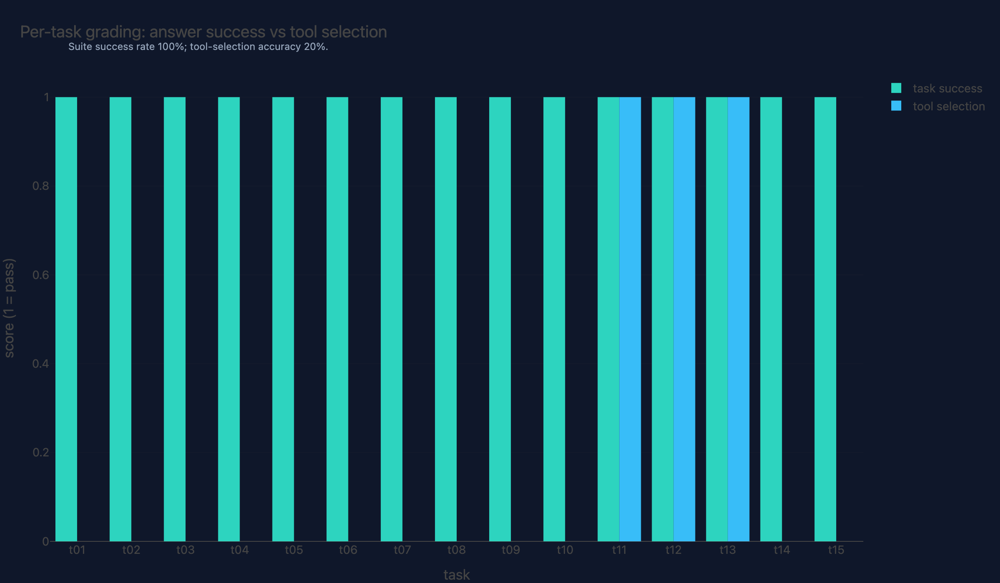
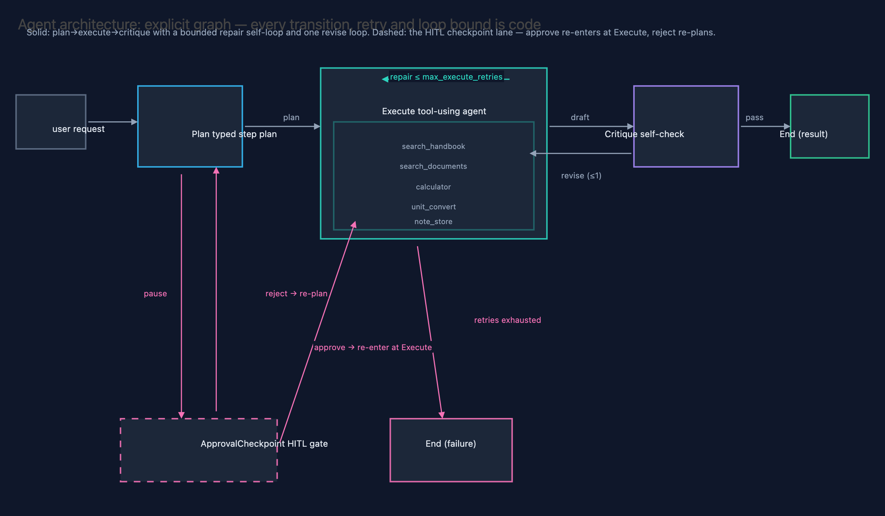

# 09 · Agentic AI Workflows

**Domain:** Agentic AI · **Data:** 12-document synthetic "Atlas Valley"
handbook + project 01's Wikipedia FAISS index (read-only) · **Status:**
working showcase on the standard platform

> A client deciding where LLM agents may run unsupervised needs graded
> evidence, not a demo.
> Headline: a 15-task deterministic suite grades a hosted multi-step
> workflow at 15/15 answer success for ~$0.01 cloud-equivalent per task —
> and catches the extra tool calls that demos hide (exact-set tool match
> 8/15; per-call traces decompose every miss).
>
> [Interactive case study with figures →](https://github.com/amm-ds/portfolio/tree/main/projects/09-agentic-workflows)

Single-shot agents are the demo; workflows are the product. This project is
the platform's dedicated agentic-AI-workflows showcase: multi-step, stateful
LLM workflows as explicit typed graphs — planning, tool orchestration,
bounded retries, self-critique, and human-in-the-loop checkpoints — graded by
a deterministic evaluation harness with per-run cost and latency budgets,
plus a cross-project retrieval arm on real data.

## Key results (full 15-task hosted run, `kimi-for-coding`)

Plain `run-all` on the hosted Kimi coding endpoint with per-call tool
capture on. How to read this table: counts are tasks passed out of 15;
tool selection is an exact-set match, so unprompted extra calls count as
misses — which is why a "failure" there can still be a correct answer.

| metric | value |
|---|---|
| tasks run | **15/15** ok (no `--ids` bound), zero retries, every critique passed |
| answer success | **15/15** |
| tool-selection accuracy | **8/15 (53%)** exact-set — up from 3/15 on the previous hosted run; the residual misses are 8 unplanned calls (`note_store` ×4, `calculator` ×2, `search_documents` ×2), decomposed per tool/task in `metrics.json detail.tooling` |
| step budget | 15/15 |
| latency | median **17.1 s**, p95 25.4 s per task; 180 s budget held 15/15 (t14 — the previous runaway at 266.9 s — finished in 18.0 s) |
| tokens / cost | 93k in + 13k out; ledger total **$0.10** cloud-equivalent of the $2.00 suite cap ($0.14 pre-cache-discount rate-card sum) |
| tooling decomposition | 47 captured tool calls: call precision **83%**, tool recall **100%** (nothing expected was ever skipped) |

{ width="100%" }

| suite | 15 tasks, 5 categories — 14 over the deterministic Atlas Valley corpus + 1 real-data lookup over 01's Wikipedia index (t15) |
|---|---|
| graders | answer success (exact keywords), tool selection (exact tool set), step budget, latency budget — deterministic `pydantic-evals` evaluators; `evaluate` runs fully offline from `data/run_records.json` |
| capture | every run record carries per-node `StepTrace`s plus per-call `tool_calls` (name, args, latency, result size, ok), the plan's step list, and the critique verdict — old records without them load with defaults |
| budgets | spend-ledger caps: $2.00 suite (`LLM_SUITE_COST_LIMIT_USD`), $0.25 per task; `budget_limits` on every live call |
| model | hosted `kimi-for-coding` via the repo-root `.env` (ADR-0004); local Ollama (`qwen3.6:35b-a3b-q4_K_M`) or any OpenAI-compatible server (e.g. LM Studio: `http://localhost:1234/v1`) through the same branch |

For comparison, the earlier bounded local run (8 of the 14 tasks then in the
suite, on `qwen3:32b`) scored 6/8 answers, 3/8 tool selection, median 474
s/task — and t07/t09 died at the plan node to reasoning-model empty-turn
flakiness.

{ width="100%" }

{ width="100%" }

{ width="100%" }

## Architecture

- **Workflow graph** — pydantic-graph `Plan → Execute → Critique → End` over a
  typed `WorkflowState`. Execute repairs validation failures on a bounded
  self-loop (`repair ≤ max_execute_retries`, then `End(failure)`); Critique
  loops `revise` back to **Execute** at most once (never back to Plan); the
  graph ends with a structured `WorkflowResult` (answer, steps, tools used,
  per-call tool traces, calibrated confidence, tokens, per-node step traces).
- **Human-in-the-loop** — a checkpoint node plans, then pauses: the typed
  `ApprovalRequest` + full state serialize to `data/checkpoint.json`; the CLI
  resumes with approve (re-enter at Execute) or reject-with-feedback (back to
  Plan with the feedback as the re-plan brief). State on disk is the single
  source of truth.
- **Tools & toolsets** — a "research ops" domain (fictional Atlas Valley field
  station); every call is traced into the run record by signature-preserving
  wrappers (the model-visible schema is unchanged):

  | tool | signature | does | guardrail | this run |
  |---|---|---|---|---|
  | `calculator` | `(expr) -> float` | AST arithmetic | no names/calls; exponent ≤ 64 | 16 calls / 11 tasks (2 unplanned) |
  | `unit_convert` | `(value, from, to) -> float` | fixed-table unit conversion | dimension match enforced | 3 / 3 |
  | `search_handbook` | `(query, top_k=3) -> list[str]` | keyword search, 12-doc in-code corpus | deterministic scoring | 19 / 11 |
  | `search_documents` | `(query, top_k=3) -> list[str]` | dense retrieval over 01's FAISS index (read-only) | prebuilt index, no writes | 4 / 3 (2 unplanned) |
  | `note_store` | `(ctx, action, note="") -> list[str]` | per-run notebook | empty append rejected | 5 / 5 (4 unplanned) |

  A second math toolset is composed via `PrefixedToolset`
  (`math_percent_change`, `math_round_to`) — two toolsets, one agent, zero
  name collisions, unit-tested.
- **Hosted/local model presets** — when a hosted provider is configured, every
  node agent is built with the platform preset: thinking disabled (big token
  saving) and temperature omitted (the endpoint rejects explicit values).
  LM Studio (`LLM_BASE_URL=http://localhost:1234/v1`, `LLM_API_KEY=lm-studio`)
  is the documented equivalent local preset — any OpenAI-compatible local
  server rides the same branch.
- **Evaluation** — `pydantic-evals` dataset + custom evaluators (suite in
  `src/agentic_workflows/evals.py`); run stage (live LLM) and evaluate stage
  (offline grading) are separate DVC stages. `metrics.json detail.tooling`
  decomposes the exact-set tool score offline from the captured traces.

## Figures

The showcase figures — per-task grading (answer success vs tool selection),
cost/latency per task, the tool-usage matrix (calls per task × tool from the
captured traces), the node waterfall (per-visit latency stack), and the agent
architecture diagram — live in `reports/figures/` (one `.html` + `.json` per
figure, served by the showcase API). Aggregates in `reports/metrics.json`
(key `agentic_suite`, plus `detail.tooling` for the trajectory
decomposition); full report in `reports/report.html`.

## Where things live

- Code + design: [projects/09-agentic-workflows](https://github.com/amm-ds/portfolio/tree/main/projects/09-agentic-workflows) —
  CLI `prepare | run | run-all | evaluate | checkpoint request|approve|reject`, DVC stages in `dvc.yaml`
- Options & rationale: [DESIGN.md](https://github.com/amm-ds/portfolio/tree/main/projects/09-agentic-workflows/DESIGN.md)
- 62 offline tests cover the graph, HITL, tools, documents, budget wiring, tool capture, and eval machinery.

## Reproduce

```bash
cd projects/09-agentic-workflows
uv run python -m agentic_workflows.cli prepare
uv run python -m agentic_workflows.cli run-all     # live run (hosted or local provider)
uv run python -m agentic_workflows.cli evaluate    # offline grading → reports/
```

Provider: repo-root `.env` (see `.env.example`) with `LLM_BASE_URL` +
`LLM_API_KEY` for hosted, Ollama running for local, or LM Studio with the
local preset above. Task t15 needs 01's index materialized
(`projects/01-rag-agent/data/index/chunks_200`).

Tests are fully offline (scripted `FunctionModel`, fixture search index):
`uv run pytest projects/09-agentic-workflows/tests`
