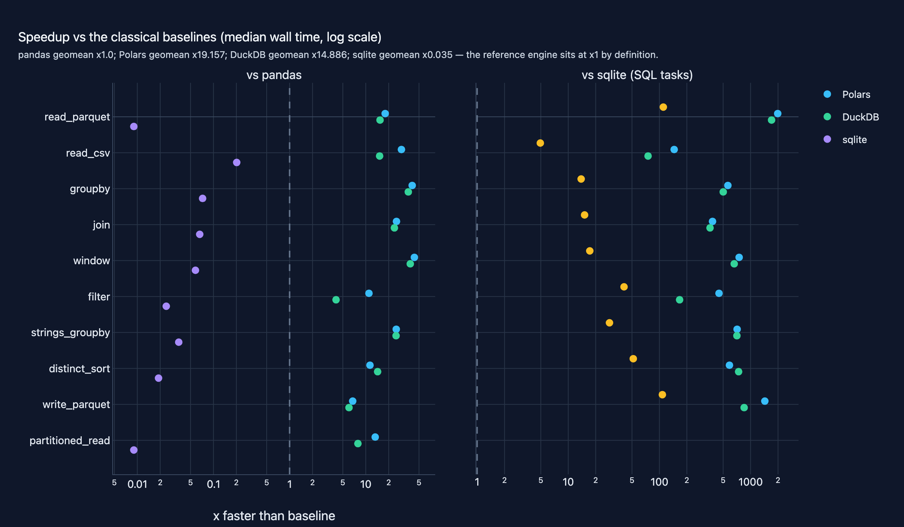
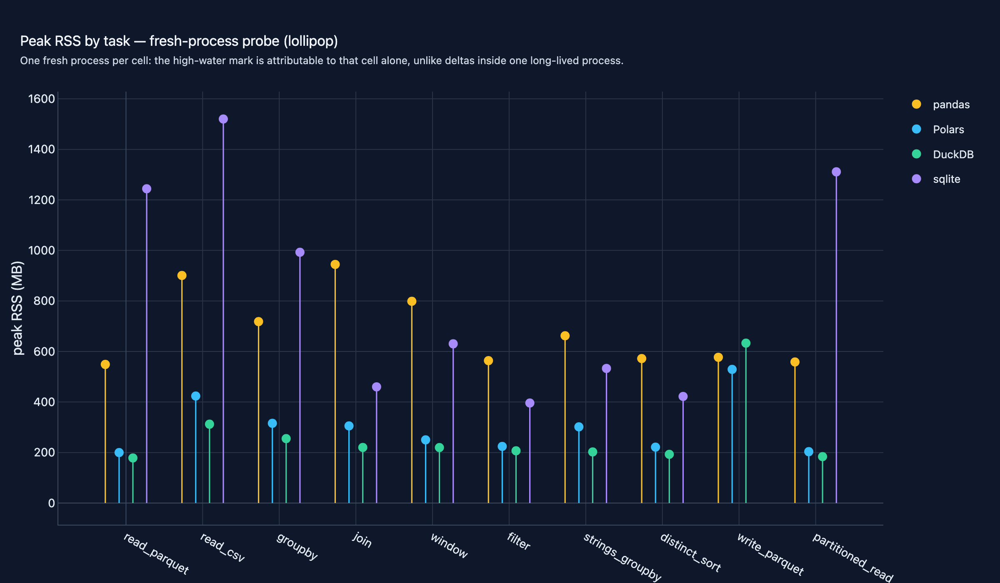

# 11 · DataFrame Engines Benchmark (pandas / Polars / DuckDB / sqlite)

**Domain:** data engineering ·
**Data:** NYC TLC yellow taxi 2024-01 (2,964,624 trips, real parquet, sha256-pinned) + seeded synthetic CI/scalability tracks ·
**Status:** working showcase —
[Project README](https://github.com/amm-ds/portfolio/tree/main/projects/11-data-engineering) ·
[DESIGN.md](https://github.com/amm-ds/portfolio/tree/main/projects/11-data-engineering/DESIGN.md) ·
[Dataset card](https://amm-ds.github.io/portfolio/data-registry/nyc-tlc/)

> Ten data tasks over 2.96M NYC taxi trips, parity-checked on pandas,
> Polars, DuckDB and stdlib sqlite: Polars 19x, DuckDB 15x pandas; sqlite
> answers every SQL task but file conversion leaves it ~29x slower; 1M-10M
> tracks show the fast two scaling sub-linearly. NYC TLC 2024-01.

**TL;DR:** data teams choosing between pandas, Polars and DuckDB — now with
stdlib sqlite as the honest classical baseline — where the answer depends on
the task mix: the engines tie on warm parquet reads and sit up to 44x apart
on group-by and window work. The benchmark is a reusable harness — pinned
data, one contract per task, equal results enforced before any timing
counts.

[Case study source and interactive figures on GitHub →](https://github.com/amm-ds/portfolio/tree/main/projects/11-data-engineering)

{ width="100%" }

The engine question comes up in every data platform engagement, and the
public answers rarely survive scrutiny: different queries per engine, no
correctness check, numbers from an unknown machine. This project answers
with a measured map over **2,964,624 real January-2024 yellow-taxi trips**:
ten analytics-shaped tasks — parquet read, CSV read, per-day group-by, zone
join, top-N-per-day window, filtered scan, string group-by, distinct sort,
parquet write, and a 31-file partitioned read — each implemented on
**pandas 2.x**, **Polars (lazy)**, **DuckDB (SQL)** and **stdlib sqlite**
behind one contract: identical canonical results on every engine, enforced
as a hard gate before any stopwatch starts. sqlite cannot read parquet or
CSV itself, so each task loads the file into its in-memory database inside
the timed cell — that conversion is the honest cost of the classical
engine, not a fudged number.

## Key results (real run, seed 42, median of 5 untraced warm repeats)

Median wall time per task, seconds; × = speedup vs pandas (bold: ladder
total). Every measured cell passed the canonical-result gate (counts and
keys exact, float sums within a 1e-5 band — parallel summation reorder is
noise, not drift). write_parquet is honestly **n/a** for sqlite.

| task | pandas | Polars | DuckDB | sqlite | Polars × | DuckDB × |
|---|---|---|---|---|---|---|
| read_parquet | 0.044 | 0.002 | 0.003 | 4.869 | 18.0 | 15.4 |
| read_csv | 1.165 | 0.040 | 0.077 | 5.753 | 29.4 | 15.2 |
| groupby | 0.374 | 0.009 | 0.010 | 5.179 | 40.7 | 36.2 |
| join | 0.242 | 0.010 | 0.010 | 3.650 | 25.3 | 23.8 |
| window | 0.341 | 0.008 | 0.009 | 5.882 | 43.5 | 38.4 |
| filter | 0.048 | 0.004 | 0.012 | 1.947 | 11.0 | 4.1 |
| strings_groupby | 0.149 | 0.006 | 0.006 | 4.212 | 25.1 | 25.0 |
| distinct_sort | 0.075 | 0.007 | 0.005 | 3.866 | 11.4 | 14.3 |
| write_parquet | 0.500 | 0.074 | 0.083 | n/a | 6.7 | 6.0 |
| partitioned_read | 0.048 | 0.004 | 0.006 | 5.190 | 13.3 | 7.9 |
| **total / geomean** | **2.99** | **0.16** | **0.22** | **40.55** | **×19.2** | **×14.9** |

Fresh-process peak RSS: pandas 549–945 MB (945 MB on the join), Polars
200–529 MB, DuckDB 178–633 MB, sqlite 396–1,520 MB (frame and database
coexist). The map, not the mean, is the takeaway: parquet IO sits at
11–18x (the page cache, not the engine, sets the price at this size),
22–43x on joins, CSV and window work, and sqlite pays seconds per task in
conversion. The gates earned their keep before the first figure shipped:
the parity check caught pandas silently dropping every trip whose borough
is the literal string "N/A" (the default CSV parser reads it as missing;
1,658 trips), and the determinism gate caught parallel-float rounding
cliffs — both now regression-tested.

Seeded 1M/3M/10M scalability tracks separate the engines further: pandas
and sqlite grow linearly (log-log slopes 0.98–1.09) while Polars (0.44–0.76)
and DuckDB (0.31–0.65) grow sub-linearly — the per-row advantage widens
with scale. At 10M group-by: pandas 1.15 s, Polars 0.031 s, DuckDB 0.020 s,
sqlite 26.4 s.

The full protocol (median-of-5 untraced warm repeats, one dedicated traced
allocation pass per cell, cold fresh-process IO reads, true peak RSS in a
fresh process), versions and hardware live in
`reports/evaluation_metadata.json`; per-task tables and figures in
`reports/`. A seeded synthetic track runs the whole protocol in about
26 seconds — that is the CI path.

{ width="100%" }
