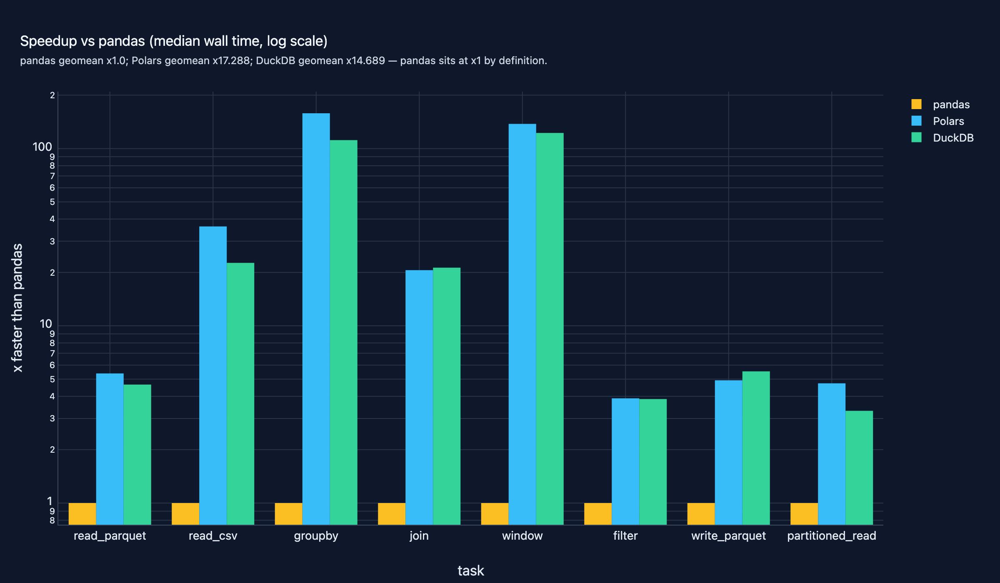
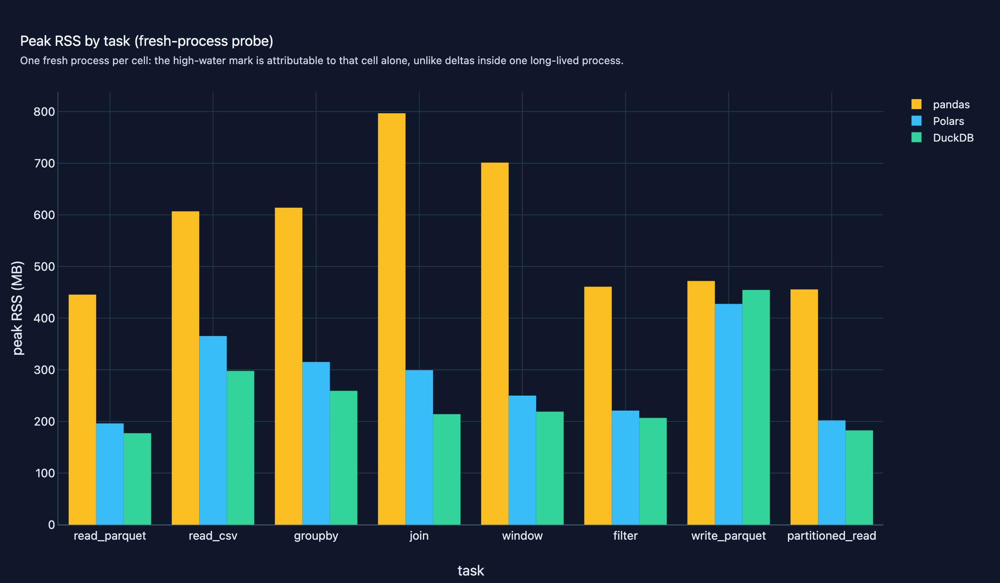

# 11 · Data Engineering (pandas / Polars / DuckDB)

**Domain:** data engineering ·
**Data:** NYC TLC yellow taxi 2024-01 (2,964,624 trips, real parquet, sha256-pinned) ·
**Status:** working showcase —
[Project README](https://github.com/amm-ds/portfolio/tree/main/projects/11-data-engineering) ·
[DESIGN.md](https://github.com/amm-ds/portfolio/tree/main/projects/11-data-engineering/DESIGN.md) ·
[Dataset card](https://amm-ds.github.io/portfolio/data-registry/nyc-tlc/)

> Eight data tasks over 2.96M NYC taxi trips on pandas, Polars and DuckDB,
> results parity-checked: Polars x17.3, DuckDB x14.7 vs pandas on the geomean
> — widest on CSV parsing, narrowest on parquet IO. Parity caught pandas
> dropping the N/A borough. Data: NYC TLC yellow 2024-01.
>
> **TL;DR:** data teams choosing between pandas, Polars and DuckDB, where the
> honest answer depends on the task mix: the same three engines tie on warm
> parquet reads and sit up to 170x apart on group-by and window work. The
> benchmark is a reusable harness — pinned data, one contract per task, equal
> results enforced before any timing counts.
>
> [Case study source and interactive figures on GitHub →](https://github.com/amm-ds/portfolio/tree/main/projects/11-data-engineering)

{ width="100%" }

The engine question comes up in every data platform engagement, and the
public answers rarely survive scrutiny: different queries per engine, no
correctness check, numbers from an unknown machine. This project answers
with a measured map over **2,964,624 real January-2024 yellow-taxi trips**:
eight analytics-shaped tasks — parquet read, CSV read, per-day group-by,
zone join, top-N-per-day window, filtered scan, parquet write, and a
31-file partitioned read — each implemented on **pandas 2.x**, **Polars
(lazy)**, and **DuckDB (SQL)** behind one contract: identical canonical
results on all three, enforced as a hard gate before any stopwatch starts.

## Key results (real run, seed 42, median of 5 warm repeats)

Median wall time per task, seconds; × = speedup vs pandas (bold: ladder
total). Every cell passed the canonical-result gate (counts and keys exact,
float sums within a 1e-5 band — parallel summation reorder is noise, not
drift).

| task | pandas | Polars | DuckDB | Polars × | DuckDB × |
|---|---|---|---|---|---|
| read_parquet | 0.014 | 0.003 | 0.003 | 5.4 | 4.7 |
| read_csv | 1.444 | 0.040 | 0.064 | 36.4 | 22.6 |
| groupby | 1.517 | 0.010 | 0.014 | 158.1 | 111.5 |
| join | 0.205 | 0.010 | 0.010 | 20.6 | 21.3 |
| window | 1.491 | 0.011 | 0.012 | 137.6 | 122.4 |
| filter | 0.018 | 0.005 | 0.005 | 3.9 | 3.9 |
| write_parquet | 0.277 | 0.056 | 0.050 | 4.9 | 5.5 |
| partitioned_read | 0.017 | 0.004 | 0.005 | 4.7 | 3.3 |
| **total / geomean** | **4.98** | **0.14** | **0.16** | **×17.3** | **×14.7** |

Fresh-process peak RSS: pandas 446–797 MB (797 MB on the join), Polars
196–428 MB, DuckDB 177–455 MB — on the write task all three tie around
428–455 MB. The map, not the mean, is the takeaway: 3–5x on parquet IO
(the page cache, not the engine, sets the price at this size), 21–36x on
joins and CSV parsing, and 111–158x on the group-by and window tasks where
pandas builds Python-object intermediates. The gates earned their keep
before the first figure shipped: the parity check caught pandas silently
dropping every trip whose borough is the literal string "N/A" (the default
CSV parser reads it as missing; 1,658 trips), and the repeat gate caught
parallel-float rounding cliffs — both now regression-tested.

The full protocol (median-of-5 warm repeats, cold fresh-process IO reads,
true peak RSS in a fresh process per cell), versions and hardware live in
`reports/evaluation_metadata.json`; per-task tables and figures in
`reports/`. A seeded synthetic track runs the whole protocol in about
15 seconds — that is the CI path.

{ width="100%" }
