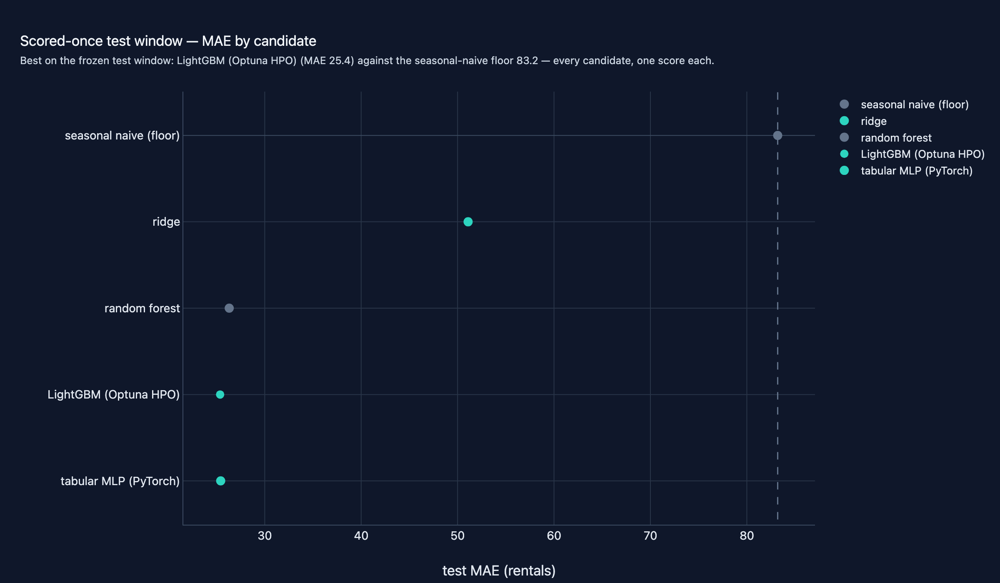
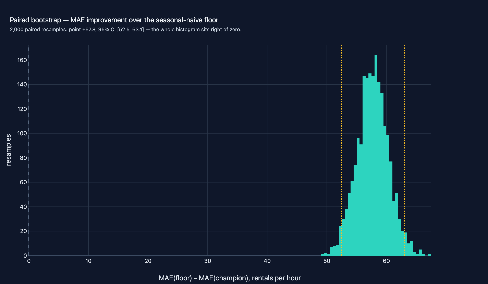

# 12 · Tabular ML & Deep Learning Lifecycle

**Domain:** classical ML + deep learning ·
**Data:** UCI Bike Sharing, Capital Bikeshare hourly (17,379 rows, real, sha256-pinned) + seeded synthetic CI twin ·
**Status:** working showcase —
[Project README](https://github.com/amm-ds/portfolio/tree/main/projects/12-tabular-ml-lifecycle) ·
[DESIGN.md](https://github.com/amm-ds/portfolio/tree/main/projects/12-tabular-ml-lifecycle/DESIGN.md) ·
[Dataset card](https://amm-ds.github.io/portfolio/data-registry/bike-sharing/)

> Real UCI Capital Bikeshare hourly demand (17,379 rows): a seeded ladder from
> seasonal-naive to LightGBM and a hand-written PyTorch MLP reaches 25.4 MAE on the
> scored-once 8-week test vs 83.2 for the floor - a 57.8/hour gain (95% CI 52.5-63.1);
> validation picked the MLP.

**TL;DR:** teams asking how much better than "same hour last week" a model can
honestly get on one tabular series — and whether a deep model with a
hand-written loop earns its keep against linear and boosted trees. The answer
here: a dead heat at the top of the ladder, decided by validation, with the
margin over the floor priced by an interval, not asserted. The lifecycle is
the deliverable: pinned ingest, 26 DQ gates, a written feature-selection
contract, a seeded five-model ladder, and a test window no choice touches.

[Case study source and interactive figures on GitHub →](https://github.com/amm-ds/portfolio/tree/main/projects/12-tabular-ml-lifecycle)

{ width="100%" }

Every stage follows one contract. The raw UCI zip passes a sha256 gate,
then 26 DQ checks (nulls, ranges, grid gaps) before any model is fit. The
`casual`/`registered` columns sum to the target, so both are dropped at
load — keeping them is textbook target leakage. The series has 165 missing
hours (~1%, the January 2011 outage pattern), so lag features are
positional shifts over the observed sequence and the gate bounds the
missing fraction at 2% instead of demanding a perfect grid. The split is
time-based throughout: the final 8 weeks (1,344 rows) are the scored-once
test window, the 8 weeks before are validation, and everything earlier —
14,523 rows after the 168-row lag warm-up — is training.

Feature selection runs on evidence, not habit: mutual information on the
training window ranks the three past-count lags first (MI 0.89 / 0.76 /
0.71 nats), validation permutation importance agrees, and the
correlated-pair rule resolves the heatmap's near-duplicate by dropping
`atemp` at |r| = 0.987 with `temp`. Fifteen features survive into a fully
seeded ladder — seasonal naive, ridge, random forest, LightGBM under a
time-budgeted Optuna study (50 trials, 240 s), and a PyTorch MLP with an
hour embedding, Huber loss in standardized-y space, and early stopping —
with loss curves, learning curves, and a 2x2x2 regularization ablation
committed as overfitting evidence.

## Key results (real run: UCI Bike Sharing, 17,379 rows → 1,344-row scored-once test window)

Median wall time is not the metric here — MAE in rentals per hour is,
with RMSE secondary and MAPE floored at 1 rental (near-zero hours at 4h
keep MAPE high for everyone; read MAE first). Every candidate's one test
score:

| candidate | val MAE | test MAE | test RMSE | test MAPE % |
|---|---|---|---|---|
| seasonal naive (floor) | 88.7 | 83.2 | 134.0 | 153.2 |
| ridge | 68.9 | 51.1 | 77.8 | 86.4 |
| random forest | 39.5 | 26.3 | 45.7 | 25.7 |
| LightGBM (Optuna HPO, 50 trials) | 34.4 | 25.4 | 40.2 | 27.4 |
| tabular MLP (PyTorch) ← champion | 34.2 | 25.4 | 39.3 | 33.7 |

Champion vs floor: +57.8 rentals/hour point estimate over 2,000 paired
bootstrap resamples, 95% CI [52.5, 63.1] — excludes zero. The ladder is
honest about its ordering: validation picked the MLP (34.2 vs LightGBM's
34.4) before the test confirmed it, and on the single test pass LightGBM's
MAE lands 0.06 rentals lower while the MLP answers with the better RMSE
(39.3 vs 40.2) — a dead heat, shipped as the MLP because the loop and its
measured controls are the deliverable. The ablation is read at face value:
every early-stopping-off row worsens validation MAE, while dropout and
weight decay sit inside row noise. The residual slices say where the
remaining error lives — spring rush hours over-forecast, winter morning
peaks under-forecast — and the limits sit next to the numbers: one city,
two seasons, positional lags around the missing hours, transfer plausible
but not measured.

{ width="100%" }

The full protocol (time-based split, judging rules, 2,000 paired bootstrap
resamples of the per-row MAE delta), versions and hardware live in
`reports/evaluation_metadata.json`; per-candidate tables and figures in
`reports/`. A seeded synthetic twin regenerates the same schema offline
and runs the whole path in CI without touching the network.
