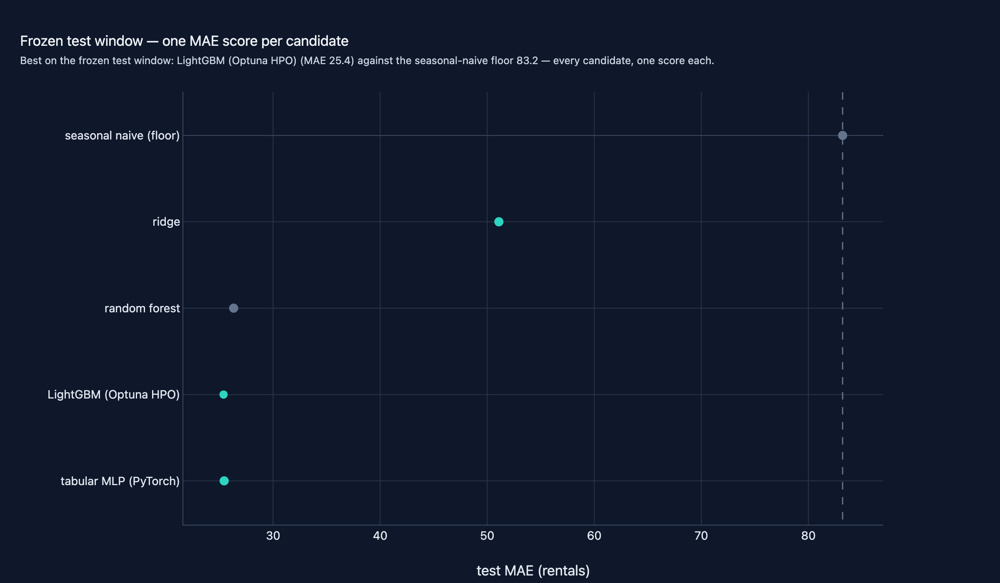

# 12 · Tabular ML & Deep Learning Lifecycle

**Domain:** classical ML + deep learning ·
**Data:** UCI Bike Sharing, Capital Bikeshare hourly (17,379 rows, real, sha256-pinned) + seeded synthetic CI twin ·
**Status:** working showcase —
[Project README](https://github.com/amm-ds/portfolio/tree/main/projects/12-tabular-ml-lifecycle) ·
[DESIGN.md](https://github.com/amm-ds/portfolio/tree/main/projects/12-tabular-ml-lifecycle/DESIGN.md) ·
[Dataset card](https://amm-ds.github.io/portfolio/data-registry/bike-sharing/)

> Real UCI Capital Bikeshare hourly demand (17,379 rows): the validation-selected
> LightGBM reaches 23.8 test MAE vs 73.0 for the seasonal-naive floor (v2 recipe:
> timestamp lags, `atemp` kept). The 49.2/hour gain has hourly 95% CI 44.4-54.0
> and week-block sensitivity 33.0-63.8.

**TL;DR:** teams asking how much better than "same hour last week" a model can
honestly get on one tabular series — and whether a deep model with a
hand-written loop earns its keep against linear and boosted trees. The answer
here: the boosted tree wins validation and test under the corrected v2 recipe,
with the margin over the floor priced by an interval, not asserted. The lifecycle
is the deliverable: pinned ingest, 26 DQ gates, a written feature-selection
contract, a seeded five-model ladder, and a test window no choice touches.

[Case study source and interactive figures on GitHub →](https://github.com/amm-ds/portfolio/tree/main/projects/12-tabular-ml-lifecycle)

{ width="100%" }

Every stage follows one contract. The raw UCI zip passes a sha256 gate,
then 26 DQ checks (nulls, ranges, grid gaps) before any model is fit. The
`casual`/`registered` columns sum to the target, so both are dropped at
load — keeping them is textbook target leakage. The series has 165 missing
hours (~1%, the January 2011 outage pattern), so under the committed v2 recipe
lag features join on the exact wall-clock hour (`timestamp - h`) and are NaN
when that hour is missing; NaN-lag rows leave train/validation, and the frozen
test window keeps every row with those few lag cells median-imputed from
training. The split is time-based throughout: the final 8 weeks (1,344 rows)
are the scored-once test window, the 8 weeks before are validation
(1,301 rows), and everything earlier — 14,273 rows after the lag warm-up and
the complete-case drop — is training.

Feature selection runs on evidence, not habit: mutual information on the
training window ranks the three past-count lags first (MI 1.00 / 0.88 /
0.78 nats), validation permutation importance agrees, and the
correlated-pair rule keeps the higher-information member of the heatmap's
near-duplicate pair — `atemp` over `temp` at |r| = 0.987. Fifteen features
survive into a fully seeded ladder — seasonal naive, ridge, random forest,
LightGBM under a time-budgeted Optuna study (50 trials, 240 s), and a PyTorch
MLP with an hour embedding, Huber loss in standardized-y space, and early
stopping — with loss curves, learning curves, and a 2x2x2 regularization
ablation committed as overfitting evidence.

## Key results (real run: UCI Bike Sharing, 17,379 rows → 1,344-row scored-once test window)

Median wall time is not the metric here — MAE in rentals per hour is,
with RMSE secondary and MAPE floored at 1 rental (near-zero hours at 4h
keep MAPE high for everyone; read MAE first). Every candidate's one test
score:

| candidate | val MAE | test MAE | test RMSE | test MAPE % |
|---|---|---|---|---|
| seasonal naive (floor) | 62.4 | 73.0 | 120.0 | 129.9 |
| ridge | 56.6 | 48.7 | 72.2 | 101.1 |
| random forest | 36.2 | 26.1 | 42.4 | 62.5 |
| LightGBM (Optuna HPO) ← served | 31.9 | 23.8 | 37.1 | 53.3 |
| tabular MLP (PyTorch) | 35.1 | 27.2 | 40.4 | 47.7 |

Served LightGBM vs floor: +49.2 rentals/hour point estimate over 2,000 paired
bootstrap resamples. The hourly 95% CI is [44.4, 54.0]; day-block and
week-block sensitivity intervals are [37.4, 61.2] and [33.0, 63.8]. All
exclude zero, and the wider block intervals expose serial dependence rather
than providing independent confirmation. The ladder is honest about its
ordering: validation picked LightGBM (31.9 vs the MLP's 35.1) before the
test confirmed it — the paired validation interval (MLP − LightGBM +3.2
[CI +1.8, +4.5]) excludes zero, so there is no tie. The ablation is read at
face value: every early-stopping-off row worsens validation MAE, while the
dropout-off, weight-decay-off row reaches 29.5 — below the served LightGBM —
but stays a post-freeze diagnostic, never a selection input. The residual
slices say where the remaining error lives — late-December evenings
over-forecast, winter mornings under-forecast — and the limits sit next to
the numbers: one city over two years and four seasons, transfer plausible
but not measured.

v2 fixes two disclosed v1 defects; v1 remains for comparison. The v1 pruning
rule dropped `atemp` (the higher-information member of the `temp`/`atemp`
pair), and v1 lags shifted positionally across the missing hours. The
corrected MLP is worse (27.16 vs 25.43); the corrected LightGBM is better
(23.76 vs 25.37) and is now the served model. The v1 run is preserved under
`previous_runs.v1` in `reports/metrics.json`, and the paired v1→v2 comparison
with block-bootstrap CIs stays in `reports/sensitivity_pruning_lags.json`.

{ width="100%" }

The full protocol (time-based split, judging rules, 2,000 paired bootstrap
resamples of the per-row MAE delta), versions and hardware live in
`reports/evaluation_metadata.json`; per-candidate tables and figures in
`reports/`. A seeded synthetic twin regenerates the same schema offline
and runs the whole path in CI without touching the network.
