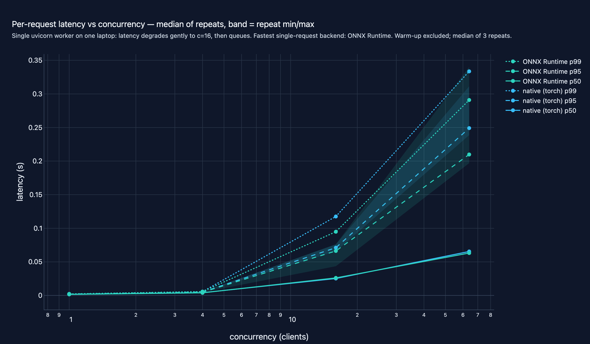
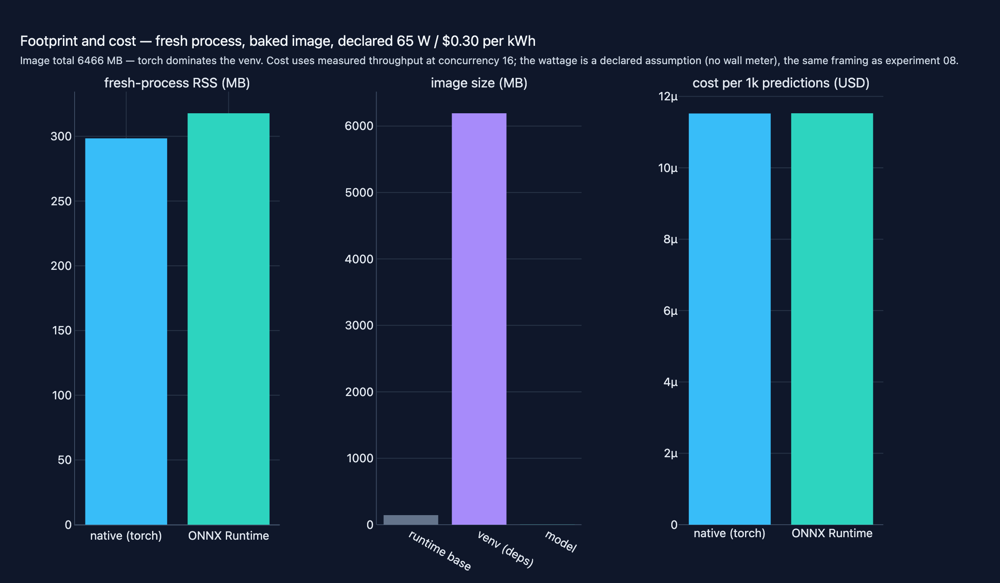

# 13 · Model API Serving & Docker Deployment

**Domain:** model serving & deployment ·
**Data:** champion MLP re-derived from experiment 12's committed recipe (UCI Bike Sharing hourly, sha256-pinned) ·
**Status:** working showcase —
[Project README](https://github.com/amm-ds/portfolio/tree/main/projects/13-model-serving) ·
[DESIGN.md](https://github.com/amm-ds/portfolio/tree/main/projects/13-model-serving/DESIGN.md) ·
[Dataset card](https://amm-ds.github.io/portfolio/data-registry/bike-sharing/)

> Experiment 12's champion MLP (25.4316 test MAE) is re-derived, exported to
> ONNX behind a hard parity gate (7.2e-07 max-abs), and served two ways from
> one FastAPI schema. Seeded paired tests: 1.6 ms p50, ~950 req/s knee, ~56k
> rows/s batched; image 6.5 GB, mostly unused CUDA.

**TL;DR:** teams asking what serving a champion tabular model actually
looks like — latency percentiles, a throughput knee, batch curves, memory,
image size, and a cost line with its assumptions written down. Three gates
stand before any benchmark number is trusted: the served artifact must be
the champion (re-derived from the committed recipe, bit for bit), the
export must compute the same function as the native model (parity gate),
and the measurement must be paired, warmed, and seeded. The reusable asset
is the protocol; the absolute laptop numbers do not transfer, the curve
shapes and paired deltas do.

[Case study source and interactive figures on GitHub →](https://github.com/amm-ds/portfolio/tree/main/projects/13-model-serving)

{ width="100%" }

The study does not import experiment 12 — workspace members are siblings,
not deps — it re-implements the tiny recipe: the same pinned zip, the same
cyclical features and past-only lags, the same selection rule (15 features,
`atemp` pruned at r = 0.987), the same hour-embedding MLP, the same seed
42. The re-derived frame checksum matches experiment 12's dataset contract
and the model lands on the same test MAE digit for digit (25.4316) before
anything is exported. The ONNX export (opset 17, dynamic batch) then faces
a hard parity gate: 512 seeded probe rows across the legal feature
envelope, native vs ONNX Runtime within 1e-4 max-abs on the raw network
output — measured at 7.15e-07, three orders inside the gate.

One small FastAPI service serves either backend behind a `--backend
native|onnx` flag — a pydantic request schema mirroring the feature
contract (malformed payloads get the standard 422), `/predict` and
`/predict/batch`, `/health` and `/ready` (readiness flips only after
warm-up rows flow through), a request id on every response, and structured
error envelopes. The hand-written async driver load-tests both backends as
real subprocesses on byte-identical seeded request streams.

## Key results (author run: one laptop, no GPU, one uvicorn worker, seed 42)

Median of 3 repeats per cell; warm-up excluded; zero errors in every cell.
Latency percentiles, concurrency sweep at 300 requests per cell:

| concurrency | native p50 ms | onnx p50 ms | native req/s | onnx req/s |
|---|---|---|---|---|
| 1 | 1.6 | 1.6 | 595 | 612 |
| 4 | 4.0 | 3.9 | 933 | 970 |
| 16 | 25.2 | 26.1 | 470 | 470 |
| 64 | 65.4 | 63.1 | 628 | 716 |

Batch endpoint, rows/s at sizes 1/8/32/128 (per-request latency stays
flat under saturation — the queue, not the model, sets the price):

| batch size | native rows/s | onnx rows/s |
|---|---|---|
| 1 | 577 | 513 |
| 8 | 4,425 | 5,104 |
| 32 | 16,797 | 18,674 |
| 128 | 55,806 | 57,451 |

Throughput climbs to a knee near 950 req/s around concurrency 4; past it
the co-located driver contends for the same CPU and the curve reshuffles —
high-concurrency cells measure contention, not pure service capacity, and
ONNX's up-to-15% leads at the saturated cells read as scheduling noise on
a shared CPU, not capability. The footprint story is measured, not
estimated: fresh-process RSS 298 vs 318 MB (native vs ONNX), and a 6.47 GB
image — 145 MB base, 6.19 GB venv, 1 MB model — dominated by torch and the
3.3 GB CUDA stack a CPU service never loads. A `chown` after `COPY` once
doubled the venv layer (12.8 GB); measuring found it. Electricity at the
measured knee: ~$1.15e-05 per 1k predictions at a declared 65 W and $0.30
per kWh — an assumption stated next to the number, not a measurement.

{ width="100%" }

The full protocol (reproduction gate, 512-row parity probe grid, paired
benchmark with warm-up excluded and median-of-3 repeats, fresh-process RSS
probes, multi-stage Docker build with healthcheck-gated readiness),
versions and hardware live in `reports/evaluation_metadata.json`;
per-cell tables and figures in `reports/`. Deliberately skipped, and said
so: TLS/auth, multi-worker serving, GPU serving, and a torch-free slim
image.
