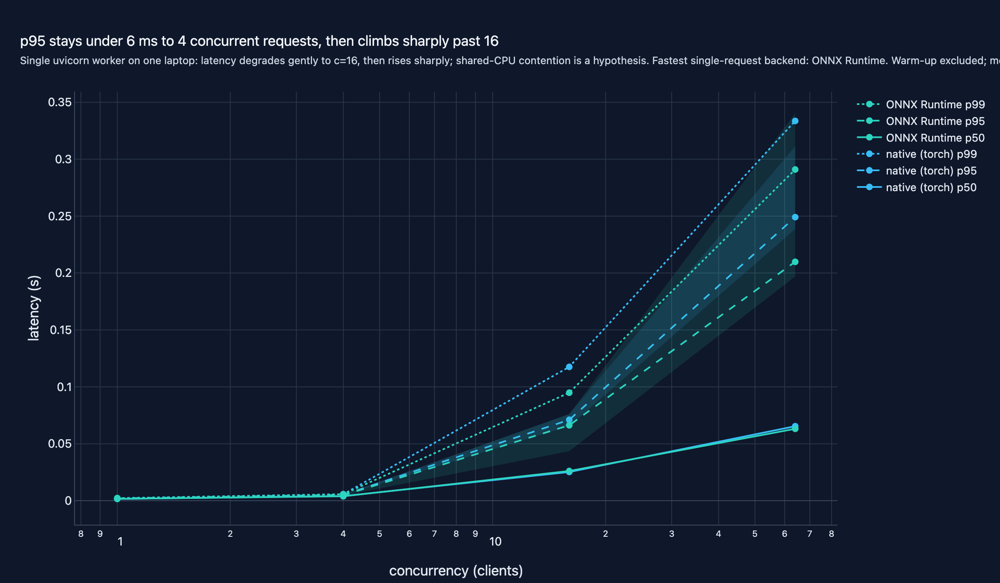
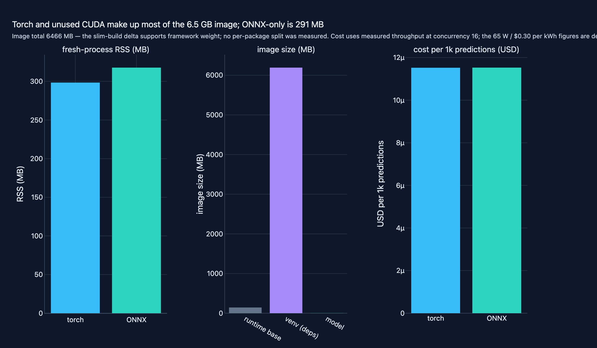

# 13 · Model API Serving & Docker Deployment

**Domain:** model serving & deployment ·
**Data:** served LightGBM re-derived from experiment 12's committed v2 recipe (UCI Bike Sharing hourly, sha256-pinned) ·
**Status:** working showcase —
[Project README](https://github.com/amm-ds/portfolio/tree/main/projects/13-model-serving) ·
[DESIGN.md](https://github.com/amm-ds/portfolio/tree/main/projects/13-model-serving/DESIGN.md) ·
[Dataset card](https://amm-ds.github.io/portfolio/data-registry/bike-sharing/)

> Project 12's v2 LightGBM (23.7636 test MAE) is rebuilt and exported to ONNX
> behind a 2.6e-4-rental parity gate. One FastAPI schema serves both backends.
> Paired tests: 2.0 ms p50 native, ~1,012 req/s knee, 28k-41k rows/s batched;
> image 1,060 MB, or 292 MB ONNX-only.

**TL;DR:** teams asking what serving a selected tabular model actually
looks like — latency percentiles, a throughput knee, batch curves, memory,
image size, and a cost line with its assumptions written down. Three gates
stand before any benchmark number is trusted: the served artifact must be
the selected model (re-derived from the committed v2 recipe, bit for bit),
the export must compute the same function as the native model (parity gate),
and the measurement must be paired, warmed, and seeded. The reusable asset
is the protocol; absolute numbers, curve shapes, and paired deltas are all
host-specific observations to re-measure on the target deployment.

[Case study source and interactive figures on GitHub →](https://github.com/amm-ds/portfolio/tree/main/projects/13-model-serving)

{ width="100%" }

The study does not import experiment 12 — workspace members are siblings,
not deps — it re-implements the tiny recipe: the same pinned zip, the same
cyclical features and date-aware lags joined on `timestamp - h`, the same
selection rule (15 features, `atemp` kept over `temp` at r = 0.987), the
same seeded Optuna study and final fit, the same seed 42. The re-derived
frame checksum matches experiment 12's dataset contract and the model lands
on the same test MAE digit for digit (23.7636) before anything is exported.
The v2 MLP (27.16) is the cited validation runner-up, not the served model.
The ONNX export (opset 15, dynamic batch) then faces a hard parity gate:
512 seeded probe rows across the legal feature envelope, native vs ONNX
Runtime within 1e-4 max-abs plus a float32 relative term on the raw
prediction — measured at 2.65e-4 rentals, about 26× inside the limit.

One small FastAPI service serves either backend behind a `--backend
native|onnx` flag — a pydantic request schema mirroring the feature
contract (malformed payloads get the standard 422), `/predict` and
`/predict/batch`, `/health` and `/ready` (readiness flips only after
warm-up rows flow through), a request id on every response, and structured
error envelopes. The hand-written async driver load-tests both backends as
real subprocesses on byte-identical seeded request streams.

## Key results (author run: one laptop, no GPU, one uvicorn worker, seed 42)

Median of 3 repeats per cell; warm-up excluded; zero errors in every cell.
Latency percentiles, concurrency sweep at 300 requests per cell:

| concurrency | native p50 ms | onnx p50 ms | native req/s | onnx req/s |
|---|---|---|---|---|
| 1 | 2.0 | 2.4 | 452 | 237 |
| 4 | 3.7 | 6.9 | 1,012 | 528 |
| 16 | 26.5 | 35.6 | 468 | 317 |
| 64 | 68.6 | 125.5 | 606 | 332 |

Explicit batch endpoint, rows/s at sizes 1/8/32/128. Per-request latency
stays comparatively flat under saturation; the figure does not separate
queueing from computation or test dynamic request batching:

| batch size | native rows/s | onnx rows/s |
|---|---|---|
| 1 | 429 | 382 |
| 8 | 3,975 | 4,432 |
| 32 | 13,645 | 19,209 |
| 128 | 28,223 | 40,872 |

Native throughput climbs to a knee near 1,012 req/s around concurrency 4;
past it the co-located driver contends for the same CPU and the curve
reshuffles — high-concurrency cells measure contention, not pure service
capacity, and the backend gaps read as scheduling noise on a shared CPU,
not capability. The footprint story is measured, not estimated:
fresh-process RSS 213 vs 113 MB (native vs ONNX), and a 1,060 MB image —
145 MB base, 983 MB venv, 2 MB model. Torch is out of the serving path
entirely; the v1 MLP image measured 6.5 GB with its torch and CUDA stack.
Electricity uses the committed concurrency-16 throughput basis:
~$1.16e-05 native and ~$1.71e-05 ONNX per 1k predictions at a declared
65 W and $0.30 per kWh. That cost basis is not the concurrency-4
throughput knee, and the wattage is an assumption, not a measurement.

{ width="100%" }

The full protocol (reproduction gate, 512-row parity probe grid, paired
benchmark with warm-up excluded and median-of-3 repeats, fresh-process RSS
probes, multi-stage Docker build with healthcheck-gated readiness),
versions and hardware live in `reports/evaluation_metadata.json`;
per-cell tables and figures in `reports/`. The measured ONNX-only slim image
is 292 MB (3.6× smaller than the full image) and passes its
readiness/prediction smoke; the full image retains both backends. The v1
study (served MLP, 25.4316) is kept under `previous_runs.v1` in
`reports/metrics.json`. Deliberately skipped: TLS/auth, multi-worker
serving, GPU serving.
