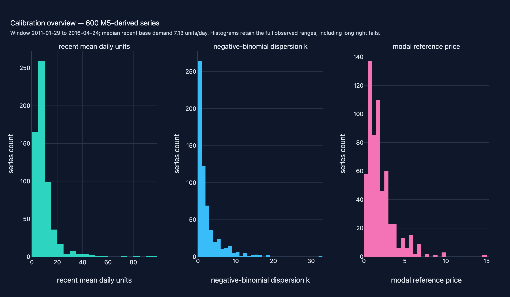
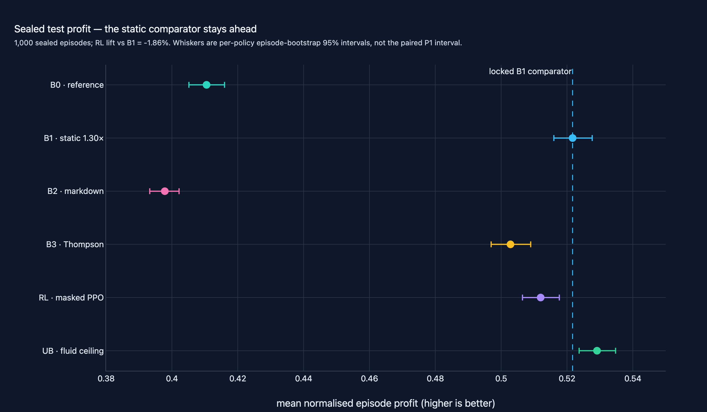
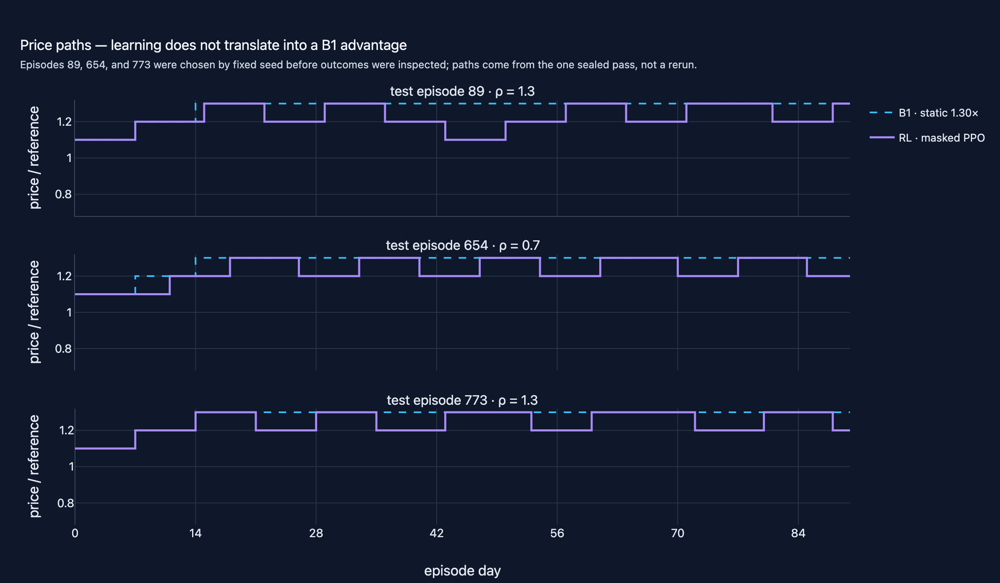
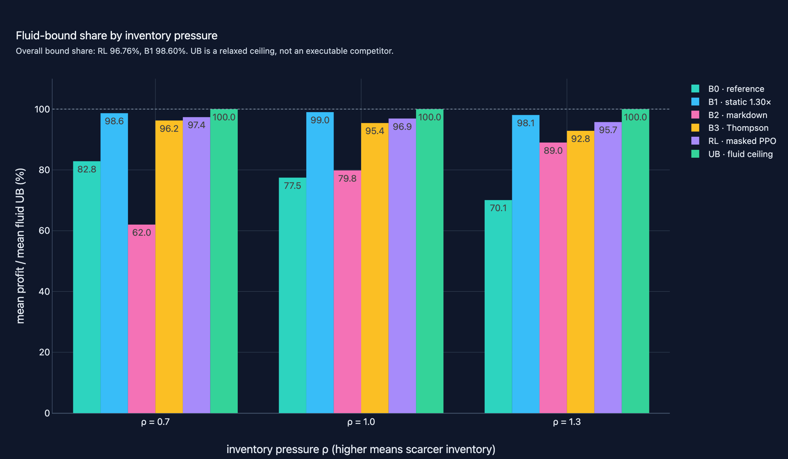

# 15 · Dynamic Pricing with RL

**Domain:** reinforcement learning & pricing simulation ·
**Data:** 600 M5 store-item series with an explicit elasticity assumption ·
**Status:** working showcase; pre-registered primary hypothesis failed —
[Project README](https://github.com/amm-ds/portfolio/tree/main/projects/15-dynamic-pricing-rl) ·
[DESIGN.md](https://github.com/amm-ds/portfolio/tree/main/projects/15-dynamic-pricing-rl/DESIGN.md) ·
[Dataset card](../data-registry/m5-nixtla-mirror.md)

> Masked PPO for constrained pricing on 600 M5-calibrated series reaches 0.5120 sealed mean profit, but trails tuned static B1 by -1.86% (paired 95% CI [-0.0114, -0.0080]); zero violations across all executable policies.

**TL;DR:** a learned pricing policy can be competent without being the best
choice. Masked PPO beats the reference, markdown, and adaptive Thompson
baselines, but loses to the validation-selected static 1.30× rule. The sealed
result is reported as a P1 failure; P2 passes because every executable policy
has zero violations on all 1,000 test episodes. These are simulator results,
not observed retail revenue.

[Case study source and interactive figures on GitHub →](https://github.com/amm-ds/portfolio/tree/main/projects/15-dynamic-pricing-rl)

## Experiment design

The environment runs 91-day episodes with a seven-step price ladder, a
seven-day cooldown, inventory limits, and common random demand streams. M5
calibrates demand scale, weekday seasonality, negative-binomial dispersion, and
reference price from 600 series. Item-level splitting yields 140/30/30
train/validation/test items with seed 42.

M5 does not identify causal elasticity. The simulator instead declares a
truncated normal prior with mean -2.5 and standard deviation 0.8, anchored to
Bijmolt et al. (2005), plus stress means -1.5 and -3.5. No reference-price or
substitution effects are modelled.

{ width="100%" }

Three PPO seeds each requested 3,000,000 steps through SubprocVecEnv(8). A
custom encoder combines two convolution layers over 14 days of price/demand
history with current inventory and time features. Seed 1 wins validation at
0.514370 mean normalised profit; only that checkpoint is retained. B1 was tuned
on 2,000 train episodes and locked as comparator on 300 validation episodes
before PPO selection.

## Sealed results

One invocation evaluated B0–B3, selected masked PPO seed 1, and the relaxed
fluid upper bound on 1,000 test specs and two 500-spec stress sets. The access
log contains exactly one read per set; the evaluator permanently refuses a
second read. Verdicts are code-computed from the frozen pre-registration.

| Policy | Mean normalised profit | 95% mean CI | Bound share | Violations |
|---|---:|---:|---:|---:|
| B0 reference | 0.4105 | [0.4052, 0.4160] | 77.59% | 0 |
| B1 static 1.30× | **0.5217** | [0.5160, 0.5277] | **98.60%** | 0 |
| B2 markdown | 0.3978 | [0.3933, 0.4022] | 75.19% | 0 |
| B3 Thompson | 0.5028 | [0.4970, 0.5090] | 95.03% | 0 |
| RL masked PPO | 0.5120 | [0.5065, 0.5177] | 96.76% | 0 |
| UB fluid ceiling | 0.5291 | [0.5237, 0.5348] | 100.00% | n/a |

{ width="100%" }

P1 requires at least +1.0% relative lift over B1 and a paired 95% bootstrap CI
above zero. Measured lift is **-1.86%**; the paired difference is -0.009696
with CI [-0.011437, -0.007998], using 2,000 resamples and seed 42. **P1 fails.**
All executable policies have zero test violations, so **P2 passes**. RL beats
B0 by 24.72%, B2 by 28.69%, and B3 by 1.82%, but those secondary comparisons
do not change the primary verdict.

{ width="100%" }

The bound view makes the remaining gap concrete: RL reaches 96.76% of the fluid
ceiling overall and B1 reaches 98.60%. Under stress means -1.5 and -3.5, RL
trails B1 by 3.52% and 0.40%, while beating B3 by 1.75% and 1.34%. Stress and
bound share are P3 context only.

{ width="100%" }

## Limits and next step

The learned policy should not be deployed from this evidence. Static 1.30×
captures margin under the assumed demand response, while PPO's adaptive paths
do not outperform it. Results cover only this simulator: elasticity is not
causal M5 elasticity, no real prices changed, and customer memory and product
substitution are absent. Future mechanisms need development-split work followed
by a fresh sealed protocol; the consumed test sets cannot become tuning data.
