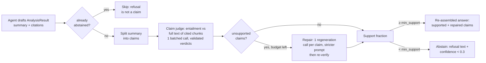

# DESIGN — Project 01: RAG & Agentic AI Assistant

Status: implemented and evaluated. See [README](README.md) for results and
`reports/` for the generated artifacts.

## 1. Requirements

| # | Requirement | How it is met |
|---|---|---|
| R1 | Answers constrained to retrieved evidence, with citations and measured unsupported-claim failures | Agent tools are the *only* corpus access; the system prompt requires citation and the output schema (`AnalysisResult`) pairs every claim with verbatim evidence spans; deterministic span checks + an entailment judge verify each drafted claim; verification and evaluation expose residual grounding failures |
| R2 | Structured, machine-checkable agent output | `output_type=AnalysisResult` (pydantic); invalid outputs fail the run loudly (`UnexpectedModelBehavior`) |
| R3 | Works offline / in CI | `evaluate --offline` is the retrieval-only CI path (no LLM calls); without a provider, `evaluate`/`chat` fail loudly with actionable guidance instead of silently degrading (ADR-0004 amended wave 10); test-only mocks live in `portfolio_core.llm.mock_model_for_tests` |
| R4 | Reproducible data | Deterministic article ids, bounded streaming scan, dataset contract with sha256, DVC stages + lock |
| R5 | Retrieval quality measured, not assumed | Graded question set; recall@5/10, MRR@5 per chunk size; RAG faithfulness/relevance/recall via judge |
| R6 | Cost/latency awareness | Per-query latency (p50/p95), token usage recorded, estimated USD/query, cost-vs-quality frontier |
| R7 | CPU-only, no GPU | `sentence-transformers` (MiniLM-L6) + FAISS `IndexFlatIP` + cross-encoder reranker on CPU |

## 2. Architecture

```mermaid
flowchart LR
    subgraph Data
        A[Wikimedia/Wikipedia<br/>20231101.en stream] --> B[prepare-corpus<br/>topic filter + DQ gates]
        B --> C[(data/raw<br/>corpus.jsonl + contract)]
    end
    subgraph Index
        C --> D[chunking<br/>paragraph-aware, sizes 200/400/800]
        D --> E[MiniLM-L6-v2 embeddings<br/>L2-normalized]
        E --> F[(FAISS IndexFlatIP<br/>per chunk size)]
    end
    subgraph Agent
        U[User question] --> G[pydantic-ai Agent<br/>AnalysisResult output]
        G -->|search_documents / read_excerpt| H[Retriever]
        H --> F
        H --> I[cross-encoder rerank<br/>ms-marco-MiniLM]
        I --> G
    end
    subgraph Eval
        G --> J[RAGEvaluator<br/>faithfulness / relevance / recall]
        H --> K[recall@k, MRR sweep]
        J & K --> L[reports/<br/>metrics.json + report.html + figures]
    end
```

## 3. Options considered

### 3.1 Vector store: ChromaDB vs FAISS

- **ChromaDB (+LangChain)**: batteries included (embedding, persistence, filtering),
  but a heavier dependency, implicit embedding behavior that is harder to pin,
  and less control over index internals.
- **FAISS `IndexFlatIP`** (chosen): exact search over normalized MiniLM embeddings,
  zero external service, trivially portable artifact (`faiss.index` + `chunks.jsonl`),
  fully reproducible offline. IVF/HNSW were unnecessary at ~10k-chunk scale and would
  add recall-vs-parameters tuning surface for no latency benefit on CPU at this size.

Decision rationale: portfolio projects value inspectable, dependency-light
artifacts; `IndexFlatIP` on normalized vectors is the smallest thing that is
exactly correct.

### 3.2 Reranking: none vs cross-encoder

- **None**: one embedding model, one latency hop; acceptable for top-5 over small corpora.
- **Cross-encoder `ms-marco-MiniLM-L-6-v2`** (chosen): re-scores the top `5 × top_k`
  candidates with full query-passage attention. Cost is ~25 small model calls per
  query — single-digit milliseconds each on CPU — a negligible fraction of the
  end-to-end budget and a visible MRR gain on natural questions.

### 3.3 Provider abstraction

Per ADR-0004 (amended wave 10) all LLM access goes through
`portfolio_core.llm.build_model`: env-configured OpenAI-compatible endpoint
first, local Ollama second (default `qwen3.6:35b-a3b-q4_K_M`; `OLLAMA_MODEL` overrides —
`gpt-oss:20b` is the documented lighter alternative). The project never
imports an LLM SDK. The deterministic runtime mock is **removed by owner
directive** — `evaluate`/`chat` require a provider and fail with actionable
guidance otherwise (`--offline` keeps a retrieval-only CI path); test-only
mocks live in `portfolio_core.llm.mock_model_for_tests`.

For the wave-10 evaluation qwen3 thinking is disabled (`think: false` via
`extra_body`, ~4× lower per-call latency) — a documented latency/depth
trade-off. The RAGAS evaluator (§3.5) and the LLM rubric judge use the same
provider, so the full quality evaluation costs $0 in API calls.

### 3.4 Chunking: fixed-size vs paragraph-aware

Fixed-size splitting cuts sentences mid-thought and separates definitional
leads from their bodies. The chosen splitter packs whole paragraphs up to the
token budget, splits long paragraphs at sentence boundaries, and only falls back
to word windows (with overlap) for pathological sentences. Guarantees are
unit-tested as properties (max size, exact overlap, determinism).

### 3.5 RAGAS evaluation (wave 10)

`evaluate --ragas` computes the RAGAS metric set — faithfulness,
answer_relevancy, context_precision, context_recall — on the agent's answers
with the **local model as evaluator** (via `langchain_openai.ChatOpenAI`
pointed at the same endpoint), so the run costs $0 in API calls. Embeddings
for `answer_relevancy` come from the project's MiniLM encoder, not an external
API. Implementation notes: ragas 0.3.1 pins `langchain-community<0.4`;
`RunConfig(timeout=900, max_workers=4)` accommodates multi-minute 32B calls;
failed samples are NaN-skipped, never fatal. `context_recall`'s reference is
the graded relevant article's lead. Because local 32B inference is the
bottleneck (full 65-question run ≈ hours), the documented real run bounds the
LLM phases with `--max-questions 30`; retrieval metrics always use the full
65-question graded set.

### 3.6 Golden-set v2: abstention, failure taxonomy, bootstrap CIs (wave 11)

The graded set was expanded to **65 questions**: 44 single-hop, 11 multi-hop,
and **10 unanswerable** questions whose topics deliberately sit outside the
corpus and whose `expected_behavior` is `abstain`. Answerable questions must
have a relevant chunk in the top-10 of the production retriever
(`validate_golden_set`); unanswerable ones are validated at authoring time
(topic disjointness) and accepted on schema.

Three measurement mechanisms were added on top of the existing judges:

- **Abstention metrics** (`_meta.abstention` in `metrics.json`): refusal
  accuracy (unanswerable questions the agent refused), cite-when-expected
  (answerable questions citing a graded-relevant article), and false-abstention
  rate (answerable questions the agent refused). Each rate is a mean over
  per-question 0/1 indicators with a **percentile bootstrap 95% CI**
  (n_resamples=1000, seeded from `config.seed`). Refusal detection is the
  deterministic documented rule `is_abstention`: confidence < 0.3 OR explicit
  no-evidence phrasing in the summary.
- **Failure taxonomy** (`_meta.taxonomy` + `reports/figures/failure_taxonomy`):
  every question is classified by deterministic first-match rules —
  `format-failure` (agent raised / schema-invalid output), abstain-expected +
  abstained → `correct`, abstain-expected + answered → `unsupported-claim`,
  answerable without relevant evidence in top_k → `retrieval-miss`,
  answerable with judge faithfulness < 0.5 → `unsupported-claim`, else
  `correct`. A correct refusal on an unanswerable question counts as correct,
  so the taxonomy sums to the question count.
- **Bootstrap CIs everywhere else**: the rag_agent row (judge faithfulness,
  answer relevance, context recall) gets `_meta.rag_ci` over its per-question
  scores, and the RAGAS row gets `_meta.ragas_ci` over per-row RAGAS scores —
  same n=1000 seeded percentile bootstrap as the abstention CIs.

The per-question evidence behind every number ships as
`reports/question_traces.json` (question → top-chunk rank → cited y/n →
faithfulness → verdict) and is linked from a table appended to
`reports/report.html`.

### 3.7 Verify-then-answer loop (wave 14)

The wave-13 golden-set pass showed retrieval is solved (context recall 0.979,
precision 1.000) while generation grounding is the bottleneck (12 correct /
18 unsupported-claim; RAGAS faithfulness 0.651). The documented next lever —
implemented here — checks the drafted answer *before* it reaches the user or
the judges:



- **Claim judge** (`rag_agent.verify`): the provider model (same local Ollama
  default) returns validated `ClaimVerdict`s in ONE batched call per answer —
  per-claim entailment against the *full text* of every cited chunk, not just
  the excerpt. `VERIFY_JUDGE=keyword` (or no provider) selects the
  deterministic content-word-coverage entailment judge; runtime judge failures
  fall back to it per batch, mirroring the rubric-judge pattern.
- **Repair/drop**: each unsupported claim gets ONE regeneration call with a
  stricter prompt (everything must be entailed; `UNSUPPORTED` marker when
  impossible), capped at `verify.max_repair_calls` (default 2) per answer;
  claims still unsupported after repair — and anything beyond the budget —
  are dropped.
- **Support floor**: if the surviving-claim fraction stays below
  `verify.min_support` (default 0.6), the answer falls back to abstention
  (refusal text + confidence < 0.3), integrating with the existing
  `is_abstention` path and the wave-11 abstention metrics.
- **Best-effort**: an unexpected verifier failure logs a warning and returns
  the original answer — verification can never make an answer worse than the
  unverified baseline.
- **Config/CLI**: `verify: {enabled, min_support, max_repair_calls}` in
  `RAGConfig`/`params.yaml` (default on); `evaluate --verify/--no-verify` and
  `chat --verify/--no-verify` A/B the loop. Overhead is measured per answer
  (`detail.verify` in `metrics.json`: mean verify latency and its share of
  answer latency, repair-call and induced-abstention counts).

**Measured (wave 14, same first-30 bounded subset, local
`qwen3.6:35b-a3b-q4_K_M`, verify ON vs wave-13 baseline):** failure taxonomy
12 correct / 18 unsupported-claim → **15 / 14** (+1 format-failure: an agent
output-retry hiccup under load, not verify). RAGAS faithfulness 0.651 → 0.606
(CIs overlapping; a duplicated question was judged 1.0 and 0.2 in the same
run, so judge noise ≈ the delta at n=30), answer relevancy 0.879 → 0.720
(shorter/repaired answers and refusals), rubric-judge faithfulness 0.283 →
0.441 (refusals make no unsupported claims), false-abstention 0.000 → 0.174
(4 support-floor abstentions). Mechanism: of 6 unsupported→correct
conversions, 3 are support-floor refusals and 3 kept/repaired answers — the
measured lever is abstention; repair quality at local-model scale is weak
(33 repair calls over 29 answers, mean claim-support fraction 0.84).
Overhead: mean 171 s verify latency per answer, **+157% over the agent phase**
(local, contention-inflated; repair calls dominate — `max_repair_calls` trades
taxonomy gain for latency directly). Verdict: the target taxonomy improves,
but 14 unsupported-claim outcomes remain and the RAGAS faithfulness delta is
unresolved at n=30; keep verify on by default without treating it as a
grounding guarantee.

## 4. SLOs and operating envelope

Historical local measurements (2026-10-14/15, `qwen3.6:35b-a3b-q4_K_M`) — the
current golden-set numbers (65 questions, local + hosted provider A/B) live in
`README.md` §Wave 14/16 and `docs/projects/01-rag-agent.md`; this table records
the original envelope targets and their first measured values:

| SLO | Target | First measurement (local, earlier 26-q / 10-q sets) |
|---|---|---|
| Retrieval recall@5 (graded set, n=26) | ≥ 0.60 | **0.962** (all chunk sizes); recall@10 = 1.000 |
| RAGAS faithfulness (n=10 bounded) | ≥ 0.70 | **0.805** — superseded by the 65-q golden set |
| RAGAS answer_relevancy (n=10) | ≥ 0.70 | **0.904** — superseded |
| RAGAS context_recall (n=10) | ≥ 0.70 | **0.952** — superseded |
| p95 end-to-end query latency | report plainly | **245 s** local (p50 61 s) — compute-bound, $0 API |
| Cost per query | $0 API (local) | **$0** local; selected hosted answer generation $0.000906/query before judge/verify costs |
| Corpus size | 500–600 articles | 593 articles / 3,589 chunks @200 |
| Random-retrieval baseline (seeded floor) | reported for contrast | recall@5 0.038/0.000/0.000, MRR@5 0.038/0.000/0.000 → Δ recall@5 up to +0.92 |

Fallback chain (ADR-0004 amended wave 10): env provider → local Ollama → loud
`LLMProviderUnavailableError` (plus a retrieval-only `--offline` CI path).
There is **no** silent degradation inside retrieval: if the embedding model
cannot be loaded or
downloaded, `EmbeddingModelError` halts the pipeline with an actionable message.

## 5. Failure modes and mitigations

| Failure | Behavior |
|---|---|
| No LLM provider available | `LLMProviderUnavailableError` with setup guidance; `evaluate --offline` for retrieval-only CI — the runtime mock was removed by owner directive (ADR-0004 amended wave 10) |
| Embedding model download fails | `EmbeddingModelError` with HF connectivity hint; no keyword fallback |
| Index/chunk metadata mismatch | `ValueError` on load (ntotal vs rows) |
| Eval question references missing article | Skipped with warning; run continues on the resolvable subset |
| Provider returns schema-invalid JSON | pydantic-ai retries, then raises `UnexpectedModelBehavior` |
| No LLM provider available | `LLMProviderUnavailableError` with setup guidance; `evaluate --offline` for retrieval-only CI |
| `JUDGE=keyword` or `--offline` | Deterministic keyword judge (CI default is the LLM judge when a provider exists) |
| LLM judge call fails mid-run | That verdict falls back to the keyword judge; the run continues |
| Claim judge / repair call fails | That batch falls back to keyword entailment / the claim is dropped; the answer path never breaks |
| Verify support floor breached | Answer falls back to abstention (refusal text + confidence < 0.3), counted by the abstention metrics |
| Token budget exhausted mid-pass | The UsageLimits cap stops the run (fail-closed); traces classify the row `budget-terminated`, never format-failure; a sealed pass with any budget termination is operationally incomplete and re-run with adequate headroom |
| Unanswerable question with a citation-mandating schema (R6, fixed) | Pre-R6, honest refusal was schema-invalid and the agent thrashed in search/read tool loops (Wave Hub burned ~33M tokens in one row). Now refusal = summary + confidence < 0.3 + empty citations/claims, and rule 5 says stop; downstream layers (judge, taxonomy) treat citation-free refusals as abstentions |
| Client corpus has no usable records | `ValueError`/`FileNotFoundError` at intake, before any indexing |

## 5b. Operations artifacts

- **Cost telemetry** — `evaluate` writes `reports/cost_telemetry.json`:
  backend label (`ollama:<OLLAMA_MODEL>` or `env:<model>`), per-query
  input/output tokens, eval wall time. **Local inference is $0 API cost**;
  rate-card figures are kept as a clearly-labelled hypothetical for hosted-model
  budget comparisons. This is the data source for the roadmap's cost telemetry.
- **Client-corpus onboarding** — `prepare-corpus --source client <dir>
  --license <spdx>` maps client JSONL (`{title, text, topic?}`) onto the same
  Article schema and dataset contract (`source: client://<dir>`); chunking,
  indexing and evaluation run unchanged. See the runbook-style usage in the
  README.

## 6. Changelog

- 1.1.0 (2026-11-14) — R7 integrity-and-retrieval wave, measured and published
  including its misses. Verifier integrity: fail-closed abstention on verifier
  failure (no more fail-open support_fraction=1.0), structured repairs that
  re-pass span checks before judging, per-claim terminal-state ledger
  (drafted = surviving + dropped), separated claim-support vs answer-correctness
  metrics. Zero-cost replay harness (recorded responses + request rails).
  Sealed set C (30 rows, gold-checked verbatim spans, Jaccard < 0.34 vs all
  180 prior). Retrieval tournament (all-local): structure-aware chunking,
  Qwen3-Embedding, BM25/RRF, Qwen3-Reranker — +1.5pt recall@10 for the best
  arm, below the pre-registered +5pt promotion gate; incumbent R0 stands.
  Judge calibration: qwen2.5:3b false-rejection 83.5% / kappa 0.155 → local
  judge diagnostic-only; hosted adjudication is the promotion instrument.
  Final sealed C run (local generation + hosted adjudication, $0.096 CE):
  MISSED — overall 0.333 vs 0.70, all 20 answerable rows abstained, false
  abstention 1.000; the small local generator cannot produce usable grounded
  answers. Published per protocol without retuning; further quality claims
  require a fresh sealed set D. Production stack unchanged.
- 1.0.0 (2026-11-12) — R6 grounding hardening, measured pre-registered:
  schema-v2 answers (claims with verbatim spans), deterministic span checks
  (NFKC substring, number/date/temporal tokens, negation polarity, entity
  proximity) ahead of the entailment judge, repair-and-drop, an inference-time
  evidence gate, and a representable abstention contract (empty
  citations/claims — the pre-R6 citation mandate made honest refusal
  schema-invalid and sent the agent into token-burning tool loops on
  unanswerable rows). Gate lexical thresholds were calibrated on an open-gate
  tuning pass and rejected (zero measured correctness delta post-verify; one
  measured false refusal on the frozen set at max-similarity 0.17): the gate
  refuses on empty evidence only and both signals stay in traces. Frozen-set
  pass A (`detail.stress_after_r6`, $9.74 cloud-equivalent, 80M token rail):
  overall 0.500 → 0.733, answer-expected 0.450 → 0.700, unsupported-claim
  11 → 5, refusal accuracy 0.600 → 0.800, false abstention 0.050 → 0.050;
  claim pipeline 54 drafted / 8 mech-failed / 9 repaired / 54 surviving.
  Mech-checker false-rejection rate 8.6% (≤10% guardrail) on tuning
  diagnostics. Measurement protocol: immutable baseline artifacts; sealed
  re-run + independent set B scored once each under tagged artifacts with
  dataset hash, commit, thresholds, caps, and cost in every run record.
  Set B (independent, pre-registered targets): overall 0.633 CI
  [0.467, 0.80] vs target ≥0.60, refusal 0.80, false abstention 0.000 —
  met; unsupported-claim 9/30 vs ≤6 and answer-expected 0.550 vs ≥0.70 —
  missed, so the generalization claim stays blocked; unanswerable rows
  6/6 refused correctly. $2.19 cloud-equivalent.
  Known debt: claim-judge/rubric-judge disagreement (3 rows), retrieval-miss
  embedding limits (2 rows), no lexical gate on plausible-but-irrelevant
  evidence (rows reach the rubric layer instead).
- 0.9.0 (2026-11-11) — citation-correctness pass (`evaluate --citations`): the
  sealed set re-answered once with claim-level verify records persisted
  (`reports/citation_records_heldout.json`, `metrics.json →
  detail.heldout_citations`; `detail.heldout` untouched). 258 claims over 42
  verified answers: first-check support 0.903 CI [0.868, 0.938], 16 repaired,
  11 dropped; the five unsupported-claim answers drafted at 0.74 first-check
  support vs 0.93 for correct. 236 calls, $1.583466 cloud-equivalent
  (p50 25.351 s, p95 84.681 s). `VerifyReport` now stamps question +
  citations; record-to-question linkage is checked, not assumed.
- 0.8.0 (2026-11-11) — sealed held-out expanded 15 → 55 questions (original
  15 plus 40 expansions gated for support, absent terms, Jaccard separation,
  and answerability). The verify-on generation pass keeps 44/55 correct
  (0.80, CI [0.69, 0.89]): taxonomy 44 correct / 9 unsupported-claim / 1
  retrieval-miss / 1 format-failure; operational recall@5 0.745, refusal
  accuracy 0.92 (12/13); 241 calls and $1.950667 cloud-equivalent under the
  $3.00 cap. The per-question failure taxonomy is the headline: 9 of 11
  failures retrieved the relevant article at rank 1 yet kept unsupported
  claims — grounding, not retrieval, is the bottleneck. Supersedes the
  15-question `detail.heldout` values quoted under 0.7.0. Evidence:
  `metrics.json → detail.heldout`, `sealed_retrieval.json`,
  `question_traces_heldout.json`.
- 0.7.0 (2026-11-07) — selected `kimi-for-coding` after the provider comparison:
  46 correct / 17 unsupported / 2 retrieval-miss / no format failures across 65
  tuning questions; rubric faithfulness 0.6209, RAGAS faithfulness 0.7337, and
  answer relevancy 0.8602 (down from 0.8775, disclosed in the article). Sealed
  held-out measured faithfulness 0.64 with 5/5 refusals, 61 calls, and $0.240699
  cloud-equivalent. Selection and held-out details live in `kimi_comparison.json`
  and `metrics.json → detail.heldout`.
- 0.6.0 (2026-10-18) — sealed 15-question held-out evaluation: 8 single-hop,
  2 multi-hop, and 5 unanswerable questions, gated for support, absent terms,
  and Jaccard separation before one verify-on hosted pass. Held-out recall@5 /
  recall@10 measured 0.600 / 0.667 against 0.831 / 0.846 on tuning; refusal was
  5/5, rubric faithfulness 0.62 [0.45, 0.79] on 10 answerable questions, and
  cost $0.25 cloud-equivalent. Details remain in `metrics.json → detail.heldout`.
- 0.5.0 (2026-10-17) — hosted 65-question evaluation and per-phase cost meter:
  44 correct / 18 unsupported / 2 retrieval-miss / 1 format, RAGAS faithfulness
  0.685 [0.605, 0.760], and $3.58 cloud-equivalent across agent, RAGAS, verify,
  and judge calls. The local 30-question verify A/B reduced unsupported-claim
  share from 60% to 47%, mainly through support-floor abstention; RAGAS
  faithfulness moved 0.651 → 0.606 with overlapping CIs and answer relevancy
  0.879 → 0.720. Verification stayed enabled without claiming a resolved
  faithfulness gain. Per-run token and USD guards stop runaway calls cleanly.
- 0.4.0 (2026-10-16) — wave 14: verify-then-answer loop (`rag_agent.verify`):
  batched per-claim entailment of the drafted summary against full cited-chunk
  text (provider judge, keyword fallback), budget-capped repair of unsupported
  claims, support-floor abstention fallback (`verify.min_support`), on by
  default via `verify:` in params.yaml with `--verify/--no-verify` A/B on
  `evaluate` and `chat`; verify overhead measured into `detail.verify`.
- 0.3.0 (2026-10-14) — wave 10: runtime mock removed (ADR-0004 amended; agent,
  LLM judge and chat now require a provider — local Ollama default), RAGAS
  evaluation behind `evaluate --ragas` (local model as evaluator, $0 API),
  cost telemetry reframed for local inference (`$0 API cost` + wall time),
  `--offline` retrieval-only CI path, `--max-questions` bound for the LLM
  phases, qwen3 `think: false` for eval throughput.
- 0.2.0 (2026-10-13) — client-corpus onboarding path (`--source client`),
  cost telemetry (`reports/cost_telemetry.json`), LLM rubric judge behind
  `JUDGE=llm` with keyword fallback.
- 0.1.0 (2026-10-12) — initial implementation: corpus prep, chunking, FAISS
  indexes (3 chunk sizes), cross-encoder rerank, pydantic-ai agent with
  structured citations, retrieval + RAG + ops evaluation, DVC pipeline. See
  git history and `reports/metrics.json` for the evaluated configuration.
