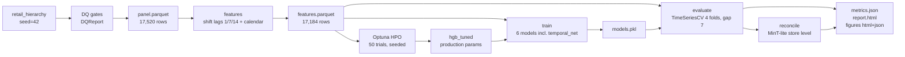

# DESIGN — 02 · Hierarchical Demand Forecasting

## Requirements

From the project spec:

1. Forecast daily units for a synthetic store-by-product retail hierarchy
   (4 stores × 6 products × 730 days, seeded, reproducible offline).
2. `config.py`: pydantic `Settings` subclass + `ForecastConfig`
   (n_days 730, n_stores 4, n_products 6, lags [1, 7, 14], n_splits 4, gap 7).
3. `data.py`: load + validate via `DatasetContract`; derive store-product
   daily series; platform DQ gates must halt the pipeline on failure.
4. `features.py`: lag + calendar features per series, **no leakage** —
   features built with `shift` only.
5. `model.py`: two models — Ridge baseline (in a sklearn `Pipeline` with
   `StandardScaler`) and `HistGradientBoostingRegressor`; global with one-hot
   series id (chosen over per-series models).
6. `evaluate.py`: honest backtest via `portfolio_core.timecv.TimeSeriesCV`;
   MAE/RMSE/MAPE via `portfolio_eval.ml.regression_metrics`; per-model
   `RunResult`; three plotly figures (forecast vs actual on example series,
   per-model metric bars, CV fold stability); report + metrics.json.
7. `cli.py`: typer commands `prepare`, `features`, `train`, `evaluate`, `all`.
8. Tests offline, runtime in seconds.

## Options considered

### A. Per-series models vs one global model with series id

- **Per-series (24 independent models)**: simple to reason about, but 24
  artefacts to version and deploy, weak transfer across series (each sees only
  730 rows), and new series require a cold-start refit.
- **Global with one-hot series id**: one artefact, the model learns
  series-level offsets plus shared seasonality/trend effects, new series are
  scored gracefully via `handle_unknown="ignore"`.
- **Global with target encoding / embeddings**: overkill for 24 series and
  leaks without careful out-of-fold encoding.

**Decision: global with one-hot series id.** Matches the spec; the panel has
identical calendars across series so a single expanding window applies to all.

### B. Validation protocol

- **Random k-fold**: rejected — masks drift; with trend + seasonality it
  leaks near-duplicate adjacent days across the split.
- **Last-block holdout**: better, but a single block gives one (possibly
  lucky) reading and no stability signal.
- **Expanding-window time CV with embargo gap** (`TimeSeriesCV`, 4 folds,
  gap 7): property-tested platform primitive; several honest readings; the
  per-fold spread doubles as a drift detector.

**Decision: expanding-window time CV, gap 7 days**, folds computed on dates
and mapped to rows so no date block straddles train/validation.

### C. Lag features vs rolling statistics

- Lags `[1, 7, 14]` capture momentum, same-weekday and two-week effects;
  weekly seasonality is also directly encoded via calendar features.
- Rolling means would add signal but complicate the leakage story (window
  must end at t−1); the spec fixes the lag set, so the simplest correct
  implementation was chosen.

**Decision: spec lags with `shift`, undefined rows dropped** (never imputed —
an imputed lag would teach the model that history is sometimes fake).

### D. Data: synthetic vs real (UCI Online Retail II)

- Real track: invoice-line data requires parsing, returns/cancellations
  handling, and a non-trivial aggregation to (date, store, product) units —
  plus network access for download. Valuable but out of scope for a
  seconds-fast, offline-guaranteed showcase.
- Synthetic: seeded, byte-identical across machines, exercises the full
  contract/DQ machinery via `synthetic://` source identity.

**Decision: both tracks.** Synthetic remains the default (CI offline, seedable);
the UCI track is implemented behind `--data-source uci` (`uci.py`): checksum-
pinned download, dependency-free XLSX streaming (stdlib zipfile/iterparse —
no openpyxl in the venv), top-8 countries × top-200 products, sales lines only
(returns excluded, documented), zero-filled daily reindex. Swapping tracks
changes nothing downstream. Full MinT covariance projection stays deferred —
the UCI panel has a flat product key, so the hierarchy is still only
store → product.

### E. Hyperparameter optimisation (wave 3)

- **Grid search**: simple and reproducible, but scales poorly beyond 2–3
  dimensions and cannot prune bad regions early.
- **Optuna TPE with median pruning**: Bayesian search over the 6-dimensional
  HGB space, with per-fold intermediate reports so unpromising trials stop
  after ~2 of 4 folds. Seeded sampler → deterministic search trajectory.

**Decision: Optuna (TPESampler seed=42, MedianPruner, ~50 trials)** with the
objective = mean MAE over the *same* date-aligned folds as the backtest
(shared `cv_row_folds`), so selection and final judgement use one protocol.
Best params are persisted to `data/hpo_best.json` and mirrored into
`ForecastConfig.hgb_tuned` defaults + `params.yaml` (production config). The
`hpo` stage is deliberately **not** part of `cli all` (minutes, not seconds).

### F. Neural model: what architecture, and what for

- Per-series embeddings + MLP over the same lag/calendar features: reuses the
  leakage-safe feature frame, trains in seconds on CPU, and plugs into the
  identical backtest via a sklearn-style `fit/predict` wrapper.
- A sequence model (LSTM/Transformer over raw windows) would need a different
  data pipeline and longer training; deferred until the simple NN justifies it.

**Decision: embedding + MLP (temporal.py)** with a hand-written loop (Adam,
grad clip 1.0, early stop on a time-ordered inner validation slice, full
seeded determinism). Honest verdict from the backtest: it lands near the
linear baseline and behind HGB — reported as-is (tree ensembles dominate on
small tabular lag problems; a sequence model is the roadmap answer).

### G. Hierarchical reconciliation

- Full MinT (covariance-based projection) is statistically heavier and needs
  residual covariance estimation across 24 series — overkill for a showcase.
  After wave 7 this stands: the UCI track's product key is flat (no category
  tree), so the hierarchy remains store → product; full covariance projection
  moves to the roadmap, gated on introducing a product-category hierarchy.
- **MinT-lite**: bottom-up store aggregation, direct store-level model, then a
  scalar shrinkage `w` distributing the parent-child discrepancy across
  children. `w` is grid-estimated on the embargoed previous fold by
  minimizing reconciled store-level MAE (a precision-ratio variant is kept
  for comparison). Coherence after reconciliation is exactly `(1-w)` times
  the incoherence before (property-tested).

### H. Final holdout + frozen selection protocol (wave 18, audit hardening)

- **Status quo (waves 1–13)**: all folds pooled into one headline number, and
  the champion pick read the same pooled numbers — selection and final
  judgement were the same data, so the headline was optimistically biased and
  the "test" was not a test.
- **Last-block holdout without rolling origins**: a single final block is
  honest but gives one (possibly lucky) reading and no stability signal.
- **Decision: rolling-origin holdout (`rolling_origin_holdout_v1`)** — the
  existing expanding-window folds stay, but the LAST origin becomes the test
  window: model/feature selection (`best_model`, champion) pools folds
  1..n-1 ONLY, every candidate is then scored exactly once on the test
  window, and the committed headline metrics are the test-window numbers.
  The pre-holdout all-fold pooled values are kept per model under
  `legacy_pooled_*` (nothing silently dropped). Property-tested: shuffling
  the test fold's actuals leaves the selection result unchanged. The
  protocol is emitted machine-readably in `evaluation_metadata.json`
  (`selection_used_origins` vs `test_origin`), and metric suite extended
  (bias, zero-safe WAPE, fold MAEs + std/range, per-horizon h=1..14 MAE/MASE
  over the test window's final 14 days). The uncertainty band is evaluated on
  the test window too: per-horizon coverage AND average width, with a
  calibrated/conservative/optimistic verdict at the 0.05 tolerance.

### I. Multi-step track: direct multi-horizon protocol (wave 19, fifth-pass audit)

- **The audit finding**: the wave-18 "14-day forecast" was 14 consecutive
  ONE-day-ahead predictions — every validation row consumed the previous
  day's true value through precomputed `lag_1/7/14` columns, and origins sat
  a 7-day embargo + 14-day window + spacing ahead of their windows, leaving a
  57-day hole between the last training date and the first scored day. Fine
  for a nowcast; not a multi-step forecast.
- **Options**: (a) recursive multi-step (feed predictions back as lags) —
  rejected: error compounding plus a second, subtler leakage path (fitted
  models consuming their own outputs as features); (b) direct multi-horizon —
  one model per horizon h with features aged ≥ h days relative to the
  target, so no actual within h days of the target is referenced by
  construction; (c) sequence models — same leakage surface as (a) at higher
  complexity, still deferred (temporal.py verdict stands).
- **Decision: direct per-horizon models** for h ∈ {1..14} — the full window
  lattice, one direct model per day, no interpolated display points anywhere
  downstream (champion-config HGB, series id as a native categorical).
  Features per h:
  calendar of the target date + lags `lag_h`, `lag_{h+7}`, `lag_{h+14}`
  (origin-relative: units(t), units(t−7), units(t−14)); training rows use
  targets ≤ the origin only. Leakage-proof property-tested by tainting every
  day in (origin, origin+h] and asserting the designs and predictions do not
  move.
- **Origins**: weekly rolling origins, origin = last training date, forecast
  window = the 14 days starting the day AFTER the origin (no embargo gap).
  Eligible origins are capped at `multistep_n_origins` (20) by dropping the
  oldest — the exact weekly cadence is preserved (documented cap; UCI has 43
  eligible). The LAST `multistep_test_origins` (4) origins are scored once;
  the earlier ones select per-series routing methods and conformal widths.
- **Intermittent demand**: ADI/CV² classification (Syntetos-Boylan quadrants:
  smooth / erratic / intermittent / lumpy, thresholds 1.32 / 0.49) is emitted
  per series in `dataset_metadata.json`. Series with ADI ≥ 1.32 (intermittent
  + lumpy) are ROUTED to the best statistical method — zero / seasonal_naive /
  Croston / SBA / TSB, fixed SES α = 0.1, hand-computed unit tests — chosen
  per series on the selection origins only (property-tested: permuting a test
  window's actuals leaves every routing choice and conformal width
  unchanged). Smooth/erratic series stay on the direct HGB. Routed vs
  unrouted is reported per class with a paired bootstrap CI.
- **Uncertainty**: per horizon, quantile HGBs (p10/p50/p90; pinball loss
  reported) plus a ±q80 split-conformal width calibrated on the selection
  origins, zero-clipped and sorted; empirical coverage AND average width per
  h with the calibrated/conservative/optimistic verdict (|coverage − 0.80| ≤
  0.05). Sparse (routed) series get P(any sale) + a quantile ladder of the
  training history instead of a band that collapses to zero width.
- **Decision metric**: an order-up-to policy simulation — per series and
  service level τ, order = quantile_τ(point + calibrated residual
  quantiles); cost = holding × leftover + stockout × short per scored cell
  (assumptions in the JSON: holding 0.25/unit, stockout 4.0/unit). Champion
  policy vs seasonal-naive policy, per class. Labelled a simulation; no
  savings claims.
- **Uncertainty on headline comparisons**: every headline comparison (per-
  class champion-vs-floor / champion-vs-naive at h=7 and h=14, model-rank
  gaps, routing before/after) carries a 95% paired cluster bootstrap CI over
  (series × scored test origins) — series resampled with replacement, one
  shared draw per replication so differences stay paired (the projects/05
  and /10 pattern).
- **Nowcast stays**: the one-day-ahead track (section H) remains as the
  clearly labelled `nowcast` track — its frozen-window numbers stay committed
  and valid, and it is never mixed into the multi-step leaderboard. The demo
  payload is schema v3 — the direct multi-horizon catalog (Phase C landed:
  per-series routed curves at the h-lattice on 3 scored origins, scoreboard,
  growth, decision mapping; no nowcast numbers).

### J. Peak-capable candidates (wave 20: "peaks aren't captured")

- **The feedback**: demand peaks are missed and the error could be
  dramatically improved. Diagnosis: the lumpy-class methods are flat-rate
  estimators — zero/SBA/TSB/Croston emit one constant per window, so a peak
  day is structurally indistinguishable from any other day; the flat methods
  cannot even *represent* a peak, let alone time it.
- **Options**: (a) rolling statistics as features for the boosted per-h
  models (rolling mean/max, days-since-last-nonzero, non-zero counts, peak
  ratio) so trees can modulate within a window; (b) a tweedie-loss HGB —
  the compound-Poisson deviance (variance power 1.5) is the standard
  count-with-spikes likelihood, half-way between Poisson (var = mean) and
  gamma (var = mean²); (c) a hurdle two-stage model — log-loss classifier
  for P(sale) times a log1p-size regressor on the positive part; (d)
  count-specific architectures (NPTS, DeepAR-style) — deferred: the panel
  is 374 days × 1,600 series; sample complexity argues for the direct HGB
  family. Decision: (a) + (b) + (c), all inside the existing direct
  per-horizon protocol.
- **Peak features**: a 9-column block computed at the reference day
  target−h (rolling mean AND max over 7/14/28d windows, days-since-last-
  non-zero, 28d non-zero-day count, 28d peak ratio). Every entry is ≥ h days
  older than the target — the same aging as the lag trio, so the leakage
  taint proof covers them unchanged. All direct candidates (direct_hgb,
  hgb_tweedie, hurdle_hgb) read the extended design.
- **hgb_tweedie**: HGBRegressor with sklearn's HalfTweedieLoss(power=1.5);
  lr/depth/leaves tuned by a seeded capped Optuna study (12 TPE trials,
  TPESampler seed 42) judged on the pooled MAE of the last two SELECTION
  origins only — never a test origin. Best params land in
  `ForecastConfig.multistep_tweedie` + `params.yaml` (the nowcast-arm
  contract).
- **hurdle_hgb**: per-h two-stage HGB on the champion hyperparameters —
  log-loss classifier for P(sale), regressor on log1p(non-zero sizes); the
  point forecast is p̂·(exp(ŷ)−1). The raw product is biased toward
  non-zero answers, so a zero-correction is fit on the SELECTION origins
  only: identity vs scalar (Σactual/Σpred) vs isotonic, whichever lowers
  the selection summed |error| (tested, not assumed — on UCI identity
  wins: shrinking a sparse forecast hurts more than the bias costs).
- **Selection/scoring**: the routing pool grows per class — sparse series
  choose among the five statistical methods PLUS the two ML candidates
  (direct_hgb stays excluded: the wave-19 finding stands); smooth/erratic
  series choose among direct_hgb and the two ML candidates. Everything is
  chosen on the selection origins only (property-tested by permuting a test
  window); the last 4 origins are scored once.
- **Peak-capture metrics** (the headline the user asked for): per scored
  window (series × test origin) over the scored h-lattice days —
  `peak_mae` = MAE on the window's top-decile-by-actual days,
  `peak_recall` = share of the window's top-5 actual days ranked in the
  forecast's own top-5. Pooled per class with paired cluster bootstrap CIs
  against the routed and zero baselines. Honest-report rule: where the flat
  methods still win pooled MAE (lumpy), the block says so with the measured
  deltas; the peak-capable models are reported as what they are — winners
  on spike-driven series (erratic) and peak-day ranking, not a uniform
  pooled-MAE improvement.
- **Bands for the new candidates**: point ± q80 split-conformal width per h,
  calibrated on the selection origins' residuals around the candidate's own
  point forecast, zero-clipped and sorted; sparse rows keep the honest
  P(sale)+quantile-ladder band. Coverage AND width committed per h.
- **Runtime**: the per-origin fit count goes from 28 to 49 HGB fits
  (7 point + 21 quantile + 7 tweedie + 7 classifier + 7 size-regressor);
  the hurdle's two stages are per-h — measured first; they fit the budget
  (no shared-classifier shortcut needed at 16 cores; UCI multi-step ≈ 4 min
  of the ≈ 12 min evaluate).

### K. Wave 21 — LightGBM arms, convex ensemble, per-series win rates

- **Price/trading-cycle features**: the direct-h design matrix gains unit-
  price statistics and weekday/trading-day flags of the target week (wave
  21). Same aging rule as every other feature (≥ h days older than the
  target), covered by the existing taint proofs.
- **LightGBM candidates** (three arms, all judged on the selection origins
  only): `lgbm_tweedie` (tweedie loss), `hurdle_lgbm` (two-stage, same
  identity/scalar/isotonic zero-correction as `hurdle_hgb` — identity won on
  UCI), and `lgbm_poisson` (Poisson loss). LightGBM params are HPO'd by a
  seeded capped Optuna study on the selection origins; a degenerate-split
  retry ladder (`_lgbm_fit_safe`) keeps fits deterministic. `lgbm_poisson`'s
  exp link overflows on this panel (literal +inf on ~11% of cells, finite
  garbage up to ~1e283 elsewhere) — `_finite_demand_pred` maps non-finite
  cells to per-series training maxima (NaN→0, +inf→train max ≥1, −inf→0;
  a poisson-only hard clip also caps finite cells). Evaluated-and-losing,
  it stays in every comparison (pooled MAE 85.15 vs zero 9.28; lumpy h=7
  beats-floor win rate 4.96%) — never hidden.
- **`peak_weighted_hgb`**: the direct HGB with sample weights up-weighting
  peak days (weight grid {2, 3}, 2.0 chosen on the selection origins' pooled
  MAE, then zero-corrected like the hurdles). `peak_weighted_hgb` joins the
  routing pools.
- **`ensemble_convex`**: per-series convex combination of the routed
  prediction and the series' best ML candidate — `pred = w·routed +
  (1−w)·best_ml`, `w ∈ {0, 0.1, …, 1}` minimising the selection summed
  |error|. No refits, test origins never read; rides as an unrouted
  benchmark (pooled MAE 7.597 vs routed 7.480, rank-1-vs-2 gap CI excludes
  zero).
- **Per-series beats-floor win rate** (the "improve EVERY series" metric):
  per class, horizon and candidate, the share of series whose summed |error|
  over the scored test origins at that h is strictly below the
  seasonal-naive floor's; 95% CI from a cluster bootstrap over series (one
  shared index draw per replication across candidates, so the CIs stay
  paired; 2,000 draws, fixed seed). Committed in `metrics.json`
  (`_multistep.win_rates`) and plotted in `multistep_win_rates`. Headline:
  even the routed champion beats the floor on only 22.17% of lumpy series
  at h=7 (CI [19.83, 24.70]) — pooled MAE wins ride on magnitude, not
  coverage.
- **Pools after wave 21**: sparse = statistical five + six ML candidates
  (hgb_tweedie, hurdle_hgb, lgbm_tweedie, lgbm_poisson, hurdle_lgbm,
  peak_weighted_hgb); dense = direct_hgb + the same six.

### L. Wave 22 — missing baselines, rolling features, hierarchy anchoring,
### better metrics

- **`ma_28`** (rolling 28-day mean, flat across the window): the
  audit-flagged missing moving-average baseline. Pure and deterministic;
  joins the sparse routing pool like every statistical method.
- **ADIDA** (`adida_sba` / `adida_tsb`): temporal aggregation of the SBA/TSB
  estimators. The daily training series is aggregated into non-overlapping
  7-day buckets aligned to the END of the training window — because the
  forecast window abuts the origin, o+1..o+14 is then exactly two buckets.
  The base estimator is fit on the bucket-total series and forecasts the two
  next bucket totals; each total is disaggregated into daily values via the
  series' empirical within-week profile: position k of the 7-day cycle gets
  the share of training demand observed at days t ≡ (len + k) (mod 7)
  (index-mod-7 is the weekday offset of a contiguous daily panel, so all
  buckets share one profile). Edge cases: all-zero training history →
  all-zero forecast (the all-zero profile subsumes it); a positive bucket
  total under an all-zero profile → uniform spread (total/7 per day) — the
  branch lives in the pure `_adida_disaggregate` helper because through the
  public entry point a zero profile implies zero bucket totals; a window
  shorter than one bucket → all-zero forecast.
- **Rolling features** (all ML candidates): rmean7/rmean14/rmean28,
  rstd14/rstd28, computed at the same target−h reference day as the
  peak/price blocks (population std; windows undefined before their full
  length → 0.0, never read). The hpo objectives (`make_multistep_tweedie_
  objective`, `make_multistep_lgbm_objective`) are threaded with the tensor
  so any future re-tuning sees the same design the evaluate track fits.
- **`routed_reconciled`** (comparison-only hierarchy anchoring): for each
  country block and window day, the anchor is the seasonal-naive forecast of
  the block's AGGREGATED demand on the target day (a genuinely independent,
  denser signal); the discrepancy (anchor − Σ member routed forecasts) is
  allocated proportionally to member routed forecasts — members with zero
  forecast get nothing — with a fallback to training-window means when the
  whole block forecasts zero, and no adjustment when those are zero too.
  **Why it lost**: 945 of 1,069 lumpy series route to the zero forecast, and
  anchoring injects the seasonal-naive's noise into exactly those flat
  forecasts — pooled MAE 9.969 vs routed 7.471 (it does cut lumpy peak-day
  MAE to 27.923, so it stays as an honest benchmark). Covariance-projection
  MinT is the documented next step, not a proven win.
- **`rmae`**: candidate pooled MAE ÷ seasonal_naive floor pooled MAE over the
  same scored cells, per candidate per class and pooled; the floor is 1.0 by
  construction and the headline claim quotes the champion's value (0.649).
  Fixes the flagged wording problem: MASE's 1.0 is the in-sample scale's
  error level, never called "seasonal-naive parity" anywhere in src or docs.
- **Per-candidate `rmsse`** (M5 convention): the unit is a (series × scored
  origin) evaluation — numerator = MSE of the candidate over the unit's
  scored horizon days, denominator = in-sample MSE of the one-step
  seasonal-naive-7 over the unit's training window; averaged over units
  (zero-scale excluded), volume-weighted variant alongside; per class and
  pooled for every candidate.
- **Newsvendor decision layer** (additive in `decision_metric`): for q ∈
  {0.8, 0.9, 0.95} the order IS a quantile of the forecast distribution —
  routed rows: dense = linear interpolation of the committed p10/p50/p90
  ladder (linear extrapolation above p90, zero-clipped), sparse = the
  q-quantile of the training history (the existing ladder machinery); floor
  rows: the same quantile of the seasonal-naive empirical distribution
  (training-window demand on the target's weekday). Cost per scored cell:
  holding 1.0 × ordered-but-unsold + stockout 3.0 × unmet per unit-day —
  a documented assumption, not a measured saving. Reported per class as
  expected daily cost per unit-demand with paired cluster-bootstrap CIs
  (routed minus floor). Result: the MAE-optimal router over-orders at q ≤
  0.90 on spike-driven lumpy demand (+0.127/unit at q=0.90, CI excludes
  zero) and wins on erratic only at q=0.95 — the same asymmetry the
  order-up-to layer shows, priced at the band quantile.

### M. Wave 23 — hierarchical forecasting track (Nixtla benchmarks)

- **Protocol `hierarchical_rolling_v1`** (`hierarchical.py`): rolling-origin
  evaluation on the committed Nixtla benchmark datasets (`data_hier/`,
  PROVENANCE.md — Rangapuram et al. ICML 2021, Olivares et al. IJF 2023,
  Kamarthi et al. PROFHIT 2022). Origin = last training period; window =
  next `horizon` periods, abutting the origin (no embargo gap); origins one
  period apart, capped at 6 by dropping the oldest (exact cadence kept).
  TourismSmall: quarterly (`QE`), season 4, horizon 4, min_train 24 quarters.
  Labour: monthly (`MS`), season 12, horizon 8, min_train 96 months.
- **Candidates fixed a priori — no routing, no selection** (unlike the panel
  track): `seasonal_naive` (hand-rolled, the panel-track definition
  f(h) = y[T − m + ((h−1) mod m)]), `auto_theta` / `auto_ets` (statsforecast
  per-node, n_jobs=1), `lgbm_global` (one LGBMRegressor over all nodes via
  mlforecast: lags 1..m + 2m, RollingMean(m)/ExpandingMean at lag 1, quarter
  or month + year date features, fixed 300 trees / lr 0.05 / seed). Every
  origin is honest evaluation for these fixed candidates.
- **Reconciliation**: every candidate scored raw, +BottomUp and
  +MinT(mint_shrink) (hierarchicalforecast 1.5.3) in one reconcile call per
  origin. All four base forecasts reconcile — the statsforecast insample
  residuals come from `sf.forecast(df, h, fitted=True)` +
  `sf.forecast_fitted_values()` (the same y_rec merge contract as the
  mlforecast path; the naive's residuals are its own one-step insample fits
  fitted[t] = y[t−m]). OLS/OptimalCombination are excluded (spike finding);
  MinT is `MinTrace`.
- **Metrics**: per level (from `tags`, ordered total → bottom; short names —
  first tag → `total`, last → `bottom`) pooled MAE and `rmae` (÷ raw
  seasonal_naive MAE at the same level, floor = 1.0). `coherence` per
  variant: pooled mean over (origin × parent × window-period) cells of
  |parent_fc − S[parent] @ fc_bottom| / max(|parent_actual|, 1) — hand-tested
  on a 3-bottom + total toy (an exactly-linear base forecast on exactly-
  aggregating actuals scores 0.0). Headline gaps (`lgbm_global+mint_shrink`
  vs `seasonal_naive`, total and bottom levels): 95% paired cluster
  bootstrap over bottom series, 2,000 reps, one shared index draw per
  replication; total-level cells are re-aggregated from the sampled bottom
  series inside each resample.
- **Determinism**: LightGBM `force_row_wise` + `n_jobs=1` + fixed seed,
  statsforecast `n_jobs=1`, `threadpool_limits(limits=1)` around every fit —
  and, decisively, `VECLIB_MAXIMUM_THREADS=1` set before numpy loads: this
  host's numpy uses Apple Accelerate, whose threaded LAPACK reductions
  (MinT's pinv/SVD) are not run-to-run reproducible and which threadpoolctl
  cannot limit (`threadpool_info()` is empty); the env var is read at
  Accelerate init, hence the early set in cli.py / hierarchical.py. Same
  landmine family as temporal.py: hierarchicalforecast's compiled `_lib`
  bundles its own `.dylibs/libomp.dylib`, so hierarchical.py imports
  lightgbm+xgboost BEFORE the Nixtla stack (dual OpenMP runtimes segfault the
  first booster fit otherwise — reproduced, then guard-verified).
  `reports_hier/metrics.json` is byte-identical across runs (gate-verified).
- **Honest result** (committed): on TourismSmall the reconciled ML candidate
  repairs a real incoherence (lgbm raw total rmae 1.205, coherence 0.102 →
  +MinT 0.869, coherence 0.000; bottom-level gap CI excludes zero); on
  Labour the raw `auto_ets` total forecast is the strongest variant and
  BottomUp degrades it (0.177 → 0.292) — reconciliation is reported per
  candidate, never as a blanket win. Wave 22's `routed_reconciled` caveat
  resolves into "proper MinT works where the base forecast needs it".
  *(Removed in the wave-24 pivot: `hierarchical.py`, `data_hier/` and
  `reports_hier/` were dropped to keep the project focused on the two retail
  regimes — the section stays as the decision record.)*

### N. Wave 24 — the M5 headline pivot (protocol `m5_direct_v1`)

- **Why**: the project's honest result on the UCI sparse panel was "baselines
  win" — the right measurement, but a weak headline. The pivot adds the
  regime where ML demonstrably wins: **dense daily store-item demand** with
  real exogenous signal. Dataset: the committed, checksum-pinned Walmart M5
  accuracy-track subset (`m5_data.py`, `data_m5/`, PROVENANCE.md) — top-3
  stores by total units (CA_3, CA_1, TX_2) × top-200 items by total units
  within those stores; 600 daily series, 2011-01-29..2016-06-19, 1,105,594
  rows, 16% zero-day share; built offline from the Nixtla `datasetsforecast`
  mirror with sha256 pins verified at load (the UCI snapshot-pin pattern).
- **Protocol** (`m5_track.py`, machine-readable in
  `reports_m5/evaluation_metadata.json`): **10 weekly rolling origins** 7
  days apart near the panel end (`rolling_origins`, anchored at the end like
  the M5 evaluation), each training on ≥ 1,096 days (3+ years) and scoring
  the next **28 days**. The first **8 origins are SELECTION** (ensemble
  weight, conformal calibration, class anchoring); the **last 2 are TEST** —
  2016-05-10 and 2016-05-17 — scored once, never read for selection. The
  window starts the day AFTER the origin.
- **Candidates**: per-series statistical (`seasonal_naive` m=7,
  `window_avg_28`, `adida`, `tsb` — statsforecast 2.1.1, C-fast, batch with a
  per-series naive-fallback path for degenerate fits), per-series automatic
  (`auto_ets`, `auto_ces`), a **global LightGBM** (mlforecast 1.1.0 recursive:
  lags 1/7/14/21/28, RollingMean(7)/RollingMean(28) at lag 1 and
  RollingMean(7) at lag 7, wave-25 additions RollingStd(7/28) and an
  ExpandingMean at lag 1, dayofweek/month/ISO-week calendar, exog
  sell_price/snap/any_snap/event codes/event distances/price
  momentum+missing — **no series-identity feature**, so the global model
  generalises across the 600 series), and `convex_ensemble`.
- **lgbm config (wave 25)**: fixed-a-priori no more — `cli tune-m5` runs a
  seeded 30-trial Optuna TPE study (`m5_tune.py`, TPESampler seed 42,
  `n_jobs=1` + `force_row_wise` + fixed booster seed) on the SELECTION
  origins only: each trial early-stops (patience 50, L1) on a nested split —
  fit rows end 56 days before the last selection origin, eval set is that
  trailing block (teacher-forced features, all selection data) — and the
  objective pools WAPE over the last 2 selection origins refit through the
  track's exact mlforecast wrapper at `best_iteration_`. Search space:
  learning_rate (log 0.02–0.3), num_leaves (16–512 int log),
  min_child_samples (5–200), colsample_bytree (0.5–1.0), n_estimators ≤ 800
  (committed value = best_iteration_). The best block lands in params.yaml
  under `m5_lgbm:`; `evaluate-m5` reads it
  (`m5_track.load_m5_lgbm_params`, defaults = the wave-24 fixed config when
  the block is absent).
- **Ensemble rule** (wave 25; fixed, deterministic): the best THREE of
  {lgbm, auto_ets, auto_ces} by SELECTION pooled WAPE; the weights are
  grid-fit on the selection origins only over a simplex with step 0.05
  (231 points, ties → first grid point lexicographically) minimising pooled
  Σ|err|. The wave-24 best-two 0.01-grid rule is retired — with a tuned lgbm
  all three pool members carry signal, and the wider pool hedges the
  per-origin selection noise.
- **Volume classes**: Syntetos-Boylan ADI/CV² (same thresholds as the panel
  track, ADI 1.32 / CV² 0.49) computed on each series' REAL history
  (pre-introduction days excluded — an item not yet assorted is not
  intermittent demand) up to the last SELECTION origin: 463 dense
  (smooth/erratic) + 137 intermittent (intermittent/lumpy) of 600.
- **Metrics**: per candidate × class × {selection, test} — MAE, WAPE
  (Σ|err|/Σy), `rmae` (pooled-MAE ratio vs the seasonal_naive floor, floored
  at 1.0), **WRMSSE** and volume-weighted WRMSSE per (series × origin) unit:
  sqrt(MSE over the 28 scored days / in-sample MSE of the one-step
  seasonal-naive-28 over that series' training window), zero-denominator
  units excluded. **Documented deviation**: the official M5 denominator is
  the lag-1 random walk; this track uses the seasonal-naive-28 denominator
  (stricter for weekly-seasonal dense demand — the lag-1 scale would flatter
  every candidate), stated in `metric_definitions`. Plus peak-day MAE
  (top-decile-by-actual days), horizon-wise MAE growth, and per-series
  win-rate vs the floor.
- **Headline gaps**: lgbm-vs-naive and ensemble-vs-naive on the TEST origins
  — pooled-WAPE difference and pooled-WRMSSE difference, each with a 95%
  paired cluster bootstrap over series (2,000 reps, one shared index draw per
  replication; the WAPE replicate is the resampled error-ratio gap
  (Σ|err_A|−Σ|err_B|)/Σy, zero-demand resamples skipped).
- **Rolling next-week service** (wave 26; the `weekly_rolling` block of
  `metrics.json`, computed from the retained per-series per-origin forecasts —
  no new fitting): the headline of a demand forecast is the NEXT week; later
  weeks roll forward as new data lands. `next_week` pools WAPE over h=1..7 of
  ALL 10 origins (each origin's first-week forecast is one deployed weekly
  forecast, so the 10 origins are 10 weekly service evaluations rolled
  together) — pooled, per volume class, with the paired cluster-bootstrap gap
  vs seasonal_naive for lgbm/convex_ensemble and an `always_beats_naive`
  verdict per candidate (`wins_everywhere` = per-class rmae < 1.0 in every
  class, reported as measured — never asserted). Honesty note carried in the
  block's method string: the 8 selection origins are included, so this is the
  operational SERVICE number, not a held-out estimate; the held-out estimate
  stays the 28-day test block. `weekly_blocks` slices the 2 scored-once test
  origins into the four 7-day blocks of the horizon (wk1 = h1-7 … wk4 =
  h22-28) — the honest error-growth shape of the month view — and
  `weekly_block_demand` records Σ actual per block so WAPE gaps translate
  into absolute-error reductions. The 28-day pooled tables stay as the month
  view.
- **Probabilistic band** (`probabilistic.py` block): per-series scaled
  split-conformal, level 0.8 — per-horizon-day width = the 0.8-quantile of
  |lgbm residual| / series scale over the 8 selection origins (8 × 600
  calibration points per h), scaled back by each scored series' in-sample
  seasonal-naive-28 RMSE (zero/NaN scale -> the origin's median valid RMSE);
  `lo/hi = point ± width_h x scale_i`, zero-clipped and sorted. This mirrors
  mlforecast's PredictionIntervals conformal strategy (per-horizon-step
  quantile of calibration-window absolute errors — the 8 selection origins
  are the calibration windows) with the documented per-series scale
  extension: a pooled absolute-width band was tried first and mis-served the
  panel's volume heterogeneity (top-quintile series covered ~61% at the
  nominal 80% level), while the scaled band brackets every volume quintile
  at ~80%. Coverage/pinball/width reported per candidate on the test
  origins, pooled and by volume class (dense/intermittent).
- **Determinism**: `VECLIB_MAXIMUM_THREADS=1` pinned in cli.py before numpy
  (Apple Accelerate — see section M); LightGBM `n_jobs=1` + fixed seed +
  `force_row_wise`; statsforecast `n_jobs=1` (closed-form/seed-free). The
  committed artifacts regenerate byte-for-byte.
- **Demo** (wave 24, phase 4): the old `forecast-workbench` demo (workbench
  payload schema v1–v3, live POST endpoint, shock levers) was removed in the
  pivot; it is rebuilt churn-style on the M5 track — `m5_demo_payload.py`
  (`cli demo-payload-m5`) writes `reports_m5/demo_payload.json` (schema
  version 4): a deterministic 24-series catalog balanced across stores ×
  demand classes with per-series history/actuals/curves for the 2 scored
  origins, plus the committed headline block verbatim. The evaluate run
  retains the catalog series' curves in a sidecar
  (`reports_m5/catalog_forecasts.parquet` — actuals, every shipped candidate
  including the committed global lgbm, the band edges) and the payload copies
  curves from it: the lgbm curve is the committed 600-series global model, not
  a catalog-subset refit (an earlier subset refit was both weaker and, via an
  mlforecast alphabetical-row-order mismatch, landed its curves on the wrong
  series). Drift guards pin the sidecar's schema-metadata pooled test WAPEs
  against the committed metrics block at 1e-9 (mixing artifacts from
  different runs fails) and re-run the per-series candidates' curves over the
  full 600-series panel live at 1e-9.
- **Honest result** (committed, `reports_m5/`, wave-25 run): ensemble WAPE
  0.491 vs naive 0.603 (gap −0.112, 95% CI [−0.122, −0.102]); WRMSSE 0.597
  vs 0.762; the models win in BOTH volume classes on this subset (dense
  0.568→0.464, intermittent 0.749→0.604) — the mirror image of the UCI
  sparse panel, which stays as the clearly-labelled secondary track. The
  wave-25 levers, as measured: the feature pass + tuned booster moved lgbm
  0.512→0.495 test WAPE (selection WAPE 0.4694 now leads the ensemble pool —
  the untuned wave-24 lgbm trailed both automatic models); the best-three
  0.05-simplex ensemble then took the blend 0.498→0.491, with lgbm × 0.45 +
  auto_ets × 0.45 + auto_ces × 0.10. The band still sits just under its 80%
  target (lgbm 77.9% coverage at 13.53 units mean width) — stated as
  measured.

## Pipeline



## Leakage-control invariants (tested)

1. `lag_k(t) == units(t−k)` exactly — unit-tested on hand-built series.
2. CV folds: `max(train_idx) < min(val_idx)` and `val_start − train_end == gap`
   — property of `TimeSeriesCV`, re-asserted in integration tests.
3. Backtest row masks are date-aligned: newest training date < earliest
   validation date.
4. Metrics are computed on pooled **out-of-fold** predictions only.
5. Frozen holdout: the last origin is the test window; selection pools
   origins 1..n-1 only — property-tested by shuffling the test fold's
   actuals and asserting the champion pick is unchanged.
6. Multi-step direct models: features for horizon h reference only actuals
   ≥ h days older than the target (the peak block at target−h plus lags
   `lag_h`, `lag_{h+7}`, `lag_{h+14}`); training rows use targets ≤ the
   origin only — property-tested by tainting every day in (origin, origin+h]
   and asserting the designs, predictions and quantiles do not move. Routing,
   the hurdle zero-correction and the conformal widths are fit on the
   selection origins only — property-tested by permuting a test window's
   actuals and asserting every routing choice, correction and width is
   unchanged.

## Experiment versioning (ADR-0007 worked example)

HPO search budgets are versioned as DVC experiments, not ad-hoc runs. The
mechanics (params flow through `params.yaml` — the CLI overlays it onto
`ForecastConfig`, so `--set-param` changes what actually executes):

```bash
# queue two search-budget variants of the hpo stage
uv run dvc exp run --queue --set-param hpo_n_trials=8 hpo
uv run dvc exp run --queue --set-param hpo_n_trials=12 hpo
uv run dvc exp run --run-all          # workers execute in temp workspaces
uv run dvc exp show --no-pager        # compare budgets side by side
```

Nothing from an experiment is applied to `params.yaml` automatically — the
full studies set the production configs (`data/hpo_best*.json` +
`params.yaml`); experiments only answer "would a smaller budget have found
it?".

Captured `dvc exp show --no-pager` (this checkout, trimmed):

```text
Task     Name             Created    Status
a75b2ee  train-rows-1m    03:24 AM   Failed
9b879a7  train-rows-500k  03:25 AM   Failed
```

(Only foreign queued tasks are visible: experiments are queued repo-wide.)

**Current blocker, worked-example lesson included:** every `dvc exp run` /
`dvc repro` validates the *whole repository* pipeline, and 07's dvc.yaml
currently declares `reports/models/predictions_baseline.parquet` as an output
of both `train_baselines` and `train_arms`. Until that overlap is removed,
all experiment execution repo-wide fails with:

```text
ERROR: output '../07-open-data-mobility/reports/models/predictions_baseline.parquet' is specified in:
	- ../07-open-data-mobility/dvc.yaml:train_arms
	- ../07-open-data-mobility/dvc.yaml:train_baselines
```

`dvc commit`, `dvc exp show` and `dvc metrics show` are unaffected (no
pipeline build). The queue commands above are the exact ones to re-run once
07's graph is fixed; the hpo stage is queue-ready (`params.yaml` carries
`hpo_n_trials`, the CLI overlays it).

## Changelog

- **0.15.0 (2026-10-28)** — wave 26 (rolling next-week service): the
  `weekly_rolling` block in `metrics.json` (§N) — `next_week` pools WAPE over
  h=1..7 of ALL 10 origins (each origin's first-week forecast = one deployed
  weekly forecast), per volume class, with the paired cluster-bootstrap gap
  vs naive for lgbm/convex_ensemble and a measured `always_beats_naive`
  verdict per candidate; `weekly_blocks` slices the 2 scored-once test
  origins into wk1..wk4 (7-day blocks) with `weekly_block_demand` volumes.
  No new fitting — computed from the retained per-origin forecasts. The
  report gains a "Rolling next-week service" section right after the
  headline table (next-week table + verdict sentence, weekly-block table +
  error-growth sentence); the 28-day pooled tables stay as the month view.
  Committed re-run: 1460s; the 28-day point metrics reproduced the wave-25
  artifacts' values exactly (determinism contract holds).
- **0.13.1 (2026-10-28)** — wave 24 fix pass: the 80% band became a per-series
  scaled split-conformal (per-horizon-day q80 of |lgbm residual| / series
  naive-28 RMSE over the 8 selection origins, scaled back per series; §N) — a
  pooled absolute width covered top-quintile series only ~61% at the nominal
  80% level; coverage now balanced across volume classes (lgbm 78.0% pooled,
  dense 77.3% / intermittent 80.4%). The demo payload's lgbm curves come from a
  new committed sidecar (`reports_m5/catalog_forecasts.parquet`, retained by
  the evaluate run for the fixed 24-series catalog) instead of a
  catalog-subset refit whose mlforecast alphabetical row order landed curves on
  the wrong series; the sidecar carries its own schema-metadata drift guards.
  Point metrics unchanged (byte-identical re-run).
- **0.14.0 (2026-10-28)** — wave 25 (M5 performance pass): lgbm feature set
  extended per M5 practice (rolling stds 7/28, expanding mean, price
  momentum/missing, any_snap, event-calendar distances — all
  known-in-advance, `m5_data.encode_events`/`split_exogenous`); new
  `m5_tune.py` + `cli tune-m5` (seeded 30-trial Optuna TPE on the selection
  origins only — nested 56-day early-stopping split, objective = pooled WAPE
  over the last 2 selection origins — writing the `m5_lgbm:` params block,
  read by `evaluate-m5` via `m5_track.load_m5_lgbm_params`); ensemble widened
  from best-two/0.01-grid to best-THREE of {lgbm, auto_ets, auto_ces} on a
  0.05 simplex (`ensemble_weights`); report rebuilt to projects/07's
  narrative structure (intro, candidate/class/band tables, business
  insights, 4 linked figures, protocol appendix — no iframes). Committed
  run: lgbm 0.512→0.495 and ensemble 0.498→0.491 test WAPE (gap −0.112, CI
  [−0.122, −0.102]), runtime 22 min; per-series statistical candidates
  byte-identical. Payload pins + README drift guards updated; the
  forecast-workbench payload now carries the 3-member ensemble block.
- **0.13.0 (2026-10-28)** — wave 24 (M5 headline pivot): new `m5_data.py`
  (checksum-pinned Walmart M5 accuracy subset, 600 series × 1,969 days,
  `data_m5/` + PROVENANCE.md) and `m5_track.py` (protocol `m5_direct_v1`,
  §N): 10 weekly rolling origins (8 selection + 2 scored once, 28-day
  horizon), 8 candidates (per-series statistical/automatic via statsforecast,
  global LightGBM via mlforecast — no series-identity feature, selection-
  fitted convex ensemble of the best two by selection WAPE), Syntetos-Boylan
  volume classes on real history (463 dense / 137 intermittent), WAPE/rmae/
  WRMSSE (documented seasonal-naive-28 denominator vs the official lag-1) +
  peak-day MAE + per-series win rates, paired cluster bootstrap CIs on every
  headline gap, split-conformal 80% band calibrated on the selection origins.
  `reports_m5/` committed (metrics/probabilistic/evaluation_metadata + report
  + figures), README/story/docs restructured M5-first with the UCI sparse
  track demoted to clearly-labelled secondary, README drift guards extended
  to the M5 quotes, showcase-API `report` route now prefers
  `reports_m5/report.html`. The `forecast-workbench` demo is rebuilt
  churn-style on the M5 track: `m5_demo_payload.py` + `cli demo-payload-m5`
  → `reports_m5/demo_payload.json` (schema v4: 24-series deterministic
  catalog, per-series curves + committed headline block; per-series-candidate
  pooled test WAPE recomputed over the full panel and pinned at 1e-9).
  Removed in the pivot: the wave-23 hierarchical track (`hierarchical.py`,
  `data_hier/`, `reports_hier/` — decision record kept as §M) and the old
  workbench demo (schema v1–v3 payload, shock levers, live POST scoring).
- **0.12.0 (2026-10-27)** — wave 23a (hierarchical track): new
  `hierarchical.py` (protocol `hierarchical_rolling_v1`) + `cli
  evaluate-hierarchical --group tourism-small|labour|both` on the committed
  Nixtla benchmark datasets (TourismSmall quarterly 89 nodes, Labour monthly
  57 nodes; `data_hier/`, PROVENANCE.md). Fixed candidates (seasonal_naive,
  AutoTheta, AutoETS, global LightGBM via mlforecast) × {raw, +BottomUp,
  +MinT(mint_shrink)} on 6 rolling origins per group; per-level MAE/rmae,
  hand-testable coherence error, paired cluster bootstrap over bottom series
  (2,000 reps, seed 42) for the headline gaps; `reports_hier/metrics.json`
  (byte-identical across runs) + `evaluation_metadata.json`; tests
  (`tests/test_hierarchical.py`: tiny-hierarchy hand cases, MinT determinism,
  TourismSmall smoke) and README/DESIGN drift guards. Result quoted in the
  README: reconciliation repairs the ML candidate's total-level incoherence
  on both benchmarks but degrades the raw auto_ets total on Labour — per-
  candidate verdicts, no blanket win.
- **0.11.0 (2026-10-27)** — wave 22 ("missing baselines and better
  metrics"): the statistical side gains `ma_28` (rolling 28-day mean, flat —
  the audit-flagged missing moving-average baseline) and the ADIDA pair
  (`adida_sba` / `adida_tsb`): 7-day non-overlapping temporal aggregation
  aligned to the END of the training window so the o+1..o+14 window is exactly
  two buckets, SBA/TSB fit on the bucket-total series, disaggregation via the
  empirical within-week profile (index-mod-7 position classes — the weekday
  offset on a contiguous daily panel); edge cases: all-zero history →
  all-zero forecast, positive bucket under an all-zero profile → uniform
  spread (pure `_adida_disaggregate` helper, unit-tested directly). All ML
  candidates gain a rolling block at the target−h reference day (rmean7/14/28,
  rstd14/28 — same ≥h-day aging, taint-tested; the hpo objectives are threaded
  with the tensor). `routed_reconciled` joins as a comparison-only benchmark:
  per country block the routed forecast is anchored to the seasonal-naive
  forecast of the country's aggregated demand, discrepancy allocated
  proportionally to member routed forecasts (fallback: training-window means;
  then no adjustment). New metric layer: `rmae` (candidate pooled MAE ÷ floor
  pooled MAE, per class + pooled), per-candidate `rmsse` (M5 convention,
  denominator = in-sample MSE of the one-step seasonal-naive-7 over each
  series × origin training window; volume-weighted variant alongside), and a
  `newsvendor` decision layer (order = the routed band's q-quantile: dense
  rows interpolate the committed p10/p50/p90 ladder with linear extrapolation
  above p90, sparse rows read the training-history ladder; floor orders the
  same quantile of the seasonal-naive weekday distribution; holding 1.0 /
  stockout 3.0 per unit-day — documented assumption, no savings claims;
  paired cluster-bootstrap CIs). UCI regenerated: the new candidates honestly
  lose — ma_28 9.944 / adida_tsb 9.977 / adida_sba 10.732 / routed_reconciled
  9.969 pooled MAE, all behind zero (9.276) and far behind routed (7.471,
  rmae 0.649); only 18 lumpy series route to an ADIDA variant, zero stays the
  ceiling (945 of 1,069) — consistent with the independent
  collapseindex/online-retail-forecast benchmark where seasonal-naive wins on
  the same dataset. Champion lumpy 6.090 vs floor 11.070 at h=7 (CI [−7.742,
  −2.877]); routing beats unrouted all-HGB by 3.982 MAE (CI [3.338, 4.756]);
  win rates lumpy routed h=7 21.89% (CI [19.55, 24.32]); newsvendor q=0.90
  erratic 1.820 vs 1.727, lumpy 2.370 vs 2.243. Demo payload schema v3
  extended (payload_revision 3.4: per-series `adida` curve y_pred-only at
  2-decimal rounding — the 3.5 MB cap leaves room for three shock families,
  not four; scoreboard candidate rows carry rmae/rmsse; decision block carries
  the newsvendor layer; drift guards cover the new blocks). Tests: wave-22
  suite (`test_wave22.py`, 16 hand-computed cases) and README drift guards
  extended to the wave-22 quotes.
- **0.10.0 (2026-10-26)** — wave 21: the multi-step track gains price/
  trading-cycle features (unit-price stats + weekday/trading-day flags of the
  target week, same ≥h-day aging), three LightGBM arms (`lgbm_tweedie`,
  `hurdle_lgbm` with the same zero-correction, `lgbm_poisson`), a
  peak-day-weighted HGB (`peak_weighted_hgb`, weight 2.0 chosen on the
  selection origins), a per-series convex ensemble benchmark
  (`ensemble_convex`), HPO for the lgbm params (seeded capped Optuna study on
  the selection origins; `_lgbm_fit_safe` degenerate-split retry ladder), and
  the per-series beats-floor win-rate metric with cluster-bootstrap CIs
  (`_multistep.win_rates`, one shared index draw per replication; new figure
  `multistep_win_rates`). `_finite_demand_pred` guards the lgbm arms'
  predictions (NaN→0, +inf→per-series training max ≥1, −inf→0; poisson-only
  hard clip) — without it `lgbm_poisson`'s exp link produces literal +inf on
  ~11% of cells. UCI regenerated (evaluate ≈ 31 min): routed stays champion
  (pooled MAE 7.480; ensemble_convex 7.597; hurdle_hgb 7.923; lgbm_poisson
  85.15 — evaluated-and-losing, kept in every table; routing picks zero 944 /
  hurdle_hgb 110 / peak_weighted_hgb 14 / hgb_tweedie 12 / lgbm_tweedie 3 /
  hurdle_lgbm 1 / lgbm_poisson 0). Lumpy champion 6.109 vs floor 11.070 at
  h=7 (CI [−7.708, −2.881]); routing beats unrouted all-HGB by 4.135 MAE (CI
  [3.464, 4.929]); win rates lumpy routed h=7 22.17% (CI [19.83, 24.70]),
  erratic 73.3%; bands pooled 0.918 conservative; decision metric τ=0.90
  erratic 1.422 vs 1.510, lumpy 2.879 vs 2.777. Demo payload schema v3
  extended (payload_revision 3.3, `win_rates` block). Tests: wave-21 suite
  (`test_wave21.py`, +12 cases incl. the finite-prediction guard) and README
  drift guards extended to the win rates / candidate quotes. All non-poisson
  candidates byte-identical across three full runs (determinism contract
  holds).
- **0.9.0 (2026-10-25)** — wave 20 (peak-capable candidates; user feedback:
  "demand peaks aren't captured correctly"): the multi-step track's design
  gains a 9-column peak block computed at target−h (rolling mean AND max over
  7/14/28d windows, days-since-last-nonzero, 28d non-zero-day count, 28d peak
  ratio) — every entry ≥ h days older than the target by construction, covered
  by the existing taint proofs (MIN_LAG_ORIGIN 14 → 28). Two ML candidates
  join the per-class router (selection origins only, property-tested):
  `hgb_tweedie` — HGB with the compound-Poisson tweedie deviance (variance
  power 1.5), lr/depth/leaves tuned by a seeded 12-trial Optuna study judged
  on the last two SELECTION origins (best selection MAE 6.8190; params in
  `ForecastConfig.multistep_tweedie` + `params.yaml`, the nowcast-arm
  contract; `cli hpo --model multistep_tweedie`) — and `hurdle_hgb` — per-h
  two-stage HGB (log-loss P(sale) classifier × log1p-size regressor; point =
  p̂·(exp(ŷ)−1)) with a zero-correction chosen on the selection origins among
  identity / scalar / isotonic (identity won on UCI — tested, not assumed).
  Routing pools per class: sparse = statistical + ML (direct_hgb stays
  excluded, the wave-19 finding); dense = direct_hgb + ML. New peak-capture
  metrics per scored window (peak_mae on the top-decile-by-actual days,
  peak_recall on the top-5 day ranks), pooled per class with paired cluster
  bootstrap CIs vs the routed and zero baselines; new figures
  `multistep_{peak_capture,candidate_comparison,peak_day_scatter}`; per-
  candidate conformal bands in probabilistic.json (`candidate_bands`, sparse
  rows keep the P(sale)+ladder band). UCI regenerated: the router now sends
  all 15 erratic series to the ML candidates (11 hurdle, 4 tweedie) — pooled
  erratic MAE 75.7 → 44.7 (routed), hurdle 39.5 beats routed (CI excludes
  zero), and erratic peak-day MAE drops from 184.3 (zero) to ~124; on lumpy
  the flat methods keep pooled MAE (routed 5.787 < hurdle 6.189 < tweedie
  7.089 — reported plainly) while tweedie cuts lumpy peak-day MAE to 22.06
  (zero 27.02) at a top-5 day-ranking recall cost (0.836 vs 0.974) — magnitude
  vs timing, both measured. Lumpy champion 6.167 vs floor 11.070 at h=7 (CI
  [−7.673, −2.789]); routing beats unrouted all-HGB by 3.970 MAE (CI
  [3.256, 4.821]); leaderboard routed 6.326 → hurdle 6.651 → tweedie 7.674 →
  zero 7.701 with the rank-1-vs-2 CI excluding zero. Bands pooled 0.923
  conservative; candidate bands 0.912. Decision metric at τ=0.90: erratic
  1.092 vs 1.180, lumpy 2.859 vs 2.716. Runtime: UCI evaluate ≈ 12.5 min
  end-to-end (multi-step ≈ 4 min, 49 HGB fits per origin — the per-h hurdle
  two-stage fits the budget, no shared-classifier shortcut), synthetic ≈ 2
  min. Tests: +9 new hand cases (hurdle math, tweedie construction, peak
  tensor, window peak metrics, zero-correction choice, selection-only proof
  extended to the correction, peak-table / candidate-comparison README
  guards). Reconciliation jittered again within the documented OpenMP
  tolerance on the canonical reruns (UCI w 0.50 → 0.75 across runs, synthetic
  w 0.05 → 0.00) — quotes follow the latest canonical run, per the wave-13
  platform note. dvc repro remains
  broken repo-wide — stages executed via their `cmd`s.
- **0.8.0 (2026-10-24)** — wave 19 (fifth-pass audit): the experiment is
  genuinely multi-step. New primary track, protocol
  `direct_multihorizon_v1` (`multihorizon.py`): direct per-horizon models
  for h ∈ {1..14} — the full window lattice (champion-config HGB; calendar of the
  target + lags `lag_h`, `lag_{h+7}`, `lag_{h+14}` — no actual within h days
  of the target, property-tested by tainting), issued from 20 weekly rolling
  origins (16 selection + the last 4 scored once; window starts the day
  after the origin — no embargo gap; the cap drops the oldest origins and is
  documented). Intermittency: ADI/CV² Syntetos-Boylan classes emitted per
  series in `dataset_metadata.json`; sparse series (ADI ≥ 1.32 — 1,069 of
  1,084 UCI series) route to the best statistical method (zero / seasonal_naive
  / Croston / SBA / TSB — `intermittent.py`, fixed SES α = 0.1, hand-computed
  unit tests) chosen on selection origins only (property-tested by permuting
  a test window). Metrics per TRUE horizon: MAE/MASE/bias/WAPE, RMSSE +
  volume-weighted RMSSE (M5-style), pinball loss for p10/p50/p90; per-h
  split-conformal bands (zero-clipped, sorted) with empirical coverage AND
  width and the calibration verdict, plus sparse P(sale)+quantile-ladder
  bands that cannot collapse. Every headline comparison carries a 95% paired
  cluster bootstrap CI over (series × scored origins) — per-class
  champion-vs-floor/naive at h=7/h=14, model-rank gaps, routing before/after
  (the projects/05 and /10 pattern). Decision metric: an order-up-to policy
  simulation (service level τ → quantile order; holding 0.25 + stockout 4.0
  per unit per cell; champion vs seasonal-naive policy per class; labelled a
  simulation — no savings claims). The nowcast track stays committed and
  frozen under its v1 protocol and is never mixed into the multi-step
  leaderboard; the demo payload is schema v3 — the multi-horizon catalog
  (Phase C landed). UCI regenerated: nowcast
  numbers bit-stable (hgb_tuned 9.545 / champion pick unchanged);
  multi-step lumpy champion 6.724 vs floor 11.070 MAE at h=7 (CI
  [−7.057, −2.258]) and 6.453 vs 10.642 at h=14; routing beats unrouted
  all-HGB by 4.645 MAE (CI [4.153, 5.135]); error grows with h (pooled MAE
  2.461 → 7.367); per-h band coverage 0.899–1.000, pooled 0.923
  (conservative); order-up-to at τ=0.90 favours the champion on erratic
  (1.058 vs 1.180 cost/unit) and the floor on lumpy (3.260 vs 2.716) —
  MAE-optimal routing over-orders at high τ on spike-driven demand.
  Reconciliation refit jittered within the documented OpenMP tolerance on
  the canonical rerun (w 0.60 → 0.50 UCI, 0.00 → 0.05 synthetic) — quotes
  follow the latest canonical run, and the over-strong "deterministic"
  wording is corrected to reference the wave-13 platform note. New figures
  `multistep_{error_vs_horizon,class_scoreboard,routing,band_calibration}`
  (unit-incompatible metrics on separate panels); runtime: UCI evaluate
  ≈ 9 min end-to-end (multi-step ≈ 75 s of it, joblib-parallel), synthetic
  ≈ 2 min. Tests: +25 (leakage taint proofs, Croston/SBA/TSB hand cases,
  routing selection-on-train-only proof, pinball/RMSSE/cost math, coverage
  verdict rules, determinism — two runs byte-identical — and the extended
  README drift guard now pins every multi-step quoted number). dvc repro
  remains broken repo-wide (07 overlap) — stages executed via their `cmd`s.
- **0.7.0 (2026-10-23)** — wave 18 (senior-review hardening): frozen holdout
  protocol `rolling_origin_holdout_v1` — the last rolling-origin window is the
  test window; `best_model`/champion selection pools folds 1..n-1 only
  (property-tested: shuffling the test window's actuals leaves the pick
  unchanged); all candidates are scored once on the test window and those are
  the committed headline numbers. The pre-holdout all-fold pooled values are
  retained per model as `legacy_pooled_*` in metrics.json (the old quoted
  numbers live on there — README/story now quote only regenerated values, and
  `tests/test_readme_numbers.py` drift-guards the README tables against the
  committed metrics). `reports*/evaluation_metadata.json` states the protocol
  machine-readably (selection_used_origins vs test_origin, within-train-window
  preprocessing guarantee, metric definitions). Metric suite extended: bias,
  zero-safe WAPE, `fold_maes`/`fold_mae_std`/`fold_mae_range`, per-horizon
  (h=1..14) `horizon_mae`/`horizon_mase` over the test window's final 14 days
  (demo-payload window convention); the metrics figure keeps unit-mixing
  metrics on separate axes and carries the zero-demand MAPE caveat.
  Uncertainty evaluation on the test window: per-horizon empirical coverage
  AND average width plus a `calibration_verdict` (|coverage−target| ≤ 0.05)
  in probabilistic.json. UCI data-generating process documented in
  `reports_uci/dataset_metadata.json` (+ README/DESIGN section, emitted by
  `prepare`), including the "zero-sales days may be missing rather than true
  zero demand (no trading calendar)" caveat and the one-sentence target
  definition. Regenerated canonical run, headline moves (test window =
  holiday quarter): UCI champion still `hgb_tuned` by selection (9.545 MAE /
  1.078 MASE) but no run dips below MASE 1.0 — the seasonal-naive itself
  scores 1.310 there, its scale being in-sample error from a quieter period,
  so 1.0 is not parity on this window — and `lgbm_tuned` posts the best
  test-window MAE (9.409) — the old "synthetic champion ranks 4th on real
  data" claim was a pooled artifact and is corrected; synthetic test window
  still led by ETS (8.924), `temporal_net` best ML (9.244); reconciliation
  w=0.60 UCI (store MAE 738.7→676.4) / w=0.00 synthetic; band verdicts
  optimistic (synthetic, 0.741 @ 26.5u) and degenerate-conservative (UCI,
  0.861 @ 0.00u). dvc repro remains broken repo-wide (07 overlap) — stages
  were executed via their `cmd`s directly.
- **0.6.0 (2026-10-15)** — wave 13 (external-audit driven): UCI Online Retail
  II promoted to the headline track (README/story lead with real numbers;
  synthetic explicitly the CI fast path — and a CLI bug fixed where the
  params.yaml overlay clobbered `--data-source`). Statistical baselines:
  `seasonal_naive` (lag-7) and per-series ETS (`statsmodels>=0.14` new dep;
  damped additive Holt-Winters, fallback chain to seasonal naive for short or
  failing series, documented + tested) through the identical backtest on both
  tracks. **MASE** added to every run (per-fold in-sample seasonal-naive
  scale, pooled). Audit figures: `forecast_fan` (p10/p50/p90 + actual, real
  track), `coherence_heatmap` (per-store incoherence before/after), takeaway
  on `fold_stability`. Conformal coverage stated as h=1-only with the
  multi-horizon note persisted in `probabilistic.json`. Real run — UCI ladder:
  hgb_tuned champion (MAE 8.989, MASE 0.980, only run < 1.0), seasonal_naive
  best floor (9.859), ETS 11.256 (intermittency breaks Holt-Winters), lgbm
  synthetic champion drops to 9.600 (cross-track transfer finding), ridge
  collapses (16.734). Synthetic ladder: ETS wins outright (8.110, MASE 0.891)
  — the deliberate mirror image. Reconciliation UCI w=0.70 (incoherence
  384.0 → 115.2, store MAE 746.9 → 737.9); coverage 0.727/0.757 synthetic,
  0.919/0.858 UCI. Note: the store-level reconciliation backtest re-fits HGB
  and jitters run-to-run within the documented OpenMP-reduction tolerance —
  the wave-13-canonical rerun moved w 0.65 → 0.70 while the 10-run ladder
  stayed bitwise identical; quoted reconciliation numbers are from the latest
  canonical run.
- **0.5.0 (2026-10-15)** — wave 11 (general-purpose boosting arms): XGBoost +
  LightGBM added (`xgboost>=2.0`, `lightgbm>=4.0`); `hpo.py` generalized to
  per-arm seeded studies (hgb 56 trials, xgb 25, lgbm 25) with per-arm search
  spaces, resumable per-arm studies in one SQLite storage, and per-arm param
  persistence (`data/hpo_best_{xgb,lgbm}.json`); `cli hpo --model`;
  `params.yaml` is now overlaid onto `ForecastConfig` (dvc `--set-param`
  changes real runs). macOS: single shared libomp runtime across torch /
  xgboost / lightgbm (import-order guard in temporal.py, rpath graft in the
  venv, single-threaded torch in the NN) — dual OpenMP runtimes segfault or
  deadlock. dvc.yaml: evaluate declares `reports/metrics.json` under
  `metrics:`, figures flow through the stage's figures-dir out. Real run
  (seed 42, 8 runs): lgbm_tuned MAE 8.413 (new champion, -1.4% vs hgb_tuned
  8.529), xgb_tuned 8.539 (wash), temporal_net 9.341; reconciliation w=0.05;
  quantile coverage 0.727 / conformal 0.757. Experiment versioning section
  added; dvc exp execution blocked by 07's overlapping output (documented).

- **0.4.0 (2026-10-13)** — wave 7 (roadmap delivery): UCI Online Retail II
  real-data track implemented (`uci.py`, `--data-source uci`, checksum-pinned,
  stdlib XLSX parser; 525,461 transactions → 405,416-row daily panel, 8
  countries × 200 products, 374 days, 89% zero share); probabilistic forecasts
  (`probabilistic.py`: quantile HGB p10/p50/p90 + split-conformal, empirical
  coverage vs 80% target, band figure). Real run — synthetic ladder topped by
  hgb_tuned (MAE 8.529, coverage 0.727 quantile / 0.757 conformal); UCI ladder
  topped by hgb_tuned (MAE 8.989) with ridge collapsing behind the naives
  (16.734) and persistence MAPE exploding (356%); UCI reconciliation w=0.65
  (incoherence 400.4 → 140.2); UCI conformal degenerate (q80 = 0, coverage
  0.858). Full MinT deferred (flat product key). Roadmap: per-series conformal
  / zero-inflated intervals, returns-aware demand, category hierarchy.
- **0.3.0 (2026-10-12)** — wave 3 (production depth): seeded Optuna HPO
  (`hpo.py`, TPESampler seed 42 + MedianPruner, resumable SQLite storage,
  per-trial checkpointing; 56 complete trials) over 6 HGB hyperparameters with
  the backtest's own CV folds as objective; production config `hgb_tuned`
  persisted to `data/hpo_best.json` + `params.yaml` + `HGBTunedConfig`
  defaults. Hand-written PyTorch `temporal_net` (`temporal.py`: series
  embeddings + MLP, Adam/grad-clip/early-stop loop, fully seeded) through the
  identical backtest. MinT-lite hierarchical reconciliation (`reconcile.py`:
  store-level aggregation, grid-estimated scalar shrinkage on the embargoed
  previous fold, exact coherence property). Custom figures: `hpo_history`,
  `hpo_importance`, `reconciliation_coherence`, takeaway subtitle on
  `forecast_vs_actual`. Real run (seed 42): ladder naive_mean 31.762 /
  naive_last 14.476 / ridge 9.116 / hgb 8.619 / **hgb_tuned 8.529** /
  temporal_net 9.341 MAE; hgb_tuned improves on hgb in every fold;
  reconciliation w=0.05, store MAE 23.892 → 23.837, incoherence 24.125 →
  22.919. Known platform note: HGB's OpenMP reductions make results bitwise
  stable only within fixed thread conditions; quoted numbers come from one
  canonical run.
- **0.2.0 (2026-10-12)** — wave 2: added `naive_mean` (global train mean) and
  `naive_last` (per-series persistence) baselines through the same backtest;
  `forecast_vs_actual` now overlays the best model vs the strongest naive;
  added EDA figures (`eda_series_overview`, `eda_units_distribution`); authored
  `story.yaml` (8 canonical sections). Real run (seed 42): hgb MAE 8.619 /
  MAPE 11.43%, −40.5% MAE vs naive_last (14.476); ridge −37.0%; naive_mean
  floor 31.762.
- **0.1.0 (2026-10-12)** — initial implementation: synthetic panel + DQ gates
  + dataset contract; shift-only lag/calendar features; global one-hot
  Ridge/HGB models; expanding-window backtest (4 folds, gap 7) with
  MAE/RMSE/MAPE, fold-stability and forecast-vs-actual figures; typer CLI +
  dvc stages; 25 offline tests. Real run (seed 42): ridge MAE 9.116 /
  MAPE 12.44%, hgb MAE 8.619 / MAPE 11.43%; pipeline ≈ 19 s.
