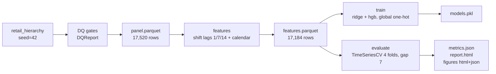

# DESIGN — 02 · Hierarchical Demand Forecasting

## Requirements

From the project spec:

1. Forecast daily units for a synthetic store-by-product retail hierarchy
   (4 stores × 6 products × 730 days, seeded, reproducible offline).
2. `config.py`: pydantic `Settings` subclass + `ForecastConfig`
   (n_days 730, n_stores 4, n_products 6, lags [1, 7, 14], n_splits 4, gap 7).
3. `data.py`: load + validate via `DatasetContract`; derive store-product
   daily series; platform DQ gates must halt the pipeline on failure.
4. `features.py`: lag + calendar features per series, **no leakage** —
   features built with `shift` only.
5. `model.py`: two models — Ridge baseline (in a sklearn `Pipeline` with
   `StandardScaler`) and `HistGradientBoostingRegressor`; global with one-hot
   series id (chosen over per-series models).
6. `evaluate.py`: honest backtest via `portfolio_core.timecv.TimeSeriesCV`;
   MAE/RMSE/MAPE via `portfolio_eval.ml.regression_metrics`; per-model
   `RunResult`; three plotly figures (forecast vs actual on example series,
   per-model metric bars, CV fold stability); report + metrics.json.
7. `cli.py`: typer commands `prepare`, `features`, `train`, `evaluate`, `all`.
8. Tests offline, runtime in seconds.

## Options considered

### A. Per-series models vs one global model with series id

- **Per-series (24 independent models)**: simple to reason about, but 24
  artefacts to version and deploy, weak transfer across series (each sees only
  730 rows), and new series require a cold-start refit.
- **Global with one-hot series id**: one artefact, the model learns
  series-level offsets plus shared seasonality/trend effects, new series are
  scored gracefully via `handle_unknown="ignore"`.
- **Global with target encoding / embeddings**: overkill for 24 series and
  leaks without careful out-of-fold encoding.

**Decision: global with one-hot series id.** Matches the spec; the panel has
identical calendars across series so a single expanding window applies to all.

### B. Validation protocol

- **Random k-fold**: rejected — masks drift; with trend + seasonality it
  leaks near-duplicate adjacent days across the split.
- **Last-block holdout**: better, but a single block gives one (possibly
  lucky) reading and no stability signal.
- **Expanding-window time CV with embargo gap** (`TimeSeriesCV`, 4 folds,
  gap 7): property-tested platform primitive; several honest readings; the
  per-fold spread doubles as a drift detector.

**Decision: expanding-window time CV, gap 7 days**, folds computed on dates
and mapped to rows so no date block straddles train/validation.

### C. Lag features vs rolling statistics

- Lags `[1, 7, 14]` capture momentum, same-weekday and two-week effects;
  weekly seasonality is also directly encoded via calendar features.
- Rolling means would add signal but complicate the leakage story (window
  must end at t−1); the spec fixes the lag set, so the simplest correct
  implementation was chosen.

**Decision: spec lags with `shift`, undefined rows dropped** (never imputed —
an imputed lag would teach the model that history is sometimes fake).

### D. Data: synthetic vs real (UCI Online Retail II)

- Real track: invoice-line data requires parsing, returns/cancellations
  handling, and a non-trivial aggregation to (date, store, product) units —
  plus network access for download. Valuable but out of scope for a
  seconds-fast, offline-guaranteed showcase.
- Synthetic: seeded, byte-identical across machines, exercises the full
  contract/DQ machinery via `synthetic://` source identity.

**Decision: synthetic only, implemented; real track documented, not
implemented.** The swap point is `data.py::build_panel` — a real
implementation would `portfolio_core.io.fetch` the UCI snapshot (checksum
pinned), map `StockCode → product`, `Country → store`, sum `Quantity` per day,
and keep every downstream module unchanged.

## Pipeline

## Leakage-control invariants (tested)

1. `lag_k(t) == units(t−k)` exactly — unit-tested on hand-built series.
2. CV folds: `max(train_idx) < min(val_idx)` and `val_start − train_end == gap`
   — property of `TimeSeriesCV`, re-asserted in integration tests.
3. Backtest row masks are date-aligned: newest training date < earliest
   validation date.
4. Metrics are computed on pooled **out-of-fold** predictions only.

## Changelog

- **0.2.0 (2026-10-12)** — wave 2: added `naive_mean` (global train mean) and
  `naive_last` (per-series persistence) baselines through the same backtest;
  `forecast_vs_actual` now overlays the best model vs the strongest naive;
  added EDA figures (`eda_series_overview`, `eda_units_distribution`); authored
  `story.yaml` (8 canonical sections). Real run (seed 42): hgb MAE 8.619 /
  MAPE 11.43%, −40.5% MAE vs naive_last (14.476); ridge −37.0%; naive_mean
  floor 31.762.
- **0.1.0 (2026-10-12)** — initial implementation: synthetic panel + DQ gates
  + dataset contract; shift-only lag/calendar features; global one-hot
  Ridge/HGB models; expanding-window backtest (4 folds, gap 7) with
  MAE/RMSE/MAPE, fold-stability and forecast-vs-actual figures; typer CLI +
  dvc stages; 25 offline tests. Real run (seed 42): ridge MAE 9.116 /
  MAPE 12.44%, hgb MAE 8.619 / MAPE 11.43%; pipeline ≈ 19 s.
