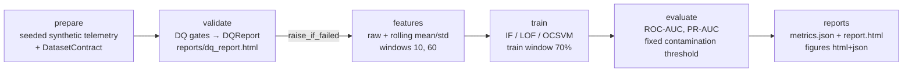

# DESIGN — 03 Anomaly Detection over Telemetry

## Requirements

- Detect anomalous minutes in synthetic telemetry (cpu, mem, latency_ms) with
  unsupervised detectors; ground-truth `is_anomaly` used for evaluation only.
- Data-quality gates must halt the pipeline loudly on violation and persist a
  human-readable report.
- Detectors train on the train window only; scoring on the test window uses a
  fixed contamination (no threshold tuning against ground truth).
- Per-model ROC-AUC + PR-AUC with overlay figures and a telemetry view marking
  the best model's flags.
- Runtime < 1 min; fully seeded and reproducible; tests run offline.

## Options considered

### Data

| option | decision |
|---|---|
| Real telemetry (node-exporter / cloud VM traces) | Rejected for now: needs network download and brittle licensing; kept as roadmap item behind the same `DatasetContract`. |
| Seeded synthetic generator from `portfolio_core.synthetic` | **Chosen**: offline, deterministic, ground-truth labels for evaluation, shared platform fallback. |

### Features

| option | decision |
|---|---|
| Raw signals only | Rejected: seasonal sinusoids bury contextual shifts. |
| Raw + rolling mean/std over windows [10, 60] (polars `rolling_mean`/`rolling_std`, `min_samples=window`) | **Chosen** — spec-compliant, complete-case matrix after dropping warm-up rows. |
| Residuals / seasonality-adjusted z-scores | Roadmap: the current injection produces self-similar anomaly clusters that rolling aggregates cannot break up (see below). |

### Detectors

| option | decision |
|---|---|
| IsolationForest | **Chosen**: partition-based; "far away ⇒ anomalous" regardless of local density. |
| LOF (`novelty=False`, `fit_predict` on train) | **Chosen** (per spec). Test-window scoring replicates `score_samples` math on the fitted neighborhood, because sklearn ≥ 1.9 blocks `score_samples`/`decision_function` when `novelty=False`. |
| One-Class SVM (`nu=contamination`, RBF) | **Chosen**: classic boundary-based baseline. |
| Autoencoder / deep model | Rejected: overkill for a 2%-contamination tabular problem and for a <1-min runtime budget. |

### Threshold

Fixed `1 − contamination` quantile of the test scores, per model. Chosen over
tuning a threshold on ground truth to keep the evaluation honest (no label
leakage into the operating point).

## Pipeline

## Finding: why LOF and OCSVM fail here

The injected anomalies (cpu += U(30, 50), latency ×= U(2, 5), independent of
the seasonal phase) form a **compact, self-similar cluster** in feature space.
Verified on the train window (k=20 nearest-neighbor distance, euclidean):

| group | mean k-NN distance |
|---|---|
| anomaly | 18.9 |
| normal | 8.5 |

- **LOF is purely local**: it compares a point's density only to its
  neighbors' density. Inside the blob, spacing is uniform, so every anomaly's
  LOF ≈ 1 (median test score on anomalies: 1.11 vs. 1.09 on normals). LOF
  never "looks outward" at the bulk of normal data, so isolation from normals
  does not register. Test ROC-AUC 0.527, PR-AUC 0.019 (below the 0.019→0.02
  prevalence band).
- **One-Class SVM (RBF) models the support of normal data**, and the dense
  blob is far more kernel-dense than the thin seasonal trajectory the normals
  trace, so the blob lands inside the learned boundary. Test ROC-AUC 0.337.
- **IsolationForest isolates by random partitioning**: a point in a distant
  blob gets isolated in a handful of splits no matter how dense the blob is.
  Test ROC-AUC 0.916, PR-AUC 0.124 — the clear champion.

Production remedies (roadmap): residual features against a rolling median to
de-cluster anomalies, subspace ensembles, and cost-aware thresholds.

Note: scaling was evaluated and rejected — it did not fix the local-density
blindness (LOF 0.63 at best with k=100 + standardization vs. 0.53 raw) and
adds a fitted-transformer artifact; keeping raw features preserves the
cleanest, most auditable story.

## Changelog

- 0.5.0 (2026-10-15): wave-13 external audit — NAB real data becomes the
  primary track (`data_source="nab"` default; synthetic generator stays the
  labelled CI/fast path): 12 checksum-pinned series across
  realAWSCloudwatch/realKnownCause/realTraffic with event-based metrics
  leading (window detected if >=1 alert inside, lead tolerance 0; range
  precision/recall/F1; PR-AUC primary, ROC-AUC secondary). Headline: overall
  PR-AUC 0.527 / range-F1 0.157 (16/17 events, 1609 alerts, range precision
  0.107) vs. synthetic PR-AUC 0.916 — the honest real-vs-synthetic delta:
  injected anomalies are trivially separable, so the synthetic track cannot
  expose the false-positive firehose. New figures `nab_timelines`,
  `nab_score_distribution`, `nab_alert_budget`; adaptive streaming runs on
  NAB (drift trigger fires on 31/120 chunks — recalibration remaining);
  series without evaluable test windows are excluded from aggregates, never
  scored as misses. Dataset card `docs/data-registry/nab.md` + import
  manifest `data-registry/imports/nab.json`.
- 0.4.0 (2026-10-13): wave-7 roadmap implementation — adaptive-threshold
  streaming simulation (`detect --adaptive`: 5 × 1 440-row chunks, median/IQR
  drift z, 0 events on the stable test stream, fixed 120 flags @ 15.9%/15.0%
  recall/precision vs. adaptive 113 @ 15.0%/15.0%); rolling-median residual
  features (IsolationForest ROC-AUC 0.9158 → 0.9999, PR-AUC → 0.9960;
  anomaly k-distance 20.5 → 59.9 vs. normal 9.5 → 17.0 — blob de-clustered);
  NSL-KDD production track (checksum-pinned mirrors of KDDTrain+/KDDTest+;
  41 mapped features; IsolationForest transfer probe ROC-AUC 0.8817 /
  PR-AUC 0.8916 at 56.9% test prevalence).
- 0.3.0 (2026-10-12): per-family Optuna HPO (`tune` stage: ~30 seeded TPE
  trials, median pruning, validation = last 20% of the train window) with
  tuned detectors persisted to `data/models_tuned/` alongside per-study
  JSON artifacts (best params, importances, trial history). New figures:
  `score_distribution` (normal vs. anomaly score histograms, log y),
  `threshold_sweep` (precision/recall vs. alert budget), `hpo_importance`;
  ROC/PR overlays restyled with `plotting.style_runs`. Real results: tuned
  OCSVM rescued (0.337 → 0.906 ROC-AUC / 0.136 PR-AUC via gamma=0.013),
  IF already near-optimal (+0.001), LOF not rescued (0.527 → 0.505).
- 0.2.0 (2026-10-12): seeded random baseline (uniform scores, `config.seed`)
  added to every evaluation — ROC-AUC 0.5091 / PR-AUC 0.0194 on the real run —
  plotted as an explicit curve in the ROC/PR overlays; `eda_signals_overview`
  figure (first 2 880 minutes of raw telemetry with injected anomalies marked);
  evaluation artifacts moved to the platform-canonical `reports/metrics.json` /
  `reports/report.html`; `story.yaml` case study authored (8 canonical
  sections).
- 0.1.0 (2026-10-12): initial pipeline — prepare/validate/features/train/
  evaluate CLI, DQ gates (null-rate, range, positivity), rolling features
  [10, 60], IF/LOF/OCSVM comparison at fixed contamination, figures +
  metrics.json + report.html. Real results: IF 0.9158/0.1239, LOF 0.5272/
  0.0195, OCSVM 0.3368/0.0241 (ROC-AUC/PR-AUC, seed 42, n=20000).
