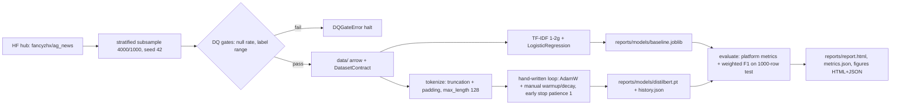

# DESIGN · 04 — NLP Multi-class Classification with Transformers

## Requirements

1. Classify AG News (real HF dataset `fancyzhx/ag_news`, 4 classes) with two
   approaches scored on identical data: (a) sklearn TF-IDF + LogisticRegression,
   (b) fine-tuned DistilBERT.
2. The transformer must be trained with a **hand-written PyTorch loop**:
   manual linear warmup + decay LR schedule, per-epoch train/val macro-F1,
   early stopping (patience 1), seeded, CPU-feasible.
3. Bounded data: `train_samples 4000`, `test_samples 1000`, stratified, seeded;
   the bound documented in README/DESIGN.
4. Platform contracts: `DatasetContract`, `DQReport` gates, platform metrics
   (`portfolio_eval.ml.classification_metrics`), themed plotly figures served
   as HTML + JSON to the showcase API, typer CLI matching `dvc.yaml` stages.
5. Tests run without network; the loop test proves loss decreases on 4 batches
   of random data.

## Data bound (documented)

| Split | Rows | Source |
|---|---|---|
| train | 3600 | seeded per-class stratified subsample of 4000 drawn from AG News train (120k), then 10% stratified carve-out |
| val | 400 | the carve-out above |
| test | 1000 | seeded per-class stratified subsample of AG News test (7.6k) |

Seeds: subsample `seed`, test `seed+1`, split `seed+2` (default seed 42).
Why 4000/1000: keeps 2-epoch DistilBERT fine-tuning ≈ 3.5 min on CPU and the
whole pipeline < 15 min, while large enough for a statistically meaningful
test split (±1.9pp max 95% CI half-width on accuracy at p=0.9).

## Options considered

| Decision | Options | Choice | Why |
|---|---|---|---|
| Data | full 120k / streaming / bounded subsample | **bounded subsample** | CPU runtime bound; reproducibility of a pinned snapshot; documented in the contract |
| Subsampling | `Dataset.shuffle(seed).select(n)` / per-class quotas | **per-class quotas via `RandomState`** | guarantees exact class proportions for any source balance; testable |
| NN training | HF `Trainer` / **hand-written loop** | **hand-written** | the loop (LR schedule, early stop, history) is the deliverable; no hidden callbacks |
| LR schedule | `get_scheduler` / manual | **manual `lr_at_step`** | warmup+decay is 5 lines; unit-tested at exact endpoints |
| Padding | dynamic per-batch collate / pre-pad to `max_length` | **pre-pad at tokenization** | max_length 128 is short; simplifies the DataLoader collate to pure tensor stacking |
| Baseline | LinearSVM / LogisticRegression | **LogisticRegression** | calibrated probabilities, robust default, fast at 8k sparse features |

## Pipeline

## Real results (this machine, CPU)

From `reports/metrics.json` (seed 42, identical 1000-row stratified test split):

| Run | accuracy | f1_macro | f1_weighted |
|---|---|---|---|
| naive_majority | 0.2500 | 0.1000 | 0.1000 |
| random_uniform | 0.2540 | 0.2533 | 0.2533 |
| baseline_tfidf_logreg | 0.8720 | 0.8714 | 0.8714 |
| distilbert_finetuned | 0.9020 | 0.9021 | 0.9021 |

Macro-F1 deltas vs. the `random_uniform` floor: baseline +61.8 pp, DistilBERT
+64.9 pp; DistilBERT vs. baseline +3.1 pp.

Training history (`reports/history.json`): epoch 1 — train_loss 0.6933,
val_loss 0.3590, val F1 0.8880; epoch 2 — train_loss 0.2840, val_loss 0.3525,
val F1 0.8823 → early stop, epoch-1 weights restored.

Figures in `reports/figures/`: `confusion_matrix_distilbert`,
`per_class_f1_distilbert`, `training_curve` (each `.html` + `.json`).

## Changelog

- 2026-10-12 · v0.1.0 — Initial working showcase: bounded stratified AG News
  preparation with DQ gates and DatasetContract; TF-IDF+LR baseline;
  hand-written DistilBERT fine-tuning loop with manual warmup/decay LR and
  patience-1 early stopping; platform-standard evaluation report with themed
  plotly figures; offline test suite (36 tests).
