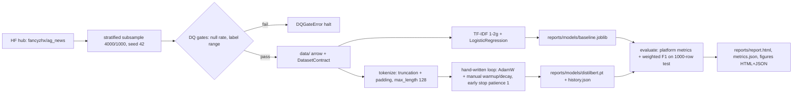

# DESIGN · 04 — NLP Multi-class Classification with Transformers

## Requirements

1. Classify AG News (real HF dataset `fancyzhx/ag_news`, 4 classes) with two
   approaches scored on identical data: (a) sklearn TF-IDF + LogisticRegression,
   (b) fine-tuned DistilBERT.
2. The transformer must be trained with a **hand-written PyTorch loop**:
   manual linear warmup + decay LR schedule, per-epoch train/val macro-F1,
   early stopping (patience 1), seeded, CPU-feasible.
3. Bounded data: `train_samples 4000`, `test_samples 1000`, stratified, seeded;
   the bound documented in README/DESIGN.
4. Platform contracts: `DatasetContract`, `DQReport` gates, platform metrics
   (`portfolio_eval.ml.classification_metrics`), themed plotly figures served
   as HTML + JSON to the showcase API, typer CLI matching `dvc.yaml` stages.
5. Tests run without network; the loop test proves loss decreases on 4 batches
   of random data.

## Data bound (documented)

| Split | Rows | Source |
|---|---|---|
| train | 3600 | seeded per-class stratified subsample of 4000 drawn from AG News train (120k), then 10% stratified carve-out |
| val | 400 | the carve-out above |
| test | 1000 | seeded per-class stratified subsample of AG News test (7.6k) |

Seeds: subsample `seed`, test `seed+1`, split `seed+2` (default seed 42).
Why 4000/1000: keeps 2-epoch DistilBERT fine-tuning ≈ 3.5 min on CPU and the
whole pipeline < 15 min, while large enough for a statistically meaningful
test split (±1.9pp max 95% CI half-width on accuracy at p=0.9).

## Options considered

| Decision | Options | Choice | Why |
|---|---|---|---|
| Data | full 120k / streaming / bounded subsample | **bounded subsample** | CPU runtime bound; reproducibility of a pinned snapshot; documented in the contract |
| Subsampling | `Dataset.shuffle(seed).select(n)` / per-class quotas | **per-class quotas via `RandomState`** | guarantees exact class proportions for any source balance; testable |
| NN training | HF `Trainer` / **hand-written loop** | **hand-written** | the loop (LR schedule, early stop, history) is the deliverable; no hidden callbacks |
| LR schedule | `get_scheduler` / manual | **manual `lr_at_step`** | warmup+decay is 5 lines; unit-tested at exact endpoints |
| Padding | dynamic per-batch collate / pre-pad to `max_length` | **pre-pad at tokenization** | max_length 128 is short; simplifies the DataLoader collate to pure tensor stacking |
| Baseline | LinearSVM / LogisticRegression | **LogisticRegression** | calibrated probabilities, robust default, fast at 8k sparse features |

## Pipeline

## Real results (this machine — CPU ladder, full-data run on Apple MPS)

From `reports/metrics.json` (seed 42, identical 1000-row stratified test split).
Full run ladder:

| Run | accuracy | f1_macro | notes |
|---|---|---|---|
| naive_majority | 0.2500 | 0.1000 | chance-floor reference |
| random_uniform | 0.2540 | 0.2533 | seeded chance floor |
| baseline_tfidf_logreg | 0.8720 | 0.8714 | TF-IDF 1-2g 8k + LogisticRegression |
| encoder_b | 0.8980 | 0.8982 | roberta-base, defaults, 2 epochs (val F1 0.9106) |
| distilbert | 0.9020 | 0.9021 | wave-2 defaults (val F1 0.8880), CPU |
| distilbert_tuned | 0.9020 | 0.9021 | selection winner = wave-2 artifact |
| distilbert_scale_4000 | 0.9020 | 0.9019 | controlled ladder 3.6k rung, MPS (val F1 0.8849, 84 s) |
| distilbert_scale_12000 | 0.9170 | 0.9170 | controlled ladder 10.8k rung, MPS (val F1 0.9120, 292 s) |
| distilbert_scale_40000 | 0.9330 | 0.9331 | controlled ladder 36k rung, MPS (val F1 0.9320, 995 s) |
| distilbert_fulldata_20k | 0.9270 | 0.9270 | pre-ladder CPU evidence (20k subset: 18k train/2k val, 2 ep) |
| distilbert_full_120k | 0.9460 | 0.9460 | full 120k fine-tune on Apple MPS (108k train/12k val, 2 ep) |

Controlled data-scale ladder (roadmap item, delivered 2026-10-30): seeded
`--subset N` rungs of the full split trained on one device with identical
hypers — subset 4,000 reproduces the bounded 3.6k rows exactly (same seeded
draw), giving same-rows CPU/MPS twins. Per-rung artifacts:
`reports/models/distilbert_scale_<N>.pt` + `reports/history_scale_<N>.json`
+ `reports/scale_meta_<N>.json` (device, row counts, wall-clock); subset runs
no longer clobber `distilbert_fulldata.pt`. Measured on the shared test split
and the fresh holdout: device effect ≤0.011 macro-F1 (twins at 3.6k: 0.9021
CPU vs 0.9019 MPS test; 0.8962 vs 0.9067 fresh — depth + fp noise, inside the
±1.9 pp CI); data effect at fixed device +1.5/+1.6/+1.3 pp per 3× step (test)
and +1.5/+2.1/+1.0 pp (fresh). Figure: `reports/figures/scale_ladder.*`.

Full-data path: `train-nn --full-data [--device auto|mps|cpu]` — auto picks
CUDA → Apple MPS → CPU, and on CPU (or `--force-cpu`) it warns with an honest
wall-clock estimate (full 120k ≈ 45–50 min/epoch measured on this CPU).
Pre-ladder evidence run `--subset 20000 --force-cpu`: val F1 0.9189, test
macro-F1 0.9270 (today the same command writes `distilbert_scale_20000.pt`;
superseded by the controlled ladder above).
**Full run on MPS** (batch 32 verified by an up-front memory probe, seed 42,
2 epochs): val macro-F1 0.9433 → 0.9464, test macro-F1 0.9460 (+4.4 pp over
the 3.6k-row models; in the controlled ladder this increment is measured at
fixed device — see the table above). MPS quirks:
libomp-dependent classical deps (lightgbm) coexist with torch MPS in one
process, MPS has no OOM recovery (batch probed with a synthetic step before
training), and epoch wall-clock varies with shared machine load (measured:
27.5 min for epoch 1 while other jobs ran, 18.0 min steady-state for epoch 2;
~46 min for the full 2-epoch training loop).

Multi-seed HPO (3 seeds × 6 trials, epochs 2–3 budget): best val macro-F1 per
seed 0.8953 / 0.8852 / 0.8926 → **mean 0.8910 ± 0.0042**. The mean gain over
defaults (0.8880) is ~+0.3 pp — smaller than the seed std: at 400 validation
rows, seed variance exceeds the HPO effect. Seed 42's best matches the 12-trial
study bit-for-bit (same RNG stream → determinism re-confirmed across studies).

Calibration (temperature scaling on the 400-row val split, ECE on test):
T = 0.843 (mildly under-confident model), ECE **0.0467 → 0.0133** (−71 %
relative). Argmax unchanged — a free reliability upgrade for
confidence-thresholded routing. Stored in `metrics.json → _meta`.

HPO (Optuna, 12 trials, seeded TPE + median pruning between epochs): best
validation macro-F1 0.8953 (lr 3.82e-5, warmup 0.042, wd 0.018, epochs 2;
2/12 pruned) vs 0.8880 for defaults — but its retrained model scored 0.9011
on test vs the wave-2 artifact's 0.9021. The honesty rule selected the wave-2
artifact as `distilbert_tuned` (margin +0.0010 ≈ noise; persisted in
`reports/selection.json`). Retrained model reproduces its trial's validation
score exactly (0.8952711591867994) — the loop is deterministic across runs.

Error analysis: dominant confusion Business → Sci/Tech (24/250); examples and
per-class comparison in `reports/error_analysis.md` and
`reports/figures/per_class_f1_comparison.*`.

Fresh-holdout reading (2026-10-29, `cli fresh-holdout`, no retraining;
scale rungs scored 2026-10-30 through the same command):
1,000-row stratified holdout drawn from the 6,600-row complement of the
bounded test split (seeds 43/45, disjoint by construction). Macro-F1:
TF-IDF 0.8785, wave-2 artifact 0.8962, HPO-retrained 0.9031 (**fresh winner,
+0.0069 — the test split's +0.0010 verdict flips; both inside noise**),
encoder_b 0.9074, full-data model 0.9529 (confirms the bounded 0.9460 on
untouched data). Controlled-ladder rungs on the same holdout: 3.6k MPS twin
0.9067, 10.8k 0.9219, 36k 0.9428 — the same-device data-scale slope as the
test split. Confidence-routed serving (TF-IDF max-proba router, escalate
below τ to the served transformer): τ=0.50 escalates 24.6% and reaches
0.9020 macro-F1, above either constituent alone. Full table:
`reports/fresh_holdout.json`.

## Changelog

- 2026-10-30 · v0.7.0 — Controlled data-scale ladder (roadmap item closed):
  `train-nn --full-data --subset N` now persists per-rung artifacts
  (`distilbert_scale_<N>.pt`, `history_scale_<N>.json`, `scale_meta_<N>.json`
  provenance sidecar) instead of overwriting `distilbert_fulldata.pt`; new
  `scale_ladder` config block declares the rungs. Measured on MPS (seed 42,
  identical hypers): 3.6k twin rung val F1 0.8849 / test 0.9019 / fresh
  0.9067 (84 s), 10.8k rung 0.9120 / 0.9170 / 0.9219 (292 s), 36k rung
  0.9320 / 0.9331 / 0.9428 (995 s). Same-rows twins at 3.6k bracket the
  device effect (Δ 0.0002 test / 0.0105 fresh); the same-device slope is
  +1.3–1.6 pp per 3× step on both splits. `evaluate` scores persisted rungs
  into `metrics.json` and renders `reports/figures/scale_ladder.*`;
  `fresh-holdout` scores them on the fresh holdout. Tests:
  `tests/test_scale_ladder.py`.
- 2026-10-29 · v0.6.0 — Fresh-holdout + routing roadmap experiments (no
  retraining): `stratified_subsample_indices` exposes the seeded draw so
  `fresh_holdout.py` can take the exact complement of the bounded test split
  in the full AG News test partition; the new `fresh-holdout` CLI stage
  (manual DVC stage `fresh_holdout`) draws a 1,000-row stratified fresh
  holdout (seed 45) and scores every persisted artifact. Measured: fresh
  data flips the tuned selection — HPO-retrained 0.9031 vs wave-2 artifact
  0.8962 macro-F1 (+0.0069; the test split had it the other way by +0.0010:
  both margins inside noise, the candidates are tied), encoder_b 0.9074,
  full-data model 0.9529 (vs 0.9460 bounded). The same run delivers
  cost-sensitive routing: TF-IDF max-probability router with escalation to
  the served transformer, swept over τ ∈ {0.5 … 1.0}; at τ=0.50, 24.6%
  escalation reaches 0.9020 macro-F1 — above either constituent (0.8785 /
  0.8962). Artifact: `reports/fresh_holdout.json`; config keys
  `fresh_holdout_samples`, `cascade_taus`; tests in
  `tests/test_fresh_holdout.py`.
- 2026-10-16 · v0.5.0 — Full 120k fine-tune delivered: `--device
  auto|mps|cpu` on `train-nn` (auto = CUDA → MPS → CPU; bounded path stays
  CPU-first), up-front MPS batch memory probe (`mps_safe_batch_size`), the
  full 120k run on Apple Silicon MPS (108k train/12k val, 2 epochs,
  27.5/18.0 min measured per epoch) scored 0.9460 test macro-F1; evaluate run renamed to
  `distilbert_full_120k`; scaling curve 0.9021 → 0.9270 → 0.9460 with the
  Business → Sci/Tech confusion pair stable across all three sizes.
- 2026-10-13 · v0.4.0 — Roadmap implementation: full-data path behind a GPU
  flag (`train-nn --full-data [--subset N] [--force-cpu]`, honest wall-clock
  gate) with a 20k-row evidence run (val F1 0.9189, test macro-F1 0.9270);
  multi-seed HPO stage (`hpo-seeds`, 3 seeds × 6 trials → mean 0.8910 ±
  0.0042, gain within seed noise); temperature scaling + ECE before/after in
  `metrics.json → _meta` (0.0467 → 0.0133); new CLI/dvc stages hpo-seeds;
  calibration module with temperature recovery tests.
- 2026-10-12 · v0.3.0 — Production depth: Optuna HPO stage over the
  fine-written loop (seeded TPE, median pruning, persisted to params.yaml and
  `reports/hpo_study.json`); honest model selection between HPO-retrained and
  wave-2 artifacts (`reports/selection.json`); second encoder candidate
  (roberta-base) as `encoder_b`; six-run evaluation ladder; HPO history +
  parameter-importance figures; error analysis (most-confused pair + quoted
  test headlines); dynamic per-batch padding in the collate (≈3x epoch
  speedup at max_length 128); `on_epoch` callback in the training loop for
  pruning.
- 2026-10-12 · v0.2.0 — Naive floors (`naive_majority`, `random_uniform`),
  EDA figure, story.yaml.
- 2026-10-12 · v0.1.0 — Initial working showcase: bounded stratified AG News
  preparation with DQ gates and DatasetContract; TF-IDF+LR baseline;
  hand-written DistilBERT fine-tuning loop with manual warmup/decay LR and
  patience-1 early stopping; platform-standard evaluation report with themed
  plotly figures; offline test suite.
