# DESIGN · Churn Modeling with Production-Grade sklearn Pipelines

## Requirements

1. Predict churn from messy tabular data (NaNs in `age`/`support_calls`,
   one huge `monthly_charges` outlier, low 8.8% base rate).
2. Preprocessing must live inside the fitted estimator — no leakage-prone
   steps outside the Pipeline, artifact deployable on raw data.
3. Class imbalance handled explicitly (`class_weight="balanced"`).
4. Model selection: small grid over the regularization strength C.
5. Evaluation beyond accuracy: ROC-AUC, precision/recall/F1 via
   `portfolio_eval`, calibration curve, permutation importance, and a
   business-cost curve (FP=1, FN=5) that picks the operating threshold.
6. Everything reproducible offline (seeded synthetic data), runtime < 1 min,
   tests without network.

## Options considered

| Decision | Options | Chosen | Why |
|---|---|---|---|
| Preprocessing placement | (a) pandas-style transform before split; (b) all inside `Pipeline` | (b) | (a) leaks train statistics (caps, medians, scales) into the holdout and makes the artifact non-deployable; (b) is the sklearn-idiomatic, leakage-safe default |
| Outlier strategy | drop rows; log-transform; quantile clipping | quantile clipping (`OutlierCapper`, 1%/99%) | dropping loses data, log-transform distorts linear-model coefficients; caps are learned on train only and keep the model linear/interpretable |
| Missing values | impute only; impute + indicator flags | impute + `MissingValueIndicator` flags | flags capture "missingness as signal" and are computed pre-imputation; cost is a few extra columns |
| Handling imbalance | threshold tuning only; oversampling; `class_weight` | `class_weight="balanced"` + threshold tuning | class weights fix the model's ranking objective during fit; the cost curve then fixes the operating point — the two are complementary, not alternatives |
| Model | logistic regression; gradient boosting | logistic regression | showcase target is *pipeline engineering*, not SOTA accuracy; LR is fast (<2 s end-to-end), regularized, and its coefficients/calibration are auditable — boosting is in the Roadmap |
| Split | temporal; stratified random | stratified random 80/20 | synthetic data has no time axis (explicitly out of scope per spec); stratification preserves the 8.8% rate in both splits |
| Threshold selection | default 0.5; Youden's J; business-cost minimum | business-cost minimum over a 41-point grid | Youden optimizes ROC geometry, not money; the client-facing question is "which threshold minimizes FP·1 + FN·5" |
| Permutation importance labels | transformed feature names (`prep.get_feature_names_out`) | raw input column names (`feature_names_in_`) | `sklearn.inspection.permutation_importance` permutes *input* columns; labeling with transformed names mislabels bars (bug caught during the real run) |

## Pipeline

```mermaid
flowchart LR
    A[churn.parquet<br/>5000 rows, messy] --> B[DQ gates<br/>DQReport, 6 checks]
    B -->|raise_if_failed| C[stratified split<br/>4000 train / 1000 holdout]
    C --> D[GridSearchCV<br/>C in 0.01..10, 3-fold, F1]
    subgraph PIPE[one fitted sklearn Pipeline]
        N[num: cap 1/99% → was_missing flags → median impute → scale]
        G[cat: most_frequent impute → one-hot, ignore unknown]
        L[LogisticRegression<br/>class_weight=balanced]
    end
    D --> PIPE
    PIPE --> E[holdout metrics × 2 runs<br/>t=0.5 vs cost-optimal t]
    E --> F[calibration · permutation importance · cost curve]
    F --> G2[ReportBuilder → reports/<br/>metrics.json, report.html, figures/*.html+json]
```

## Evaluation protocol

- Same fitted model scored twice: at threshold 0.5 and at the cost-optimal
  threshold, producing two `RunResult` rows. This isolates the value of
  operating-point tuning from model quality (ROC-AUC is threshold-independent
  and identical across both runs).
- Business cost: `FP·1 + FN·5` swept over 41 thresholds; optimum at 0.725,
  cutting holdout cost from 350 to 282 (−19.4%) and lifting F1 0.580 → 0.683.
- Calibration: 10-bin reliability diagram; the balanced model is slightly
  over-forecasting at high probabilities, motivating the Roadmap
  calibration stage.
- Permutation importance: holdout F1 decrease, 5 repeats, error bars;
  `monthly_charges` (0.118) and `contract` (0.076) dominate — matching the
  generator's ground truth.

## Changelog

- 2026-10-12 · Initial implementation: config/features/model/evaluate/cli,
  DQ gates, dvc.yaml + params.yaml wired into the CLI, 27 tests (93% package
  coverage), real run: ROC-AUC 0.8344, cost 350 → 282 at t*=0.725.
- 2026-10-12 · Fixed mislabeled permutation-importance bars (input-space vs
  transformed-space names); fixed `check_range` crash on all-null columns.
- 2026-10-12 · Wave 2: naive-majority baseline row on the same cost curve,
  `eda_churn_profile` figure, `story.yaml` (8 canonical sections), NaN-aware
  DQ null-rate gates, `dvc commit` lockfile.
- 2026-10-12 · Wave 3: Optuna model selection (logreg vs HistGB, seeded TPE,
  median pruning) with the selection persisted to `params.yaml` as the
  production config; isotonic calibration on a train-only calibration split
  (raw vs calibrated compared via ECE + business cost); PR-curve and
  decision-curve figures; `add_takeaway`/`style_runs` storytelling on all new
  figures. Search-space ranges capped (HistGB max_iter ≤ 150, fast solvers for
  l1/l2) after the first HPO pass blew the runtime budget — saga+elasticnet
  and large boosting grids were the cost drivers.
- 2026-10-13 · Wave 7: cost-aware HPO objective — trials scored by CV
  business cost (FP=1/FN=5) on out-of-fold probabilities at per-trial
  cost-optimal thresholds (documented in `hpo.py`); winner changed from the
  F1-selected HistGB to a lightly-regularized logistic (C=0.2365,
  l1_ratio=0.1388) that lands at the holdout cost optimum. Added `prepare
  --input client.csv` onboarding (same DQ gates + DatasetContract, churned
  optional) and seeded paired bootstrap CIs (2,000 resamples) on the
  holdout cost delta vs naive (−158, 95% CI [−237, −87], significant),
  persisted as `_meta.cost_delta_ci` in metrics.json with a `bootstrap_ci`
  figure. Also fixed: `family_scores` averaged across all trials regardless
  of family; polars str-bytes mypy false positive on `mean()`.
