# DESIGN · Churn Modeling with Production-Grade sklearn Pipelines

## Requirements

1. Predict churn from messy tabular data (NaNs in `age`/`support_calls`,
   one huge `monthly_charges` outlier, low 8.8% base rate).
2. Preprocessing must live inside the fitted estimator — no leakage-prone
   steps outside the Pipeline, artifact deployable on raw data.
3. Class imbalance handled explicitly (`class_weight="balanced"`).
4. Model selection: small grid over the regularization strength C.
5. Evaluation beyond accuracy: ROC-AUC, precision/recall/F1 via
   `portfolio_eval`, calibration curve, permutation importance, and a
   business-cost curve (FP=1, FN=5) that picks the operating threshold.
6. Everything reproducible offline (seeded synthetic data), runtime < 1 min,
   tests without network.

## Options considered

| Decision | Options | Chosen | Why |
|---|---|---|---|
| Preprocessing placement | (a) pandas-style transform before split; (b) all inside `Pipeline` | (b) | (a) leaks train statistics (caps, medians, scales) into the holdout and makes the artifact non-deployable; (b) is the sklearn-idiomatic, leakage-safe default |
| Outlier strategy | drop rows; log-transform; quantile clipping | quantile clipping (`OutlierCapper`, 1%/99%) | dropping loses data, log-transform distorts linear-model coefficients; caps are learned on train only and keep the model linear/interpretable |
| Missing values | impute only; impute + indicator flags | impute + `MissingValueIndicator` flags | flags capture "missingness as signal" and are computed pre-imputation; cost is a few extra columns |
| Handling imbalance | threshold tuning only; oversampling; `class_weight` | `class_weight="balanced"` + threshold tuning | class weights fix the model's ranking objective during fit; the cost curve then fixes the operating point — the two are complementary, not alternatives |
| Model | logistic regression; gradient boosting | logistic regression | showcase target is *pipeline engineering*, not SOTA accuracy; LR is fast (<2 s end-to-end), regularized, and its coefficients/calibration are auditable — boosting is in the Roadmap |
| Split | temporal; stratified random | stratified random 80/20 | synthetic data has no time axis (explicitly out of scope per spec); stratification preserves the 8.8% rate in both splits |
| Threshold selection | default 0.5; Youden's J; business-cost minimum | business-cost minimum over a 41-point grid | Youden optimizes ROC geometry, not money; the client-facing question is "which threshold minimizes FP·1 + FN·5" |
| Permutation importance labels | transformed feature names (`prep.get_feature_names_out`) | raw input column names (`feature_names_in_`) | `sklearn.inspection.permutation_importance` permutes *input* columns; labeling with transformed names mislabels bars (bug caught during the real run) |

## Pipeline

```mermaid
flowchart LR
    A[churn.parquet<br/>5000 rows, messy] --> B[DQ gates<br/>DQReport, 6 checks]
    B -->|raise_if_failed| C[stratified split<br/>4000 train / 1000 holdout]
    C --> D[GridSearchCV<br/>C in 0.01..10, 3-fold, F1]
    subgraph PIPE[one fitted sklearn Pipeline]
        N[num: cap 1/99% → was_missing flags → median impute → scale]
        G[cat: most_frequent impute → one-hot, ignore unknown]
        L[LogisticRegression<br/>class_weight=balanced]
    end
    D --> PIPE
    PIPE --> E[holdout metrics × 2 runs<br/>t=0.5 vs cost-optimal t]
    E --> F[calibration · permutation importance · cost curve]
    F --> G2[ReportBuilder → reports/<br/>metrics.json, report.html, figures/*.html+json]
```



## Evaluation protocol

- Same fitted model scored twice: at threshold 0.5 and at the cost-optimal
  threshold, producing two `RunResult` rows. This isolates the value of
  operating-point tuning from model quality (ROC-AUC is threshold-independent
  and identical across both runs).
- Business cost: `FP·1 + FN·5` swept over 41 thresholds; optimum at 0.725,
  cutting holdout cost from 350 to 282 (−19.4%) and lifting F1 0.580 → 0.683.
- Calibration: 10-bin reliability diagram; the balanced model is slightly
  over-forecasting at high probabilities, motivating the Roadmap
  calibration stage.
- Permutation importance: holdout F1 decrease, 5 repeats, error bars;
  `monthly_charges` (0.118) and `contract` (0.076) dominate — matching the
  generator's ground truth.

## Changelog

- 2026-10-12 · Initial implementation: config/features/model/evaluate/cli,
  DQ gates, dvc.yaml + params.yaml wired into the CLI, 27 tests (93% package
  coverage), real run: ROC-AUC 0.8344, cost 350 → 282 at t*=0.725.
- 2026-10-12 · Fixed mislabeled permutation-importance bars (input-space vs
  transformed-space names); fixed `check_range` crash on all-null columns.
- 2026-10-12 · Wave 2: naive-majority baseline row on the same cost curve,
  `eda_churn_profile` figure, `story.yaml` (8 canonical sections), NaN-aware
  DQ null-rate gates, `dvc commit` lockfile.
- 2026-10-12 · Wave 3: Optuna model selection (logreg vs HistGB, seeded TPE,
  median pruning) with the selection persisted to `params.yaml` as the
  production config; isotonic calibration on a train-only calibration split
  (raw vs calibrated compared via ECE + business cost); PR-curve and
  decision-curve figures; `add_takeaway`/`style_runs` storytelling on all new
  figures. Search-space ranges capped (HistGB max_iter ≤ 150, fast solvers for
  l1/l2) after the first HPO pass blew the runtime budget — saga+elasticnet
  and large boosting grids were the cost drivers.
- 2026-10-13 · Wave 7: cost-aware HPO objective — trials scored by CV
  business cost (FP=1/FN=5) on out-of-fold probabilities at per-trial
  cost-optimal thresholds (documented in `hpo.py`); winner changed from the
  F1-selected HistGB to a lightly-regularized logistic (C=0.2365,
  l1_ratio=0.1388) that lands at the holdout cost optimum. Added `prepare
  --input client.csv` onboarding (same DQ gates + DatasetContract, target
  column optional) and seeded paired bootstrap CIs (2,000 resamples) on the
  holdout cost delta vs naive (−158, 95% CI [−237, −87], significant),
  persisted as `_meta.cost_delta_ci` in metrics.json with a `bootstrap_ci`
  figure. Also fixed: `family_scores` averaged across all trials regardless
  of family; polars str-bytes mypy false positive on `mean()`.
- 2026-10-15 · Wave 11: XGBoost + LightGBM arms in the cost-aware selection
  (sklearn-API classifiers on the same ColumnTransformer output — one
  preprocessing contract, no native-categorical bypass; both pinned
  `n_jobs=1` after measuring OpenMP oversubscription). Winner unchanged:
  logistic (C=0.6494, l1_ratio=0.4540) wins both the best trial (CV cost
  1,220) and the family mean (1,225 vs 1,367 lightgbm / 1,409 xgboost /
  1,339 histgb). macOS libomp: neither wheel bundles it (upstream expects
  brew) and naive per-package copies load two OpenMP runtimes → segfault on
  xgboost unpickle with lightgbm imported (measured). Fix:
  `model.py:_ensure_libomp` self-healed the active venv with ONE shared
  `<venv>/lib/libomp.dylib` plus an `@loader_path` rpath on both dylibs
  (sources: xgboost copy, `vendor/libomp.dylib` — removed in wave 12 —, or
  the workspace venv — the latter covers DVC-experiment temp venvs); the
  workspace venv itself was repaired the same way (single
  `.venv/lib/libomp.dylib`, per-package copies removed). Also declared previously-transitive deps (pandas, optuna,
  pyyaml); fixed `family_scores` to filter `TrialState.COMPLETE` (Optuna 5
  sets `value` on pruned trials); corrected the xgboost arm to balance via
  native `scale_pos_weight` (`class_weight` is silently ignored).
  Sensitivity experiments and the queue blocker are documented in
  "Experiment versioning" below.
- 2026-10-15 · Wave 12 (external-audit remediation): removed
  `vendor/libomp.dylib` and the `_ensure_libomp` venv surgery from wave 11 —
  replaced by a documented prerequisite (README: macOS `brew install libomp`;
  Linux wheels bundle libgomp) and a graceful import guard in `model.py`
  (`_boosting_import_error`: actionable message on libomp-load failures, no
  path rewriting or rpath grafting). Type ignores reduced 13 → 6 by
  re-exporting the untyped third-party names (pandas, pyyaml, threadpoolctl)
  from `config.py` so consumers import typed-Any handles; remaining ignores
  each carry a reason (sklearn Any-base classes ×2, the three re-exports,
  and one intentional invalid-kwargs test). The workspace venv keeps the
  wave-11 repair (single `.venv/lib/libomp.dylib` + loader-path rpaths), so
  all tests pass on this machine with no in-repo binary.

- 2026-10-15 · Wave 13 (real-data primary): the IBM telco churn dataset
  (7,043 rows, sha256-pinned, canonical GitHub mirror — the HF id
  `julien-c/telco-churn` from planning does not exist and is the documented
  fallback trigger) is now the default `data_source: telco`, behind the same
  DQ gates + DatasetContract; the synthetic generator is the clearly labeled
  CI path. Added a scheme layer (`model.py:SCHEMES`) so the pipeline contract
  (capping, flags, imputation, one-hot, cost tuning) is column-agnostic;
  telco carries gender/senior_citizen/contract as fairness slices through
  prepare → holdout → evaluation. New: per-slice report (`_meta.slices` +
  `fairness_slices` figure) and a FN-cost × threshold cost-surface heatmap
  with the operating point marked. Registry: `registry/telco-churn.dvc`
  import-url manifest + `docs/data-registry/telco-churn.md` card + index
  entry. Real-data verdicts: XGBoost replaces the synthetic track's logistic
  winner; isotonic calibration improves BOTH ECE and cost on telco (the
  synthetic non-transfer conclusion does not generalize); the operating
  threshold does not transfer across regimes (t*=0.700 synthetic vs 0.175
  telco) — the cost-curve procedure does. Holdout: cost 1,035 → 601
  (−41.9%), bootstrap −416 [−485, −343]; slice gap is contractual
  (month-to-month recall 0.98 vs two-year 0.00 at FN=5).
- 2026-10-29 · Wave 14 — FN-cost sensitivity, re-run. The monorepo DVC graph
  blockers are resolved (01's overlapping outs fixed upstream; this wave fixed
  07's `train_arms` duplicate out), so `dvc exp run --queue` validates and
  queues again — but the queued runner still fails in the experiment temp
  venv on this machine (libomp exists only in the repaired workspace venv),
  which "Experiment versioning" below documents honestly. The numbers come
  from the identical evaluation code path via the new `churn_pipeline
  sensitivity` command (re-scores the persisted artifacts under FN=3/5/8,
  writes `reports/sensitivity.json`, touches nothing else; the FN=5 variant
  reproduces the committed baseline bit-for-bit). Measured: naive 1,035
  throughout; calibrated 510/601/699 at t*=0.200/0.175/0.100; deltas
  −547/−416/−344 with CIs [−618, −474]/[−485, −343]/[−426, −258]; the raw
  model beats the calibrated one at FN=8 (691 vs 699) — calibration's cost
  edge is cost-model dependent. New test: sensitivity self-check +
  baseline-untouched guard.

## Experiment versioning

What-if sensitivity of the operating point to the FN-cost assumption. The
intended tracking mechanism is queued DVC experiments:

```bash
uv run dvc exp run --queue --set-param fn_cost=3 -n fn3
uv run dvc exp run --queue --set-param fn_cost=8 -n fn8
uv run dvc exp run --run-all
uv run dvc exp show --no-pager
```

**Graph blocker — resolved (2026-10-29).** `dvc exp run` validates the whole
monorepo pipeline graph. It originally failed on an overlapping-outs
declaration in `projects/01-rag-agent/dvc.yaml`; after that was fixed the
same check failed on `projects/07-open-data-mobility/dvc.yaml:train_arms`,
which declared `reports/models/predictions_baseline.parquet` as both a dep
and an out (the arms write `predictions_arms.parquet` — see the comment in
`arms.py`). The 07 declaration was corrected in this wave and
`dvc exp run --queue` now validates and queues cleanly.

**Runner blocker — environmental, documented (2026-10-29).** On this machine
`dvc exp run --run-all` still cannot execute the experiments: DVC reproduces
queued experiments in a temporary venv under `.dvc/tmp/exps/`, and the
xgboost/lightgbm wheels need libomp, which exists only in the repaired
workspace venv (see "Options considered" wave 11/12 — `brew install libomp`
is the documented prerequisite and this machine instead carries the venv
repair). The failure is at import time in the *temp* venv, not a pipeline
bug. The numbers below therefore come from the identical evaluation code
path run in the workspace venv via the project's sensitivity command:

```bash
uv run python -m churn_pipeline.cli sensitivity            # fn_cost 3, 5, 8
```

`churn_pipeline sensitivity` re-scores the persisted artifacts under
alternative FN costs — same `evaluate_holdout` code path as `evaluate`,
thresholds re-derived per variant on the same 1,409-row holdout, nothing
applied back to the baseline (writes only `reports/sensitivity.json`). The
variant equal to the production `fn_cost` reproduces the committed baseline
bit-for-bit (`matches_baseline`), which is the self-check that the what-if
pass is faithful. Queued DVC experiments remain the canonical tracking
mechanism on machines with a working libomp.

Sensitivity results (real telco holdout, 1,409 rows, FP=1; 2026-10-29):

| variant | fn_cost | naive cost | raw selected cost (t*) | calibrated cost (t*) | Δ vs naive, raw vs naive (95% CI) |
|---|---|---|---|---|---|
| fn3 | 3 | 1,035 | 488 (0.325) | 510 (0.200) | −547 [−618, −474] |
| fn5 | 5 | 1,035 | 619 (0.150) | 601 (0.175) | −416 [−485, −343] — reproduces the committed baseline |
| fn8 | 8 | 1,035 | 691 (0.100) | 699 (0.100) | −344 [−426, −258] |

Reading: the more a missed churner costs relative to a false alarm, the
lower the cost-optimal threshold (alarm earlier) and the smaller the
absolute saving — the naive contact-everyone comparator has no missed
churners to inflate, so its 1,035 cost is fn-independent. The XGBoost
selection is never in doubt: every variant's CI excludes zero. One honest
wrinkle: isotonic calibration's cost advantage is itself cost-model
dependent — it helps at fn=5 (619 → 601) but slightly hurts at fn=8
(691 → 699); the earlier synthetic conclusion ("calibration does not move
the optimum") was not universal either. The earlier synthetic-track
sensitivity (t* 0.775 / 0.700 / 0.625 at fn 3/5/8, logistic winner
throughout) showed the same directional story on the 8.8%-churn regime.
