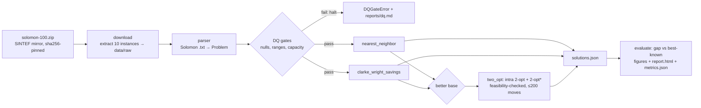

# DESIGN — Routing Optimization (06)

## Requirements

1. Solve VRPTW instances from the Solomon 100-customer benchmark (real data,
   subset: C101–C105, RC102–RC105, RC108).
2. Three hand-written, deterministic solvers: nearest neighbor, Clarke–Wright
   savings, and a 2-opt improvement pass — runtime-friendly (seconds per
   instance, 2-opt capped at 200 accepted moves).
3. Hard validation of every solution: all customers served exactly once,
   capacity respected (time-window feasibility checked per route).
4. Evaluation against the curated best-known table
   (`docs/data-registry/best_known/solomon100.csv`) with gap-%, plus three
   portfolio-themed figures and markdown/HTML reports.
5. Reproducible: pinned data snapshot, DVC stages, offline tests ≥ 60 %
   package coverage, no `print` in library code.

## Data source decision

The registry fetch script (`docs/data-registry/scripts/fetch_cvrplib.py`)
targets `https://solomonbenchmark.s3.amazonaws.com/{inst}.txt`; at snapshot
time (2026-10-12) **every object in that bucket returned 404**. Options:

- **(a) Fix the bucket/URL** — rejected: the mirror is outside this repo's
  control; nothing to fix locally.
- **(b) Canonical CVRPLIB site (PUC-Rio)** — rejected: tarball URL 404s as
  well.
- **(c) SINTEF TOP backup zip** — chosen: the registry's own dataset card
  (`docs/data-registry/cvrplib-solomon.md`) names SINTEF as the maintained
  mirror ("as a backup, you will find a zip-file with the 100 instance
  definitions"), and it serves all 56 instance files in one archive
  (`solomon-100.zip`, sha256 pinned in `data/raw/dataset_card.json`). The
  instance text files are the identical immutable academic artifacts.

Note: SINTEF's CDN rejects urllib's default `User-Agent` (HTTP 403), so the
download uses an explicit browser UA with the same checksum/idempotency
semantics as `portfolio_core.io.fetch` (which cannot set headers).

## Solver decisions

| Decision | Options | Choice | Why |
|---|---|---|---|
| Construction (a) | depot-first NN; time-oriented (earliest-due) seeded NN | **earliest-due seed** | Depot-first greedy fragments routes on tight-window instances (RC105 needed 26 vehicles); seeding by urgency is the classic fix and keeps NN honest as a baseline. |
| Return-leg pruning | reject customers that break depot return during selection; trim after | **trim after** | Up-front pruning strands customers and inflates fleet size; post-hoc trimming re-offers them to the next route. |
| Construction (b) | sequential vs parallel savings; with/without TW feasibility on merges | **parallel savings, TW-checked merges** | Feasibility-checked merges are the standard VRPTW adaptation; sequential application is deterministic and fast enough (ms). |
| Improvement (c) | intra-route 2-opt only; + inter-route 2-opt* tail exchange | **both, first-improvement, feasibility-checked** | On C101 the CW plan is genuinely intra-2-opt-optimal (1 improving move, infeasible) — tail exchanges are required to make the 2-opt stage meaningful and stay within "2-opt moves that preserve feasibility". |
| Metaheuristic (d) | tabu search; genetic algorithm; ALNS | **ALNS (Ropke-Pisinger)** | Destroy (random/worst/Shaw) + regret-2 repair directly attacks cross-route re-sequencing — the neighborhood 2-opt cannot express and where the measured gap lived; one seeded RNG drives every decision, keeping it deterministic. |
| ALNS acceptance | hill-climb; SA with reheating | **SA, geometric cooling** | Escaping the tuned-2-opt local optimum requires accepting temporarily worse plans; temperature 5 % → 0.1 % of start distance over the iteration cap. |
| ALNS tuning | hand-picked; seeded search | **seeded search on 6-instance subset** (segment/reaction/init) | Full-benchmark evaluation per trial would cost minutes; a representative subset (C101/C104/R104/R108/RC104/RC105) keeps the search ~30 s and transfers (winner: segment 100, reaction 0.5, uniform). |
| Full benchmark | 10-instance subset; all 56 | **all 56 + per-family reporting** | Per-family gaps (C1…RC2) expose where each solver actually stands; subset hid C2's wide-horizon difficulty. Best-known references for the 42 instances missing from the registry CSV ship as a clearly-sourced project-local supplement (`best_known_supplement.csv`, SINTEF TOP values; registry wins conflicts). |
| Fleet cap (`max_vehicles`) | hard fail; soft (warn + report) | **soft** | The instance fleet (25) is an upper bound, not the optimum; a baseline heuristic exceeding it (CW needs 31 on R101) is a finding, reported with the vehicle count — never hidden. |
| Distance | rounded vs full-precision Euclidean | **full precision, Euclidean** | Matches the double-precision convention the best-known table is published under. |
| External reference | none; OR-Tools CP-SAT yardstick | **CP-SAT, hinted + time-bounded (`ortools_cp`)** | Per-vehicle circuits over time-window-filtered arcs (necessary condition `ready_i + service_i + dist_ij <= due_j`), fleet capped at hinted fleet + slack, ALNS plan injected as the solution hint, depot return on a separate timestamp (a shared departure/arrival variable makes every route a `t >= t` cycle). Single worker + fixed seed = deterministic within the limit; UNKNOWN status falls back to the hint, so the arm never degrades an incumbent. Measured verdict: ties ALNS on all 56 instances within a 10 s budget at ~5x the runtime; certifies <=25-customer subproblems to optimality in seconds. |

## Flow

## Contracts

- `Customer` / `Problem` / `RoutePlan` derive from `PortfolioBaseModel`
  (extra=forbid). `RoutePlan.validate_against` is the hard gate: exactly-once
  service, no depot/unknown ids, per-route capacity; `_finish` in `solver.py`
  additionally refuses time-window-infeasible routes.
- Names normalize to the compact form (`C1_01`, `c101.txt` → `C101`) before
  joining the best-known table.
- Figures go through `portfolio_core.plotting` (`apply_theme`, `save_html`,
  `save_json`) — ADR-0005; both HTML and JSON are written so the showcase API
  can serve them.

## Changelog

- **2026-10-12** — Initial implementation. Solvers: time-oriented NN,
  TW-checked Clarke–Wright, first-improvement 2-opt with 2-opt* tail exchange.
  Evaluation against 10-instance subset; real run: mean gap 19.55 % (2-opt),
  10/10 instances best-solved by 2-opt, full solve stage ~0.1 s.
- **2026-10-12** — Data mirror switched from dead S3 bucket to SINTEF backup
  zip (see "Data source decision"); dataset card with sha256
  `8a0a72cb…77e47` written to `data/raw/dataset_card.json`.
- **2026-10-12** — Wave 2: added `randomized` seeded feasible baseline (shuffle
  + pack + return-leg repair, no local search) — mean gap 302.86 %, the flat
  reference that makes construction (−68.2 % distance vs savings) and 2-opt
  (−3.7 % further) legible. Added `eda_instance_map` figure (C101 scatter
  colored by time-window width). Authored `story.yaml` (8 canonical sections)
  served via `portfolio_core.story`.
- **2026-10-12** — Wave 3: `two_opt` gained `acceptance` (first/best) and
  `tail_exchange` knobs plus a convergence `trace`; new `tuning.py` runs a
  seeded 24-trial random search (budget 50–500, acceptance, tail exchange,
  best-of-k restarts; objective = mean distance) and persists the winner to
  `params.yaml` as `solver_best`. Result: `two_opt_tuned` at 19.08 % mean gap
  (−0.45 pts vs untuned); negative results — restarts don't pay, budgets
  saturate — kept in README/story. New figures: `solver_profile`,
  `convergence_C101`, `convergence_RC105` using `add_takeaway`/`style_runs`.
  Note: `style_runs` sets `line=` which bar traces reject; grouped-bar figures
  fall back to marker-color styling via the public `is_baseline_run` hint.
- **2026-10-13** — Wave 7: ALNS behind the same `RoutePlan` contract (random /
  worst / Shaw destroy + regret-2 repair, segment-wise operator-weight
  adaptation, SA acceptance, iteration-capped from config) started from the
  tuned 2-opt plan; second seeded search tunes ALNS knobs on a 6-instance
  subset (winner: segment 100, reaction 0.5, uniform init → `alns_best`).
  Benchmark extended to all 56 Solomon instances with per-family gap table and
  `family_gap` figure; registry best-known table supplemented by a
  project-local CSV (`best_known_supplement.csv`) for the 42 missing
  instances (SINTEF TOP values). Results: ALNS mean gap 4.23 % (vs 13.63 %
  tuned 2-opt), wins 56/56, negative gaps on 8 instances (convention-mixed
  references); per-family: C1 4.48, C2 6.50, R1 4.10, R2 3.04, RC1 4.75,
  RC2 3.00. Roadmap down to one item: hierarchical objective.
- **2026-10-15** — Wave 13 (external reference): `ortools_cp` OR-Tools CP-SAT
  arm behind the same `RoutePlan` contract — per-vehicle circuits over
  time-window-filtered arcs, hinted by the ALNS plan, single worker + fixed
  seed, 10 s/instance wall budget from config (`ortools_time_limit_s`,
  `ortools_max_vehicles`, `ortools_fleet_slack`). Debugging history that
  mattered: the first model crashed or hung at 100 customers (full arc graph =
  204k bools; presolve consumed the whole limit) and proved INFEASIBLE
  everywhere because depot departure and return shared one time variable
  (every route became a `t >= t` cycle) — caught by the tiny-instance tests.
  Fixed model: filtered arcs, separate return timestamp, depot-usage guard,
  coverage-checked extraction with hint fallback. Result: on all 56
  instances CP-SAT ended at UNKNOWN within budget and the arm returned the
  ALNS incumbent unchanged (ties 56/56 at ~5x runtime; 25-customer prefix of
  C101 certified optimal at 191.8 in 2.9 s vs the 286.3 2-opt hint). New
  figures: `pareto_gap_runtime` (all seven solvers), `alns_convergence_C101`
  / `_RC105` (two-panel ALNS traces); ALNS `trace`/`stats` captured on the
  convergence instances. New tests: `tests/test_ortools.py` (feasibility,
  never-worse-than-hint, determinism-within-limit).
- **2026-10-15** — Wave 12 (external-audit remediation): (1) vehicle-count
  comparison — `best_known_vehicles` column added to the registry CSV (14
  rows, SINTEF values) and the project supplement (42 rows); evaluation now
  reports distance gap % AND vehicle-count delta per instance, per family and
  in a two-panel `family_gap` figure; solutions also ranked under the
  benchmark convention (vehicles first, then distance) — intra-ladder ALNS
  wins 43/56 (not 56/56) under it, and no solver beats the references on
  vehicle count (best +3.73 mean). (2) God-module split: `evaluate.py` 950 →
  orchestration-only (~730) + `figures.py` (254) + `reporting.py` (~120);
  `solver.py` 708 → `solver.py` (437, 2-opt + ALNS) + `construct.py` (225,
  NN/savings/randomized) + `routing.py` (89, shared geometry/feasibility
  core). Pure moves — all 47 tests passed unmodified; construction/routing
  names re-exported from `solver` for backward compatibility.
