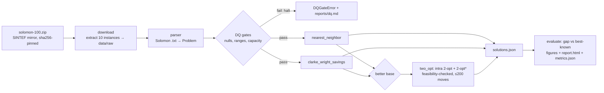

# DESIGN — Routing Optimization (06)

## Requirements

1. Solve VRPTW instances from the Solomon 100-customer benchmark (real data,
   subset: C101–C105, RC102–RC105, RC108).
2. Three hand-written, deterministic solvers: nearest neighbor, Clarke–Wright
   savings, and a 2-opt improvement pass — runtime-friendly (seconds per
   instance, 2-opt capped at 200 accepted moves).
3. Hard validation of every solution: all customers served exactly once,
   capacity respected (time-window feasibility checked per route).
4. Evaluation against the curated best-known table
   (`docs/data-registry/best_known/solomon100.csv`) with gap-%, plus three
   portfolio-themed figures and markdown/HTML reports.
5. Reproducible: pinned data snapshot, DVC stages, offline tests ≥ 60 %
   package coverage, no `print` in library code.

## Data source decision

The registry fetch script (`docs/data-registry/scripts/fetch_cvrplib.py`)
targets `https://solomonbenchmark.s3.amazonaws.com/{inst}.txt`; at snapshot
time (2026-10-12) **every object in that bucket returned 404**. Options:

- **(a) Fix the bucket/URL** — rejected: the mirror is outside this repo's
  control; nothing to fix locally.
- **(b) Canonical CVRPLIB site (PUC-Rio)** — rejected: tarball URL 404s as
  well.
- **(c) SINTEF TOP backup zip** — chosen: the registry's own dataset card
  (`docs/data-registry/cvrplib-solomon.md`) names SINTEF as the maintained
  mirror ("as a backup, you will find a zip-file with the 100 instance
  definitions"), and it serves all 56 instance files in one archive
  (`solomon-100.zip`, sha256 pinned in `data/raw/dataset_card.json`). The
  instance text files are the identical immutable academic artifacts.

Note: SINTEF's CDN rejects urllib's default `User-Agent` (HTTP 403), so the
download uses an explicit browser UA with the same checksum/idempotency
semantics as `portfolio_core.io.fetch` (which cannot set headers).

## Solver decisions

| Decision | Options | Choice | Why |
|---|---|---|---|
| Construction (a) | depot-first NN; time-oriented (earliest-due) seeded NN | **earliest-due seed** | Depot-first greedy fragments routes on tight-window instances (RC105 needed 26 vehicles); seeding by urgency is the classic fix and keeps NN honest as a baseline. |
| Return-leg pruning | reject customers that break depot return during selection; trim after | **trim after** | Up-front pruning strands customers and inflates fleet size; post-hoc trimming re-offers them to the next route. |
| Construction (b) | sequential vs parallel savings; with/without TW feasibility on merges | **parallel savings, TW-checked merges** | Feasibility-checked merges are the standard VRPTW adaptation; sequential application is deterministic and fast enough (ms). |
| Improvement (c) | intra-route 2-opt only; + inter-route 2-opt* tail exchange | **both, first-improvement, feasibility-checked** | On C101 the CW plan is genuinely intra-2-opt-optimal (1 improving move, infeasible) — tail exchanges are required to make the 2-opt stage meaningful and stay within "2-opt moves that preserve feasibility". |
| Fleet cap (`max_vehicles`) | hard fail; soft (warn + report) | **soft** | The instance fleet (25) is an upper bound, not the optimum; a baseline heuristic exceeding it on RC105 is a finding, reported with the vehicle count — never hidden. |
| Distance | rounded vs full-precision Euclidean | **full precision, Euclidean** | Matches the double-precision convention the best-known table is published under. |

## Flow

## Contracts

- `Customer` / `Problem` / `RoutePlan` derive from `PortfolioBaseModel`
  (extra=forbid). `RoutePlan.validate_against` is the hard gate: exactly-once
  service, no depot/unknown ids, per-route capacity; `_finish` in `solver.py`
  additionally refuses time-window-infeasible routes.
- Names normalize to the compact form (`C1_01`, `c101.txt` → `C101`) before
  joining the best-known table.
- Figures go through `portfolio_core.plotting` (`apply_theme`, `save_html`,
  `save_json`) — ADR-0005; both HTML and JSON are written so the showcase API
  can serve them.

## Changelog

- **2026-10-12** — Initial implementation. Solvers: time-oriented NN,
  TW-checked Clarke–Wright, first-improvement 2-opt with 2-opt* tail exchange.
  Evaluation against 10-instance subset; real run: mean gap 19.55 % (2-opt),
  10/10 instances best-solved by 2-opt, full solve stage ~0.1 s.
- **2026-10-12** — Data mirror switched from dead S3 bucket to SINTEF backup
  zip (see "Data source decision"); dataset card with sha256
  `8a0a72cb…77e47` written to `data/raw/dataset_card.json`.
- **2026-10-12** — Wave 2: added `randomized` seeded feasible baseline (shuffle
  + pack + return-leg repair, no local search) — mean gap 302.86 %, the flat
  reference that makes construction (−68.2 % distance vs savings) and 2-opt
  (−3.7 % further) legible. Added `eda_instance_map` figure (C101 scatter
  colored by time-window width). Authored `story.yaml` (8 canonical sections)
  served via `portfolio_core.story`.
