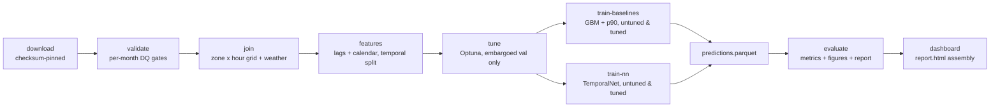

# DESIGN — Urban Mobility Demand Intelligence

## Requirements

1. Prove end-to-end capability on real, messy, large public data (NYC TLC +
   NOAA), not synthetic toys.
2. Peak RAM < 8 GB on a laptop; bounded runtime.
3. Hard temporal discipline: no random splits, no leakage.
4. DQ gates as data, not prints — failing gates halt the pipeline loudly.
5. Deliverables a client can act on: next-hour demand per zone, calibrated
   uncertainty bands, weather-elasticity findings.

## Scale decisions

**Lazy Polars + streaming engine everywhere.** Raw trips are never
materialised: `scan_parquet` → narrow column selection (8 of ~19 columns) →
filters → aggregation, collected with `engine="streaming"`. Observed peaks
(`/usr/bin/time -l`, Apple Silicon): validate 1.74 GB, join 1.48 GB,
features 1.70 GB, training ≈1.8 GB — comfortably under the 8 GB budget.

**Month-by-month processing.** Each of the 12 monthly files (~3–3.8M rows)
is validated and aggregated independently; only the tiny (zone × hour)
grains are concatenated. A month that fails its DQ gates stops the pipeline
before any downstream work.

**Bounded slice rationale.** 12 consecutive months of yellow taxi is the
dataset card's declared laptop-friendly slice (~1.5 GB compressed, 41.2M
rows) — large enough to be honest about scale, small enough to re-run in
minutes. `max_rows_per_month` (null = all) and `max_train_rows` (2M,
most-recent temporal slice — never a random subsample) bound the rest.

## Cleaning decisions (documented, tested)

- Pickups outside the file's own month are dropped — month files occasionally
  carry garbage dates (e.g. a 2002 pickup in the 2024-01 file) which would
  poison per-zone lag alignment.
- `passenger_count` is 5–13% null across 2024 (known TLC pattern); it is
  unused for demand (we count trips, not people), filled with 0, and gated at
  a 20% ceiling to catch structurally broken files.
- Negative fares, negative distances, >8 passengers, sub-minute and >4h
  trips, and out-of-range zone IDs are excluded by contract.

## Join design

Validated trips → pickups per (PULocationID, hour) → **reindexed onto the
complete zone × hour grid** with explicit zeros. Without the grid, sparse
zones (airports, suburbs) would have missing hour rows and `shift()` would
treat "previous observed hour" as t-1h, misaligning every lag. Final grain:
265 zones × 8,784 hours = 2,327,760 rows, weather joined on date, borough
attached from the zone lookup.

GHCN-Daily handling: `qflag` non-empty ⇒ failed QC ⇒ null; PRCP converted
from tenths of mm, TMAX/TMIN from tenths of °C, SNOW is whole mm
(GHCN-Daily units, verified against 2024 Central Park totals).

## Temporal-split discipline

- Train: ts < 2024-10-01; test: ts ≥ 2024-10-01 (pure `ts` predicate, no
  shuffle anywhere).
- Target = **next-hour pickups** (`shift(-1)` within zone): a row at `t`
  predicts the hour starting at `t+1h`; every feature strictly precedes the
  prediction instant.
- Lags [1, 2, 24, 168] are computed `over("zone_id")` — per-zone windows, no
  cross-zone leakage.
- NN early stopping uses the last fold of `portfolio_core.timecv.TimeSeriesCV`
  (n_splits=4, **gap=24h**): a 24-sample embargo between fit and validation
  so model selection never sees the future of the validation rows.

## Model choices

- **GBM mean** — `HistGradientBoostingRegressor`: NaN-native (weather gaps
  need no imputation), strong tabular baseline, early stopping on the
  temporal tail of train.
- **GBM p90** — same family, `loss="quantile", quantile=0.9` for staffing
  buffers; calibration reported (91.1% coverage on test).
- **TemporalNet** — 64-32 MLP, hand-written loop (DataLoader, Adam, MSE,
  gradient clipping, early stop on embargoed val MAE, seeded). Target trained
  in **log1p space**: demand is multiplicative, and a Gaussian loss on raw
  counts over-penalises busy zones — with raw counts the NN sat *below* the
  lag-24 baseline (MAE 7.10); after the log transform it beats it (5.51) and
  takes the best MAPE (54.5%). GBM still wins MAE/RMSE.

## Hyperparameter optimisation (wave 3)

Both models are tuned with **Optuna** (seeded TPE) against a validation
window that is the last fold of `TimeSeriesCV(n_splits=4, gap=24)` computed
on the **train side only** — the Oct–Dec test window is never touched during
tuning.

- **GBM study** (30 trials): `learning_rate`, `max_iter`, `max_leaf_nodes`,
  `min_samples_leaf`, `l2_regularization`, `max_features`; **median pruning**
  at a 100-iteration checkpoint (trials worse than the running median at that
  budget stop before paying for the full fit). Objective: MAE on the embargoed
  validation fold.
- **NN study** (10 trials): `hidden_size` (32–128), `lr` (log), `epochs` ≤ 8,
  `weight_decay` (log) — driven through the same hand-written `_fit_net` loop
  as production training; objective: raw-scale val MAE.
- **Row budget**: the HPO window is capped to the most-recent
  `hpo.max_fit_rows` (500k) of the train slice per trial — a temporal slice,
  never a random subsample. Chosen so 30 GBM trials with full fits finish in
  minutes, not an hour; the final tuned models are refit on the full train
  window by the train stages.
- Best params persist to `reports/models/hpo_{gbm,nn}.json` (runtime source
  of truth for the train stages) and are mirrored into `params.yaml` under
  `gbm_tuned` / `nn_tuned` as the production config.

The evaluate stage additionally reports **p90 band calibration** (empirical
coverage per borough + overall vs the 90% target) and **permutation
importance** of the tuned GBM on a bounded test slice
(`hpo.perm_importance_rows`, chronological head).

## Pipeline

## Changelog

- 2026-10-12 (wave 3) — Optuna HPO for GBM (30 trials, median pruning) and
  TemporalNet (10 trials) on an embargoed train-side validation window;
  `gbm_tuned` / `temporal_net_tuned` runs added to the run ladder; p90
  calibration-by-borough and GBM permutation-importance figures; heatmap
  y-axis grouped by borough.
- 2026-10-12 — initial build: full pipeline green on 2024 data; DQ gates
  tightened after observing 5–13% `passenger_count` nulls and out-of-month
  pickup dates; grid reindex added after detecting lag misalignment on
  sparse zones; NN moved to log1p target after raw-count underperformance.
