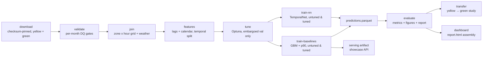

# DESIGN — Urban Mobility Demand Intelligence

## Requirements

1. Prove end-to-end capability on real, messy, large public data (NYC TLC +
   NOAA), not synthetic toys.
2. Peak RAM < 8 GB on a laptop; bounded runtime.
3. Hard temporal discipline: no random splits, no leakage.
4. DQ gates as data, not prints — failing gates halt the pipeline loudly.
5. Deliverables a client can act on: next-hour demand per zone, calibrated
   uncertainty bands, weather-elasticity findings.

## Scale decisions

**Lazy Polars + streaming engine everywhere.** Raw trips are never
materialised: `scan_parquet` → narrow column selection (8 of ~19 columns) →
filters → aggregation, collected with `engine="streaming"`. Observed peaks
(`/usr/bin/time -l`, Apple Silicon): validate 1.74 GB, join 1.48 GB,
features 1.70 GB, training ≈1.8 GB — comfortably under the 8 GB budget.

**Month-by-month processing.** Each of the 12 monthly files (~3–3.8M rows)
is validated and aggregated independently; only the tiny (zone × hour)
grains are concatenated. A month that fails its DQ gates stops the pipeline
before any downstream work.

**Bounded slice rationale.** 12 consecutive months of yellow taxi is the
dataset card's declared laptop-friendly slice (~1.5 GB compressed, 41.2M
rows) — large enough to be honest about scale, small enough to re-run in
minutes. `max_rows_per_month` (null = all) and `max_train_rows` (2M,
most-recent temporal slice — never a random subsample) bound the rest.

## Cleaning decisions (documented, tested)

- Pickups outside the file's own month are dropped — month files occasionally
  carry garbage dates (e.g. a 2002 pickup in the 2024-01 file) which would
  poison per-zone lag alignment.
- `passenger_count` is 5–13% null across 2024 (known TLC pattern); it is
  unused for demand (we count trips, not people), filled with 0, and gated at
  a 20% ceiling to catch structurally broken files.
- Negative fares, negative distances, >8 passengers, sub-minute and >4h
  trips, and out-of-range zone IDs are excluded by contract.

## Join design

Validated trips → pickups per (PULocationID, hour) → **reindexed onto the
complete zone × hour grid** with explicit zeros. Without the grid, sparse
zones (airports, suburbs) would have missing hour rows and `shift()` would
treat "previous observed hour" as t-1h, misaligning every lag. Final grain:
265 zones × 8,784 hours = 2,327,760 rows, weather joined on date, borough
attached from the zone lookup.

GHCN-Daily handling: `qflag` non-empty ⇒ failed QC ⇒ null; PRCP converted
from tenths of mm, TMAX/TMIN from tenths of °C, SNOW is whole mm
(GHCN-Daily units, verified against 2024 Central Park totals).

## Temporal-split discipline

- Train: ts < 2024-10-01; test: ts ≥ 2024-10-01 (pure `ts` predicate, no
  shuffle anywhere).
- Target = **next-hour pickups** (`shift(-1)` within zone): a row at `t`
  predicts the hour starting at `t+1h`; every feature strictly precedes the
  prediction instant.
- Lags [1, 2, 24, 168] are computed `over("zone_id")` — per-zone windows, no
  cross-zone leakage.
- NN early stopping uses the last fold of `portfolio_core.timecv.TimeSeriesCV`
  (n_splits=4, **gap=24h**): a 24-sample embargo between fit and validation
  so model selection never sees the future of the validation rows.

## Model choices

- **GBM mean** — `HistGradientBoostingRegressor`: NaN-native (weather gaps
  need no imputation), strong tabular baseline, early stopping on the
  temporal tail of train.
- **GBM p90** — same family, `loss="quantile", quantile=0.9` for staffing
  buffers; calibration reported for the served `gbm_tuned` band: 90.8%
  coverage overall on the Q4 test window (Manhattan 91.4%, Queens 89.6%,
  sparse N/A zones 84.7% under-cover, Staten Island 98.5%).
- **TemporalNet** — 64-32 MLP, hand-written loop (DataLoader, Adam, MSE,
  gradient clipping, early stop on embargoed val MAE, seeded). Target trained
  in **log1p space**: demand is multiplicative, and a Gaussian loss on raw
  counts over-penalises busy zones — with raw counts the NN sat *below* the
  lag-24 baseline (MAE 7.10); after the log transform it beats it (5.51) and
  takes the best MAPE (54.5%). GBM still wins MAE/RMSE.

## Hyperparameter optimisation (wave 3)

Both models are tuned with **Optuna** (seeded TPE) against a validation
window that is the last fold of `TimeSeriesCV(n_splits=4, gap=24)` computed
on the **train side only** — the Oct–Dec test window is never touched during
tuning.

- **GBM study** (30 trials): `learning_rate`, `max_iter`, `max_leaf_nodes`,
  `min_samples_leaf`, `l2_regularization`, `max_features`; **median pruning**
  at a 100-iteration checkpoint (trials worse than the running median at that
  budget stop before paying for the full fit). Objective: MAE on the embargoed
  validation fold.
- **NN study** (10 trials): `hidden_size` (32–128), `lr` (log), `epochs` ≤ 8,
  `weight_decay` (log) — driven through the same hand-written `_fit_net` loop
  as production training; objective: raw-scale val MAE.
- **Row budget**: the HPO window is capped to the most-recent
  `hpo.max_fit_rows` (500k) of the train slice per trial — a temporal slice,
  never a random subsample. Chosen so 30 GBM trials with full fits finish in
  minutes, not an hour; the final tuned models are refit on the full train
  window by the train stages.
- Best params persist to `reports/models/hpo_{gbm,nn}.json` (runtime source
  of truth for the train stages) and are mirrored into `params.yaml` under
  `gbm_tuned` / `nn_tuned` as the production config.

The evaluate stage additionally reports **p90 band calibration** (empirical
coverage per borough + overall vs the 90% target) and **permutation
importance** of the tuned GBM on a bounded test slice
(`hpo.perm_importance_rows`, chronological head).

## Pipeline



## Changelog

- 2026-10-30 (wave 15, API slice) — roadmap closure: the showcase API
  `POST /projects/07-open-data-mobility/forecast` endpoint now accepts an
  optional `service=yellow|green` request field (default yellow, echoed in
  the response), routing through the committed `services.json` registry with
  a dir-escape guard and a bundle-meta service cross-check; unknown service
  → 422. apps/showcase-api tests pin default-yellow parity with the
  pre-field response, green routing against the committed green bundle
  (differs from yellow on the same body), and unchanged readiness. No
  project-07 code or measured metric changed — the last `remaining` roadmap
  item is delivered.
- 2026-10-30 (wave 15) — roadmap closure. (1) Drift observatory scored the
  first genuinely unseen month: `drift-check --month 2025-01` fetched
  `yellow_tripdata_2025-01.parquet` live through the checksum machinery
  (no pin for drift months; the 59 MB file is cached under `data/drift/raw`
  for idempotent re-runs), passed the light DQ gates (3,330,979 cleaned
  rows), and scored MAE 4.442 vs pinned 4.676 (**−5.0%**, in-window; MAPE
  59.6%, ΔMAE vs naive +34.6%, p90 coverage 87.4% — slight under-cover).
  Three months are now in `reports/drift` and `dvc.lock`. (2) Per-service
  retraining productionized: `build-serving-artifact` now also fits the
  green bundle (`gbm_green_served`: default `gbm_mean` family + quantile-0.9
  p90 twin on all 534,240 curated green zone-hours — the measured wave-14
  control recipe over all available green history) and persists it under
  `serving/green/` in the identical three-file contract, plus a typed
  `services.json` registry (`mobility.schemas.ServingRegistry`) and
  `predict_service` (typed reference; unknown zone/missing features →
  `ValueError`, mirroring the API's 422s). The showcase API read the yellow
  root bundle unchanged; the endpoint `service` field landed the same day
  (see the wave-15 API-slice entry above). (3) `mobility/gbm.py` extracted (torch-free) as the home of
  `_make_gbm`/`hpo_result` so `serving`/`drift` stay torch-free — the
  wave-11 process boundary extended. Note: `reports/models/serving` is a
  git-committed deployable (`.gitignore` exception), so the `serving` DVC
  stage cannot be `dvc repro`'d ("already tracked by SCM"); build it via the
  CLI and commit the files, and refresh `dvc.lock` with
  `dvc repro --single-item drift_check` (a full `dvc repro` walks upstream
  and re-runs `tune` after deleting its outs — minutes, and it wiped
  `hpo_gbm.json`/`hpo_nn.json` when interrupted mid-run on 2026-10-30;
  they were restored from the DVC cache and the drift evidence regenerated
  deterministically).
- 2026-10-29 (wave 14) — transfer study gained the per-service retraining
  control (`gbm_green_retrained`: default GBM family fit on green Jan–Feb,
  337k zone-hours): beats green persistence on all metrics on green March
  (MAE 0.180 vs 0.212, RMSE 0.688 vs 1.100, MAPE 66.4% vs 81.8%) — the
  mixed yellow transfer is a service-distribution gap, and per-service
  retraining is the measured fix. Drift observatory scored 2024-12 from the
  local snapshot (MAE 5.046 vs pinned 4.676, +7.9%, in-window; 2024-11 was
  +8.2%): two in-window months verify wiring, not unseen drift. Fixed the
  stale p90 figure in "Model choices" (91.1% → the served-band 90.8% with
  borough spread). `train_arms` dvc.yaml out corrected to
  `predictions_arms.parquet` (it had duplicated `train_baselines`' out,
  which blocked `dvc exp run` graph validation monorepo-wide).
- 2026-10-13 (wave 7) — green-taxi expansion (bounded 2024-01..03 slice):
  transfer study shows yellow-trained GBMs lose MAE to green persistence
  (0.296 vs 0.212) but win RMSE/MAPE — per-service retraining recommended.
  Serving artifact per SERVING.md (tuned GBM + p90 + zones) with the showcase
  API forecast endpoint verified live (JFK zone 132 → 223.8 / p90 251.8).
- 2026-10-12 (wave 3) — Optuna HPO for GBM (30 trials, median pruning) and
  TemporalNet (10 trials) on an embargoed train-side validation window;
  `gbm_tuned` / `temporal_net_tuned` runs added to the run ladder; p90
  calibration-by-borough and GBM permutation-importance figures; heatmap
  y-axis grouped by borough.
- 2026-10-12 — initial build: full pipeline green on 2024 data; DQ gates
  tightened after observing 5–13% `passenger_count` nulls and out-of-month
  pickup dates; grid reindex added after detecting lag misalignment on
  sparse zones; NN moved to log1p target after raw-count underperformance.

## Experiment versioning

What-if variants are queued with DVC experiments (params-only overrides,
applied to nothing — the queue documents intent, `dvc exp run --run-all`
executes when someone wants the numbers):

```bash
uv run dvc exp run --queue --name train-rows-1m   -S max_train_rows=1000000
uv run dvc exp run --queue --name train-rows-500k -S max_train_rows=500000
uv run dvc exp show --no-pager
```

Trimmed `dvc exp show --no-pager` at queue time:

| experiment | state | max_train_rows |
|---|---|---|
| train-rows-500k | Queued | 500000 |
| train-rows-1m | Queued | 1000000 |

Both ask: does halving/quartering the 2M-row train slice change the Q4 run
ladder? Sensitivity to the bounded-slice budget is the open question; the
queued experiments answer it without touching the committed pipeline state.

## Wave 11 notes

- Challenger arms (xgboost/lightgbm) run in a **torch-free subprocess**
  (`mobility train-arms`, module `mobility.arms`): xgboost/lightgbm's OpenMP
  runtime cannot coexist with torch's in one process on macOS — whichever
  loads second segfaults the first at fit time (also at **joblib unpickle**
  time: loading an lgbm-fitted estimator in a torch-importing process crashes
  the same way — observed on 2026-10-30 when a missing `hpo_gbm.json` let
  the serving arm selection fall through to `gbm_lgbm_tuned`). `model.py`/
  `tune.py` therefore never import xgboost/lightgbm; `train-arms` runs
  `python -c "from mobility.arms import fit_arms; fit_arms()"`.
- Serving decision rule: a challenger replaces `gbm_tuned` only on a strictly
  better **validation** MAE (never test). Wave-11 outcome: both challengers
  lost on validation (xgb 3.182 vs 3.165; lgbm 3.173 vs 3.165) → the served
  artifact stays `gbm_tuned`, even though both beat it on the Q4 test window
  (xgb −4.1% MAE) — switching on test results would be test-set selection.

## Wave 15 notes

- Per-service serving extension: the contract is **directory-based** — a
  service bundle is the same three files under `serving/<service>/`, so the
  showcase API's directory-parameterized loader needed no change to read it;
  the endpoint-level `service` field (apps/showcase-api) now routes it
  (optional, default yellow, echoed in the response; unknown service → 422).
  `mobility.serving` gained `fit_service_gbms` / `build_service_bundle` /
  `load_service_bundle` / `predict_service`, and `build_serving_artifact`
  writes the yellow root bundle + green bundle + `services.json` registry in
  one command. The green fit deliberately avoids importing
  `mobility.transfer` (which pulls torch via `mobility.model`): the green
  feature frame is built from `_with_features` directly, and the GBM factory
  moved to `mobility/gbm.py`.
- Drift evidence hygiene: `reports/drift` is a DVC out of the manual
  `drift_check` stage; refresh it with `dvc repro --single-item drift_check`
  (or `dvc commit drift_check -f` after CLI runs). A bare `dvc repro
  drift_check` walks upstream stages and re-runs `tune` (deleting its outs
  first) — expensive and, interrupted, it left `hpo_gbm.json`/`hpo_nn.json`
  deleted on 2026-10-30 (restored from the DVC cache; drift reports
  regenerated deterministically, byte-level metrics identical).
